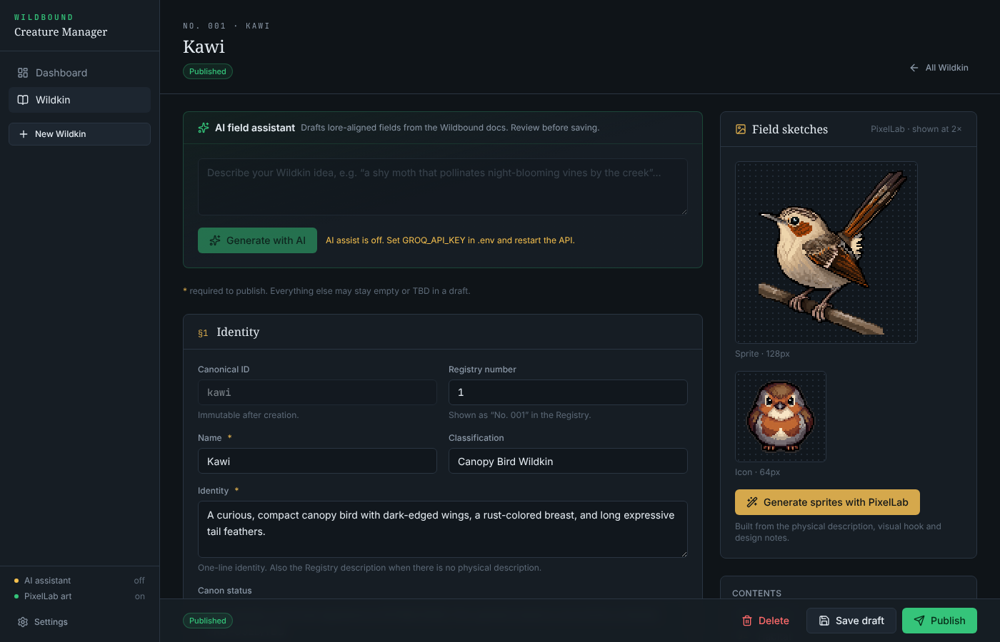

# WILDBOUND

A location-aware 2D creature-collecting and field-research game. Where you are in the real world decides which part of the fictional WILDBOUND world you are exploring, which habitat you are standing in, and which Wildkin can appear.

This repository holds **v0.3.0**: a developer-facing **Map Editor**, a **Creature Manager** (an editable Wildkin encyclopedia with an AI assistant and PixelLab art generation), the **API** behind them, and the playable **web game** (username login, live location, radar with spawning and wandering Wildkin, Observe, Registry, Satchel and Party). v0.3.0 adds the core creature systems: **stats, genetics, levels and EXP, turn-based wild battles, capture through battle, healing, and Field Registry licenses** (see [What is new in v0.3.0](#what-is-new-in-v030)). Parts of the game are deliberately left as **fill-in-the-blank exercises**: see [Exercises](#exercises-fill-in-the-blanks).

```
Real location (lat/lng)
        |
        v
WILDBOUND region  ->  Habitat  ->  Conditions (time, weather)  ->  Encounter table  ->  Wildkin
```

> 📚 **Full documentation lives in [`docs/`](docs/README.md)**: a plain-English overview for non-programmers,
> architecture and data-flow diagrams, the database, every API endpoint, the editor and game internals, the game rules
> (spawning, weather, anti-teleport) with charts, and a cookbook of step-by-step recipes for adding features safely.
> This README is the short version.

## Table of contents

- [The idea](#the-idea)
- [What is new in v0.3.0](#what-is-new-in-v030)
- [Why a map editor first](#why-a-map-editor-first)
- [The Creature Manager (apps/manager)](#the-creature-manager-appsmanager)
- [Three separate representations of the world](#three-separate-representations-of-the-world)
- [Tech stack](#tech-stack)
- [The game (apps/web)](#the-game-appsweb)
- [Location security (anti-teleport)](#location-security-anti-teleport)
- [Exercises (fill in the blanks)](#exercises-fill-in-the-blanks)
- [Repository layout](#repository-layout)
- [Quick start](#quick-start)
- [Typical workflow](#typical-workflow)
- [Data model](#data-model)
- [Draft vs published](#draft-vs-published)
- [API](#api)
- [How a coordinate is resolved](#how-a-coordinate-is-resolved)
- [Validation](#validation)
- [Testing](#testing)
- [Scripts](#scripts)
- [Sample world: Mabunyi Nature Reserve](#sample-world-mabunyi-nature-reserve)
- [Scope and roadmap](#scope-and-roadmap)
- [Troubleshooting](#troubleshooting)

## The idea

The player experience combines three things:

- **Location-aware exploration.** The player's real position determines their current WILDBOUND region and habitat.
- **Classic top-down 2D exploration.** The eventual field screen should look like a small, readable game world, not a GIS map.
- **Field research and creature discovery.** Wildkin appear in the environment, can be observed or studied, and are recorded in a Registry.

The real-world geography is an implementation layer. The player-facing fiction stays WILDBOUND: the real park in Quezon City is "Mabunyi Nature Reserve" in the game.

The first test world has five Wildkin with simple ecological ties (more are written in the [Creature Manager](#the-creature-manager-appsmanager)):

| Wildkin | Environment | Category, body trait (v0.3.0, PROPOSED) |
|---|---|---|
| Kawi | canopy, woodland edges | Aerial, feathered |
| Mimu | forest floor, leaf litter, moss | Terrestrial, soft-bodied |
| Lumae | sunny flowering clearings | Verdant, leafy |
| Kantar | rocks, fallen branches, sheltered surfaces | Terrestrial, plated |
| Riverkin | freshwater | Aquatic, slick |

## What is new in v0.3.0

The Wildkin stop being only Registry entries and become individuals you raise, battle with and study. In plain terms:

- **Every species has a stat shape** (HP, Attack, Defense, Speed) that always adds up to **300**: rarity is not strength. It also has a **category** (Aerial, Aquatic, Terrestrial, Verdant), one or two **body traits** (Plated, Feathered, Soft-bodied, Leafy, Slick), one or two **placeholder attacks** (the real skill system comes in 0.4.0) and a **gene pool**. All authored in the Creature Manager's new section 9 "Battle & genetics".
- **Every wild Wildkin is an individual**: a level from its encounter table's range (authored in the Map Editor), an inherited **Build** (Small/Typical/Large) and **Temperament** (Bold/Steady/Wary), a rare cosmetic **marking**, and a per-stat **vigor**. The player sees grades and words, never raw numbers.
- **Starter.** A new player picks Kawi, Mimu or Kantar at level 5, entrusted by the rangers at East Research Gate.
- **Wild battles.** Turn-based, server-authoritative, one Wildkin per side: attack, switch, use a Trail Ration, throw a capsule or escape. Attack **approaches** (Strike, Pierce, Crush, Surge, Toxin, Spore) are strong or weak against body traits; these **matchups** are hidden until discovered and then recorded in the Registry. A status framework (Asleep, Stunned, Numbed, Entangled, Exhausted) is ready for 0.4.0's skills.
- **Capture through battle.** Wildkin are feral: weaken one (without knocking it out), then throw a capsule. Category capsules add a bonus on a match.
- **Levels 1 to 100 and EXP** from battles, walking with the lead Wildkin, observation, exploration and captures, with daily caps, a rested bonus and shared EXP. Every gain is logged.
- **Healing.** Injured and fainted Wildkin get first aid and recover slowly (8 hours empty to full); **vets** at field stations (East Research Gate) heal instantly and for free. Losing a battle costs nothing but your party's HP.
- **Field Registry licenses.** One per category, ranks 1 to 5. The rank sets the **obedience cap** (rank × 20): a Wildkin at the cap stops gaining EXP until the license ranks up, and one captured above it is **restless** (it travels with you but will not battle and cannot be healed). Ranks are earned with **researcher EXP** (from observing and recording, never from battling) and an **assessment** at a field station. Higher ranks also show more about your Wildkin (**scanner depth**) and open license-locked habitats.
- **Items without currency**: daily POI pickups (exercise #14) and rank-up grants.
- **Canon**: the Wildkin Bible is now `docs/WILDBOUND_Wildkin_Bible_v1.2.docx`, the ecology reference `docs/WILDBOUND_Wildkin_Biology_and_Ecology_Reference_v1.1.docx`, and The First Field Survey gained an appendix on the field license.

Full detail: [`docs/14-battles-and-research.md`](docs/14-battles-and-research.md) and [`docs/07-game-systems.md`](docs/07-game-systems.md). Brief and decisions: [`patches/0.3.0/instructions.md`](patches/0.3.0/instructions.md).

## Why a map editor first

Everything location-aware depends on authored data: where regions and habitats are, which POIs exist, which Wildkin live where under which conditions. Editing that as raw JSON or SQL does not scale even for one park. The Map Editor is an internal tool that lets one developer:

1. View real geography.
2. Draw WILDBOUND regions and habitats on it.
3. Place points of interest.
4. Assign encounter tables with weights and conditions.
5. Save drafts, validate, and publish.
6. Drop a simulated player anywhere and see exactly what the game would resolve.

It deliberately is **not** a general GIS product. It supports only the operations WILDBOUND content needs.

## The Creature Manager (apps/manager)

Wildkin themselves are authored in a second internal tool, the **Creature Manager** (http://localhost:5175). It is the Wildkin Bible as an app:

- **Dashboard** with stat cards (Wildkin, published, drafts, unpublished changes, battle-ready, with art, deleted), rarity breakdown and the next registry number.
- **Wildkin list** with icon, registry number and name; Create, Edit, Delete (soft delete) and Restore.
- **Entry page**: the Bible entry in nine sections (identity, habitat, diet and temperament, activity and rarity, appearance, behaviour, ecology, game, and since v0.3.0 **battle and genetics**: category, body traits, base stats, placeholder attacks, gene pool), with selects and comboboxes for every property that has fixed choices. The in-game preview adds a stat shape and matchup summary and a **Roll a sample** button (a level 50 individual).
- **Save draft / Publish.** Entries live in their own encyclopedia table (`wildkin_entries`). Publishing copies only the game fields (name, Registry description, habitat tags and summary, rarity, activity, spawn modifiers, skills, movement style, category, body traits, base stats, attacks, gene pool) into the `creatures` table the editor and game read. Publishing needs a category, at least one body trait, base stats adding up to exactly 300 and at least one attack.
- **AI assistant.** Describe an idea in a sentence; the API asks a Groq LLM, which is given the canon documents in `docs/` (Bible first) and the existing roster, and fills in the form for you to review. Needs `GROQ_API_KEY`.
- **PixelLab art.** Generates a 64 px icon and a 128 px sprite from the entry's physical description, visual hook and design notes, with the cheapest model (Pixen), after checking the credit balance. The art is stored in the database and served by the API, so the game shows it without a rebuild. Needs `PIXELLAB_API_KEY`.

Full guide: [`docs/13-creature-manager.md`](docs/13-creature-manager.md).



## Three separate representations of the world

These are kept apart on purpose. Do not couple them.

| Layer | Meaning | Where it lives |
|---|---|---|
| **Real world** | Latitude/longitude, boundaries, roads, water | MapLibre basemap + PostGIS geometry |
| **WILDBOUND world context** | Region, habitat, POIs, encounter tables, conditions | `@wildbound/shared` schemas, `@wildbound/world` rules |
| **Presentation** | Tiles, trees, sprites, camera, movement | Phaser, later (`apps/web`) |

PostGIS says *where* something is. WILDBOUND rules say *what it means*. Phaser will later decide *how it looks*. There is one world model; the future Phaser field reads the same `WorldContext` the editor previews.

## Tech stack

The app stack is standardized on React, Node.js + Express, Prisma, PostgreSQL, Tailwind CSS, TanStack Query, Zod and react-hook-form. Location features keep their specialised tools (PostGIS, MapLibre, Turf).

| Area | Choice | Notes |
|---|---|---|
| Language | TypeScript 5.9 | Strict mode, `noUncheckedIndexedAccess` |
| Runtime | Node.js 22+ | Uses the built-in `process.loadEnvFile` |
| Monorepo | pnpm 10 workspaces | `apps/*` and `packages/*` |
| Frontend | React 19 + Vite 7 | Editor, Creature Manager and web game |
| Routing (web, manager) | React Router 7 | Web: `/` login → `/location` → `/play/*`; manager: `/`, `/wildkin`, `/wildkin/:id` |
| Styling | Tailwind CSS 4 (+ shadcn/ui in the web game and manager) | Web: handheld "field nav" look from the Stitch mockups (`patches/0.1.0/mockups/`); editor: its original dark theme as `@theme` tokens; manager: dark "field research" theme |
| Server state | TanStack Query 5 | Editor, manager and web: all API calls go through query/mutation hooks |
| Forms | react-hook-form + Zod resolver | Editor inspectors, manager entry form and web forms use the same Zod schemas the API validates with |
| Map | MapLibre GL JS 5 | Open-source WebGL maps, no API key needed |
| Editor state | Zustand 5 | Local editing only: the world being edited, selection, tool, undo/redo |
| Client geometry | Turf.js 7 | Convenience only; PostGIS is authoritative |
| Backend | Express 5 | Plain REST + JSON, cookie sessions for players |
| Database | PostgreSQL 16 + PostGIS 3.4 | Geometry as SRID 4326 (WGS84 lon/lat) |
| DB access | Prisma 7 (`@prisma/adapter-pg`) | Prisma schema + migrations; PostGIS queries via `$queryRaw` |
| Validation and contracts | Zod 4 | One schema set shared by editor, API and web |
| Weather | Open-Meteo | Free, key-free; fetched by the server for the player's position |
| AI assistant | Groq API (chat completions, JSON mode) | Creature Manager only, optional (`GROQ_API_KEY`). Default model `llama-3.3-70b-versatile`; canon `.docx` read with mammoth |
| Art | PixelLab API v2 (Pixen) | Creature Manager generates Wildkin icons/sprites (optional, `PIXELLAB_API_KEY`), stored in the DB and served at `/api/art/...`. Seed art and the player head in `apps/web/public` |
| Tests | Vitest 3 + supertest | Unit, exercises, and integration tests against real PostGIS |
| Local DB | Docker Compose (`postgis/postgis:16-3.4`) | Also creates a separate test database |
| Geographic interchange | GeoJSON (RFC 7946) | `[lng, lat]` order everywhere |
| Future game renderer | Phaser 3 | Not started |

## Repository layout

```
wildbound/
  apps/
    api/        Express API: editor authoring/publish/preview, Creature Manager (+ Groq, PixelLab), player auth, game, art
    editor/     React + MapLibre Map Editor (developer tool)
    manager/    React Creature Manager: Wildkin encyclopedia, draft/publish, AI assistant, PixelLab art (developer tool)
    web/        React game: login, location gate, starter, radar, battles, Registry, Satchel, Party, License
  packages/
    shared/     Zod schemas and TypeScript types: the data contract used everywhere
    world/      Pure domain logic: validation, conditions, encounters, movement checks, spawning, wandering, weather,
                stats, genetics, levels and EXP, the battle engine, recovery, research and licenses, pickups
    db/         Prisma schema + migrations, PostGIS queries, Wildkin encyclopedia repo, seed data, test helpers
    game/       (later) reserved; the v0.3.0 battle rules live in packages/world/src/battle
    assets/     (later) tile, creature and effect asset metadata
  patches/0.1.0/  v0.1.0 instructions, Stitch mockups + design tokens, handover notes, exercises
  patches/0.2.0/  v0.2.0 instructions (Creature Manager, wandering spawns)
  patches/0.3.0/  v0.3.0 instructions (battles, genetics, licenses), handover notes, exercises
  docs/           Documentation + game canon (WILDBOUND_Wildkin_Bible_v1.2.docx,
                  WILDBOUND_The_First_Field_Survey_Source_of_Truth.docx,
                  WILDBOUND_Wildkin_Biology_and_Ecology_Reference_v1.1.docx), also the AI assistant's lore context
                  (docs/lore/assistant-brief.md)
  docker/         Postgres init scripts (creates the test database)
```

Dependency direction (arrows mean "depends on"):

```
apps/editor  ---> packages/shared, packages/world
apps/manager ---> packages/shared, packages/world
apps/web     ---> packages/shared
apps/api     ---> packages/db, packages/world, packages/shared
packages/db ---> packages/world, packages/shared
packages/world ---> packages/shared
```

`packages/world` and `packages/shared` have no database or React dependencies, so the same rules run in the API, the editor and tests.

Each app and package has its own README with details.

## Quick start

Requirements: Node 22+, pnpm (`corepack enable`), Docker Desktop (for PostGIS).

```bash
pnpm install                    # also generates the Prisma client
cp .env.example .env            # Windows: copy .env.example .env
pnpm db:up                      # PostGIS 16 on localhost:5432
pnpm db:migrate                 # apply Prisma migrations
pnpm db:seed --publish          # 5 Wildkin (+ encyclopedia entries, battle data and art) + sample Mabunyi world, published
pnpm dev                        # API :4000, editor :5173, game :5174, Creature Manager :5175
```

| URL | What |
|---|---|
| http://localhost:5173 | Map Editor |
| http://localhost:5174 | The game (open on your phone via your LAN IP + HTTPS, or use browser devtools "Sensors" to fake a location) |
| http://localhost:5175 | Creature Manager |
| http://localhost:4000/api/health | API health check |

The Creature Manager's AI helpers are optional: add `GROQ_API_KEY` (free key at https://console.groq.com/keys) and `PIXELLAB_API_KEY` (https://pixellab.ai) to `.env` and restart the API. Without them the manager works and the two buttons are disabled with a hint.

If the Docker volume was created before `docker/initdb` existed, create the test database once: `docker exec -it wildbound-db createdb -U postgres wildbound_test`.

**Upgrading from v0.2.0?** Run `pnpm install`, `pnpm db:migrate` (adds migration `5_battle_system`: battle fields on creatures, level ranges, license requirements, individual genetics and HP on spawns and captured Wildkin, and the new battle, license, EXP and record tables; existing captured Wildkin become level 5 with a typical genome, existing active spawns are expired, and every player gets rank 1 in all four licenses) and `pnpm db:seed` (fills the battle data into the five seed species, including their encyclopedia entries). Existing encounter tables get wild levels 1 to 10; `pnpm db:seed --force --publish` instead replaces your world draft with the sample world and its authored level ranges, and publishes it. Species you authored yourself need section 9 filled in before you can publish them again. Add `ASSESSMENT_RELAX_WEATHER=true` from `.env.example`.

**Upgrading from v0.1.0?** Run `pnpm install`, `pnpm db:migrate` (adds migrations `2_wildkin_manager` to `4_registry_number_reuse`) and `pnpm db:seed` (creates the five encyclopedia entries and imports their art; your world draft is kept). Add the new `.env` keys from `.env.example` (the manager reaches the API through its Vite proxy, so `CORS_ORIGINS` needs no change).

**Upgrading from the Drizzle version?** Just run `pnpm db:migrate`. A database created by the old Drizzle migrations is detected and baselined (its world tables match the first Prisma migration), so your authored draft is kept. Then `pnpm db:seed` refreshes the Wildkin with their new Registry fields.

**Testing the game on a desktop.** Browsers only allow geolocation on `https://` or `localhost`. In Chrome devtools open *More tools → Sensors* and pick a location inside the Mabunyi region (e.g. `14.6518, 121.0444`). Move it in small steps: big jumps are rejected by the server (that is the anti-teleport check working).

### Environment variables (`.env`)

| Variable | Purpose |
|---|---|
| `DATABASE_URL` | Dev database connection string |
| `DATABASE_URL_TEST` | Separate database used by integration tests (must differ from `DATABASE_URL`) |
| `API_PORT`, `API_HOST` | API bind address (default `4000`, `127.0.0.1`) |
| `EDITOR_TOKEN` | Bearer token required by every `/api/editor/*` and `/api/manager/*` route |
| `CORS_ORIGINS` | Comma-separated browser origins allowed to call the API (the editor; the game and the Creature Manager go through their Vite proxies) |
| `WORLD_TIMEZONE` | Fallback time zone when neither the weather service nor the browser supplies one (default `Asia/Manila`) |
| `WEATHER_API_URL` | Open-Meteo forecast endpoint (default `https://api.open-meteo.com/v1/forecast`). `off` = always clear (offline dev) |
| `SECURE_COOKIES` | `true` to mark the session cookie `Secure` (behind HTTPS) |
| `GROQ_API_KEY` | Enables the Creature Manager AI assistant (empty = off) |
| `GROQ_MODEL` | Groq chat model with JSON mode (default `llama-3.3-70b-versatile`) |
| `LORE_SOURCE` | Lore sent to the AI assistant: `brief` (default, the condensed `docs/lore/assistant-brief.md`, ~2,000 tokens) or `full` (the canon `docs/WILDBOUND_*.docx`) |
| `LORE_MAX_CHARS` | Upper bound on lore characters per assistant request (default `30000`; matters for `LORE_SOURCE=full`) |
| `PIXELLAB_API_KEY` | Enables PixelLab art generation in the Creature Manager (empty = off) |
| `ASSESSMENT_RELAX_WEATHER` | `true` (default): license assessment requirements "observe in N weathers" are clamped to 1, because live weather is always clear until exercise #1 is done. Set `false` once real weather works |
| `VITE_API_URL` | API base URL for the editor and the manager |
| `VITE_EDITOR_TOKEN` | Token the editor and manager send. The web game never reads it |

The editor token is a single shared secret meant for local development. Replace it with real accounts before exposing the editor or manager anywhere public.

## Typical workflow

New species first: in the **Creature Manager**, create the Wildkin (optionally with the AI assistant and PixelLab), **Save draft**, then **Publish**. It then appears in the editor's Wildkin picker (refetched when the editor tab regains focus). Then, in the editor:

1. Start everything (see Quick start) and open the editor.
2. Pick the **Region** tool (`R`), click points around the real area, then double-click or press Enter. Rename it in the side panel.
3. Pick **Habitat** (`H`) and draw habitats inside the region.
4. Pick **POI** (`P`) and click to place points of interest (type `research-station` or `gate` makes a field station with a vet and assessments).
5. Select a habitat and add an **encounter table**; choose Wildkin and weights, and set its **wild levels** (min, max; an entry can override them). Optionally restrict by time of day or weather. A habitat can also get a **license requirement** (category and rank 2 to 5) that blocks battle and capture for players below it. Every region needs an easy entry habitat (a table starting at level 10 or lower).
6. **Save draft** (`Ctrl+S`), then **Validate**.
7. Use **Test** (`T`) to drop a simulated player and read the resolved context.
8. **Publish**. Players (and `apps/web`) now see it.
9. Keep editing: the draft changes, the published world does not, until you publish again.

Editor controls: drag white handles to reshape, drag midpoints to add a vertex, right-click a vertex to delete it, `Ctrl+Z` / `Ctrl+Shift+Z` for undo/redo, `Delete` to remove the selection.

## Data model

All geometry is WGS84 longitude/latitude (SRID 4326), GeoJSON `[lng, lat]`. Distances use PostGIS `::geography`, so they are meters. The Prisma schema is `packages/db/prisma/schema.prisma`.

World (authored in the editor, draft + published):

| Entity | Key fields |
|---|---|
| `WorldRegion` | slug (unique), name, description, MultiPolygon, biomeTags, unlockCondition, storyStateRequirements, active |
| `Habitat` | regionId, slug (unique per region), Polygon, habitatTags, conditionRules, licenseRequirement (`{ category, rank }` or null) |
| `PointOfInterest` | regionId, slug (unique per region), type, Point, interactionId, unlockCondition |
| `EncounterTable` | regionId, habitatId (null means region-wide), conditionRules, active, minLevel and maxLevel (wild levels, default 1 to 10), entries |
| `EncounterEntry` | creatureId, weight (1 to 1000), conditions, optional minLevel and maxLevel override |
| `Creature` | id (slug), registryNumber, name, description, habitatAffinity, habitatSummary, rarity, activityPattern, spawnModifiers, skills, movementStyle, category, bodyTraits, baseStats, attacks, genePool, deletedAt (soft delete) |

Wildkin encyclopedia (authored in the Creature Manager):

| Entity | Key fields |
|---|---|
| `WildkinEntry` | id (= creature id once published), registryNumber (unique), name, status (`draft`/`published`), content (every other Bible field, JSON validated by `WildkinEntryInputSchema`), publishedAt, deletedAt |
| `WildkinArt` | entryId + kind (`icon` 64 px / `sprite` 128 px), PNG bytes, prompt, model |

Players:

| Entity | Key fields |
|---|---|
| `Player` | username (lowercased, unique), displayName |
| `PlayerSession` | sha256 of the session token, expiresAt |
| `PlayerPosition` | the server's view of where the player is: lat, lng, accuracy, recordedAt, strikes, lockedUntil, timeZone |
| `Spawn` | one Wildkin placed near one player: creature, lat/lng (changes as it wanders), heading, movedAt, environment at spawn time, status (`active`, `in_battle`, `captured`, `fled`, …), expiresAt, level, genome, vigor |
| `RegistryEntry` | per player and species: first observed/captured, counts |
| `InventoryItem` | per player and item id (items are defined in code: `ITEMS` in `@wildbound/shared`), at most 30 per item |
| `CapturedWildkin` | one captured individual, optional nickname, party slot 0–5 or storage, level, exp, genome, vigor, currentHp + hpUpdatedAt (lazy natural recovery), where and how it was caught |
| `Battle` | one wild battle: player, spawn, status (`active` or its outcome), turn, engine state (JSON). At most one active per player |
| `ResearcherLicense` | per player and category: rank 1 to 5, researcher EXP. `AssessmentCompletion` records each passed assessment |
| `ExpEvent` | every EXP gain (Wildkin or researcher track) with its source, amount and day key |
| `MatchupRecord`, `ConditionRecord`, `PhenotypeRecord`, `HabitatVisit`, `PoiPickup` | "only once" research records and daily pickups, each backed by a primary key |

`Player` also gained the rested-bonus and walking-meter columns.

`conditionRules` is `{ timeOfDay: ("dawn"|"day"|"dusk"|"night")[], weather: ("clear"|"cloudy"|"rain"|"storm"|"fog")[] }`. An empty list means "any"; a non-empty list must contain the current value.

`spawnModifiers` (per species) multiply encounter weights by weather and time of day, e.g. Kawi `{ weather: { rain: 0.5, storm: 0 }, timeOfDay: { night: 0.1 } }`. Values come from the activity patterns proposed in the Wildkin Bible.

## The game (apps/web)

1. **Login** (`/`): pick a researcher name. That name is the save slot; using it again resumes your progress. There is no password yet.
2. **Location** (`/location`): the game cannot be entered without location sharing. Once the first GPS fix arrives you move on automatically.
3. **Starter** (`/play/starter`, first visit only): a player with no Wildkin chooses Kawi, Mimu or Kantar at level 5.
4. **Radar** (`/play`): your position is a PixelLab player head; nearby Wildkin are face icons that **wander** around (experimental, kept in v0.3.0), and POIs within 300 m are signs. Tap a Wildkin for **Observe** or **Battle** (both need you within 60 m).
   - *Observe* unlocks the Registry basics (name, registry number, description, habitat), shows the spawn's level and visible traits, and earns researcher EXP.
   - *Battle* starts a wild battle (disabled with the reason when out of range, in a license-locked habitat, or when your party needs rest).
   - Tap a POI to search it for supplies (exercise #14), and at a field station (East Research Gate) to visit the **vet** or go to an **assessment**.
5. **Battle** (`/play/battle/:battleId`): the wild Wildkin at the top, yours at the bottom, HP bars, and four console buttons: **Attack**, **Switch**, **Satchel** (Trail Ration, capsules) and **Escape**. A field-note log plays each turn. Capturing adds the Wildkin to your Party and unlocks rarity, activity pattern and skills in the Registry. A "Battle in progress" banner on every tab leads back.
6. **Registry**: a Pokédex-style grid. Unknown species are silhouettes with only their number. Observed species gain field notes (category, body traits and recorded matchups, conditions seen, phenotypes recorded).
7. **Satchel** (inventory, Trail Ration "Use") and **Party** (6 slots plus storage; level, HP bar, condition, Lead badge) with a detail page per Wildkin (`/play/party/:wildkinId`: EXP, HP and recovery estimate, attacks, stats as words by scanner depth, where it was caught).
8. **License** (`/play/license`): one card per category with rank, obedience cap, researcher EXP and the next assessment's checklist, and "Take assessment" at a field station.

If location sharing is turned off (or the signal is lost) mid-game, the game is covered by a "Survey paused" overlay until it comes back.

**Time and weather.** The status bar shows the device's local time, the time-of-day band and live weather. Both feed spawning: encounter-table conditions decide *whether* a species can appear, and per-species `spawnModifiers` decide *how often* (the modifiers are one of the exercises).

**Spawning.** Each `GET /api/game/state` (polled every 10 s on the radar) expires old spawns, drops ones you walked far away from, lets the rest wander, and tops you up to 6 spawns (at most 2 new per tick) within 120 m, chosen by weight from the published encounter tables at your server-side position. Each new spawn gets a level from its table's range and a genome rolled from its species' gene pool and the habitat's tags. A spawn in a battle is frozen (no expiry, no wandering). Species deleted in the Creature Manager never spawn.

**Wandering (experimental).** Spawns take steps of a random 5–15 s each since they last moved (at most 6 per poll), each on its own rhythm, in the style of their species' `movementStyle` (`still`, `skulker`, `forager`, `roamer`, `darter`), slower outside their activity period. A spawn that wanders more than `spawnRadiusM` (120 m) from you is despawned. On the radar each marker sets off after its own random delay and walks for a distance-based time (no lockstep), face their direction and fade in and out; "It wandered off." shows if the selected one leaves. Code: `packages/world/src/wandering.ts`. Kept as it is in v0.3.0; still to be kept, tuned or removed after play-testing.

**Battles, EXP and licenses.** Everything is decided on the server: turn order, damage, matchups, capture, EXP and researcher EXP. The client sends one action per turn with the turn number it saw (a double tap cannot act twice) and gets back the new battle view plus events to play back. Hidden information (the wild Wildkin's stats, genome and vigor, the capture chance, unrecorded matchups, details above your scanner depth) is never sent. Every tunable number lives in `GAME_RULES`, `BATTLE_RULES`, `EXP_RULES` or `RESEARCH_RULES` in `@wildbound/shared`. See [`docs/14-battles-and-research.md`](docs/14-battles-and-research.md).

**Art.** Wildkin images load from the API (`/api/art/wildkin/<id>/<icon|sprite>.png`, stored in the database), falling back to the static PNGs in `apps/web/public/wildkin/` and then a placeholder.

## Location security (anti-teleport)

Previously anyone could call the public resolver with any coordinate and "be" anywhere. Now:

- **No public coordinate lookup.** Resolving arbitrary coordinates and reading the whole world are editor-only (`/api/editor/*`, bearer token).
- **The server tracks where each player is.** Clients only *report* GPS fixes (`POST /api/game/position`). `checkMovement` in `@wildbound/world` accepts a fix only if the distance from the last accepted one is at most `40 m/s × elapsed + both accuracies + 25 m`, using the server's clock. Fixes worse than `GAME_RULES.maxAccuracyM` (200 m, generous for desktop Wi-Fi location) are ignored. The radar shows your current accuracy against that limit (`ACC ±x/200M`, red when too imprecise); the dashed ring is the 60 m observe/battle range.
- **Strikes and lockout.** Each implausible jump is rejected and counts as a strike; 3 in a row lock the player for 2 minutes. An accepted move resets the count.
- **Server-authoritative actions.** Spawns are created by the server around the tracked position and belong to one player. Observe and battle check ownership, status, expiry and distance from the *tracked* position, never coordinates sent with the request; so do POI pickups, vets and assessments (distance to the POI). Battle rolls, capture and EXP are computed on the server.
- **Stale positions don't count.** A position older than 2 minutes cannot be used to act; the web client re-sends its last fix every 30 s while still.

All limits live in `GAME_RULES` (`packages/shared/src/game.ts`). Browsers cannot prove a fix is genuine (GPS spoofing apps exist), so this is plausibility checking, not proof.

## Exercises (fill in the blanks)

The game is a working skeleton with deliberate gaps, marked `TODO(you)` in the code. Each has instructions and hints right where it lives, and a working fallback so the game runs while it is open. The lists, in a suggested order, are in [`patches/0.1.0/EXERCISES.md`](patches/0.1.0/EXERCISES.md) (#1 to #9) and [`patches/0.3.0/EXERCISES.md`](patches/0.3.0/EXERCISES.md) (#10 to #16); overview in [`docs/12-exercises-and-roadmap.md`](docs/12-exercises-and-roadmap.md).

| # | Exercise | Where |
|---|---|---|
| 1 | Weather codes (also unlocks the weather requirements of license assessments: set `ASSESSMENT_RELAX_WEATHER=false` when done) | `packages/world/src/weather.ts` |
| 2 | Species spawn modifiers | `packages/world/src/spawning.ts` |
| 3 | ~~Capture~~: **retired**, superseded by battle capture in v0.3.0 | |
| 4 | Captured-only Registry section (now also the stat shape descriptors) | `apps/web/src/features/registry/RegistryDetailPage.tsx` |
| 5 | Rename API: **done** | `PATCH /api/game/wildkin/:id` |
| 6 | Rename form | `apps/web/src/features/party/RenameForm.tsx` |
| 7, 8 | Rearrange the party (API, then UI; slot 0 is the lead Wildkin) | `PUT /api/game/party`, `apps/web/src/features/party/PartyPage.tsx` |
| 9 | POI inspector on react-hook-form | `apps/editor/src/inspectors/PoiInspector.tsx` |
| 10 | Weighted turn order and escape chance | `packages/world/src/battle/turn-order.ts` |
| 11 | Matchup multiplier | `packages/world/src/battle/matchups.ts` |
| 12 | In-battle capture chance | `packages/world/src/battle/capture.ts` |
| 13 | Lazy natural recovery | `packages/world/src/recovery.ts` |
| 14 | Daily POI pickup route | `POST /api/game/pois/:poiId/collect` in `apps/api/src/routes/game.ts` |
| 15 | Assessment checklist with progress | `apps/web/src/features/license/AssessmentChecklist.tsx` |
| 16 | Live stat budget counter | `apps/manager/src/features/wildkin/BaseStatsEditor.tsx` |

```bash
pnpm test:exercises    # tests for the pure-logic exercises (#1, #2, #10 to #13); they fail until you implement them
grep -rn "TODO(you)" apps packages --include=*.ts --include=*.tsx
```

## Draft vs published

Every world table has a composite primary key `(id, stage)` where stage is `draft` or `published`.

- The editor only ever writes `draft`. Saving replaces the whole draft in one transaction.
- **Publish** validates the saved draft and, if valid, copies it to `published` atomically and records a row in `publications` (version number plus counts).
- The game and `GET /api/editor/published` read `published`. Draft edits never leak to players.
- Editors can preview the draft with `stage=draft` on `/api/editor/resolve`.
- Full version history is deferred. Only the latest published version is kept.

## API

Editor and Creature Manager routes need `Authorization: Bearer $EDITOR_TOKEN`. Game routes need the `wb_session` cookie from `POST /api/auth/login`. Full reference: [`docs/04-api-reference.md`](docs/04-api-reference.md).

| Method | Path | Access | Notes |
|---|---|---|---|
| GET | `/api/health` | public | |
| POST | `/api/auth/login` | public | `{ username }`. Creates or resumes the player, sets the session cookie |
| POST | `/api/auth/logout` | session | |
| GET | `/api/auth/me` | session | 401 without a session |
| POST | `/api/game/position` | session | `{ lat, lng, accuracy }` → verdict `first-fix`/`accepted`/`too-fast`/`low-accuracy`/`locked` |
| GET | `/api/game/state` | session | Environment (local time + live weather), region/habitat (and its license lock), nearby spawns (level and hints after observing, `inBattle`, `battleLocked`), POIs within 300 m with their services, `activeBattleId`, `needsStarter`, `hasUsableWildkin` |
| GET / POST | `/api/game/starter` | session | Starter options / `{ creatureId }` choose Kawi, Mimu or Kantar at level 5 (409 `already_has_wildkin`) |
| POST | `/api/game/spawns/:id/observe` | session | Unlocks the species' basic Registry entry; records conditions and phenotypes; researcher EXP and the lead's EXP |
| POST | `/api/game/spawns/:id/battle` | session | Start a wild battle (409 `battle_in_progress`, `habitat_locked`, `no_usable_wildkin`, `out_of_range`) |
| GET | `/api/game/battles/current` | session | The active battle, or 404 |
| GET | `/api/game/battles/:id` | session | Battle view (own battles, any outcome) |
| POST | `/api/game/battles/:id/actions` | session | `{ turn, action }` (attack, switch, item, capsule, escape, replace) → `{ battle, events }` (409 `stale_turn`, `invalid_action`, `battle_over`) |
| GET | `/api/game/registry` | session | Every species, fields unlocked by progress, field notes |
| GET | `/api/game/inventory` | session | |
| GET | `/api/game/party` | session | 6 slots + storage, with level, HP, condition, restless reason and lead |
| GET | `/api/game/wildkin/:id` | session | One Wildkin's details (scanner depth applied) |
| PUT | `/api/game/party` | session | **Exercise #7** (501) |
| PATCH | `/api/game/wildkin/:id` | session | Rename (nickname) |
| POST | `/api/game/items/:itemId/use` | session | `{ wildkinId }`: Trail Ration (409 `restless`, `no_items`, `full_hp`) |
| POST | `/api/game/stations/:poiId/heal` | session | Vet: heal every non-restless Wildkin you own (409 `not_a_station`, `out_of_range`) |
| POST | `/api/game/pois/:poiId/collect` | session | **Exercise #14** (501): daily pickup |
| GET | `/api/game/licenses` | session | Four license views with assessment progress |
| POST | `/api/game/licenses/:category/assessment` | session | Take the next assessment (409 `not_at_station`, `exp_too_low`, `assessment_incomplete`, `max_rank`) |
| GET | `/api/editor/world` | editor | Draft + creatures + status |
| GET | `/api/editor/creatures` | editor | Creature catalogue (no deleted species); the editor refetches it on window focus |
| GET | `/api/editor/published` | editor | The published world (active regions only) |
| GET | `/api/editor/resolve?lat&lng[&radius&timeOfDay&weather&stage]` | editor | Coordinate → world context (draft or published) |
| PUT | `/api/editor/draft` | editor | Save the whole draft. 400 on malformed or structurally broken documents |
| POST | `/api/editor/validate` | editor | Validate a posted document without saving |
| POST | `/api/editor/publish` | editor | 409 with issues if validation fails |
| GET | `/api/manager/config` | editor | Whether the AI assistant and PixelLab art are configured |
| GET | `/api/manager/stats` | editor | Dashboard counts, next registry number |
| GET | `/api/manager/wildkin?deleted=exclude\|include\|only` | editor | Encyclopedia list |
| GET / PUT | `/api/manager/wildkin/:id` | editor | Read / replace an entry (id is immutable) |
| POST | `/api/manager/wildkin` | editor | Create a draft (409 on duplicate id or registry number) |
| POST | `/api/manager/wildkin/:id/publish` | editor | Copy game fields into `creatures` (400 `publish_incomplete` if required fields are empty or the battle fields are not ready) |
| DELETE | `/api/manager/wildkin/:id` | editor | Soft delete (entry + creature) |
| POST | `/api/manager/wildkin/:id/restore` | editor | Undo the soft delete |
| POST | `/api/manager/assist` | editor | `{ prompt, current? }` → lore-aligned suggestion from Groq (503 without `GROQ_API_KEY`) |
| GET | `/api/manager/art/balance` | editor | PixelLab balance |
| POST | `/api/manager/wildkin/:id/art` | editor | `{ kinds?, extraPrompt? }` → generate icon/sprite (balance checked first, 402 if too low) |
| GET | `/api/art/wildkin/:id/:kind.png` | public | Wildkin art from the database (non-deleted entries) |

`POST /api/game/spawns/:id/capture` is gone in v0.3.0 (404): capture is a `capsule` action inside a battle. The old public `GET /api/world/resolve`, `GET /api/world/published` and `GET /api/creatures` are gone: they let anyone look up any coordinate or read the whole world. See [Location security](#location-security-anti-teleport).

Example (editor preview):

```bash
curl -H "Authorization: Bearer dev-editor-token" \
  "http://localhost:4000/api/editor/resolve?lat=14.6518&lng=121.0444&timeOfDay=day&weather=clear"
```

## How a coordinate is resolved

PostGIS does the spatial lookups; `@wildbound/world` applies the game rules.

1. **Region.** The active region whose geometry covers the point (`ST_Covers`, so boundary counts as inside). If several do, the smallest area wins.
2. **Habitat.** The habitat of that region covering the point; smallest area wins.
3. **Nearby POIs.** POIs of that region within `radius` meters (default 300, max 5000), nearest first, up to 25.
4. **Encounter tables.** Active tables for the habitat, then region-wide ones. A habitat table applies only if the habitat's own condition rules and the table's rules both pass. An entry is available only if its own conditions also pass.
5. **Available Wildkin.** Weights of available entries across applicable tables are summed per creature and normalized.
6. **Environment.** For the game, the server derives both from the player's tracked position: live weather from Open-Meteo, and the time of day in the location's own time zone (dawn 05:00 to 07:00, day 07:00 to 17:00, dusk 17:00 to 19:00, night 19:00 to 05:00). The editor preview can pass `timeOfDay`/`weather` explicitly (defaults: current hour in `WORLD_TIMEZONE`, clear).
7. No region means an empty context.

## Validation

| Blocks saving (HTTP 400) | Blocks publishing (HTTP 409) | Warning only |
|---|---|---|
| Malformed payload or coordinates | Habitat more than 50% outside its region | Habitat partly outside its region |
| Invalid wild level range (`invalid-level-range`: min above max, outside 1 to 100, or only one override bound) | | A level range crossing a license band boundary, a multiple of 20 (`level-range-crosses-band`) |
| | | A region with no easy entry habitat: no active table starting at level 10 or lower (`region-without-entry-habitat`) |
| Self-intersecting boundary | POI outside its region | Overlapping habitats (smaller wins) |
| Missing parent region or habitat | Active encounter table with no Wildkin | Region with no habitats |
| Table habitat in a different region | | Habitat with no encounter table |
| Unknown Wildkin (a species deleted in the Creature Manager can still be saved, but blocks publishing) | | Same Wildkin listed twice |
| Duplicate ids, or duplicate slugs within their scope | | No active region |

The database enforces the same invariants as a backstop: `ST_IsValid` checks, composite foreign keys that keep draft and published rows separate, unique constraints and a weight range check.

## Testing

```bash
pnpm test              # unit + integration (integration needs the database running)
pnpm test:unit         # no database needed
pnpm test:integration  # API and PostGIS tests against DATABASE_URL_TEST
pnpm test:exercises    # the fill-in-the-blank exercises (fail until implemented)
pnpm typecheck         # all packages
```

- **Unit:** schemas, conditions and time of day, encounter weighting and level bands, movement checks, spawn planning, wandering, validation rules (incl. level ranges), context assembly, geometry helpers, stats and grades, genetics, EXP curve and sources, the battle engine (turn order, damage, statuses, capture, faint and replace), recovery, researcher EXP and assessments, pickups, editor edit operations and level form helpers, manager form and battle preview helpers, the web battle log, lore budget, art prompt, suggestion sanitizing.
- **Integration (real PostGIS, Express via supertest):** point-in-polygon, habitat selection, nearby POIs, draft/published isolation, publish gating, editor auth, payload validation, the authoring-to-resolve workflow (incl. level ranges and license requirements), the migration on a database with v0.2.0 data, the game (login, teleport rejection and lockout, spawn ownership, wandering and despawning, deleted species, range checks, Registry unlocking), battles (starter, every guard, won/captured/lost/escaped/abandoned, stale turns, frozen spawns, EXP sources and caps, restless rules, vets, Trail Rations, scanner depth, licenses and every assessment code) and the Creature Manager (CRUD, publish incl. the stat budget, soft delete, AI assistant and art with fake providers, so no network or credits are used).

Integration tests run against `wildbound_test`, never your dev data.

## Scripts

| Command | What it does |
|---|---|
| `pnpm dev` | API, editor, game and Creature Manager together |
| `pnpm dev:api` / `pnpm dev:editor` / `pnpm dev:web` / `pnpm dev:manager` | One at a time |
| `pnpm build` | Production build of the editor, web game and Creature Manager |
| `pnpm build:manager` | Production build of the Creature Manager only |
| `pnpm db:up` / `pnpm db:down` | Start or stop the PostGIS container |
| `pnpm db:migrate` | Apply Prisma migrations (baselines an old Drizzle database first) |
| `pnpm db:seed` | Seed Wildkin (creatures, plus encyclopedia entries and art if missing; battle fields filled into older seed entries) and the sample draft (skips the draft if it has content). Resets the five seed creatures' game fields |
| `pnpm db:seed --force` | Replace the draft with the sample world |
| `pnpm db:seed --publish` | Seed and publish |
| `pnpm db:reset` | Drop all WILDBOUND tables and re-run migrations |
| `pnpm --filter @wildbound/db migrate:new` | After editing `schema.prisma`: create a new migration (review the SQL) |
| `pnpm --filter @wildbound/db studio` | Prisma Studio |

## Sample world: Mabunyi Nature Reserve

The seed data (`packages/db/seed/`) is one region, three habitats (Forest Edge, Sunbreak Clearing, Silayan Creekside), seven POIs (East Research Gate, Zigzag Forest Trail, Sunbreak, Root Hollow, Fern Hollow, Creek Trail, Silayan Creek) and three encounter tables, using the five Wildkin above. Wild levels: Forest Edge 2 to 6, Sunbreak Clearing 3 to 8, Silayan Creekside 4 to 10 (Riverkin 5 to 12), all within license rank 1 (cap 20), so a new player can battle everything. East Research Gate is the field station (vet and assessments). No habitat is license-locked; to test a lock, give a habitat a license requirement in the editor's Habitat inspector and publish.

The boundary is a **placeholder** near Ninoy Aquino Parks and Wildlife Center in Quezon City. Redraw it over your real area in the editor: use the Satellite basemap, select the region and drag its vertices. The world lives in data, not in UI code.

## Scope and roadmap

Done in v0.1.0: the Map Editor, the PostGIS-backed resolver, draft/publish, Express + Prisma API, username sessions, live location with server-side movement checks, live weather and local time, server-authoritative spawns, Observe, the Registry, Satchel and Party views, PixelLab placeholder art, and automated tests.

Done in v0.2.0: the Creature Manager (Wildkin encyclopedia, dashboard, draft/publish into `creatures`, soft delete and restore, Groq AI assistant fed with the canon documents, PixelLab art generation with balance checks), Wildkin art stored in the database and served by the API, the editor's creature list following the database live, and wandering spawns on the radar (experimental).

Done in v0.3.0: stat shapes with an equal budget, categories, body traits, placeholder attacks and gene pools; individual genetics and vigor; levels and EXP; wild level ranges; wild battles with matchups and a status framework; capture through battle; first aid, natural recovery and vets; Field Registry licenses with researcher EXP, assessments, the obedience cap, restless Wildkin, license-locked habitats, category capsules and scanner depth; the starter Wildkin; canon updates.

Left as exercises: the weather-code mapping, species spawn modifiers, the capture-only Registry section, the rename form, party editing, the POI inspector form, turn order and escape, matchups, capture chance, natural recovery, daily pickups, the assessment checklist and the stat budget counter (see [Exercises](#exercises-fill-in-the-blanks)).

Next, v0.4.0: the skill system (four skills per species, passives, learning by level) replacing the placeholder attacks, status sources, NPC friendly battles and sparring circuits, Temperament-driven wild behaviour, research assignments, field techniques. Later: currency and shops, breeding (the allele model is the groundwork), evolutions, POI minigames, Phaser field exploration, player-vs-player battles, passwords/real accounts, offline/PWA, social features. See [`docs/12-exercises-and-roadmap.md`](docs/12-exercises-and-roadmap.md#roadmap).

AI tools (Groq, PixelLab) are used only for authoring in the Creature Manager. They are never a runtime dependency of the game and never the source of geographic truth; AI suggestions are reviewed by a person before saving. Generated art is placeholder until approved against the Wildkin Bible.

## Troubleshooting

- **Editor shows a token prompt.** `VITE_EDITOR_TOKEN` must equal `EDITOR_TOKEN`. Restart Vite after editing `.env`.
- **Creature Manager: "AI assist is off" / "Art generation is off".** Set `GROQ_API_KEY` / `PIXELLAB_API_KEY` in `.env` and restart the API.
- **Creature Manager: "Groq returned 429" (or 413).** Groq's rate/token limit, common on the free tier. Keep `LORE_SOURCE=brief` (the default; ~4,000 tokens per request instead of ~9,500 with `full`), wait a minute, or set another `GROQ_MODEL`.
- **A new Wildkin is missing from the editor.** Publish it in the manager (drafts are not game data), then focus the editor tab.
- **"Cannot reach the API".** Run `pnpm dev:api` and check `VITE_API_URL` (editor) or the Vite proxy target (game, `API_PROXY_TARGET`).
- **Integration tests fail to connect.** Run `pnpm db:up` and make sure `wildbound_test` exists (see Quick start).
- **Base map is blank.** The tile servers need internet access. Try the OSM or Satellite option in the editor.
- **CORS errors in the editor.** Add your origin to `CORS_ORIGINS` and restart the API. (The game and the Creature Manager use a Vite proxy and need no CORS entry.)
- **The game says "No surveyed habitat here".** Your (real or simulated) location is outside every published region. Publish from the editor or run `pnpm db:seed --publish`, and set a location inside the region.
- **The game stays on "Share your location".** Geolocation needs `https://` or `localhost`. On a phone, serve the game over HTTPS (e.g. a tunnel) or use desktop devtools Sensors.
- **"That GPS jump looked impossible".** You moved the simulated location too far at once. Move in small steps or wait; after 3 jumps you are locked for 2 minutes.
- **Weather always "Clear".** Either `WEATHER_API_URL=off`, Open-Meteo is unreachable, or you have not done the weather exercise yet.
- **The game opens on "Choose a companion".** A player with no captured Wildkin picks a starter first (`/play/starter`).
- **"Battle" is disabled.** The sheet says why: out of range (60 m), a battle already running, a license-locked habitat, or no usable Wildkin ("Your party needs rest"). Visit the vet at East Research Gate or wait for natural recovery (exercise #13 must be done for that).
- **A Wildkin is "Restless".** It was captured above your license's obedience cap. Rank up that category's license (researcher EXP plus an assessment at a field station).
- **"Cannot publish yet" in the Creature Manager after upgrading.** Older species need section 9 (category, body traits, base stats adding up to 300, an attack). The five seed species get theirs from `pnpm db:seed`.
- **`Cannot find module './generated/prisma/client.ts'`.** Run `pnpm install` (or `pnpm --filter @wildbound/db generate`).

