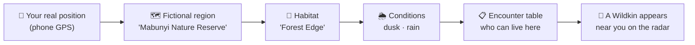
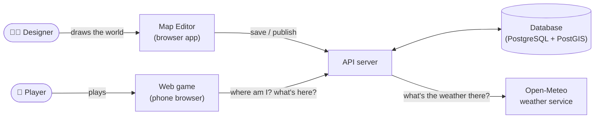
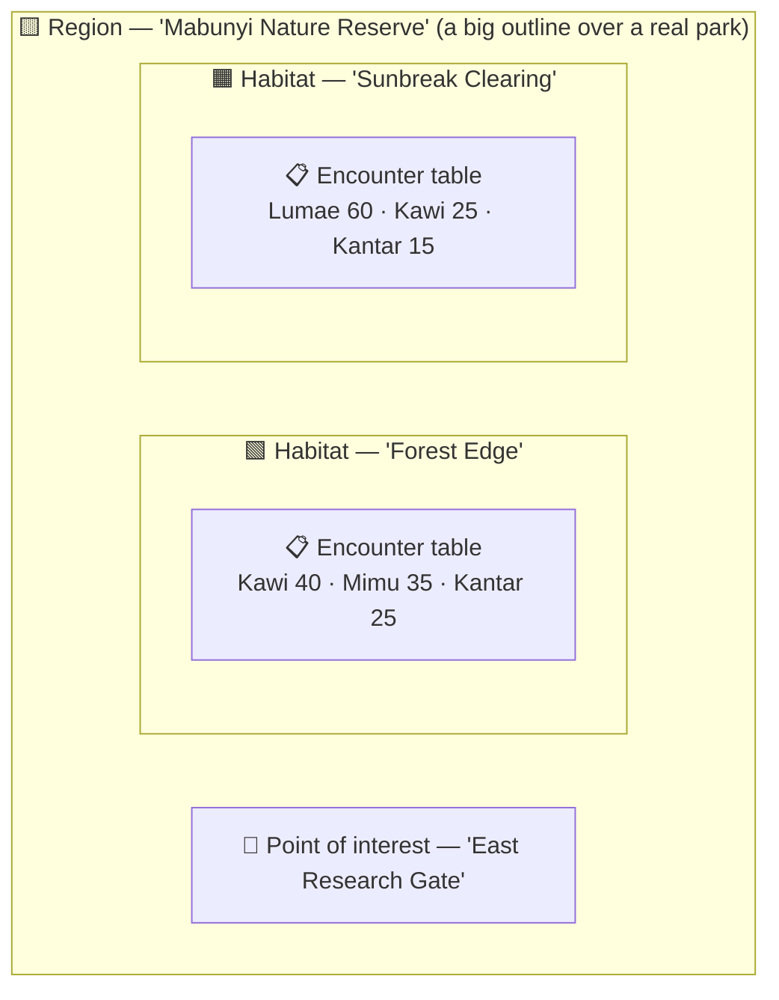
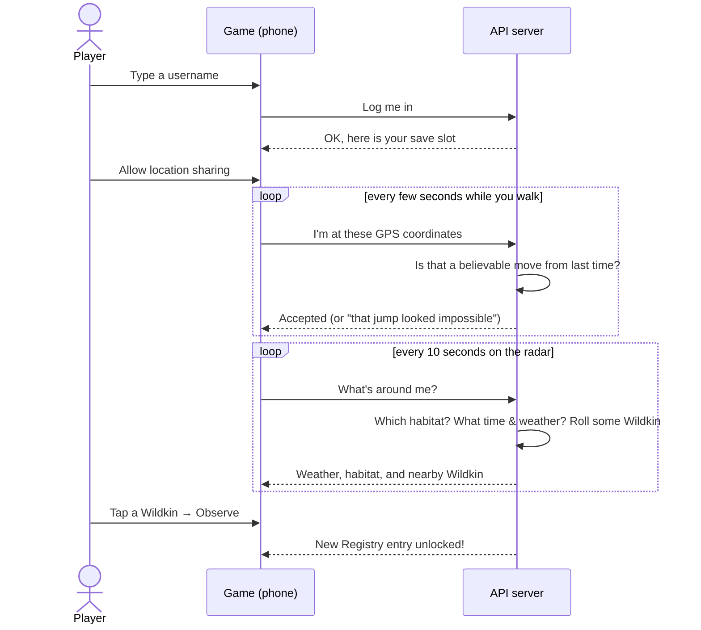

# 00 · WILDBOUND in plain English

> **Who this is for:** anyone. No programming knowledge needed. Technical words are explained when they first appear,
> and all of them are in the [Glossary](glossary.md).

## The game in one paragraph

WILDBOUND is a creature-collecting and nature-research game played on a phone, **where you are in the real world
matters**. Walk into a real park and the game places you inside a fictional nature reserve; stand near the creek and you
are in the "creekside" habitat; go out at dusk in the rain and different creatures (called **Wildkin**) appear than at
noon in the sun. You **observe** Wildkin to learn about them, **capture** them to study them further, and fill in a
**Registry** (a field guide, much like a Pokédex).

## The three pieces of software

The repository (one folder holding all the code, called a **monorepo**) contains three programs that work together:

| Program | Who uses it | What it is like |
|---|---|---|
| **Map Editor** (`apps/editor`) | The game's developers and designers | A drawing tool on top of a real map. You draw the borders of fictional regions and habitats, pin landmarks, and decide which Wildkin live where. |
| **Web game** (`apps/web`) | Players | The game itself, styled like a handheld "field navigator" device. Login, location sharing, radar, Registry, Satchel (bag) and Party. |
| **API server** (`apps/api`) | The two programs above (never people directly) | The "back office". It stores everything in a database, checks every request, decides what spawns, and keeps players honest. |

An **API** (Application Programming Interface) is a set of addresses a program can call to ask for data or ask for
something to happen, like a restaurant's order window. The editor and the game never touch the database directly; they
always go through the API, which checks that every request is allowed and makes sense.

## How the world is described

The game world is not drawn as pictures. It is **data**: a list of shapes and rules that the editor creates and the
game reads. Think of it as a set of nested containers:

| Thing | Plain meaning | Real-world comparison |
|---|---|---|
| **Region** | A named area of the fictional world drawn over a real place | A national park on a map |
| **Habitat** | A smaller area inside a region with its own character | "The woods", "the meadow", "the riverbank" inside that park |
| **Point of interest (POI)** | A named spot | A trailhead sign, a pond, a research station |
| **Encounter table** | The list of Wildkin that can appear in a habitat, each with a **weight** (how common it is) | A birdwatcher's checklist: "sparrows: very common, herons: occasional" |
| **Conditions** | Optional rules like "only at night" or "only when raining" | "Owls: night only" |
| **Spawn modifiers** | Per-species "more likely / less likely" adjustments for time and weather | "Frogs are three times as active after rain" |

**Weights** are relative. If Kawi has 40 and Mimu has 35 and Kantar has 25 (total 100), then out of 100 appearances
roughly 40 are Kawi. If you added a fourth creature with weight 100, everyone else would become half as common.

### Draft and published

Designers can experiment freely because there are **two copies** of the world:

- The **draft** is the work-in-progress copy. Only the editor sees it.
- The **published** copy is what players see.

Pressing **Publish** in the editor checks the draft for mistakes (for example a habitat drawn outside its region) and,
only if it passes, copies it over the published world in one step. Players never see a half-finished world. It works
like "Save draft" vs "Post" on a blog.

## What happens when you play

1. **Login.** You pick a username. It is your save slot; type it again later to continue. (There is no password yet.
   That is a known gap; see [Security](08-security.md).)
2. **Location.** The game will not start without location sharing. If you turn it off mid-game, the game pauses with a
   "Survey paused" screen until it comes back.
3. **Radar.** A map centred on you (shown as a little pixel-art head) with nearby Wildkin as icons.
4. **Observe** (within 60 metres): unlocks the Wildkin's name, description and habitat in your Registry.
5. **Capture** (within 60 metres, uses a Field Capsule): also unlocks rarity, activity pattern and skills, and adds the
   Wildkin to your Party. *Capture is one of the unfinished "exercises" in v0.1.0.*
6. **Registry** lists every species. Ones you have never met show only as a dark silhouette and a number.
7. **Satchel** is your bag (Field Capsules, Trail Rations, a Field Notebook). **Party** holds six companions; extras go
   to storage.

### Time and weather change what you meet

The server looks up the **real weather** at your position (from the free Open-Meteo service) and your **local time of
day** (dawn 5–7, day 7–17, dusk 17–19, night 19–5). Encounter tables can say "only at dawn" or "only in rain", and each
species has modifiers. For example Kawi, a bird, almost disappears at night (×0.1) and hides in storms (×0); Kantar, an
armoured critter that shelters by day, doubles at night. See the chart in
[Wildkin and world content](09-wildkin-and-content.md#spawn-modifiers).

### Why players can't cheat by faking their location (mostly)

A cheater could make their phone report a fake position to "teleport" to a rare habitat. The server defends against
this in plain ways:

- **It only accepts believable movement.** Between two reports you can move at most about 40 m per second (144 km/h,
  enough for a car) plus some slack for GPS wobble. A jump across the city in two seconds is rejected.
- **Three impossible jumps in a row lock you out for 2 minutes.**
- **Wildkin are placed by the server around where the server believes you are**, and you can only act on Wildkin the
  server gave *you*, within 60 m of that server-side position.
- **Only developers can ask "what is at this coordinate?"** Players can only ask "what is around me?"

A determined cheater with a GPS-spoofing app who "walks" slowly can still fool any browser game; this is plausibility
checking, not proof. Details in [Security model](08-security.md).

## What is finished and what is not (v0.1.0)

| Area | Status |
|---|---|
| Map Editor: draw, edit, validate, publish, test any spot | ✅ Done |
| Login, location gate, radar, live weather and time, spawning, Observe, Registry, Satchel, Party views | ✅ Done |
| Server-side anti-teleport checks | ✅ Done |
| Capture, renaming, rearranging the party, real weather mapping, spawn modifiers, captured Registry details, POI editor form | 🧩 Left as learning **exercises** (marked `TODO(you)` in the code) |
| The real top-down "walking around" game view (Phaser), battles, real accounts with passwords, offline mode | 🔜 Not started |

The exercises are intentional: v0.1.0 is a working skeleton built so the project owner can practise React, Node,
Express, Prisma and friends by filling in the gaps. See [Exercises and roadmap](12-exercises-and-roadmap.md).

## Where things are (non-technical map of the folders)

| Folder | What's inside |
|---|---|
| `apps/editor` | The Map Editor |
| `apps/web` | The player game |
| `apps/api` | The server |
| `packages/shared` | The "dictionary" all programs agree on: what a region, a Wildkin, a request looks like |
| `packages/world` | The game rules (time of day, encounter odds, movement checks, validation), with no screens and no database |
| `packages/db` | Database layout, the sample world and the five starting Wildkin |
| `documents/` | The game's creative canon (Wildkin Bible etc., Word files) |
| `patches/0.1.0/` | The brief for this version, UI mockups, notes between work sessions |
| `docs/` | This documentation |

Next: [01 · Architecture](01-architecture.md) (technical) or [09 · Wildkin and world content](09-wildkin-and-content.md)
(creative).
