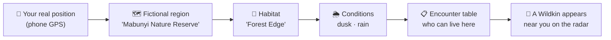
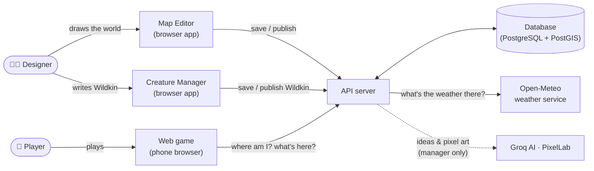
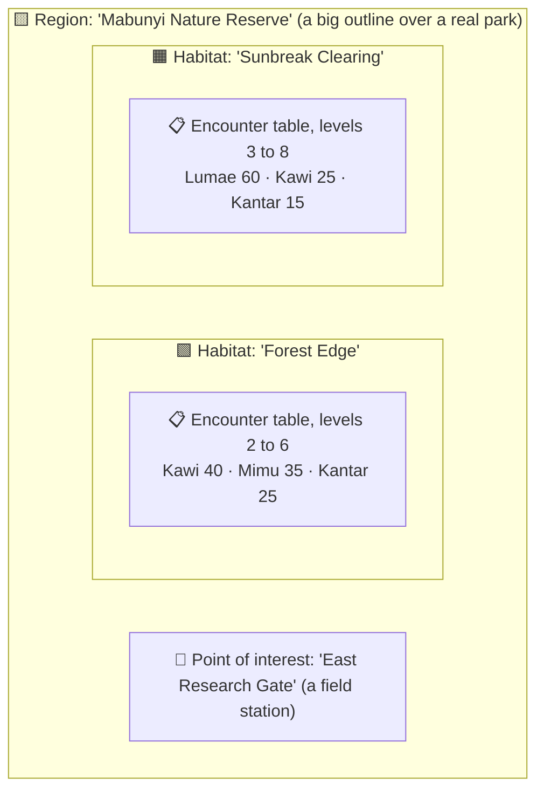
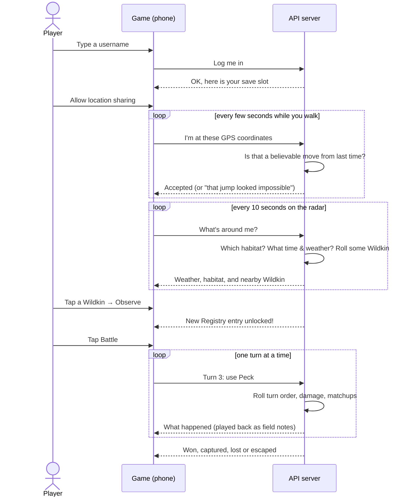

# 00 · WILDBOUND in plain English

> **Who this is for:** anyone. No programming knowledge needed. Technical words are explained when they first appear,
> and all of them are in the [Glossary](glossary.md).

## The game in one paragraph

WILDBOUND is a creature-collecting and nature-research game played on a phone, **where you are in the real world
matters**. Walk into a real park and the game places you inside a fictional nature reserve; stand near the creek and you
are in the "creekside" habitat; go out at dusk in the rain and different creatures (called **Wildkin**) appear than at
noon in the sun. You **observe** Wildkin to learn about them, **battle** wild ones with your own companions,
**capture** the ones you have weakened, raise them, and fill in a **Registry** (a field guide, much like a Pokédex).
Your **Field Registry license** says which Wildkin you know enough about to care for, and you earn higher ranks by doing
real fieldwork.

## The four pieces of software

The repository (one folder holding all the code, called a **monorepo**) contains four programs that work together:

| Program | Who uses it | What it is like |
|---|---|---|
| **Map Editor** (`apps/editor`) | The game's developers and designers | A drawing tool on top of a real map. You draw the borders of fictional regions and habitats, pin landmarks, and decide which Wildkin live where. |
| **Creature Manager** (`apps/manager`) | The game's designers and writers | An editable Wildkin encyclopedia, like the Wildkin Bible as an app. Write a species' entry, let an AI assistant suggest lore-friendly details, generate its pixel art, and **publish** it into the game. See [13 · Creature Manager](13-creature-manager.md). |
| **Web game** (`apps/web`) | Players | The game itself, styled like a handheld "field navigator" device. Login, location sharing, radar, battles, Registry, Satchel (bag), Party and License. |
| **API server** (`apps/api`) | The three programs above (never people directly) | The "back office". It stores everything in a database, checks every request, decides what spawns and how it moves, plays out every battle turn, and keeps players honest. |

An **API** (Application Programming Interface) is a set of addresses a program can call to ask for data or ask for
something to happen, like a restaurant's order window. The editor, the manager and the game never touch the database
directly; they always go through the API, which checks that every request is allowed and makes sense.

### Where Wildkin come from

A new species starts life in the **Creature Manager** as an encyclopedia entry. While it is a **draft**, only the
manager sees it. **Publish** copies the game-relevant parts (name, Registry description, habitat, rarity, activity,
spawn modifiers, skills, how it moves, and since v0.3.0 its category, body traits, base stats, placeholder attacks and
gene pool) into the game's creature list. A species can only be published once its four base stats add up to exactly
300 and it has a category, at least one body trait and at least one attack. From then on the Map Editor can put it into
habitats, and players can meet it. **Delete** retires a species without destroying anything: it stops appearing, but
players who already met it keep it in their Registry, and it can be restored.

The manager has two optional AI helpers, both only used while *writing* content, never while playing:

- an **AI assistant** (a language model from Groq) that has read the WILDBOUND story documents and turns a one-line idea
  ("a shy moth that pollinates night-blooming vines by the creek") into a filled-in entry for you to review;
- a **PixelLab** button that draws the creature's icon and sprite from its written physical description.

## How the world is described

The game world is not drawn as pictures. It is **data**: a list of shapes and rules that the editor creates and the
game reads. Think of it as a set of nested containers:

| Thing | Plain meaning | Real-world comparison |
|---|---|---|
| **Region** | A named area of the fictional world drawn over a real place | A national park on a map |
| **Habitat** | A smaller area inside a region with its own character | "The woods", "the meadow", "the riverbank" inside that park |
| **Point of interest (POI)** | A named spot | A trailhead sign, a pond, a research station |
| **Encounter table** | The list of Wildkin that can appear in a habitat, each with a **weight** (how common it is) and a **level range** (how strong the wild ones are) | A birdwatcher's checklist: "sparrows: very common, herons: occasional" |
| **Conditions** | Optional rules like "only at night" or "only when raining" | "Owls: night only" |
| **Spawn modifiers** | Per-species "more likely / less likely" adjustments for time and weather | "Frogs are three times as active after rain" |
| **License requirement** | Optional: a habitat where only researchers with a high enough license rank may battle and capture | A nature reserve's "permit holders only" zone (anyone may still look) |

**Weights** are relative. If Kawi has 40 and Mimu has 35 and Kantar has 25 (total 100), then out of 100 appearances
roughly 40 are Kawi. If you added a fourth creature with weight 100, everyone else would become half as common.

**Level ranges** work the same way for strength: a table that says "levels 2 to 6" places wild Wildkin between level 2
and level 6. A single entry can override its table (in Mabunyi, Riverkin at the creek is level 5 to 12). Because players
do not choose where they live, every region needs an easy habitat for beginners; difficulty should rise *within* a
region, not between neighbourhoods.

### Draft and published

Designers can experiment freely because there are **two copies** of the world:

- The **draft** is the work-in-progress copy. Only the editor sees it.
- The **published** copy is what players see.

Pressing **Publish** in the editor checks the draft for mistakes (for example a habitat drawn outside its region) and,
only if it passes, copies it over the published world in one step. Players never see a half-finished world. It works
like "Save draft" vs "Post" on a blog.

## What happens when you play

1. **Login.** You pick a username. It is your save slot; type it again later to continue. (There is no password yet.
   That is a known gap; see [Security](08-security.md).)
2. **Location.** The game will not start without location sharing. If you turn it off mid-game, the game pauses with a
   "Survey paused" screen until it comes back.
3. **Starter.** The first time you reach the game you choose a companion: Kawi, Mimu or Kantar at level 5, entrusted by
   the ranger at East Research Gate. (Capture needs a battle and a battle needs a Wildkin, so nobody starts
   empty-handed.)
4. **Radar.** A map centred on you (shown as a little pixel-art head) with nearby Wildkin as icons, and nearby points of
   interest as small signs. Wildkin **wander around** a little, each in its own way (a bird darts, a burrower skulks, a
   river creature roams); if one wanders too far it is gone ("It wandered off."). *This movement is experimental; it is
   kept as it is in v0.3.0, except that a Wildkin stops wandering while you battle it.*
5. **Observe** (within 60 metres): unlocks the Wildkin's name, description and habitat in your Registry, and tells you
   its level and anything unusual about it ("Larger than typical"). Observing earns **researcher EXP** toward your
   license.
6. **Battle** (within 60 metres): your lead Wildkin faces the wild one. See [Battles and capture](#battles-and-capture).
7. **Points of interest.** Tap a sign to search it for supplies once a day, and at a **field station** such as East
   Research Gate to visit the vet or take a license assessment.
8. **Registry** lists every species. Ones you have never met show only as a dark silhouette and a number. Observed
   species gain **field notes**: what you have learned about their body traits, the times and weathers you have seen
   them in, and unusual individuals.
9. **Satchel** is your bag (capsules, Trail Rations, a Field Notebook). **Party** holds six companions; extras go to
   storage. **License** shows your four Field Registry licenses.

## Battles and capture

A **wild battle** is a short, respectful bout between your Wildkin and a wild one, one on each side, taking turns like a
board game. Each turn you choose one thing to do:

| Choice | What it does |
|---|---|
| **Attack** | Your Wildkin uses one of its one or two attacks. How much it hurts depends on the attacker's level and Attack, the defender's Defense, and a little luck. |
| **Switch** | Swap in another party member. It costs your turn (sending in a replacement after a faint is free). |
| **Satchel** | Feed a Trail Ration (heals a quarter of max HP), or throw a **capsule** to try to capture. |
| **Escape** | Try to get away. Faster Wildkin escape more easily, and every failed try makes the next one easier. |

- **Who goes first** is a weighted coin flip on Speed: the faster Wildkin has better odds, never a certainty.
- **Matchups.** Every species has one or two **body traits** (Plated, Feathered, Soft-bodied, Leafy, Slick) and every
  attack has an **approach** (Strike, Pierce, Crush, Surge, Toxin, Spore). Some approaches work especially well or badly
  on some traits: armour plates crack under Crush but turn away Pierce. You do not know these in advance; the first time
  you see one in battle it is written into your field notes ("Field note recorded: Plated is weak to Crush") and earns
  researcher EXP.
- **Capture happens inside the battle.** Wild Wildkin are feral and will not accept a capsule while they still have the
  strength to resist, so you weaken them first. The lower its HP, the better your chance; a matching **category
  capsule** (Canopy, Current, Burrow or Bloom) adds a bonus. Every capsule thrown is used up. A Wildkin that has fainted
  cannot be captured: knocking it out wins the bout but lets it go.
- **Losing** means none of your Wildkin can keep going. The only cost is that they are exhausted; there is no money and
  no EXP penalty.
- A battle you walk away from (more than 120 m) counts as escaped; one you leave alone for 10 minutes is abandoned and
  the wild Wildkin wanders off.

The server plays out every turn. The phone only sends "turn 3: use Peck" and shows what the server says happened, so a
modified phone cannot win battles or capture anything it should not. The exact rules are in
[14 · Battles and research](14-battles-and-research.md).

## Individual Wildkin, levels and EXP

- **Every species has the same total strength.** HP, Attack, Defense and Speed always add up to 300 for every species,
  just shared out differently (Kawi is fast, Kantar is armoured). A rare Wildkin is not a stronger one.
- **Every individual is a little different.** Some are smaller or larger than typical, some bolder or warier, a few
  carry a rare cosmetic **marking** (for example "Banded" Kantar). These are inherited traits (the groundwork for
  breeding later). On top of that each has its own **vigor**, how healthy and well developed it is. The game shows words
  ("Strong", "Robust"), never raw numbers.
- **Levels go from 1 to 100, and the level is the bond** between you and your Wildkin. Wildkin gain **EXP** from
  battles (the biggest share, but not by a huge margin), from walking with you as the **lead** (party slot 1), from you
  observing and exploring, and from captures. Daily caps keep any one activity from being farmed.
- A wild Wildkin keeps its level when you capture it.

## Field Registry licenses

There is one license per **category** of Wildkin (Aerial, Aquatic, Terrestrial, Verdant), because birds of the canopy
and creek swimmers live by different rules. Everyone starts at **rank 1** of 5 in all four.

- Your rank sets the **obedience cap**: rank × 20 levels (rank 1 covers levels 1 to 20, rank 2 up to 40, and so on). A
  Wildkin at your cap stops gaining EXP until you rank up; EXP beyond the cap is simply not gained.
- A Wildkin you capture **above** your cap is **restless**: it travels with you and still grows up to the top of its own
  license band, but it will not battle and cannot be treated until you earn the license.
- **Researcher EXP** comes from learning, not from fighting: observing species (the first time is worth the most),
  recording matchups and unusual individuals, seeing species at new times and weathers, visiting habitats.
- To rank up you need enough researcher EXP **and** must pass an **assessment** at a field station: a checklist of real
  fieldwork, such as "Observe 2 different species" and "Capture 1 Wildkin". Passing grants category capsules and Field
  Capsules, and any Wildkin that are now within your cap stop being restless.
- Some habitats can be **restricted research zones** ("Restricted research zone: Aquatic rank 3"). You may still observe
  there (that is how you earn the license), but you cannot battle or capture until your rank is high enough. The sample
  world has none.
- Higher ranks also let your scanner show more about your own Wildkin: individual stat grades and temperament from rank
  2, vigor from rank 3, the inherited genes from rank 4.

## Healing

- Every injured or fainted Wildkin gets **first aid** and is placed in its capsule, where it recovers slowly (from empty
  to full in about 8 hours). *The slow recovery is exercise #13; until it is done, HP only comes back through vets and
  Trail Rations.*
- **Vets** at field stations such as East Research Gate heal all your Wildkin (party and storage) instantly and for
  free.
- A **Trail Ration** restores a quarter of a Wildkin's HP, in a battle or on the trail.
- Restless Wildkin cannot be treated at all; they stay as they are until you earn the license that covers them.

There is no money in the game yet. Items come from searching points of interest once a day and from license rank-ups.

### Time and weather change what you meet

The server looks up the **real weather** at your position (from the free Open-Meteo service) and your **local time of
day** (dawn 5 to 7, day 7 to 17, dusk 17 to 19, night 19 to 5). Encounter tables can say "only at dawn" or "only in rain", and each
species has modifiers. For example Kawi, a bird, almost disappears at night (×0.1) and hides in storms (×0); Kantar, an
armoured critter that shelters by day, doubles at night. See the chart in
[Wildkin and world content](09-wildkin-and-content.md#spawn-modifiers).

### Why players can't cheat by faking their location (mostly)

A cheater could make their phone report a fake position to "teleport" to a rare habitat. The server defends against
this in plain ways:

- **It only accepts believable movement.** Between two reports you can move at most about 40 m per second (144 km/h,
  enough for a car) plus some slack for GPS wobble. A jump across the city in two seconds is rejected.
- **Three impossible jumps in a row lock you out for 2 minutes.**
- **Wildkin are placed by the server around where the server believes you are**, and you can only act on Wildkin the
  server gave *you*, within 60 m of that server-side position.
- **Only developers can ask "what is at this coordinate?"** Players can only ask "what is around me?"

A determined cheater with a GPS-spoofing app who "walks" slowly can still fool any browser game; this is plausibility
checking, not proof. Details in [Security model](08-security.md).

## What is finished and what is not (v0.3.0)

| Area | Status |
|---|---|
| Map Editor: draw, edit, validate, publish, test any spot | ✅ Done |
| Map Editor: wild level ranges, license-locked habitats | ✅ Done (v0.3.0) |
| Creature Manager: encyclopedia, draft/publish, soft delete, AI assistant, PixelLab art | ✅ Done (v0.2.0) |
| Creature Manager: battle and genetics fields (category, body traits, stats, attacks, gene pool) | ✅ Done (v0.3.0) |
| Wandering Wildkin on the radar | 🧪 Experimental, kept as it is (a Wildkin in a battle stops wandering) |
| Login, location gate, radar, live weather and time, spawning, Observe, Registry, Satchel, Party views | ✅ Done |
| Starter companion, wild battles, capture through battle, levels and EXP, genetics, healing (first aid, vets, Trail Rations) | ✅ Done (v0.3.0) |
| Field Registry licenses: ranks, researcher EXP, assessments, restless Wildkin, restricted zones, scanner depth | ✅ Done (v0.3.0) |
| Server-side anti-teleport checks | ✅ Done |
| Weighted turn order and escape, matchup multiplier, capture chance, natural recovery, daily POI supplies, assessment checklist progress, live stat budget counter (exercises #10 to #16) | 🧩 Left as learning **exercises** (marked `TODO(you)` in the code); each has a working fallback |
| Rearranging the party, rename form, real weather mapping, spawn modifiers, captured Registry details, POI editor form (exercises #1, #2, #4, #6 to #9) | 🧩 Still open from v0.1.0 |
| Capture as a radar button (exercise #3) | Retired: superseded by capture inside battles |
| Skills and passives, NPC friendly battles (planned for v0.4.0); breeding, currency and shops, the Phaser "walking around" view, real accounts with passwords, offline mode | 🔜 Not started |

The exercises are intentional: WILDBOUND is built so the project owner can practise React, Node, Express, Prisma and
friends by filling in the gaps. While an exercise is open the game still runs on a simple fallback (for example, the
faster Wildkin always strikes first, and there is no natural recovery, so injured Wildkin need a vet). See
[Exercises and roadmap](12-exercises-and-roadmap.md).

## Where things are (non-technical map of the folders)

| Folder | What's inside |
|---|---|
| `apps/editor` | The Map Editor |
| `apps/manager` | The Creature Manager |
| `apps/web` | The player game |
| `apps/api` | The server |
| `packages/shared` | The "dictionary" all programs agree on: what a region, a Wildkin, a request looks like |
| `packages/world` | The game rules (time of day, encounter odds, movement checks, validation, stats, genetics, levels, the battle engine, licenses), with no screens and no database |
| `packages/db` | Database layout, the sample world and the five starting Wildkin |
| `patches/0.1.0/` to `patches/0.3.0/` | The brief for each version, UI mockups, notes between work sessions, exercise lists |
| `docs/` | This documentation, plus the game's creative canon (Wildkin Bible etc., Word files `WILDBOUND_*.docx`) |

Next: [01 · Architecture](01-architecture.md) (technical) or [09 · Wildkin and world content](09-wildkin-and-content.md)
(creative).
