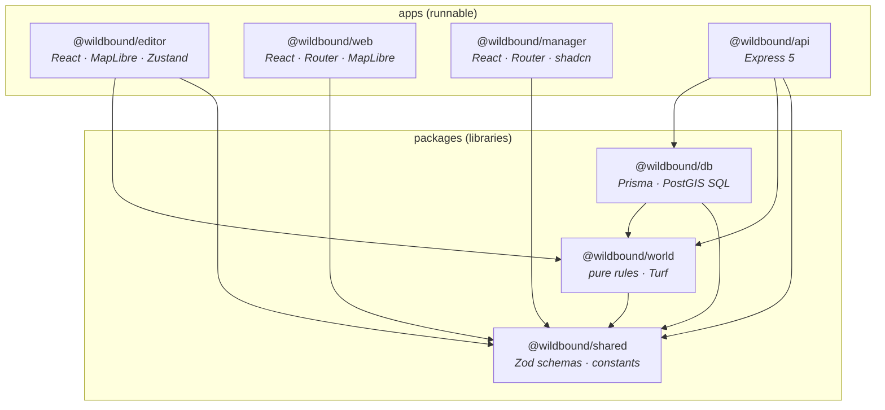
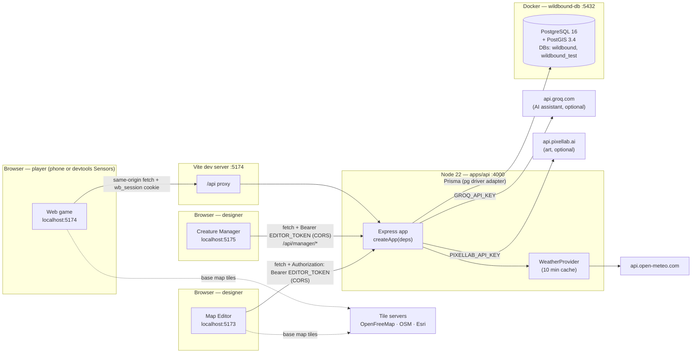
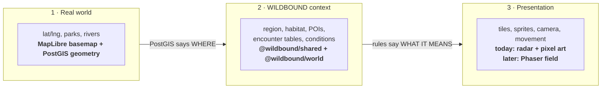
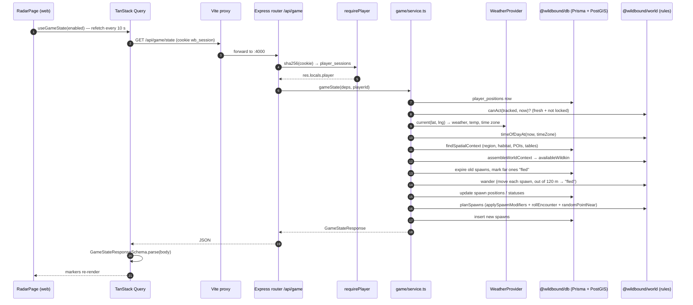
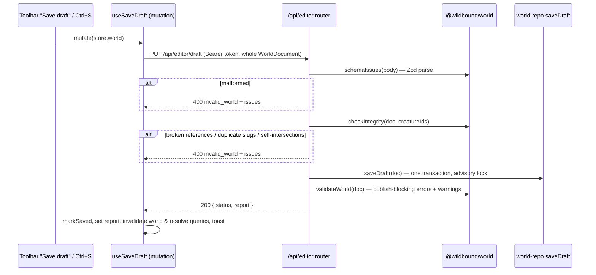

# 01 · Architecture

> **In plain English:** WILDBOUND is four programs (Map Editor, Creature Manager, game, server) plus shared code
> libraries, all in one repository. The server is the single source of truth: the browser apps only ask it questions. The game rules live in
> one small library with no database or screens, so the same rules run everywhere and are easy to test.

## Contents

- [Monorepo layout](#monorepo-layout)
- [Package dependency graph](#package-dependency-graph)
- [Runtime topology](#runtime-topology)
- [Layers of the world: real, WILDBOUND, presentation](#three-separate-representations-of-the-world)
- [Tech stack and why](#tech-stack-and-why)
- [Life of a request](#life-of-a-request)
- [Design principles (rules to keep)](#design-principles-rules-to-keep)
- [How TypeScript is wired](#how-typescript-is-wired)

## Monorepo layout

The repo is a [pnpm workspace](https://pnpm.io/workspaces) (`pnpm-workspace.yaml` lists `apps/*` and `packages/*`).
Packages import each other by name (`@wildbound/shared`), and pnpm links them locally (`"workspace:*"`).

```
wildbound/
├── apps/
│   ├── api/          @wildbound/api     Express 5 REST API (port 4000)
│   ├── editor/       @wildbound/editor  React + MapLibre Map Editor (port 5173)
│   ├── web/          @wildbound/web     React player game (port 5174)
│   └── manager/      @wildbound/manager React Creature Manager: Wildkin encyclopedia, AI assist, art (port 5175)
├── packages/
│   ├── shared/       @wildbound/shared  Zod schemas + TS types: the data contract
│   ├── world/        @wildbound/world   Pure domain rules (no DB, no React, no network)
│   ├── db/           @wildbound/db      Prisma schema, migrations, PostGIS queries, seed data
│   ├── game/         (reserved)         Future battle/game systems. Only a README
│   └── assets/       (reserved)         Future tile/creature asset metadata. Only a README
├── docs/             This documentation + game canon (WILDBOUND_*.docx: Wildkin Bible, First Field Survey,
│                     Biology & Ecology), which the Creature Manager's AI assistant reads as lore
├── patches/0.1.0/    The v0.1.0 brief, handovers, exercises list, Stitch mockups + DESIGN.md
├── patches/0.2.0/    The v0.2.0 brief (Creature Manager, wandering spawns)
├── docker/initdb/    SQL run on first DB start (creates wildbound_test)
├── docker-compose.yml  PostGIS 16-3.4 container "wildbound-db"
├── vitest.config.ts  Test projects: unit, exercises, integration
├── tsconfig.base.json  Shared strict TypeScript settings
├── .env.example      Every environment variable (copy to .env)
├── .mcp.json         PixelLab MCP server (art generation tool, dev-time only)
└── .claude/, .agents/  AI-assistant skills (shadcn). Not part of the product
```

Every package is **consumed as TypeScript source**: there is no build step for `shared`, `world` or `db`. The API runs
with `tsx` (TypeScript executor), and Vite compiles the shared packages into the browser bundles.

## Package dependency graph

Arrows mean "imports from". There are no cycles, and the arrows only point *down* toward `shared`.



| Package | May import | Must never import | Why |
|---|---|---|---|
| `shared` | `zod` only | anything else in the repo | Everyone depends on it; keep it tiny and dependency-free |
| `world` | `shared`, `@turf/turf` | `db`, React, `fetch`, Node APIs | Rules must run identically in the browser (editor preview) and on the server |
| `db` | `shared`, `world`, Prisma | Express, React | Persistence only. (`world` is used by the seed script for validation) |
| `api` | `db`, `world`, `shared`, Express | React | Server |
| `editor` | `world`, `shared` | `db` | Browser app; reads/writes only through the API |
| `web` | `shared` only | `world`, `db` | The game must not compute rules client-side: the server is authoritative |
| `manager` | `shared` only | `world`, `db` | Browser app; reads/writes only through the API (`/api/manager/*`) |

> ⚠️ **`apps/web` deliberately does not depend on `@wildbound/world`.** If the game client could run the encounter or
> movement rules, it would be tempting to trust its results. Keep game decisions on the server.

## Runtime topology

What runs where during development:



Key points:

- **The editor and the Creature Manager call the API cross-origin** (`VITE_API_URL`, default
  `http://localhost:4000`) with a bearer token, so the API enables CORS for the origins in `CORS_ORIGINS` (default
  `:5173`, `:5174`, `:5175`).
- **The game calls the API same-origin.** Vite proxies `/api/*` from `:5174` to `:4000` (`apps/web/vite.config.ts`,
  override with `API_PROXY_TARGET`). That keeps the httpOnly `wb_session` cookie first-party with no CORS involved. In
  production you would serve the game and API under one domain (or a reverse proxy) for the same reason.
- **Weather** is fetched by the server, never by the client, so a player cannot choose their own weather.
- **Groq and PixelLab** are called only by the API, only for Creature Manager requests, and only when their keys are
  set. API keys never reach a browser. The game never depends on them: art is stored in the database and served by
  `GET /api/art/wildkin/:id/:kind.png`.
- **Map tiles** are only decoration. The base map is "geographic truth" for drawing; it is never the game map.

## Three separate representations of the world

These layers are kept apart on purpose. Do not couple them.



There is **one world model**: the `WorldContext` (see [02 · World model](02-world-model.md#worldcontext-the-answer-to-what-is-here)).
The editor's Test panel, the API's game service and the future Phaser field all consume that same shape.

## Tech stack and why

| Area | Choice | Why this one | Where |
|---|---|---|---|
| Language | TypeScript 5.9 (strict, `noUncheckedIndexedAccess`) | One language end to end; shared types | everywhere |
| Runtime | Node.js ≥ 22 | Built-in `process.loadEnvFile`, `fetch`, `AbortSignal.timeout` | api, db scripts |
| Monorepo | pnpm 10 workspaces | Fast, strict, local package linking | root |
| Contracts | Zod 4 | One schema = runtime validation + TS type; used by client *and* server | `packages/shared` |
| Backend | Express 5 | Familiar; v5 forwards async errors to the error middleware | `apps/api` |
| DB | PostgreSQL 16 + PostGIS 3.4 | Real spatial queries (point-in-polygon, distances in meters) | Docker |
| DB access | Prisma 7 with `@prisma/adapter-pg` | Typed queries and migrations; raw SQL for geometry | `packages/db` |
| Frontend | React 19 + Vite 7 | Standard, fast dev server | editor, web, manager |
| Server state | TanStack Query 5 | Caching, polling, invalidation instead of hand-rolled fetch state | editor, web, manager |
| Local editor state | Zustand 5 | Small store that the imperative map can subscribe to outside React | editor |
| Forms | react-hook-form 7 + `zodResolver` | Same Zod schemas validate the form and the API | editor inspectors, web login, manager entry form |
| Styling | Tailwind CSS 4 (+ shadcn/ui in web and manager) | Utility classes with design tokens in CSS | editor, web, manager |
| Routing | React Router 7 | Route guards for login → location → game; manager pages | web, manager |
| Maps | MapLibre GL JS 5 | Open-source WebGL maps, no API key | editor, web |
| Client geometry | Turf.js 7 | Area, overlap, point-in-polygon for validation and drawing (PostGIS stays authoritative) | world, editor |
| Weather | Open-Meteo | Free, key-free current weather + time zone | api |
| AI assistant | Groq chat completions (JSON mode), default `llama-3.3-70b-versatile` | Fast, has a free tier, OpenAI-compatible; optional | api (`manager/assistant.ts`) |
| Canon reading | mammoth | Extracts text from the `.docx` canon for the assistant | api (`manager/lore.ts`) |
| Tests | Vitest 3 + supertest | Unit, exercises and real-PostGIS integration tests | root `vitest.config.ts` |
| Art | PixelLab API v2 (Pixen, the cheapest model) | Generated from the Creature Manager, stored in the DB; the game only downloads PNGs | api (`manager/art.ts`), `wildkin_art` |
| Future renderer | Phaser 3 | Top-down field view. Not started | – |

## Life of a request

### A player's radar refresh (`GET /api/game/state`)

This is the busiest path in the game. It shows how the layers cooperate.



### An editor save (`PUT /api/editor/draft`)



## Design principles (rules to keep)

These are the decisions the codebase is built around. Breaking one usually breaks something subtle.

1. **The server is authoritative.** Clients report what they observe (GPS fixes) and ask to act on things the server
   gave them. They never send "I am in habitat X" or "spawn Y at Z". → [08 · Security](08-security.md)
2. **One contract.** Every request and response has a Zod schema in `@wildbound/shared`. The API parses inputs with it
   (`parseOr400`); both clients parse responses with it. Change the schema, and TypeScript shows you every place to update.
3. **Rules are pure.** `@wildbound/world` functions take data in and return data out. Anything with side effects (DB,
   weather HTTP, clock, randomness) is passed in as an argument. That is why `createApp` takes `now` and `random`.
4. **PostGIS answers *where*, `world` decides *what it means*.** Spatial lookups are SQL; all game logic about
   tables, conditions and probabilities is TypeScript.
5. **Draft and published never mix.** Every world table is keyed by `(id, stage)` and relations include the stage.
6. **The world is data, not code.** No region, habitat or Wildkin is hard-coded in UI or logic (Wildkin are authored
   in the Creature Manager, their art is served from the database). The only code-defined catalogue is `ITEMS`
   (inventory items).
7. **Deterministic output.** Lists are sorted (by name then id, or weight then id), so tests and previews are stable.
8. **Locked data is `null`, not hidden.** The Registry API sends `null` for fields the player has not unlocked; the
   UI never receives secrets it is supposed to hide.
9. **Editor edits are pure functions** (`apps/editor/src/world-edit.ts`) so every edit is one undo step and unit-testable.
10. **Delete softly.** Species are retired with `deleted_at`, never removed, so players' Registry and Party history
    stays intact. Code that lists species for *new* things (spawning, pickers) uses `listCreatures(db)`; code that shows
    *existing* things (Registry, Party) uses `listCreatures(db, { includeDeleted: true })`.
11. **External AI is optional and server-side.** The assistant and art generator are interfaces injected into
    `createApp`; without keys they are `null` and the features switch off cleanly.

## How TypeScript is wired

- `tsconfig.base.json` holds the strict settings. Each package's `tsconfig.json` extends it.
- `allowImportingTsExtensions` + `noEmit`: imports include the `.ts` extension (`import { x } from "./conditions.ts"`).
  Keep that style in new files.
- `moduleResolution: "Bundler"`: packages expose `src/index.ts` directly through their `package.json` `exports`.
- `noUncheckedIndexedAccess`: `array[i]` is `T | undefined`. Code uses `!` only where the index is proven valid.
- Generated Prisma client: `packages/db/src/generated/prisma/` (gitignored, created by `pnpm install` →
  `prisma generate`).
- `pnpm typecheck` runs `tsc --noEmit` in every package in parallel.

Next: [02 · World model and data contract](02-world-model.md).
