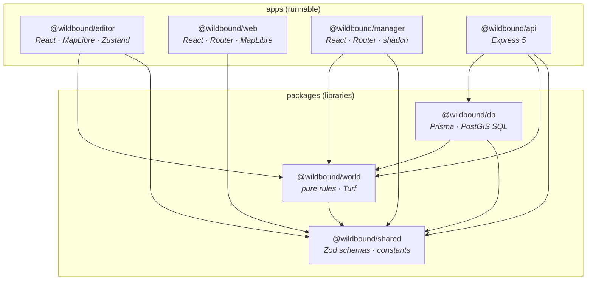
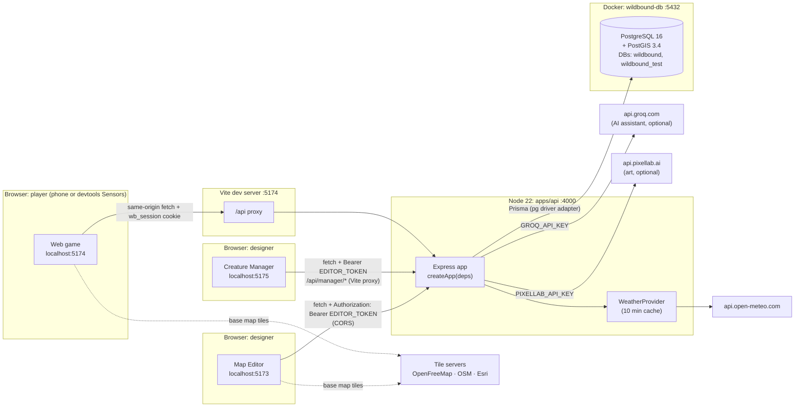
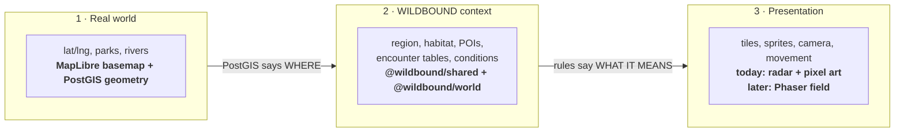
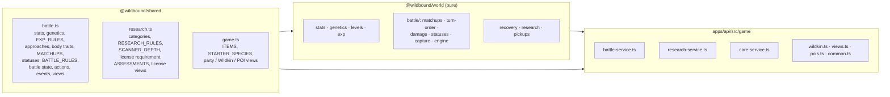
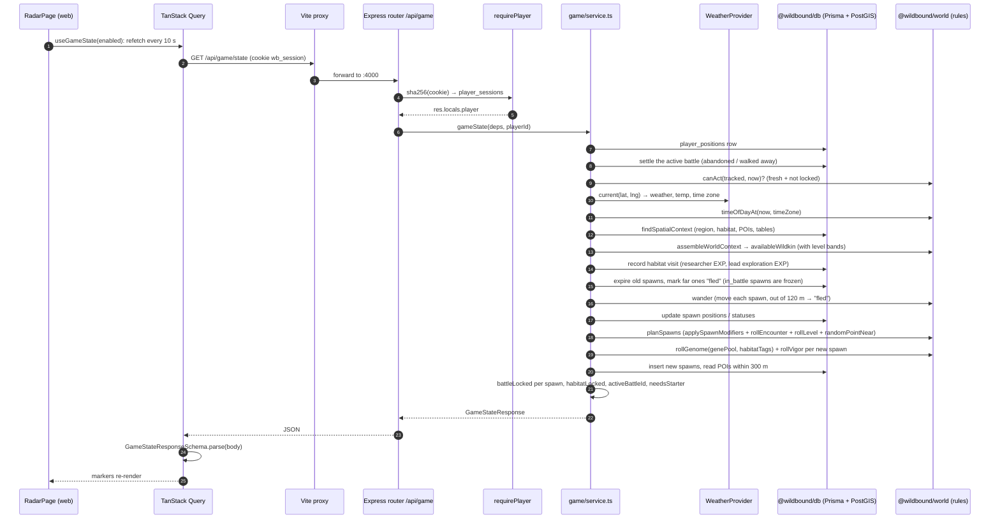
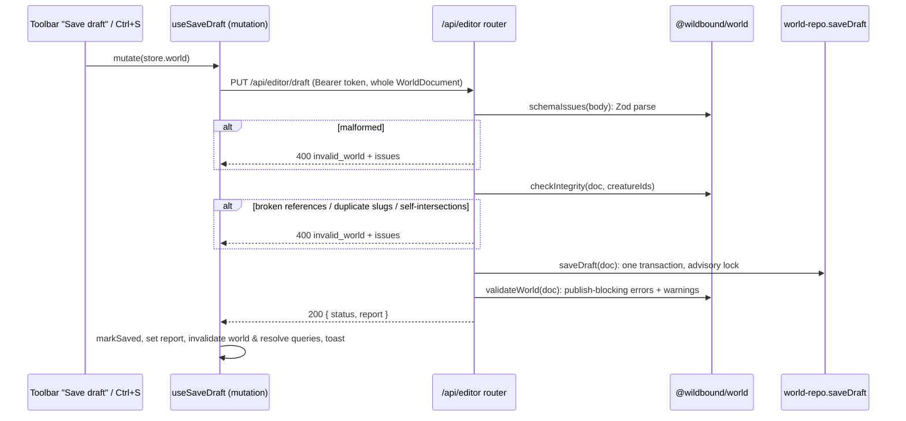

# 01 · Architecture

> **In plain English:** WILDBOUND is four programs (Map Editor, Creature Manager, game, server) plus shared code
> libraries, all in one repository. The server is the single source of truth: the browser apps only ask it questions. The game rules live in
> one small library with no database or screens, so the same rules run everywhere and are easy to test.

## Contents

- [Monorepo layout](#monorepo-layout)
- [Package dependency graph](#package-dependency-graph)
- [Runtime topology](#runtime-topology)
- [Layers of the world: real, WILDBOUND, presentation](#three-separate-representations-of-the-world)
- [Tech stack and why](#tech-stack-and-why)
- [Where the creature systems live (v0.3.0)](#where-the-creature-systems-live-v030)
- [Life of a request](#life-of-a-request)
- [Design principles (rules to keep)](#design-principles-rules-to-keep)
- [How TypeScript is wired](#how-typescript-is-wired)

## Monorepo layout

The repo is a [pnpm workspace](https://pnpm.io/workspaces) (`pnpm-workspace.yaml` lists `apps/*` and `packages/*`).
Packages import each other by name (`@wildbound/shared`), and pnpm links them locally (`"workspace:*"`).

```
wildbound/
├── apps/
│   ├── api/          @wildbound/api     Express 5 REST API (port 4000)
│   ├── editor/       @wildbound/editor  React + MapLibre Map Editor (port 5173)
│   ├── web/          @wildbound/web     React player game (port 5174)
│   └── manager/      @wildbound/manager React Creature Manager: Wildkin encyclopedia, AI assist, art (port 5175)
├── packages/
│   ├── shared/       @wildbound/shared  Zod schemas + TS types: the data contract
│   ├── world/        @wildbound/world   Pure domain rules (no DB, no React, no network), incl. the battle engine
│   ├── db/           @wildbound/db      Prisma schema, migrations, PostGIS queries, seed data
│   ├── game/         (reserved)         Future game systems (the v0.3.0 battle engine lives in world). Only a README
│   └── assets/       (reserved)         Future tile/creature asset metadata. Only a README
├── docs/             This documentation + game canon (WILDBOUND_*.docx: Wildkin Bible, First Field Survey,
│                     Biology & Ecology), which the Creature Manager's AI assistant reads as lore
├── patches/0.1.0/    The v0.1.0 brief, handovers, exercises list, Stitch mockups + DESIGN.md
├── patches/0.2.0/    The v0.2.0 brief (Creature Manager, wandering spawns)
├── patches/0.3.0/    The v0.3.0 brief (stats, genetics, battles, licenses), handovers, exercises list
├── docker/initdb/    SQL run on first DB start (creates wildbound_test)
├── docker-compose.yml  PostGIS 16-3.4 container "wildbound-db"
├── vitest.config.ts  Test projects: unit, exercises, integration
├── tsconfig.base.json  Shared strict TypeScript settings
├── .env.example      Every environment variable (copy to .env)
├── .mcp.json         PixelLab MCP server (art generation tool, dev-time only)
└── .claude/, .agents/  AI-assistant skills (shadcn). Not part of the product
```

Every package is **consumed as TypeScript source**: there is no build step for `shared`, `world` or `db`. The API runs
with `tsx` (TypeScript executor), and Vite compiles the shared packages into the browser bundles.

## Package dependency graph

Arrows mean "imports from". There are no cycles, and the arrows only point *down* toward `shared`.



| Package | May import | Must never import | Why |
|---|---|---|---|
| `shared` | `zod` only | anything else in the repo | Everyone depends on it; keep it tiny and dependency-free |
| `world` | `shared`, `@turf/turf` | `db`, React, `fetch`, Node APIs | Rules must run identically in the browser (editor preview) and on the server |
| `db` | `shared`, `world`, Prisma | Express, React | Persistence only. (`world` is used by the seed script for validation) |
| `api` | `db`, `world`, `shared`, Express | React | Server |
| `editor` | `world`, `shared` | `db` | Browser app; reads/writes only through the API |
| `web` | `shared` only | `world`, `db` | The game must not compute rules client-side: the server is authoritative |
| `manager` | `shared`, `world` | `db` | Browser app; reads/writes only through the API (`/api/manager/*`). Since v0.3.0 it uses `world` for the authoring preview ("Roll a sample" individual, stat descriptors), never for game decisions |

> ⚠️ **`apps/web` deliberately does not depend on `@wildbound/world`.** If the game client could run the encounter or
> movement rules, it would be tempting to trust its results. Keep game decisions on the server.

## Runtime topology

What runs where during development:



Key points:

- **The editor calls the API cross-origin** (`VITE_API_URL`, default `http://localhost:4000`) with a bearer token, so
  the API enables CORS for the origins in `CORS_ORIGINS` (default `:5173`, `:5174`, `:5175`).
- **The Creature Manager calls `/api/*` on its own origin** with the bearer token; its Vite server proxies to the API
  (`apps/manager/vite.config.ts`, target `API_PROXY_TARGET` or `VITE_API_URL`), so it works whatever `CORS_ORIGINS` says.
- **The game calls the API same-origin.** Vite proxies `/api/*` from `:5174` to `:4000` (`apps/web/vite.config.ts`,
  override with `API_PROXY_TARGET`). That keeps the httpOnly `wb_session` cookie first-party with no CORS involved. In
  production you would serve the game and API under one domain (or a reverse proxy) for the same reason.
- **Weather** is fetched by the server, never by the client, so a player cannot choose their own weather.
- **Groq and PixelLab** are called only by the API, only for Creature Manager requests, and only when their keys are
  set. API keys never reach a browser. The game never depends on them: art is stored in the database and served by
  `GET /api/art/wildkin/:id/:kind.png`.
- **Map tiles** are only decoration. The base map is "geographic truth" for drawing; it is never the game map.

## Three separate representations of the world

These layers are kept apart on purpose. Do not couple them.



There is **one world model**: the `WorldContext` (see [02 · World model](02-world-model.md#worldcontext-the-answer-to-what-is-here)).
The editor's Test panel, the API's game service and the future Phaser field all consume that same shape.

## Tech stack and why

| Area | Choice | Why this one | Where |
|---|---|---|---|
| Language | TypeScript 5.9 (strict, `noUncheckedIndexedAccess`) | One language end to end; shared types | everywhere |
| Runtime | Node.js ≥ 22 | Built-in `process.loadEnvFile`, `fetch`, `AbortSignal.timeout` | api, db scripts |
| Monorepo | pnpm 10 workspaces | Fast, strict, local package linking | root |
| Contracts | Zod 4 | One schema = runtime validation + TS type; used by client *and* server | `packages/shared` |
| Backend | Express 5 | Familiar; v5 forwards async errors to the error middleware | `apps/api` |
| DB | PostgreSQL 16 + PostGIS 3.4 | Real spatial queries (point-in-polygon, distances in meters) | Docker |
| DB access | Prisma 7 with `@prisma/adapter-pg` | Typed queries and migrations; raw SQL for geometry | `packages/db` |
| Frontend | React 19 + Vite 7 | Standard, fast dev server | editor, web, manager |
| Server state | TanStack Query 5 | Caching, polling, invalidation instead of hand-rolled fetch state | editor, web, manager |
| Local editor state | Zustand 5 | Small store that the imperative map can subscribe to outside React | editor |
| Forms | react-hook-form 7 + `zodResolver` | Same Zod schemas validate the form and the API | editor inspectors, web login, manager entry form |
| Styling | Tailwind CSS 4 (+ shadcn/ui in web and manager) | Utility classes with design tokens in CSS | editor, web, manager |
| Routing | React Router 7 | Route guards for login → location → game; manager pages | web, manager |
| Maps | MapLibre GL JS 5 | Open-source WebGL maps, no API key | editor, web |
| Client geometry | Turf.js 7 | Area, overlap, point-in-polygon for validation and drawing (PostGIS stays authoritative) | world, editor |
| Weather | Open-Meteo | Free, key-free current weather + time zone | api |
| AI assistant | Groq chat completions (JSON mode), default `llama-3.3-70b-versatile` | Fast, has a free tier, OpenAI-compatible; optional | api (`manager/assistant.ts`) |
| Canon reading | mammoth | Extracts text from the `.docx` canon for the assistant | api (`manager/lore.ts`) |
| Tests | Vitest 3 + supertest | Unit, exercises and real-PostGIS integration tests | root `vitest.config.ts` |
| Art | PixelLab API v2 (Pixen, the cheapest model) | Generated from the Creature Manager, stored in the DB; the game only downloads PNGs | api (`manager/art.ts`), `wildkin_art` |
| Future renderer | Phaser 3 | Top-down field view. Not started | (none yet) |

## Where the creature systems live (v0.3.0)

v0.3.0 added stats, genetics, levels and EXP, wild battles, healing and Field Registry licenses. They follow the same
split as everything else: **vocabularies, constants and Zod contracts in `shared`, pure formulas in `world`, persistence
and orchestration in `apps/api/src/game/`, screens in the apps.** Every tunable number lives in one exported object
(`GAME_RULES`, `EXP_RULES`, `BATTLE_RULES`, `RESEARCH_RULES`), so tuning after play-testing never touches logic. The
formulas and numbers are documented in [07 · Game systems](07-game-systems.md); the routes in
[04 · API reference](04-api-reference.md).



**`packages/shared/src`**

| File | What it holds |
|---|---|
| `battle.ts` | `STAT_KEYS`, `STAT_BUDGET` (300), `BaseStatsSchema`, stat descriptors and grades, vigor words; genome, alleles, `TRAIT_MODIFIERS`, gene pools (`GenePoolSchema`, `DEFAULT_GENE_POOL`); `LEVEL_MIN`/`LEVEL_MAX`, `EXP_RULES`; `APPROACHES`, `BODY_TRAITS`, `MATCHUPS` (with the field-note lines), `AttackSchema`; `STATUSES`, `STATUS_RULES`; `BATTLE_RULES`; `BattleStateSchema` (server only), `BattleActionSchema`, `BattleActionRequestSchema` (`{ turn, action }`), `BattleEventSchema`, `BattleViewSchema`, `BATTLE_END_LINES` |
| `research.ts` | `CATEGORIES`, `CATEGORY_CAPSULES`, `RESEARCH_RULES` (obedience cap, thresholds, researcher EXP amounts, rank-up grants), `obedienceCap`, `rankForLevel`, `SCANNER_DEPTH`/`scannerShows`, `LicenseRequirementSchema`, `ASSESSMENTS` (checklists as data), license and assessment views |
| `game.ts` (extended) | New `ITEMS` (category capsules), `ITEM_STACK_MAX`, `STARTER_SPECIES`/`STARTER_LEVEL`, `poiRadiusM`, spawn `level`/`hints`/`battleLocked`, `PoiViewSchema`, Registry `fieldNotes`, party and `WildkinDetailSchema` (scanner depth applied), starter, item, vet and pickup contracts |
| `world.ts` (extended) | Creature `category`, `bodyTraits`, `baseStats`, `attacks`, `genePool`; table and entry `minLevel`/`maxLevel`; habitat `licenseRequirement` (see [02](02-world-model.md)) |

**`packages/world/src`** (all randomness injected as `random: () => number`)

| File | What it does |
|---|---|
| `stats.ts` | Stats at a level from base stats, trait modifiers and vigor; grades and descriptors |
| `genetics.ts` | `rollGenome(pool, habitatTags, random)`, `rollVigor`, `phenotype`, `traitModifiers`, `inheritGenome` (breeding groundwork), `individualStats` |
| `levels.ts` | EXP curve, `levelForExp`, `applyExpGain(current, amount, cap)` (EXP beyond the cap is lost), `expCapFor`, `levelProgress` |
| `exp.ts` | EXP yields per source, rested charges, walking meter, `dayKey` |
| `battle/matchups.ts` | `traitEffect`, `matchupMultiplier` (exercise #11), `evaluateMatchup` |
| `battle/turn-order.ts` | `attackOrder` and `escapeChance` (exercise #10), `dodgeChance` |
| `battle/damage.ts` | The damage formula |
| `battle/statuses.ts` | Status durations, skips, ticking (the framework; nothing inflicts a status in 0.3.0) |
| `battle/capture.ts` | `battleCaptureChance` (exercise #12), `capsuleBonus` |
| `battle/engine.ts` | `resolveTurn(state, action, { random })`: one pure function per turn; also `pickLead`, `isUsable`, `endBattle` |
| `recovery.ts` | Lazy natural recovery `currentHp(row, maxHp, now, restless)` (exercise #13), `msUntilFull` |
| `research.ts` | Researcher EXP and its split across categories, `phenotypeRecordTraits`, `categoryPresence`, assessment progress and the "achievable in this world" clamp |
| `pickups.ts` | `rollPickup(poiType, random)` for daily POI supplies |
| `encounters.ts`, `spawning.ts` (extended) | `effectiveLevelRange`, level bands per Wildkin, `rollLevel`; `planSpawns` returns a `level` per spawn |
| `validation.ts` (extended) | The three level-range rules (see [05](05-map-editor.md#wild-levels-and-license-requirements)) |

**`apps/api/src/game`** (`routes/game.ts` stays thin and only parses input and calls these)

| File | Responsibility |
|---|---|
| `common.ts` | `GameDeps` (db, weather, clock, random, `relaxWeather`), `playerDayKey`, `insertOnce` (every "only once" rule goes through a primary key with `ON CONFLICT DO NOTHING`), `loadLicenses`/`ensureLicenses`, `requirePosition` |
| `wildkin.ts` | Loads captured Wildkin with stats, lazy HP, restless flag and EXP cap; party, lead, party and detail views (scanner depth); `grantWildkinExp` (logs to `exp_events`) |
| `views.ts` | Registry rows with field notes, spawn views (level and hints only after observing) |
| `pois.ts` | PostGIS POI lookups, `stationInRange`, `isFieldStation` |
| `battle-service.ts` | Habitat locks, starting a battle (guards), the lazy "abandoned" and "walked away" endings, `actInBattle`, battle EXP, capture |
| `research-service.ts` | Researcher EXP, observation records, matchup and phenotype records, habitat visits, Registry field knowledge, license views, assessments |
| `care-service.ts` | Item grants (stack cap) and spending, starter choice, Trail Rations, vets |
| `service.ts` (extended) | Position reports also walk the lead (walking EXP); the radar state also settles battles, records habitat visits, rolls level, genome and vigor for new spawns, and lists POIs |

## Life of a request

### A player's radar refresh (`GET /api/game/state`)

This is the busiest path in the game. It shows how the layers cooperate.



### A battle turn (`POST /api/game/battles/:id/actions`)

The battle screen sends **one action for the turn it saw**: `{ turn, action }`, where `action` is one of `attack`,
`switch`, `item` (Trail Ration), `capsule`, `escape` or `replace` (`BattleActionRequestSchema`). The server resolves the
whole turn, saves it, and answers with the new battle view plus the list of events that happened, which the client
plays back as field notes.

```mermaid
sequenceDiagram
    autonumber
    participant UI as BattlePage (web)
    participant Q as useBattleAction (TanStack Query)
    participant R as routes/game.ts
    participant B as battle-service.actInBattle
    participant E as @wildbound/world resolveTurn
    participant DB as Prisma (one transaction)

    UI->>Q: mutate({ type: "attack", attackIndex: 0 })
    Q->>R: POST /battles/:id/actions { turn: 3, action }
    R->>R: parseOr400(IdParamsSchema, BattleActionRequestSchema)
    R->>B: actInBattle(deps, playerId, id, body)
    B->>DB: load own battle (404 if not yours, 409 battle_over if ended)
    B->>B: lazy ending? (idle 10 min → abandoned; > 120 m away → escaped)
    B->>B: body.turn ≠ stored turn → 409 stale_turn { turn }
    B->>DB: item or capsule action: is there one in the satchel? (409 invalid_action)
    B->>E: resolveTurn(state, action, { random })
    E-->>B: new state, events, matchup discoveries (or invalid_action)
    B->>DB: BEGIN
    B->>DB: battles.updateMany where id, status = active, turn = 3 (count ≠ 1 → stale_turn)
    B->>DB: spend the item or capsule
    B->>DB: write party HP that changed (current_hp, hp_updated_at)
    B->>DB: matchup_records (first time only) + researcher EXP
    alt outcome reached
        B->>DB: release or capture the spawn
        B->>DB: captured: new captured_wildkin, Registry, capture EXP and records
        B->>DB: won or captured: battle EXP (rested bonus), shared EXP, exp_events
    end
    B->>DB: COMMIT
    B-->>R: { battle: BattleView, events: [...] } (battle-end event last)
    R-->>Q: JSON
    Q->>Q: setQueryData(["game","battle",id], battle)
    Q->>Q: outcome set: invalidate party, Wildkin, inventory, state, registry, licenses
    Q-->>UI: play events with 900 ms delays, then show the end screen
```

Why it is built this way:

- **Double taps and second tabs** cannot play a turn twice. The early `turn` check gives a friendly 409, and the
  `updateMany ... where turn = expected` inside the transaction is the real guard: if two requests race, only one
  matches the row. The client handles `stale_turn` by refetching the battle.
- **The engine is pure.** `resolveTurn` never touches the database, the clock or `Math.random`, so every rule (turn order,
  dodge, damage, matchups, capture, faint handling, statuses) is unit-tested with `seededRandom`. The service only loads,
  persists and awards.
- **Everything a turn changes is one transaction:** the battle row, the spent item, party HP, records, the spawn, the new
  Wildkin and every EXP event. A failure anywhere rolls all of it back.
- **"Only once" rules are primary keys,** not checks: a matchup or phenotype is recorded with `insertOnce` (insert or do
  nothing), so a race can never award researcher EXP twice. One active battle per player is a partial unique index.
- **The client sees only what it may know:** `BattleView` has the wild Wildkin's HP as a fraction, never its stats,
  genome or the capture chance.

### An editor save (`PUT /api/editor/draft`)



## Design principles (rules to keep)

These are the decisions the codebase is built around. Breaking one usually breaks something subtle.

1. **The server is authoritative.** Clients report what they observe (GPS fixes) and ask to act on things the server
   gave them. They never send "I am in habitat X" or "spawn Y at Z". → [08 · Security](08-security.md)
2. **One contract.** Every request and response has a Zod schema in `@wildbound/shared`. The API parses inputs with it
   (`parseOr400`); both clients parse responses with it. Change the schema, and TypeScript shows you every place to update.
3. **Rules are pure.** `@wildbound/world` functions take data in and return data out. Anything with side effects (DB,
   weather HTTP, clock, randomness) is passed in as an argument. That is why `createApp` takes `now` and `random`.
4. **PostGIS answers *where*, `world` decides *what it means*.** Spatial lookups are SQL; all game logic about
   tables, conditions and probabilities is TypeScript.
5. **Draft and published never mix.** Every world table is keyed by `(id, stage)` and relations include the stage.
6. **The world is data, not code.** No region, habitat or Wildkin is hard-coded in UI or logic (Wildkin are authored
   in the Creature Manager, their art is served from the database). The only code-defined catalogue is `ITEMS`
   (inventory items).
7. **Deterministic output.** Lists are sorted (by name then id, or weight then id), so tests and previews are stable.
8. **Locked data is `null`, not hidden.** The Registry API sends `null` for fields the player has not unlocked; the
   UI never receives secrets it is supposed to hide. The same goes for battles and the scanner: wild stats, genomes,
   vigor, the capture chance, unrecorded matchups and anything above the player's scanner depth are `null` or absent.
9. **Editor edits are pure functions** (`apps/editor/src/world-edit.ts`) so every edit is one undo step and unit-testable.
10. **Delete softly.** Species are retired with `deleted_at`, never removed, so players' Registry and Party history
    stays intact. Code that lists species for *new* things (spawning, pickers) uses `listCreatures(db)`; code that shows
    *existing* things (Registry, Party) uses `listCreatures(db, { includeDeleted: true })`.
11. **External AI is optional and server-side.** The assistant and art generator are interfaces injected into
    `createApp`; without keys they are `null` and the features switch off cleanly.
12. **One constants object per system.** `GAME_RULES`, `EXP_RULES`, `BATTLE_RULES`, `RESEARCH_RULES`: logic reads its
    numbers from them, so tuning is a one-line change.
13. **Multi-row writes are one interactive transaction, and every "only once" rule is a unique key** (daily pickups,
    first records, assessment completions, one active battle), so concurrent requests cannot double-award.

## How TypeScript is wired

- `tsconfig.base.json` holds the strict settings. Each package's `tsconfig.json` extends it.
- `allowImportingTsExtensions` + `noEmit`: imports include the `.ts` extension (`import { x } from "./conditions.ts"`).
  Keep that style in new files.
- `moduleResolution: "Bundler"`: packages expose `src/index.ts` directly through their `package.json` `exports`.
- `noUncheckedIndexedAccess`: `array[i]` is `T | undefined`. Code uses `!` only where the index is proven valid.
- Generated Prisma client: `packages/db/src/generated/prisma/` (gitignored, created by `pnpm install` →
  `prisma generate`).
- `pnpm typecheck` runs `tsc --noEmit` in every package in parallel.

Next: [02 · World model and data contract](02-world-model.md).
