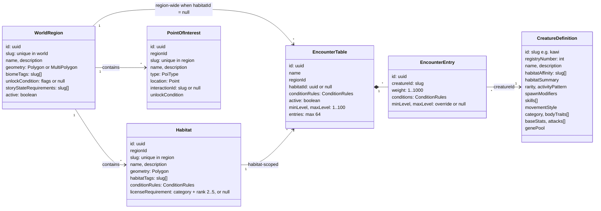
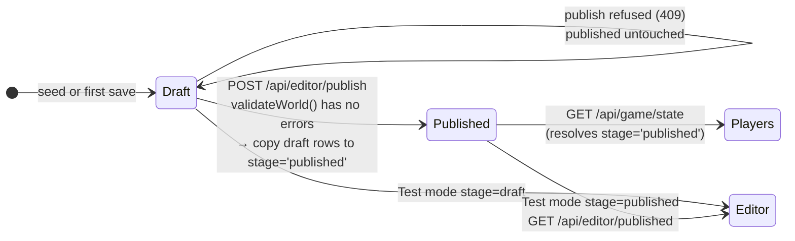

# 02 · World model and data contract

> **In plain English:** the WILDBOUND world is a document: a list of regions, habitats, points of interest and
> encounter tables. That document has exactly one agreed shape, written once in `packages/shared` and used by every
> program. The editor edits a *draft* copy; publishing copies it to the *published* copy that players see. Since v0.3.0
> encounter tables also say how strong their wild Wildkin are (a level range), habitats can be restricted to players
> with a high enough license rank, and each species carries its battle and genetics data.

## Contents

- [The entities](#the-entities)
- [Conditions](#conditions)
- [Wild levels](#wild-levels)
- [License requirements](#license-requirements)
- [Creatures (Wildkin definitions)](#creatures-wildkin-definitions)
- [Spawns: what is rolled when a Wildkin appears](#spawns-what-is-rolled-when-a-wildkin-appears)
- [The WorldDocument](#the-worlddocument)
- [Draft vs published](#draft-vs-published)
- [WorldContext: the answer to "what is here?"](#worldcontext-the-answer-to-what-is-here)
- [Player-side data](#player-side-data)
- [The shared package (`@wildbound/shared`)](#the-shared-package-wildboundshared)
- [Conventions](#conventions)

## The entities



| Entity | Meaning | Rules worth knowing |
|---|---|---|
| **WorldRegion** | A named WILDBOUND area drawn over real geography ("Mabunyi Nature Reserve") | Stored as MultiPolygon (a Polygon is normalized by `ST_Multi`). Inactive regions never resolve. If regions overlap at a point, the **smallest** wins. |
| **Habitat** | A sub-area with ecological character ("Forest Edge") | Must sit inside its region (> 50 % outside blocks publishing; > 1 % warns). Overlapping habitats are allowed; the smallest wins at a point. Its `conditionRules` gate its encounter tables. Its `habitatTags` also steer the genetics of Wildkin spawned there. An optional `licenseRequirement` makes it a restricted research zone. |
| **PointOfInterest** | A named spot ("East Research Gate") | Must be inside its region to publish. `type` is one of `gate, trail, landmark, clearing, hollow, water, research-station, other`. `interactionId` is a hook for future interactions (not used yet). |
| **EncounterTable** | Weighted list of Wildkin | `habitatId = null` ⇒ applies to the whole region. Inactive tables are ignored. An active table with no entries blocks publishing. Has a wild level range (`minLevel`, `maxLevel`, default 1 to 10). |
| **EncounterEntry** | One Wildkin in a table | Integer weight 1 to 1000 (also a DB CHECK). Its own `conditions` must pass too. Listing the same Wildkin twice warns. May override the table's level range. |
| **CreatureDefinition** | A species | Not authored in the editor: written and published in the [Creature Manager](13-creature-manager.md) (the seed species come from `packages/db/seed/creatures.json`). See [09 · Wildkin](09-wildkin-and-content.md). |

`unlockCondition` and `storyStateRequirements` exist in the model for future story gating. **They are stored and
returned, but nothing evaluates them yet** (there is no player story state).

## Conditions

```ts
// packages/shared/src/world.ts
ConditionRules = { timeOfDay: ("dawn"|"day"|"dusk"|"night")[], weather: ("clear"|"cloudy"|"rain"|"storm"|"fog")[] }
```

- **Empty list = any.** `{ timeOfDay: [], weather: [] }` always passes (`EMPTY_CONDITIONS`).
- A non-empty list must contain the current value: `{ timeOfDay: ["dawn","dusk"] }` passes only at dawn or dusk.
- Both lists must pass (AND). Within a list it is OR.

Conditions appear at three levels, and **all** must pass for an entry to be available:


The habitat gate only applies to tables scoped to that habitat. Region-wide tables skip it.
Implementation: `conditionsMatch()` in `packages/world/src/conditions.ts`, used by `evaluateEncounterTable()` and
`assembleWorldContext()`. Full algorithm in [07 · Game systems](07-game-systems.md#coordinate-resolution).

## Wild levels

Every wild Wildkin has a level (1 to 100). The level comes from the encounter table it was rolled from.

| Field | Where | Rule |
|---|---|---|
| `minLevel`, `maxLevel` | `EncounterTable` | Integers 1 to 100, `minLevel <= maxLevel`. Default for new tables (and older drafts without the fields): 1 to 10 (`DEFAULT_WILD_LEVELS`) |
| `minLevel`, `maxLevel` | `EncounterEntry` | Both set (an override) or both `null` (use the table's range). Same 1 to 100 and min <= max rules |

- **Effective range** of an entry = its override when both bounds are set, else its table's range
  (`effectiveLevelRange(table, entry)` in `packages/world/src/encounters.ts`). The resolved entries in a `WorldContext`
  carry the effective `minLevel`/`maxLevel`.
- **Level bands.** The same species can come from several applicable tables (a habitat table and a region-wide one),
  each with its own range. So each `availableWildkin` item has `levelBands: { minLevel, maxLevel, weight }[]`, one band
  per available entry, with the entry's weight (`combineAvailableWildkin`).
- **The level roll.** `planSpawns` first picks the species by its (modified) weight, then `rollLevel(bands, random)`
  picks one of that species' bands by weight and a level uniformly within it. Each `PlannedSpawn` has a `level`.
- **Captured Wildkin keep the level** they were caught at.
- **Validation** (shown in the editor's Issues panel; see [05](05-map-editor.md#wild-levels-and-license-requirements)):

| Code | Severity | When |
|---|---|---|
| `invalid-level-range` | Error: blocks **saving** (schema) | min > max, outside 1 to 100, or only one override bound set |
| `level-range-crosses-band` | Warning | A table or effective entry range crosses a license band (every 20 levels: 1 to 20, 21 to 40, ...), e.g. 18 to 24 |
| `region-without-entry-habitat` | Warning | An active region with no active table that has an entry starting at level 10 or below (`ENTRY_HABITAT_MAX_LEVEL`) |

Seed world (`packages/db/seed/mabunyi.world.json`): Forest Edge 2 to 6, Sunbreak Clearing 3 to 8, Silayan Creekside 4
to 10 with Riverkin overridden to 5 to 12. All within license rank 1 (cap 20), so a new player can battle everything in
Mabunyi.

## License requirements

```ts
// packages/shared/src/research.ts
LicenseRequirement = { category: "aerial" | "aquatic" | "terrestrial" | "verdant", rank: 2 | 3 | 4 | 5 } | null
```

A habitat's `licenseRequirement` (default `null`, open to everyone) makes it a **restricted research zone**. Rank 1 is
what every player has, so a requirement starts at 2. For a player whose rank in that category is below the requirement:

- spawns still appear there and can be **observed** (observing is how the license is earned);
- **battle and capture are refused** (409 `habitat_locked`, with `details.requirement`); the spawn's `battleLocked` and
  the radar's `habitatLocked` read "Restricted research zone: Aquatic rank 3".

The lock is checked against the habitat a spawn was created in (`spawns.habitat_id`), from the **published** world. It is
authored in the editor's Habitat inspector and published like every other habitat field. The seed world has no locked
habitats; [05](05-map-editor.md#locking-a-habitat-for-testing) explains how to lock one for testing.

## Creatures (Wildkin definitions)

```ts
CreatureDefinition = {
  id: "kawi",                       // slug, primary key, used for icon/sprite file names
  registryNumber: 1,                // "No. 001", unique
  name: "Kawi",
  description: "...",
  habitatAffinity: ["canopy", ...], // tags (informational today)
  habitatSummary: "Forest canopy and bright woodland edges.",
  rarity: "common" | "uncommon" | "rare" | "TBD",
  activityPattern: "diurnal" | "nocturnal" | "crepuscular" | "cathemeral" | "sheltering_by_day" | "seasonal" | "TBD",
  spawnModifiers: { weather: { rain: 0.5, storm: 0 }, timeOfDay: { night: 0.1 } },  // missing key = ×1
  skills: [{ name, description, canon: "established" | "proposed" }],                // ≤ 8
  movementStyle: "forager",         // how spawns wander on the radar (v0.2.0)

  // v0.3.0: battle and genetics (authored in the Creature Manager, section 9)
  category: "aerial",               // aerial | aquatic | terrestrial | verdant | "TBD"; decides the license
  bodyTraits: ["feathered"],        // 1 or 2 of plated, feathered, soft-bodied, leafy, slick
  baseStats: { hp: 65, atk: 75, def: 50, spd: 110 },  // each 10..150, sum exactly 300 (STAT_BUDGET); null = not set
  attacks: [                        // 0..2 placeholder attacks (replaced by the 0.4.0 skill system)
    { name: "Peck", approach: "pierce", power: 40, description: "...", canon: "proposed", priority: false },
  ],
  genePool: {
    build:       { pAllele: 0.4, byHabitatTag: [] },   // chance of each L allele (Large)
    temperament: { pAllele: 0.4, byHabitatTag: [] },   // chance of each W allele (Wary)
    marking: { name: "Pale-tailed", description: "...", frequency: 0.05 },  // or null; frequency 0..0.2
  },
}
```

`habitatSummary`, `rarity`, `activityPattern`, `spawnModifiers`, `skills` and every v0.3.0 field have defaults in the
schema (`category: "TBD"`, `bodyTraits: []`, `baseStats: null`, `attacks: []`, `genePool: DEFAULT_GENE_POOL` with 0.5 /
0.5 and no marking), so the `Json` columns read from the DB are re-parsed with `CreatureDefinitionSchema` in
`listCreatures()` to restore shape.

| Field | Meaning |
|---|---|
| `category` | Which Field Registry license covers the species. `"TBD"` cannot be published |
| `bodyTraits` | Anatomy that is weak to or resists certain attack approaches (`MATCHUPS` in `packages/shared/src/battle.ts`). 1 or 2 to publish |
| `baseStats` | The species' stat shape. The four values must add up to exactly 300, so rarity never means strength |
| `attacks` | One or two placeholder attacks, each with one `approach` (strike, pierce, crush, surge, toxin, spore) and `power` 30 to 60. Kept separate from `skills`, which stays the Registry's proposed skill list |
| `genePool` | Allele odds for Build (S/L) and Temperament (B/W), each with optional per-habitat-tag overrides (the first matching tag in authored order wins), and an optional recessive cosmetic marking variant |

The Creature Manager refuses to publish a species without a category, at least one body trait, `baseStats` summing to 300
and at least one attack (see [13](13-creature-manager.md)). The values for the five seed species are in
[09 · Wildkin and content](09-wildkin-and-content.md); the formulas that use them are in [07](07-game-systems.md).

## Spawns: what is rolled when a Wildkin appears

Each wild Wildkin is an individual, decided **once, on the server, when it spawns** (`gameState` in
`apps/api/src/game/service.ts`), and stored on the `spawns` row:

| Column | Rolled with | Notes |
|---|---|---|
| `level` | `rollLevel(levelBands)` inside `planSpawns` | From the species' level bands at that spot (above) |
| `genome` | `rollGenome(creature.genePool, habitat.habitatTags, random)` | Two alleles each for Build, Temperament and Marking. The habitat's tags select the allele odds, which is how "larger Kantar deeper in mature woodland" works. A spawn outside any habitat (region-wide tables only) uses the defaults |
| `vigor` | `rollVigor(random)` | 0 to 5 per stat, uniform, not inherited |

The phenotype (Small/Typical/Large, Bold/Steady/Wary, marked or not) is derived from the genome on read and never
stored. The player learns about a spawn only by observing it: the level, a Build hint, a marking hint and (from license
rank 2 in its category) a Temperament hint. Stats, genome and vigor of wild Wildkin are never sent to the client. When
the spawn is captured, its level, genome and vigor are copied to the new `captured_wildkin` row.

## The WorldDocument

```ts
WorldDocument = { regions: WorldRegion[]; habitats: Habitat[]; pois: PointOfInterest[]; encounterTables: EncounterTable[] }
```

- It is **flat** (four arrays linked by ids), not nested. That keeps edits simple and makes saving "replace everything".
- Limits: 200 regions, 2000 habitats, 5000 POIs, 2000 tables, 64 entries per table (`WorldDocumentSchema`).
- `EMPTY_WORLD` is the empty document.
- The editor loads it with `GET /api/editor/world`, edits it in memory, and sends the **whole thing** back with
  `PUT /api/editor/draft`.

## Draft vs published



| Question | Answer |
|---|---|
| Who writes `draft`? | Only `saveDraft()` (editor `PUT /draft`) and the seed script |
| Who writes `published`? | Only `publishDraft()` |
| Who reads `published`? | The game (`gameState` → `resolveWorldContext(stage:"published")`), `GET /api/editor/published`, editor Test mode |
| Can a draft row reference a published row? | No. Every FK includes `stage` |
| Is there version history? | Only a `publications` row per publish (version number, time, counts). Content history is deferred |
| What does "unpublished changes" mean? | `world_meta.draft_updated_at > latest publications.published_at` (`getWorldStatus()`) |
| What is published, the editor's memory or the saved draft? | The **saved** draft. The editor's Publish button saves first if there are unsaved edits |

## WorldContext: the answer to "what is here?"

`WorldContext` (`packages/shared/src/api.ts`) is what resolving a coordinate returns. It is the single world model all
consumers share.

```jsonc
{
  "coordinate": { "lat": 14.6518, "lng": 121.0444 },
  "stage": "published",
  "version": 3,                              // published version, null for draft
  "environment": { "timeOfDay": "day", "weather": "clear", "tags": ["tropical-forest","urban-park","clearing","flowering","sunny"] },
  "region":  { "id": "...", "slug": "mabunyi-nature-reserve", "name": "Mabunyi Nature Reserve", "biomeTags": [...], ... },
  "habitat": { "id": "...", "slug": "sunbreak-clearing", "name": "Sunbreak Clearing", "conditionsMet": true, "licenseRequirement": null, ... },
  "nearbyPois": [ { "name": "Sunbreak", "type": "clearing", "distanceMeters": 0, ... } ],
  "encounterTables": [
    { "name": "Sunbreak Clearing Encounters", "scope": "habitat", "applicable": true,
      "entries": [ { "creatureId": "lumae", "weight": 60, "available": true, "probability": 0.6, "minLevel": 3, "maxLevel": 8 }, ... ] }
  ],
  "availableWildkin": [
    { "creatureId": "lumae", "name": "Lumae", "weight": 60, "probability": 0.6,
      "levelBands": [ { "minLevel": 3, "maxLevel": 8, "weight": 60 } ] }, ...
  ]
}
```

- `environment.tags` = region biome tags + habitat tags (de-duplicated). They are semantic hints for presentation.
- `encounterTables[].entries[].probability` is the share **within that table**.
- `availableWildkin[].probability` is the share **across all applicable tables** (weights summed per creature).
- `entries[].minLevel`/`maxLevel` are the **effective** range; `availableWildkin[].levelBands` keeps one band per entry.
- No region ⇒ `region: null` and empty arrays, still HTTP 200.

Players never receive a `WorldContext`; the game API reduces it to `{ region: {id,name}, habitat: {id,name,licenseRequirement} }`
plus server-placed spawns and nearby POIs. Only the editor can resolve arbitrary coordinates.

## Player-side data

Player data is not part of the world document. It lives in its own tables (see [03 · Database](03-database.md)) and
its API shapes are in `packages/shared/src/game.ts`:

| Schema | Used for |
|---|---|
| `GAME_RULES` | The radar and movement numbers: spawn radius 120 m, interact radius 60 m, POI radius 300 m, max 6 active spawns, spawn TTL 10 min, 40 m/s max speed, 200 m max accuracy, 25 m jitter slack, 3 strikes, 2 min lock, 2 min stale position, 30-day sessions. Battle, EXP and license numbers live in `BATTLE_RULES`, `EXP_RULES` and `RESEARCH_RULES` |
| `ITEMS`, `ITEM_STACK_MAX`, `STARTER_INVENTORY` | Item catalogue (field-capsule, the four category capsules, trail-ration, field-notebook), the 30-per-item cap, and what new players get (10 Field Capsules / 3 Trail Rations / 1 Field Notebook) |
| `STARTER_SPECIES`, `STARTER_LEVEL` | Kawi, Mimu or Kantar at level 5 for a new player |
| `LoginRequestSchema` | Username: 3 to 20 chars, letters/digits/underscore |
| `PositionReportSchema` → `PositionResponseSchema` | GPS fix in, verdict out (`accepted`, `first-fix`, `low-accuracy`, `too-fast`, `locked`) |
| `GameStateResponseSchema` | Radar payload: position, lock, environment, region, habitat (with its license requirement), `habitatLocked`, spawns, POIs, `activeBattleId`, `needsStarter`, `hasUsableWildkin` |
| `SpawnViewSchema` | One spawn as the player sees it (distance, inRange, observed, expiresAt, `inBattle`, and after observing `level` and `hints`; `battleLocked` reason) |
| `PoiViewSchema` | A nearby POI with distance, `inRange`, `services` (`pickup`, `vet`, `assessment`) and `pickedUpToday` |
| `RegistryEntryViewSchema`, `RegistryResponseSchema` | Registry rows with locked fields as `null`; `fieldNotes` once observed, `statShape` once captured |
| `ObserveResponseSchema` | Observe result (Registry entry, revealed spawn, researcher EXP, the lead's EXP). `CaptureResponseSchema` was removed in v0.3.0: capture is a battle action |
| `InventoryResponseSchema`, `PartyResponseSchema`, `CapturedWildkinViewSchema` | Satchel, party (exactly 6 slots, `null` = empty) + storage; each Wildkin with level, HP fraction, condition, restless reason, lead flag, marking |
| `WildkinDetailSchema` | One captured Wildkin with scanner depth applied (hidden fields `null`) |
| Starter, item use, vet, pickup schemas | `StarterRequestSchema`, `UseItemRequestSchema`, `VetResponseSchema`, `PickupResponseSchema`, ... |
| `UpdatePartyRequestSchema`, `RenameWildkinRequestSchema` | Exercise endpoints (#7, #5) |

Battle contracts (`BattleActionRequestSchema`, `BattleViewSchema`, `BattleEventSchema`, ...) are in `battle.ts`, license
contracts (`LicenseViewSchema`, `AssessmentResponseSchema`, ...) in `research.ts`.

## The shared package (`@wildbound/shared`)

| File | Contents |
|---|---|
| `constants.ts` | Vocabularies (`TIME_OF_DAY`, `WEATHER`, `POI_TYPES`, `RARITIES`, `ACTIVITY_PATTERNS`, `PUBLICATION_STAGES`), suggested tags, limits (`ENCOUNTER_WEIGHT_*`, `NEARBY_POI_*`), `WORLD_SRID = 4326` |
| `geo.ts` | GeoJSON schemas: `PositionSchema` (`[lng, lat]`), `LinearRingSchema` (closed, ≥ 3 distinct vertices), `PolygonSchema`, `MultiPolygonSchema`, `AreaGeometrySchema`, `PointSchema`; helpers `polygonsOf`, `toMultiPolygon` |
| `world.ts` | `SlugSchema`, `TagListSchema`, `ConditionRulesSchema`, `SpawnModifiersSchema`, `CreatureDefinitionSchema`, the four entity schemas, `DEFAULT_WILD_LEVELS`, `levelRangeProblems`, `WorldDocumentSchema` (which refines level ranges) |
| `battle.ts` | Stats, genetics, levels and `EXP_RULES`, approaches, body traits and `MATCHUPS`, attacks, statuses, `BATTLE_RULES`, the battle state, actions, events and views (v0.3.0) |
| `research.ts` | Categories, `RESEARCH_RULES`, scanner depth, `LicenseRequirementSchema`, assessments and license views (v0.3.0) |
| `wildkin.ts` | The Creature Manager's encyclopedia entry schemas |
| `api.ts` | Validation issues and reports, editor responses, `ResolveQuerySchema` (coerces query strings), `WorldContextSchema` (with `LevelBandSchema`), `PublishedWorldResponseSchema`, `ApiErrorSchema` (with optional `details`) |
| `game.ts` | Everything player-facing (above) |
| `index.ts` | Re-exports all of the above |

Each schema exports its inferred type (`export type Habitat = z.infer<typeof HabitatSchema>`). Use the type for
compile-time checks and the schema for runtime parsing.

```ts
import { HabitatSchema, type Habitat } from "@wildbound/shared";
const habitat: Habitat = HabitatSchema.parse(json); // throws ZodError with readable messages if wrong
```

## Conventions

| Convention | Detail |
|---|---|
| Coordinates | GeoJSON order **`[longitude, latitude]`**, WGS84 (SRID 4326). Objects use `{ lat, lng }` explicitly named |
| Ids | World entities: UUID (generated by the editor with `crypto.randomUUID()`). Creatures: slug (`"kawi"`). Items: slug key of `ITEMS` |
| Slugs | Lowercase letters, digits, single hyphens, ≤ 64 chars (`SLUG_PATTERN`). Region slugs unique in the world; habitat and POI slugs unique within their region |
| Tags | Slugs, unique per list, ≤ 32 |
| Names | Trimmed, 1 to 120 chars |
| Timestamps on the wire | ISO 8601 strings |
| Distances | Meters |
| Probabilities | 0..1 floats |
| Levels | Integers 1 to 100 (`LEVEL_MIN`, `LEVEL_MAX`) |

Next: [03 · Database](03-database.md).
