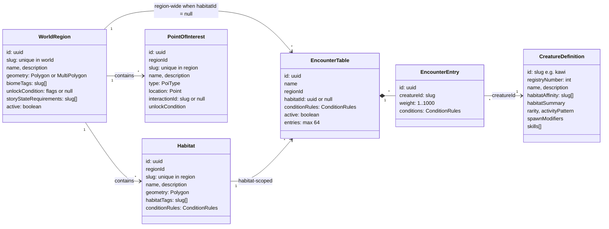
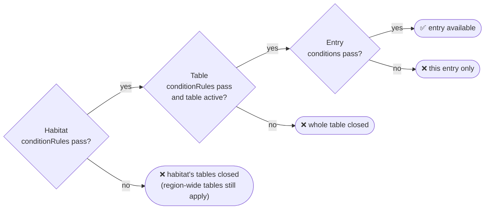
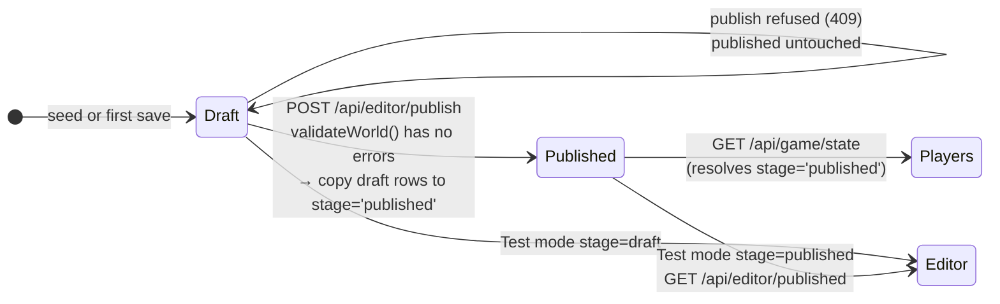

# 02 · World model and data contract

> **In plain English:** the WILDBOUND world is a document: a list of regions, habitats, points of interest and
> encounter tables. That document has exactly one agreed shape, written once in `packages/shared` and used by every
> program. The editor edits a *draft* copy; publishing copies it to the *published* copy that players see.

## Contents

- [The entities](#the-entities)
- [Conditions](#conditions)
- [Creatures (Wildkin definitions)](#creatures-wildkin-definitions)
- [The WorldDocument](#the-worlddocument)
- [Draft vs published](#draft-vs-published)
- [WorldContext: the answer to "what is here?"](#worldcontext-the-answer-to-what-is-here)
- [Player-side data](#player-side-data)
- [The shared package (`@wildbound/shared`)](#the-shared-package-wildboundshared)
- [Conventions](#conventions)

## The entities



| Entity | Meaning | Rules worth knowing |
|---|---|---|
| **WorldRegion** | A named WILDBOUND area drawn over real geography ("Mabunyi Nature Reserve") | Stored as MultiPolygon (a Polygon is normalized by `ST_Multi`). Inactive regions never resolve. If regions overlap at a point, the **smallest** wins. |
| **Habitat** | A sub-area with ecological character ("Forest Edge") | Must sit inside its region (> 50 % outside blocks publishing; > 1 % warns). Overlapping habitats are allowed; the smallest wins at a point. Its `conditionRules` gate its encounter tables. |
| **PointOfInterest** | A named spot ("East Research Gate") | Must be inside its region to publish. `type` is one of `gate, trail, landmark, clearing, hollow, water, research-station, other`. `interactionId` is a hook for future interactions (not used yet). |
| **EncounterTable** | Weighted list of Wildkin | `habitatId = null` ⇒ applies to the whole region. Inactive tables are ignored. An active table with no entries blocks publishing. |
| **EncounterEntry** | One Wildkin in a table | Integer weight 1–1000 (also a DB CHECK). Its own `conditions` must pass too. Listing the same Wildkin twice warns. |
| **CreatureDefinition** | A species | Not authored in the editor: seeded from `packages/db/seed/creatures.json`. See [09 · Wildkin](09-wildkin-and-content.md). |

`unlockCondition` and `storyStateRequirements` exist in the model for future story gating. **They are stored and
returned, but nothing evaluates them yet** (there is no player story state).

## Conditions

```ts
// packages/shared/src/world.ts
ConditionRules = { timeOfDay: ("dawn"|"day"|"dusk"|"night")[], weather: ("clear"|"cloudy"|"rain"|"storm"|"fog")[] }
```

- **Empty list = any.** `{ timeOfDay: [], weather: [] }` always passes (`EMPTY_CONDITIONS`).
- A non-empty list must contain the current value: `{ timeOfDay: ["dawn","dusk"] }` passes only at dawn or dusk.
- Both lists must pass (AND). Within a list it is OR.

Conditions appear at three levels, and **all** must pass for an entry to be available:



The habitat gate only applies to tables scoped to that habitat. Region-wide tables skip it.
Implementation: `conditionsMatch()` in `packages/world/src/conditions.ts`, used by `evaluateEncounterTable()` and
`assembleWorldContext()`. Full algorithm in [07 · Game systems](07-game-systems.md#coordinate-resolution).

## Creatures (Wildkin definitions)

```ts
CreatureDefinition = {
  id: "kawi",                       // slug, primary key, used for icon/sprite file names
  registryNumber: 1,                // "No. 001", unique
  name: "Kawi",
  description: "...",
  habitatAffinity: ["canopy", ...], // tags (informational today)
  habitatSummary: "Forest canopy and bright woodland edges.",
  rarity: "common" | "uncommon" | "rare" | "TBD",
  activityPattern: "diurnal" | "nocturnal" | "crepuscular" | "cathemeral" | "sheltering_by_day" | "seasonal" | "TBD",
  spawnModifiers: { weather: { rain: 0.5, storm: 0 }, timeOfDay: { night: 0.1 } },  // missing key = ×1
  skills: [{ name, description, canon: "established" | "proposed" }],                // ≤ 8
}
```

`habitatSummary`, `rarity`, `activityPattern`, `spawnModifiers` and `skills` have defaults in the schema, so the
`Json` columns read from the DB are re-parsed with `CreatureDefinitionSchema` in `listCreatures()` to restore shape.

## The WorldDocument

```ts
WorldDocument = { regions: WorldRegion[]; habitats: Habitat[]; pois: PointOfInterest[]; encounterTables: EncounterTable[] }
```

- It is **flat** (four arrays linked by ids), not nested. That keeps edits simple and makes saving "replace everything".
- Limits: 200 regions, 2000 habitats, 5000 POIs, 2000 tables, 64 entries per table (`WorldDocumentSchema`).
- `EMPTY_WORLD` is the empty document.
- The editor loads it with `GET /api/editor/world`, edits it in memory, and sends the **whole thing** back with
  `PUT /api/editor/draft`.

## Draft vs published



| Question | Answer |
|---|---|
| Who writes `draft`? | Only `saveDraft()` (editor `PUT /draft`) and the seed script |
| Who writes `published`? | Only `publishDraft()` |
| Who reads `published`? | The game (`gameState` → `resolveWorldContext(stage:"published")`), `GET /api/editor/published`, editor Test mode |
| Can a draft row reference a published row? | No. Every FK includes `stage` |
| Is there version history? | Only a `publications` row per publish (version number, time, counts). Content history is deferred |
| What does "unpublished changes" mean? | `world_meta.draft_updated_at > latest publications.published_at` (`getWorldStatus()`) |
| What is published, the editor's memory or the saved draft? | The **saved** draft. The editor's Publish button saves first if there are unsaved edits |

## WorldContext: the answer to "what is here?"

`WorldContext` (`packages/shared/src/api.ts`) is what resolving a coordinate returns. It is the single world model all
consumers share.

```jsonc
{
  "coordinate": { "lat": 14.6518, "lng": 121.0444 },
  "stage": "published",
  "version": 3,                              // published version, null for draft
  "environment": { "timeOfDay": "day", "weather": "clear", "tags": ["tropical-forest","urban-park","clearing","flowering","sunny"] },
  "region":  { "id": "...", "slug": "mabunyi-nature-reserve", "name": "Mabunyi Nature Reserve", "biomeTags": [...], ... },
  "habitat": { "id": "...", "slug": "sunbreak-clearing", "name": "Sunbreak Clearing", "conditionsMet": true, ... },
  "nearbyPois": [ { "name": "Sunbreak", "type": "clearing", "distanceMeters": 0, ... } ],
  "encounterTables": [
    { "name": "Sunbreak Clearing Encounters", "scope": "habitat", "applicable": true,
      "entries": [ { "creatureId": "lumae", "weight": 60, "available": true, "probability": 0.6 }, ... ] }
  ],
  "availableWildkin": [ { "creatureId": "lumae", "name": "Lumae", "weight": 60, "probability": 0.6 }, ... ]
}
```

- `environment.tags` = region biome tags + habitat tags (de-duplicated). They are semantic hints for presentation.
- `encounterTables[].entries[].probability` is the share **within that table**.
- `availableWildkin[].probability` is the share **across all applicable tables** (weights summed per creature).
- No region ⇒ `region: null` and empty arrays, still HTTP 200.

Players never receive a `WorldContext`; the game API reduces it to `{ region: {id,name}, habitat: {id,name} }` plus
server-placed spawns. Only the editor can resolve arbitrary coordinates.

## Player-side data

Player data is not part of the world document. It lives in its own tables (see [03 · Database](03-database.md)) and
its API shapes are in `packages/shared/src/game.ts`:

| Schema | Used for |
|---|---|
| `GAME_RULES` | Every tunable number: spawn radius 120 m, interact radius 60 m, max 6 active spawns, spawn TTL 10 min, 40 m/s max speed, 200 m max accuracy, 25 m jitter slack, 3 strikes, 2 min lock, 2 min stale position, 30-day sessions |
| `ITEMS`, `STARTER_INVENTORY` | Item catalogue (field-capsule, trail-ration, field-notebook) and what new players get (10 / 3 / 1) |
| `LoginRequestSchema` | Username: 3–20 chars, letters/digits/underscore |
| `PositionReportSchema` → `PositionResponseSchema` | GPS fix in, verdict out (`accepted`, `first-fix`, `low-accuracy`, `too-fast`, `locked`) |
| `GameStateResponseSchema` | Radar payload: position, lock, environment, region, habitat, spawns |
| `SpawnViewSchema` | One spawn as the player sees it (distance, inRange, observed, expiresAt) |
| `RegistryEntryViewSchema`, `RegistryResponseSchema` | Registry rows with locked fields as `null` |
| `ObserveResponseSchema`, `CaptureResponseSchema` | Action results |
| `InventoryResponseSchema`, `PartyResponseSchema` | Satchel, party (exactly 6 slots, `null` = empty) + storage |
| `UpdatePartyRequestSchema`, `RenameWildkinRequestSchema` | Exercise endpoints |

## The shared package (`@wildbound/shared`)

| File | Contents |
|---|---|
| `constants.ts` | Vocabularies (`TIME_OF_DAY`, `WEATHER`, `POI_TYPES`, `RARITIES`, `ACTIVITY_PATTERNS`, `PUBLICATION_STAGES`), suggested tags, limits (`ENCOUNTER_WEIGHT_*`, `NEARBY_POI_*`), `WORLD_SRID = 4326` |
| `geo.ts` | GeoJSON schemas: `PositionSchema` (`[lng, lat]`), `LinearRingSchema` (closed, ≥ 3 distinct vertices), `PolygonSchema`, `MultiPolygonSchema`, `AreaGeometrySchema`, `PointSchema`; helpers `polygonsOf`, `toMultiPolygon` |
| `world.ts` | `SlugSchema`, `TagListSchema`, `ConditionRulesSchema`, `SpawnModifiersSchema`, `CreatureDefinitionSchema`, the four entity schemas, `WorldDocumentSchema` |
| `api.ts` | Validation issues and reports, editor responses, `ResolveQuerySchema` (coerces query strings), `WorldContextSchema`, `PublishedWorldResponseSchema`, `ApiErrorSchema` |
| `game.ts` | Everything player-facing (above) |
| `index.ts` | Re-exports all of the above |

Each schema exports its inferred type (`export type Habitat = z.infer<typeof HabitatSchema>`). Use the type for
compile-time checks and the schema for runtime parsing.

```ts
import { HabitatSchema, type Habitat } from "@wildbound/shared";
const habitat: Habitat = HabitatSchema.parse(json); // throws ZodError with readable messages if wrong
```

## Conventions

| Convention | Detail |
|---|---|
| Coordinates | GeoJSON order **`[longitude, latitude]`**, WGS84 (SRID 4326). Objects use `{ lat, lng }` explicitly named |
| Ids | World entities: UUID (generated by the editor with `crypto.randomUUID()`). Creatures: slug (`"kawi"`). Items: slug key of `ITEMS` |
| Slugs | Lowercase letters, digits, single hyphens, ≤ 64 chars (`SLUG_PATTERN`). Region slugs unique in the world; habitat and POI slugs unique within their region |
| Tags | Slugs, unique per list, ≤ 32 |
| Names | Trimmed, 1–120 chars |
| Timestamps on the wire | ISO 8601 strings |
| Distances | Meters |
| Probabilities | 0..1 floats |

Next: [03 · Database](03-database.md).
