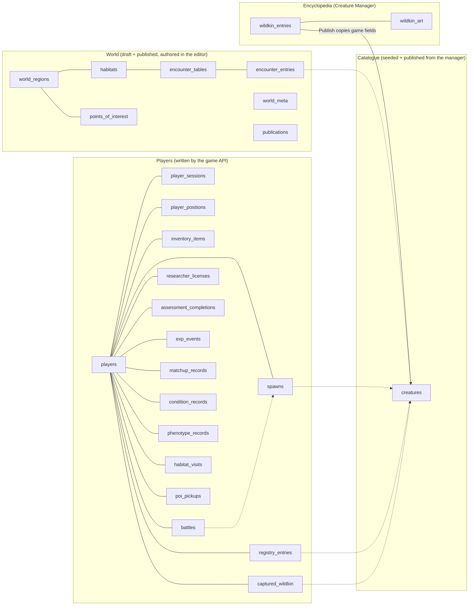
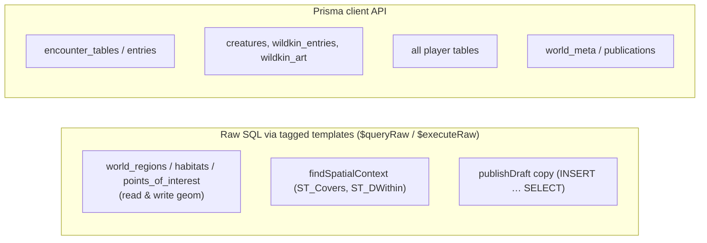
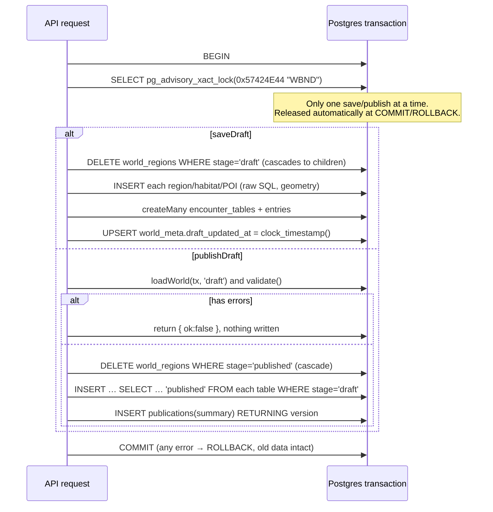
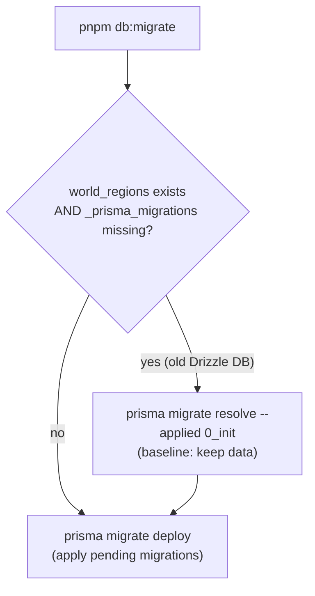

# 03 · Database

> **In plain English:** everything the game remembers (the world, the Wildkin catalogue and encyclopedia, every
> player's progress) is stored in a PostgreSQL database. A plug-in called PostGIS lets the database understand shapes on a map, so it can
> answer "which habitat contains this GPS point?" quickly and correctly.
>
> Since v0.3.0 it also remembers each Wildkin's level, genes and health, the battle a player is in, their four Field
> Registry licenses, every EXP gain (with where it came from) and the research notes they have made. Rules like "one
> battle at a time" or "each matchup is recorded once" are enforced by the database itself, so two quick taps can never
> break them.

## Contents

- [Overview](#overview)
- [Entity-relationship diagram](#entity-relationship-diagram)
- [Tables](#tables)
- [Constraints that protect the data](#constraints-that-protect-the-data)
- [Prisma and PostGIS together](#prisma-and-postgis-together)
- [The repository functions (`world-repo.ts`)](#the-repository-functions-world-repots)
- [The encyclopedia functions (`wildkin-repo.ts`)](#the-encyclopedia-functions-wildkin-repots)
- [Saving and publishing: transactions and locks](#saving-and-publishing-transactions-and-locks)
- [Spatial queries explained](#spatial-queries-explained)
- [Migrations](#migrations)
- [Seed data](#seed-data)
- [Test database](#test-database)
- [How to change the schema](#how-to-change-the-schema)

## Overview

| Item | Value |
|---|---|
| Engine | PostgreSQL 16 + PostGIS 3.4 (`postgis/postgis:16-3.4` in `docker-compose.yml`) |
| Databases | `wildbound` (dev), `wildbound_test` (integration tests, created by `docker/initdb/01-test-db.sql`) |
| Access library | Prisma 7, `prisma-client` generator, `@prisma/adapter-pg` driver adapter (pool of 10) |
| Schema file | `packages/db/prisma/schema.prisma` |
| Migrations | `packages/db/prisma/migrations/{0_init,1_players,2_wildkin_manager,3_registry_description,4_registry_number_reuse,5_battle_system}/migration.sql` |
| Generated client | `packages/db/src/generated/prisma/` (gitignored; `pnpm install` runs `prisma generate`) |
| Entry point | `createDb(url)` → `{ db: PrismaClient, url, close }` in `packages/db/src/client.ts` |
| SRID | 4326 (WGS84 lon/lat) for every geometry |

## Entity-relationship diagram

```mermaid
erDiagram
    creatures {
        text id PK "slug, e.g. kawi"
        int registry_number "unique among non-deleted"
        text name
        text description
        text_arr habitat_affinity
        text habitat_summary
        text rarity
        text activity_pattern
        jsonb spawn_modifiers
        jsonb skills
        text movement_style "still|skulker|forager|roamer|darter"
        text category "aerial|aquatic|terrestrial|verdant|TBD"
        text_arr body_traits "1-2 of BODY_TRAITS"
        jsonb base_stats "hp,atk,def,spd sum 300; null = not authored"
        jsonb attacks "placeholder attacks"
        jsonb gene_pool "allele odds + marking variant"
        timestamptz deleted_at "soft delete"
    }
    wildkin_entries {
        text id PK "canonical id = creatures.id once published"
        int registry_number "unique among non-deleted"
        text name
        enum status "draft | published"
        jsonb content "every other Bible field"
        timestamptz updated_at
        timestamptz published_at
        timestamptz deleted_at "soft delete"
    }
    wildkin_art {
        text entry_id PK "FK wildkin_entries, CASCADE"
        text kind PK "icon | sprite"
        bytea png
        text prompt
        text model
        timestamptz created_at
    }
    world_regions {
        uuid id PK
        enum stage PK "draft | published"
        text slug "unique per stage"
        text name
        geometry geom "MultiPolygon 4326, GiST"
        text_arr biome_tags
        jsonb unlock_condition
        text_arr story_state_requirements
        bool active
    }
    habitats {
        uuid id PK
        enum stage PK
        uuid region_id FK
        text slug "unique per stage+region"
        geometry geom "Polygon 4326, GiST"
        text_arr habitat_tags
        jsonb condition_rules
        jsonb license_requirement "null or category+rank 2..5"
    }
    points_of_interest {
        uuid id PK
        enum stage PK
        uuid region_id FK
        text slug "unique per stage+region"
        text type
        geometry geom "Point 4326, GiST"
        text interaction_id
        jsonb unlock_condition
    }
    encounter_tables {
        uuid id PK
        enum stage PK
        uuid region_id FK
        uuid habitat_id FK "null = region-wide"
        text name
        jsonb condition_rules
        bool active
        int min_level "CHECK 1..100, <= max"
        int max_level "CHECK 1..100"
    }
    encounter_entries {
        uuid id PK
        enum stage PK
        uuid table_id FK
        text creature_id FK
        int weight "CHECK 1..1000"
        jsonb conditions
        int position
        int min_level "null = table range"
        int max_level "null = table range"
    }
    world_meta {
        int id PK "always 1"
        timestamptz draft_updated_at
    }
    publications {
        int version PK "autoincrement"
        timestamptz published_at
        jsonb summary "counts"
    }
    players {
        uuid id PK
        text username UK "lowercased"
        text display_name
        timestamptz last_seen_at
        int rested_charges "CHECK 0..10"
        timestamptz last_battle_exp_at
        real walk_meter_m
        text walk_meter_day
    }
    player_sessions {
        uuid id PK
        uuid player_id FK
        text token_hash UK "sha256"
        timestamptz expires_at
    }
    player_positions {
        uuid player_id PK
        float lat
        float lng
        float accuracy_m
        timestamptz recorded_at
        int strikes
        timestamptz locked_until
        text time_zone
    }
    spawns {
        uuid id PK
        uuid player_id FK
        text creature_id FK
        float lat
        float lng
        uuid region_id
        uuid habitat_id
        text time_of_day
        text weather
        enum status "active|captured|fled|expired|in_battle"
        timestamptz observed_at
        int level "CHECK 1..100"
        jsonb genome
        jsonb vigor
        float heading "radians, wandering"
        timestamptz moved_at "last wandering step"
        timestamptz expires_at
    }
    registry_entries {
        uuid player_id PK
        text creature_id PK
        timestamptz first_observed_at
        int times_observed
        timestamptz first_captured_at
        int times_captured
    }
    inventory_items {
        uuid player_id PK
        text item_id PK
        int quantity "CHECK >= 0"
    }
    captured_wildkin {
        uuid id PK
        uuid player_id FK
        text creature_id FK
        text nickname
        int party_slot "0..5 or null, unique per player"
        timestamptz captured_at
        int level "CHECK 1..100"
        int exp "CHECK >= 0"
        jsonb genome "NOT NULL"
        jsonb vigor "NOT NULL"
        int current_hp "CHECK >= 0, at hp_updated_at"
        timestamptz hp_updated_at
        int caught_level
        uuid caught_habitat_id
        text caught_at_time_of_day
        text caught_at_weather
    }
    battles {
        uuid id PK "gen_random_uuid()"
        uuid player_id FK "one active per player"
        uuid spawn_id FK
        text kind "wild"
        enum status "active|won|lost|captured|escaped|abandoned"
        int turn
        jsonb state "BattleState, server only"
        timestamptz created_at
        timestamptz updated_at
    }
    researcher_licenses {
        uuid player_id PK
        text category PK "aerial|aquatic|terrestrial|verdant"
        int rank "CHECK 1..5"
        int exp "researcher EXP, CHECK >= 0"
    }
    assessment_completions {
        uuid player_id PK
        text category PK
        int rank PK "rank reached, CHECK 2..5"
        timestamptz completed_at
    }
    exp_events {
        uuid id PK "gen_random_uuid()"
        uuid player_id FK
        text track "wildkin|researcher"
        uuid captured_wildkin_id FK "SET NULL"
        text category "researcher track"
        text source
        int amount "CHECK > 0"
        text day_key "player-local YYYY-MM-DD"
        jsonb meta
        timestamptz created_at
    }
    matchup_records {
        uuid player_id PK
        text body_trait PK
        text approach PK
        text effect "weak|resist"
        timestamptz recorded_at
    }
    condition_records {
        uuid player_id PK
        text creature_id PK
        text kind PK "time_of_day|weather"
        text value PK
        timestamptz recorded_at
    }
    phenotype_records {
        uuid player_id PK
        text creature_id PK
        text trait PK "small|large|bold|wary|marking"
        timestamptz recorded_at
    }
    habitat_visits {
        uuid player_id PK
        uuid habitat_id PK "no FK"
        text day_key PK
        bool first_ever
        timestamptz visited_at
    }
    poi_pickups {
        uuid player_id PK
        uuid poi_id PK "no FK"
        text day_key PK
        jsonb items
        timestamptz collected_at
    }

    world_regions ||--o{ habitats : "region_id+stage"
    world_regions ||--o{ points_of_interest : "region_id+stage"
    world_regions ||--o{ encounter_tables : "region_id+stage"
    habitats |o--o{ encounter_tables : "habitat_id+stage"
    encounter_tables ||--o{ encounter_entries : "table_id+stage"
    creatures ||--o{ encounter_entries : "RESTRICT"
    players ||--o{ player_sessions : cascade
    players ||--o| player_positions : cascade
    players ||--o{ spawns : cascade
    players ||--o{ registry_entries : cascade
    players ||--o{ inventory_items : cascade
    players ||--o{ captured_wildkin : cascade
    players ||--o{ battles : cascade
    spawns ||--o{ battles : cascade
    players ||--|{ researcher_licenses : "cascade, 4 rows"
    players ||--o{ assessment_completions : cascade
    players ||--o{ exp_events : cascade
    captured_wildkin |o--o{ exp_events : "SET NULL"
    players ||--o{ matchup_records : cascade
    players ||--o{ condition_records : cascade
    players ||--o{ phenotype_records : cascade
    players ||--o{ habitat_visits : cascade
    players ||--o{ poi_pickups : cascade
    creatures ||--o{ condition_records : cascade
    creatures ||--o{ phenotype_records : cascade
    creatures ||--o{ spawns : ""
    creatures ||--o{ registry_entries : ""
    creatures ||--o{ captured_wildkin : "RESTRICT"
    wildkin_entries ||--o{ wildkin_art : cascade
    wildkin_entries |o..o| creatures : "publish copies game fields (same id, no FK)"
```



The schema splits into four groups:



## Tables

### Catalogue

| Table | Prisma model | Notes |
|---|---|---|
| `creatures` | `Creature` | One row per species: the **game data** the editor and the game read. `spawn_modifiers` and `skills` are JSON validated by Zod on read. `movement_style` (default `forager`) drives [wandering](07-game-systems.md#wandering-spawns-experimental). Written by `pnpm db:seed` (`upsertCreatures`) and by **Publish** in the Creature Manager. `deleted_at` marks a **soft-deleted** species (it stops spawning and disappears from editor pickers). A plain `DELETE` of a creature that encounter entries or captured Wildkin reference is **blocked** (RESTRICT); the Creature Manager's permanent delete (`purgeWildkin`) removes those rows first, in one transaction. Battle fields (v0.3.0): `category` (default `TBD`), `body_traits` (`text[]`, default empty), `base_stats` (JSON `{ hp, atk, def, spd }` summing to 300, `NULL` until authored; the game then falls back to 75/75/75/75), `attacks` (JSON list of placeholder attacks, default `[]`) and `gene_pool` (JSON allele odds and marking variant, default 0.5/0.5 and no marking). All are validated by Zod on read (`CreatureDefinitionSchema`) |

### Encyclopedia (Creature Manager)

| Table | Prisma model | Notes |
|---|---|---|
| `wildkin_entries` | `WildkinEntry` | One Wildkin Bible entry per species, authored in the [Creature Manager](13-creature-manager.md). `id`, `registry_number` (unique among non-deleted entries) and `name` are columns; every other field (prose, tags, spawn modifiers, skills, movement style…) is in `content` JSON, validated by `WildkinEntryInputSchema` from `@wildbound/shared` on every read. `status` is `draft` until the first publish; "unpublished changes" means `updated_at > published_at`. `deleted_at` = soft delete |
| `wildkin_art` | `WildkinArt` | PNG bytes per entry and kind (`icon` 64 px, `sprite` 128 px; `CHECK kind IN ('icon','sprite')`), plus the PixelLab `prompt` and `model` used (`"imported"` for the hand-made seed art). PK `(entry_id, kind)`, so regenerating replaces the old image. Served publicly at `GET /api/art/wildkin/:id/:kind.png` |

There is deliberately **no foreign key** between `wildkin_entries` and `creatures`. They share the id by convention:
publishing an entry upserts `creatures` with the same id (`publishWildkin`). Registry numbers are checked across **both**
tables, so a seeded creature without an entry still "owns" its number.

### World (authored, two stages)

| Table | Prisma model | Notes |
|---|---|---|
| `world_regions` | `WorldRegion` | PK `(id, stage)`. `geom` is `Unsupported("geometry(MultiPolygon,4326)")`. Unique `(stage, slug)` |
| `habitats` | `Habitat` | PK `(id, stage)`. FK `(region_id, stage)` → regions, ON DELETE CASCADE. Unique `(stage, region_id, slug)`. `license_requirement` (v0.3.0, JSON, nullable): `{ "category": "aquatic", "rank": 3 }` makes the habitat a restricted research zone (players below that rank can observe but not battle there); `NULL` = open to everyone |
| `points_of_interest` | `PointOfInterest` | PK `(id, stage)`. Point geometry. Unique `(stage, region_id, slug)` |
| `encounter_tables` | `EncounterTable` | PK `(id, stage)`. FKs to region and (optional) habitat, both with stage, CASCADE. `min_level` / `max_level` (v0.3.0, NOT NULL, default 1 and 10): the wild level range of every entry in the table. `CHECK encounter_tables_level_range`: both 1 to 100 and `min_level <= max_level` |
| `encounter_entries` | `EncounterEntry` | PK `(id, stage)`. `position` keeps the authored order. `min_level` / `max_level` (v0.3.0, nullable): an override of the table's range for this one Wildkin. `CHECK encounter_entries_level_range`: both `NULL`, or both 1 to 100 with `min_level <= max_level` |
| `world_meta` | `WorldMeta` | Single row (id = 1). `draft_updated_at` set on each save with `clock_timestamp()` |
| `publications` | `Publication` | One row per publish. `version` autoincrements; `summary` holds counts |

### Players

| Table | Prisma model | Notes |
|---|---|---|
| `players` | `Player` | `username` is lowercased (the login key); `display_name` is as typed. v0.3.0: `rested_charges` (stored rested-bonus charges, `CHECK 0..10`; more accrue lazily since `last_battle_exp_at`, see [07](07-game-systems.md)), `last_battle_exp_at` (null until the first battle EXP), `walk_meter_m` and `walk_meter_day` (the walking-EXP meter: metres counted on the player-local day `walk_meter_day`) |
| `player_sessions` | `PlayerSession` | Only the **sha256 hash** of the cookie token is stored. Expires after 30 days |
| `player_positions` | `PlayerPosition` | One row per player: the **server's** idea of where they are. Only `reportPosition` (via `checkMovement`) writes it, plus `environmentAt` updating `time_zone` |
| `spawns` | `Spawn` | One Wildkin placed for one player. Index `(player_id, status, expires_at)` serves the radar query. Records the environment at spawn time. `lat`/`lng` change as the spawn wanders; `heading` (radians, null until the first step) and `moved_at` (last wandering step) belong to [wandering](07-game-systems.md#wandering-spawns-experimental). v0.3.0: `level` (rolled from the encounter entry's level band, `CHECK 1..100`), `genome` and `vigor` (JSON, rolled at spawn time with the habitat's tags; NOT NULL with the typical defaults below). Status `in_battle` (new `spawn_status` value) means a battle with it is running: it neither wanders nor expires, and a second request cannot observe or battle it |
| `registry_entries` | `RegistryEntry` | PK `(player_id, creature_id)`. Existence = observed; `first_captured_at` not null = captured |
| `inventory_items` | `InventoryItem` | PK `(player_id, item_id)`. Item definitions live in code (`ITEMS`) |
| `captured_wildkin` | `CapturedWildkin` | One captured individual. `party_slot` 0 to 5 or `NULL` (storage). Unique `(player_id, party_slot)`; Postgres allows many NULLs, so storage is unlimited. v0.3.0 columns below |
| `battles` | `Battle` | v0.3.0. One wild battle. `status` is the `battle_status` enum (`active`, `won`, `lost`, `captured`, `escaped`, `abandoned`); `turn` counts resolved turns (the stale-turn guard updates `WHERE turn = expected`); `state` is the server-only engine state (`BattleStateSchema`: both sides' stats, HP, attacks, statuses), never sent to the client as is. `kind` is `wild` (friendly NPC battles come in 0.4.0). FKs to `players` and `spawns`, both CASCADE. Index `(player_id, status)`. The partial unique index `battles_one_active_per_player` allows **one active battle per player** |
| `researcher_licenses` | `ResearcherLicense` | v0.3.0. PK `(player_id, category)`: one Field Registry license per category, so every player has exactly four rows (created at login by `ensureLicenses`, backfilled by the migration). `rank` 1 to 5 (default 1), `exp` = cumulative researcher EXP in that category. `CHECK`s: rank range, exp non-negative, category one of `aerial`, `aquatic`, `terrestrial`, `verdant` |
| `assessment_completions` | `AssessmentCompletion` | v0.3.0. One passed assessment. PK `(player_id, category, rank)` with `rank` = the rank reached (`CHECK 2..5`), so each rank-up can only happen once |
| `exp_events` | `ExpEvent` | v0.3.0. Every EXP gain, on either `track` (`wildkin` or `researcher`). `source` is one of `WILDKIN_EXP_SOURCES` (`battle`, `battle-shared`, `walking`, `observation`, `exploration`, `capture`) or `RESEARCHER_EXP_SOURCES` (`first-observation`, `repeat-observation`, `first-capture`, `repeat-capture`, `condition-record`, `matchup-record`, `phenotype-record`, `habitat-first-visit`, `habitat-daily-visit`). `amount` is what was **actually** gained (`CHECK > 0`: a Wildkin at its license cap gains nothing and nothing is logged). `captured_wildkin_id` (wildkin track; `ON DELETE SET NULL`), `category` (researcher track), `day_key` (player-local `YYYY-MM-DD`), `meta` (e.g. `creatureId`, `battleId`). Daily caps are counted from this log. Index `(player_id, day_key, source)` |
| `matchup_records` | `MatchupRecord` | v0.3.0. A matchup discovered in battle, **per body trait** (it applies to every species with that trait). PK `(player_id, body_trait, approach)`; `effect` is `weak` or `resist` (`CHECK`) |
| `condition_records` | `ConditionRecord` | v0.3.0. First observation of a species at a time of day or in a weather. PK `(player_id, creature_id, kind, value)`; `kind` is `time_of_day` or `weather` (`CHECK`). FK to `creatures` CASCADE |
| `phenotype_records` | `PhenotypeRecord` | v0.3.0. First time the player saw a species showing a phenotype. PK `(player_id, creature_id, trait)`; `trait` is `small`, `large`, `bold`, `wary` or `marking` (`CHECK`). FK to `creatures` CASCADE |
| `habitat_visits` | `HabitatVisit` | v0.3.0. PK `(player_id, habitat_id, day_key)`: one row per player, habitat and day; `first_ever` marks the first visit to that habitat. **No FK** to `habitats` (their key is `(id, stage)` and the draft is rewritten on every save) |
| `poi_pickups` | `PoiPickup` | v0.3.0. A daily POI search (exercise #14). PK `(player_id, poi_id, day_key)`: one per player, POI and day. `items` is the JSON loot. No FK to `points_of_interest` (same reason) |

`captured_wildkin` columns added in v0.3.0:

| Column | Type | Meaning |
|---|---|---|
| `level` | int, NOT NULL, default 5 | 1 to 100 (`CHECK`). Kept in sync with `exp` and clamped by the license cap |
| `exp` | int, NOT NULL, default 125 | Total EXP (`CHECK >= 0`). A Wildkin caught at level L starts with `totalExpForLevel(L)` (125 for level 5) |
| `genome` | JSON, **NOT NULL**, default typical | `{ "build": ["S","L"], "temperament": ["B","W"], "marking": ["+","+"] }` (heterozygous, unmarked) |
| `vigor` | JSON, **NOT NULL**, default average | `{ "hp": 2, "atk": 2, "def": 2, "spd": 2 }` (each 0 to 5) |
| `current_hp` | int, NOT NULL | HP at `hp_updated_at` (`CHECK >= 0`). Natural recovery is added lazily on read (`currentHp` in `@wildbound/world`), so nothing ticks in the background |
| `hp_updated_at` | timestamptz, NOT NULL, default now | When `current_hp` was written. Reset when a restless Wildkin starts cooperating after a rank-up, so it does not heal for the time it was frozen |
| `caught_level` | int, nullable | Level at capture |
| `caught_habitat_id`, `caught_at_time_of_day`, `caught_at_weather` | nullable | Where and in what conditions it was caught (null for the starter and for Wildkin caught before v0.3.0) |

`genome` and `vigor` are NOT NULL on both `spawns` and `captured_wildkin` (the brief allowed nullable; a typical default
is simpler for every reader). Rows that existed before v0.3.0 get the typical genome and average vigor.

## Constraints that protect the data

The validation in code is the first line of defence; these database rules are the backstop.

| Constraint | Where defined | Protects against |
|---|---|---|
| `CHECK (ST_IsValid(geom))` on regions and habitats | `0_init/migration.sql` | Self-intersecting or broken polygons |
| `encounter_entries_weight_range CHECK (weight BETWEEN 1 AND 1000)` | `0_init` | Out-of-range weights |
| Composite FKs including `stage` | `0_init` | Draft rows pointing at published rows |
| Unique slugs per stage (and region) | `0_init` | Duplicate slugs |
| `creatures_registry_number_positive` | `1_players` | Bad Registry numbering |
| `inventory_items_quantity_non_negative CHECK (quantity >= 0)` | `1_players` | Spending capsules you don't have (even under races) |
| `captured_wildkin_party_slot_range CHECK (party_slot IS NULL OR BETWEEN 0 AND 5)` + unique `(player_id, party_slot)` | `1_players` | Two Wildkin in one slot, slot 6+ |
| `player_positions_lat_range`, `_lng_range` | `1_players` | Impossible coordinates |
| `ON DELETE CASCADE` from `players` | `1_players` | Orphaned player data when a player is deleted |
| `wildkin_art_kind_check`, `ON DELETE CASCADE` art → entry | `2_wildkin_manager` | Unknown art kinds; orphaned art |
| Partial unique `registry_number` on `creatures` and `wildkin_entries` (`WHERE deleted_at IS NULL`) | `4_registry_number_reuse` | Two live Wildkin with one number (a deleted one may share it) |
| Partial unique index `battles_one_active_per_player` on `battles(player_id) WHERE status = 'active'` | `5_battle_system` | Two battles at once, even from two simultaneous requests |
| `encounter_tables_level_range`, `encounter_entries_level_range` | `5_battle_system` | Levels outside 1 to 100, min above max, an entry override with only one end |
| `spawns_level_range`, `captured_wildkin_level_range` (1 to 100), `captured_wildkin_exp_non_negative`, `captured_wildkin_current_hp_non_negative` | `5_battle_system` | Impossible levels, EXP or HP |
| `researcher_licenses_rank_range` (1 to 5), `_exp_non_negative`, `_category_known` | `5_battle_system` | Unknown categories, ranks beyond 5 |
| `assessment_completions_rank_range` (2 to 5) | `5_battle_system` | A completion for rank 1 or 6+ |
| `exp_events_track_known`, `exp_events_amount_positive` | `5_battle_system` | Unknown tracks; zero or negative gains in the log |
| `matchup_records_effect_known`, `condition_records_kind_known`, `phenotype_records_trait_known` | `5_battle_system` | Unknown record values |
| `players_rested_charges_range` (0 to 10) | `5_battle_system` | More rested charges than `EXP_RULES.restedMaxCharges` |

### "Only once" rules

Every rule of the form "this can happen only once" is backed by a primary key or unique index, never by "check, then
insert" alone (two quick taps could both pass the check). The API inserts these rows with `createMany(..., skipDuplicates: true)`
(`insertOnce` in `apps/api/src/game/common.ts`, which is `INSERT ... ON CONFLICT DO NOTHING`), so a duplicate simply
inserts nothing and never aborts the surrounding transaction; where a duplicate must be refused, the API catches Prisma's
`P2002` and answers 409.

| Rule | Backed by |
|---|---|
| One active battle per player | `battles_one_active_per_player` (a racing second start answers 409 `battle_in_progress`) |
| One action per battle turn | `UPDATE battles ... WHERE turn = expected` (the loser answers 409 `stale_turn`) |
| Each rank-up once | PK `assessment_completions (player_id, category, rank)` (plus `UPDATE ... WHERE rank = current`) |
| Four licenses per player | PK `researcher_licenses (player_id, category)` |
| Each matchup recorded (and rewarded) once per body trait | PK `matchup_records (player_id, body_trait, approach)` |
| Each species' time of day / weather recorded once | PK `condition_records (player_id, creature_id, kind, value)` |
| Each species' phenotype recorded once | PK `phenotype_records (player_id, creature_id, trait)` |
| One habitat visit reward per habitat and day | PK `habitat_visits (player_id, habitat_id, day_key)` |
| One POI search per POI and day | PK `poi_pickups (player_id, poi_id, day_key)` |
| One starter per player | Unique `(player_id, party_slot)`: the starter goes into slot 0 (a racing second choice answers 409 `already_has_wildkin`) |

The API's error handler (`apps/api/src/errors.ts`) maps the Postgres error codes to HTTP: `23514` (check), `XX000`/`22023`
(PostGIS invalid geometry) → 400 `invalid_geometry`; `23505` (unique) → 409 `conflict`; `23503` (FK) → 400 `invalid_reference`.

## Prisma and PostGIS together

Prisma has no geometry type. The project uses both styles side by side:



- Geometry columns are `Unsupported(...)` in `schema.prisma`: they exist in migrations, but the generated client can't
  read or write them, so `prisma.worldRegion.findMany()` would simply not include `geom`.
- Spatial SQL uses **tagged templates**: `` db.$queryRaw`SELECT ... WHERE id = ${id}::uuid` ``. Every `${}` becomes a
  bound parameter, never string concatenation, so it is safe from SQL injection. SQL fragments are composed with
  `Prisma.sql\`...\``.
- Helpers in `world-repo.ts`:
  - `geomFromGeoJson(g)` → `ST_SetSRID(ST_GeomFromGeoJSON($json), 4326)`
  - `json(v)` → `$text::jsonb` (or SQL `NULL` for `null`)
  - `textArray(v)` → `$arr::text[]`
  - `stageSql(s)` → `$s::publication_stage`
- Reads use `ST_AsGeoJSON(geom)` and `JSON.parse` to get GeoJSON back.
- `Executor = PrismaClient | Prisma.TransactionClient`, so repo functions work inside or outside a transaction.

## The repository functions (`world-repo.ts`)

| Function | Does | Used by |
|---|---|---|
| `listCreatures(db, { includeDeleted? })` | Creatures ordered by registry number, re-parsed with Zod. Soft-deleted species are left out unless `includeDeleted: true` (Registry, Party, observe and saving drafts use that) | API everywhere |
| `upsertCreatures(db, list)` | Insert or update creatures by id (with the battle fields; a null `baseStats` is written as SQL `NULL`) | seed, tests |
| `loadWorld(db, stage)` | Full `WorldDocument` for a stage (raw SQL for spatial tables, Prisma for tables), including habitat license requirements and table/entry level ranges | editor GET, publish, seed |
| `getWorldStatus(db)` | Draft/publish timestamps, version, `hasUnpublishedChanges` | editor |
| `saveDraft(db, doc)` | Replace the whole draft (transaction + advisory lock) | `PUT /draft`, seed |
| `publishDraft(db, validate)` | Validate the saved draft and copy to published atomically | `POST /publish`, seed `--publish` |
| `findSpatialContext(db, {stage, lat, lng, radiusMeters})` | Region, habitat, nearby POIs, applicable tables and published version | `resolveWorldContext` |

## The encyclopedia functions (`wildkin-repo.ts`)

| Function | Does | Used by |
|---|---|---|
| `listWildkin(db, deleted)` | Summaries (`deleted`: `exclude` / `include` / `only`), ordered by registry number | `GET /api/manager/wildkin` |
| `getWildkin(db, id)` | One full `WildkinEntry` (columns + `content` + status + art info) | manager routes |
| `createWildkin(db, data)` | Insert a draft. 409 `conflict` if the id exists as an entry **or** a creature, or the registry number is taken | `POST /api/manager/wildkin` |
| `updateWildkin(db, data)` | Replace the entry (id is immutable). Refused for deleted entries | `PUT /api/manager/wildkin/:id` |
| `publishWildkin(db, id)` | Check `publishIssues` (the `PUBLISH_REQUIRED_FIELDS`, plus since v0.3.0 the battle fields in `PUBLISH_BATTLE_CHECKS`: a category, at least one body trait, base stats summing to exactly 300, at least one attack; issue codes `required` and `battle-<field>`), then upsert `creatures` with `creatureFromEntry(entry)` (clearing its `deleted_at`) and mark the entry published, in one transaction | `POST …/publish` |
| `softDeleteWildkin` / `restoreWildkin` | Set / clear `deleted_at` on the entry **and** the creature with the same id; restore moves to the next free registry number if its own was taken | `DELETE …`, `POST …/restore` |
| `wildkinUsage` / `purgeWildkin` | Count / delete everything referencing a species (encounter entries, Registry records, captures, spawns), then the creature and the entry (art cascades) | `GET …/usage`, `DELETE …?permanent=1` |
| `wildkinStats(db)` | Dashboard counts and `nextRegistryNumber` (max over entries and creatures + 1) | `GET /api/manager/stats` |
| `saveWildkinArt` / `loadWildkinArt` | Upsert / read PNG bytes (`load` returns null for deleted entries) | art routes, seed |
| `seedWildkinEntries(db, list)` | Insert entries that do not exist yet (never overwrites authored work); marked published when the creature already exists | seed |
| `creatureFromEntry(data)` | The game projection: `description` = registry description, `habitatAffinity` = habitat tags, plus rarity, activity, modifiers, skills, movement style and the battle fields (category, body traits, base stats, attacks, gene pool) | publish |
| `backfillBattleFields(db, list)` | v0.3.0: fills the battle fields into existing entries from the seed data, only where a field is absent or still at its default; does not touch `updated_at` | seed |

`WildkinRepoError` codes map to HTTP in `apps/api/src/routes/manager.ts`: `not_found` 404, `conflict` 409, `deleted`
409, `publish_incomplete` 400. The full flow is in [13 · Creature Manager](13-creature-manager.md#encyclopedia-vs-creatures).

## Saving and publishing: transactions and locks



- Transactions use `{ timeout: 60_000, maxWait: 10_000 }` because large worlds take more than Prisma's 5 s default.
- `clock_timestamp()` (not `now()`) so a publish right after a save in the same test still has a later timestamp.
- Because save **deletes then reinserts**, a failed insert (e.g. invalid geometry) rolls back and the previous draft
  survives. The integration test "rejects self-intersecting geometry and leaves the previous draft intact" proves it.

## Spatial queries explained

`findSpatialContext` runs these (simplified):

```sql
-- point = ST_SetSRID(ST_MakePoint(lng, lat), 4326)

-- 1. Region: the smallest active region that covers the point (boundary counts as inside)
SELECT ... FROM world_regions
WHERE stage = $stage AND active AND ST_Covers(geom, point)
ORDER BY ST_Area(geom::geography) ASC, id ASC LIMIT 1;

-- 2. Habitat: the smallest habitat of that region covering the point
SELECT ... FROM habitats
WHERE stage = $stage AND region_id = $region AND ST_Covers(geom, point)
ORDER BY ST_Area(geom::geography) ASC, id ASC LIMIT 1;

-- 3. Nearby POIs of that region, in meters, nearest first, max 25
SELECT ..., ST_Distance(geom::geography, point::geography) AS distance_meters
FROM points_of_interest
WHERE stage = $stage AND region_id = $region AND ST_DWithin(geom::geography, point::geography, $radius)
ORDER BY distance_meters, id LIMIT 25;

-- 4. Encounter tables (Prisma): active, this region, habitatId IS NULL or = the habitat
```

| PostGIS function | Plain meaning |
|---|---|
| `ST_Covers(a, b)` | "Is b inside a, edges included?" |
| `::geography` | Treat lon/lat as points on the Earth so areas and distances come out in m² / m |
| `ST_Area` | Area (used to prefer the smaller, more specific shape) |
| `ST_DWithin(a, b, r)` | "Is a within r meters of b?" Uses the GiST index |
| `ST_Distance` | Distance in meters |
| `ST_IsValid` | "Is this a legal polygon?" |
| `ST_Multi` | Turn a Polygon into a MultiPolygon (regions are stored as MultiPolygon) |

The **GiST indexes** on every `geom` column make "which shapes contain this point" fast even with many shapes.

## Migrations

| Migration | Contents |
|---|---|
| `0_init` | `CREATE EXTENSION postgis`; the world tables, enums, composite keys, GiST indexes, `ST_IsValid` and weight CHECKs. Identical to the old Drizzle schema |
| `1_players` | Registry columns on `creatures` (backfills `registry_number` alphabetically, then `NOT NULL`), `spawn_status` enum, all player tables, hand-written CHECKs |
| `2_wildkin_manager` | v0.2.0: `wildkin_entry_status` enum, `wildkin_entries`, `wildkin_art` (+ kind CHECK), `creatures.movement_style` (default `forager`) and `creatures.deleted_at`, `spawns.heading` and `spawns.moved_at` |
| `3_registry_description` | v0.2.0: fills the new `registryDescription` in `wildkin_entries.content` from `creatures.description` (or the identity line for drafts) |
| `4_registry_number_reuse` | v0.2.0: registry numbers unique only among non-deleted rows: partial unique indexes `creatures_registry_number_live_key` and `wildkin_entries_registry_number_live_key` (`WHERE deleted_at IS NULL`) replace the plain unique indexes |
| `5_battle_system` | v0.3.0: `battle_status` enum and `in_battle` added to `spawn_status`; battle fields on `creatures`; level ranges on `encounter_tables` / `encounter_entries`; `habitats.license_requirement`; level, genome and vigor on `spawns`; level, EXP, genome, vigor, HP and capture details on `captured_wildkin`; rested and walking columns on `players`; the new tables `battles`, `researcher_licenses`, `assessment_completions`, `exp_events`, `matchup_records`, `condition_records`, `phenotype_records`, `habitat_visits`, `poi_pickups`; DB-side `gen_random_uuid()` defaults for `battles.id` and `exp_events.id`; the partial unique index and CHECKs above; backfills (below) |

What `5_battle_system` does to existing data (generated with `prisma migrate diff`, then edited by hand):

1. **Active spawns expire.** `UPDATE spawns SET status = 'expired' WHERE status = 'active'`: spawns from before genetics
   have no level, genome or vigor worth keeping, so new ones are rolled on the next radar poll.
2. **Every existing player gets four rank 1 licenses** (`INSERT ... SELECT ... CROSS JOIN` the four categories,
   `ON CONFLICT DO NOTHING`).
3. **Existing captured Wildkin become level 5** (EXP 125) with the typical genome and average vigor (the column
   defaults), `caught_level = 5`, and full HP for their species at level 5:
   `round((floor(base.hp × 2 × 5 / 100) + 5 + 10) × (1 + 2 / 100))`. Base HP comes from the creature row when it has
   stats, else the v0.3.0 seed value for the five opening Wildkin (Kawi 65, Mimu 70, Lumae 100, Kantar 70, Riverkin 85),
   else 75. Then the `current_hp` default is dropped (new rows must set it).
4. **`pnpm db:seed` finishes the job:** `clampCapturedHp` (`packages/db/src/player-repo.ts`) lowers any `current_hp`
   above the real maximum once the species' actual base stats are written, and `backfillBattleFields` fills the battle
   fields into encyclopedia entries authored before v0.3.0 (only fields still missing or at their default).

> Note: `ALTER TYPE spawn_status ADD VALUE 'in_battle'` runs inside the migration's transaction, so no statement in the
> migration uses the new value (Postgres allows that only after commit).

`runMigrations(url)` (`packages/db/src/migrate.ts`):



Set `PRISMA_MIGRATE_VERBOSE=1` to see Prisma's own output. `pnpm db:migrate --test` targets `DATABASE_URL_TEST`.

## Seed data

`pnpm db:seed` (`packages/db/src/scripts/seed.ts`):

| Flag | Effect |
|---|---|
| *(none)* | Upsert the 5 Wildkin into `creatures`; insert their encyclopedia entries and art if missing; save the Mabunyi sample world as the draft **only if the draft is empty** |
| `--force` | Overwrite the current draft with the sample world |
| `--publish` | Also publish (fails with a readable list if validation errors exist) |
| `--creatures` | Creatures (plus their encyclopedia entries and art) only |

Encyclopedia seeding (v0.2.0):

- `packages/db/seed/wildkin.json` holds the five Wildkin Bible entries. `seedWildkinEntries` inserts only the ones that
  are **missing**, so edits made in the Creature Manager survive a re-seed.
- The hand-made PixelLab art in `apps/web/public/wildkin/{icons,sprites}/<id>.png` is imported into `wildkin_art`
  (prompt `"imported"`) when an entry has no art of that kind yet.

> ⚠️ `creatures` rows of the five seed Wildkin **are** overwritten from `creatures.json` on every `pnpm db:seed`. If you
> changed Kawi's game fields in the manager, publish it again after seeding (the encyclopedia entry still has your
> version).

Since v0.3.0 the seed also carries the five species' battle data (category, body traits, base stats, attacks, gene
pool; PROPOSED values) in both `creatures.json` and `wildkin.json`, and the Mabunyi tables have wild level ranges. After
upserting creatures it runs `clampCapturedHp` and `backfillBattleFields` (see [Migrations](#migrations)).

Seed files are validated with the shared schemas (`seed-data.ts`) and the sample world with `checkIntegrity` before
saving. Contents are described in [09 · Wildkin and world content](09-wildkin-and-content.md).

`packages/db/src/scripts/cli.ts` turns common setup errors (DB not running, bad credentials, missing DB, missing tables)
into one-line messages instead of stack traces.

## Test database

`@wildbound/db/testing`:

- `openTestDb()` requires `DATABASE_URL_TEST`, refuses to run if it equals `DATABASE_URL`, migrates it, and returns a handle.
- `resetTestData(handle)` truncates every table (including `wildkin_entries`, `wildkin_art` and the v0.3.0 tables) and re-seeds the creatures. Integration tests call it in `beforeEach`.
- v0.3.0 helpers: `createTestPlayer` (with its four licenses), `createTestWildkin` (level, HP, slot, genome, vigor, `hpUpdatedAt`), `maxHpOf`, `createTestBattle`.
- `packages/db/test/migration.test.ts` applies migrations 0 to 4 to a scratch database, inserts v0.2.0 rows, applies 5 and checks the backfills, the one-active-battle index and a CHECK. The test user needs `CREATEDB`.

## How to change the schema

1. Edit `packages/db/prisma/schema.prisma`.
2. `pnpm --filter @wildbound/db migrate:new` (runs `prisma migrate dev --create-only`); name the migration.
3. **Read the generated `migration.sql`.** Add by hand anything Prisma can't express:
   - geometry columns (`geometry(Polygon,4326)`) and GiST indexes,
   - `CHECK` constraints,
   - data backfills before `SET NOT NULL` (see `1_players` and `5_battle_system` for examples),
   - partial unique indexes (see `battles_one_active_per_player` in `5_battle_system`).
4. `pnpm db:migrate` (and `pnpm db:migrate --test` if you run integration tests).
5. `pnpm --filter @wildbound/db generate` if the client didn't regenerate.
6. Update the Zod schema in `packages/shared`, the repo/API code that maps rows ↔ schemas, the seed JSON if needed, and
   `resetTestData`/`reset.ts` table lists if you added a table.
7. `pnpm typecheck && pnpm test`.

> ⚠️ If you add a **world** table, it needs the `(id, stage)` key, stage-aware FKs, an insert in `saveDraft`, a copy in
> `publishDraft`, and a read in `loadWorld`. See [11 · Cookbook](11-cookbook.md#add-a-field-or-entity-to-the-world).

Browse data with `pnpm --filter @wildbound/db studio` (Prisma Studio; geometry columns are not shown).

Next: [04 · API reference](04-api-reference.md).
