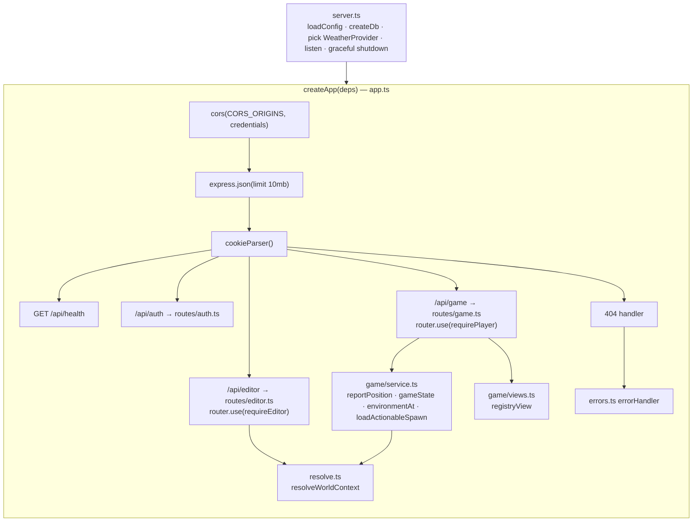

# 04 · API reference

> **In plain English:** the API server is the only program that talks to the database. The editor and the game send it
> requests like "save this world" or "what is around me?" and get JSON answers back. Editor requests need a secret
> token; game requests need a login cookie.

Base URL in development: `http://localhost:4000`. All bodies are JSON. All request and response shapes are Zod schemas
in `@wildbound/shared` (names given below), so the TypeScript types are the real reference.

## Contents

- [App structure](#app-structure)
- [Authentication](#authentication)
- [Errors](#errors)
- [Endpoint summary](#endpoint-summary)
- [Health](#health)
- [Auth endpoints](#auth-endpoints)
- [Game endpoints](#game-endpoints)
- [Editor endpoints](#editor-endpoints)
- [Configuration](#configuration)
- [Adding an endpoint](#adding-an-endpoint)

## App structure



`createApp({ db, config, weather, now?, random? })` builds the app without listening. Tests pass a test database, a
`StaticWeather`, a fixed clock and `seededRandom()` and drive it in-process with supertest.

| File | Responsibility |
|---|---|
| `src/server.ts` | Process entry. `WEATHER_API_URL=off` ⇒ `StaticWeather` (always clear), else `OpenMeteoWeather` |
| `src/app.ts` | Middleware, routers, 404, error handler |
| `src/config.ts` | `loadConfig()` reads env (see [Configuration](#configuration)) |
| `src/http.ts` | `HttpError(status, code, message, issues?)`, `parseOr400(schema, input)`, `notImplemented(what)` |
| `src/errors.ts` | Error middleware |
| `src/auth.ts` | `requireEditor`, `startSession`, `endSession`, `requirePlayer`, `SESSION_COOKIE = "wb_session"` |
| `src/resolve.ts` | `resolveWorldContext(db, query, { timeZone, now })` |
| `src/weather.ts` | `WeatherProvider` interface, `OpenMeteoWeather`, `StaticWeather` |
| `src/game/service.ts` | Game logic that touches the DB |
| `src/game/views.ts` | `registryView(creature, entry)` |
| `src/routes/*.ts` | Thin HTTP handlers |

Express 5 forwards rejected promises from async handlers to the error middleware, so handlers simply
`throw new HttpError(...)`.

## Authentication

| Route group | Mechanism | Middleware |
|---|---|---|
| `/api/health`, `POST /api/auth/login` | none | – |
| `/api/auth/logout`, `/api/auth/me`, `/api/game/*` | `wb_session` cookie (httpOnly, SameSite=Lax, `Secure` if `SECURE_COOKIES=true`, 30 days) | `requirePlayer(db)` sets `res.locals.player` |
| `/api/editor/*` | `Authorization: Bearer <EDITOR_TOKEN>` (constant-time compare) | `requireEditor(token)` |

Details and caveats: [08 · Security model](08-security.md).

## Errors

Every error body is `ApiError`:

```json
{ "error": "out_of_range", "message": "Get closer: 84 m away (max 60 m)", "issues": [] }
```

`issues` (optional) is a list of `ValidationIssue` `{ severity, code, entityType, entityId?, message }`.

| Status | `error` codes | When |
|---|---|---|
| 400 | `bad_request`, `invalid_world`, `invalid_geometry`, `invalid_reference` | Zod parse failure (`parseOr400`), malformed JSON, broken world document, DB CHECK/FK failure |
| 401 | `unauthorized` (editor), `unauthenticated` (player) | Missing/wrong token; no/expired session |
| 404 | `not_found` | Unknown route; spawn not yours |
| 409 | `validation_failed`, `conflict`, `out_of_range`, `location_unavailable`, `no_capsules`* | Publish blocked; unique violation; too far; no fresh position / locked |
| 410 | `gone` | Spawn expired, fled or already captured |
| 501 | `not_implemented` | Exercise endpoints not built yet |
| 500 | `internal` | Anything else (logged on the server, never returned) |

\* `no_capsules` is the code suggested by the capture exercise.

## Endpoint summary

| Method | Path | Access | Request | Response |
|---|---|---|---|---|
| GET | `/api/health` | public | – | `{ ok: true }` |
| POST | `/api/auth/login` | public | `LoginRequest` | `MeResponse` + cookie |
| POST | `/api/auth/logout` | cookie (optional) | – | 204 |
| GET | `/api/auth/me` | session | – | `MeResponse` |
| POST | `/api/game/position` | session | `PositionReport` | `PositionResponse` |
| GET | `/api/game/state` | session | – | `GameStateResponse` |
| POST | `/api/game/spawns/:id/observe` | session | – | `ObserveResponse` |
| POST | `/api/game/spawns/:id/capture` | session | – | `CaptureResponse` · **501 exercise** |
| GET | `/api/game/registry` | session | – | `RegistryResponse` |
| GET | `/api/game/inventory` | session | – | `InventoryResponse` |
| GET | `/api/game/party` | session | – | `PartyResponse` |
| PUT | `/api/game/party` | session | `UpdatePartyRequest` | 204 or `PartyResponse` · **501 exercise** |
| PATCH | `/api/game/wildkin/:id` | session | `RenameWildkinRequest` | `CapturedWildkinView` · **501 exercise** |
| GET | `/api/editor/world` | editor | – | `EditorWorldResponse` |
| GET | `/api/editor/published` | editor | – | `PublishedWorldResponse` |
| GET | `/api/editor/resolve` | editor | query `ResolveQuery` | `WorldContext` |
| PUT | `/api/editor/draft` | editor | `WorldDocument` | `SaveDraftResponse` |
| POST | `/api/editor/validate` | editor | `WorldDocument` | `ValidationReport` |
| POST | `/api/editor/publish` | editor | – | `PublishResponse` |

Removed in v0.1.0 (they allowed coordinate "teleporting"): public `GET /api/world/resolve`, `GET /api/world/published`,
`GET /api/creatures`.

## Health

`GET /api/health` → `200 { "ok": true }`. Does not touch the database.

## Auth endpoints

### `POST /api/auth/login`

Creates the player if the (lowercased) username is new, with `STARTER_INVENTORY` (10 Field Capsules, 3 Trail Rations,
1 Field Notebook); otherwise resumes it and bumps `lastSeenAt`. Starts a new session and sets the cookie.

```http
POST /api/auth/login
Content-Type: application/json

{ "username": "Sam_Field" }
```

```json
200 { "player": { "id": "8f1c…", "username": "sam_field", "displayName": "Sam_Field" } }
Set-Cookie: wb_session=<random 32 bytes base64url>; HttpOnly; SameSite=Lax; Path=/; Expires=…
```

400 if the username fails `UsernameSchema` (3–20 chars, `[A-Za-z0-9_]`).

### `POST /api/auth/logout`

Deletes the session row (if the cookie matches one) and clears the cookie. Always `204`.

### `GET /api/auth/me`

`200 MeResponse` or `401 unauthenticated`. The web app uses it to decide whether to show the login screen.

## Game endpoints

All require a session. **None accept coordinates for actions**; everything uses the server-tracked position.

### `POST /api/game/position`

Report one GPS fix. The server runs `checkMovement` and stores the fix only if plausible.

```json
// request (PositionReport)
{ "lat": 14.6518, "lng": 121.0444, "accuracy": 12, "clientTime": 1760900000000, "timeZone": "Asia/Manila" }
```

```json
// response (PositionResponse)
{
  "verdict": "accepted",
  "position": { "lat": 14.6518, "lng": 121.0444, "accuracyM": 12, "recordedAt": "2026-10-19T11:59:00.000Z" },
  "lockedUntil": null
}
```

| `verdict` | Meaning | Stored? |
|---|---|---|
| `first-fix` | First position ever for this player | yes |
| `accepted` | Plausible move | yes, strikes reset |
| `low-accuracy` | `accuracy` > 200 m | no, no strike |
| `too-fast` | Moved further than allowed | no (strike +1) |
| `locked` | Third strike now, or still locked | no |

`position` is always the **server's** view (unchanged when rejected). `clientTime` is informational only. `timeZone` is
a fallback used when the weather service gives none. See [07 · Anti-teleport](07-game-systems.md#anti-teleport-movement-checks).

### `GET /api/game/state`

The radar. Called every 10 s by the web app. Side effects: expires old spawns, marks spawns more than 240 m away as
`fled`, creates up to 2 new spawns (cap 6 active).

```json
{
  "position": { "lat": 14.6518, "lng": 121.0444, "accuracyM": 10, "recordedAt": "…" },
  "lockedUntil": null,
  "environment": { "timeOfDay": "night", "weather": "clear", "timeZone": "Asia/Manila", "temperatureC": 27.1, "weatherSource": "live" },
  "region": { "id": "1000…0001", "name": "Mabunyi Nature Reserve" },
  "habitat": { "id": "2000…0002", "name": "Sunbreak Clearing" },
  "spawns": [
    { "id": "…", "creatureId": "kantar", "registryNumber": 4, "lat": 14.6516, "lng": 121.0446,
      "distanceM": 31.2, "inRange": true, "observed": false, "expiresAt": "…" }
  ]
}
```

If the player has no position, a stale one (> 2 min) or is locked, `environment`, `region`, `habitat` are `null` and
`spawns` is `[]` (still 200). `region: null` with an environment means "outside every published region".

> Note: `creatureId` is included in spawns so the client can show the right icon. The *name* is only shown once the
> Registry has it (the radar labels unknown spawns `??? No. 004`).

### `POST /api/game/spawns/:id/observe`

Guard (`loadActionableSpawn`): fresh unlocked position (else 409 `location_unavailable`), spawn belongs to the player
(else 404), active and not expired (else 410), within 60 m of the tracked position (else 409 `out_of_range`).
Then, in one transaction: upsert the Registry entry (create, or `timesObserved + 1`) and set `spawns.observed_at`.

```json
200 { "entry": { "creatureId": "kantar", "registryNumber": 4, "status": "observed", "name": "Kantar",
                 "description": "…", "habitatSummary": "…", "rarity": null, "activityPattern": null, "skills": null,
                 "timesObserved": 1, "timesCaptured": 0, "firstObservedAt": "…", "firstCapturedAt": null },
      "firstObservation": true }
```

Observing does not remove the spawn; you can still capture it.

### `POST /api/game/spawns/:id/capture` — exercise #3

Runs the same guard, then answers `501 not_implemented`. Intended behaviour (see the `TODO(you)` in
`apps/api/src/routes/game.ts`): spend a Field Capsule, roll `captureChance(rarity, observedFirst)`, on failure roll
`FLEE_CHANCE_ON_FAIL`, and in one transaction update capsule, spawn, `captured_wildkin` and Registry. Response:

```json
{ "success": true, "fled": false, "capsulesLeft": 9, "entry": { "status": "captured", "rarity": "common", … }, "wildkinId": "…" }
```

### `GET /api/game/registry`

Every species, ordered by registry number, with fields unlocked by progress:

| status | Fields filled |
|---|---|
| `unknown` | `creatureId`, `registryNumber`, counts = 0 |
| `observed` | + `name`, `description`, `habitatSummary`, `firstObservedAt` |
| `captured` | + `rarity`, `activityPattern`, `skills`, `firstCapturedAt` |

Plus `observedCount` (observed or captured), `capturedCount`, `total`.

### `GET /api/game/inventory`

```json
{ "items": [ { "itemId": "field-capsule", "name": "Field Capsule", "description": "…", "category": "capture", "quantity": 10 }, … ] }
```

Rows whose `item_id` is not in `ITEMS` are skipped.

### `GET /api/game/party`

```json
{ "party": [ { "id": "…", "creatureId": "kawi", "registryNumber": 1, "speciesName": "Kawi", "nickname": null, "partySlot": 0, "capturedAt": "…" }, null, null, null, null, null ],
  "storage": [] }
```

`party` always has exactly 6 entries (`PARTY_SIZE`).

### `PUT /api/game/party` — exercise #7

Body `{ "slots": [uuid|null × 6] }` (validated: length 6, no duplicates). Currently `501`.

### `PATCH /api/game/wildkin/:id` — exercise #5

Body `{ "nickname": "Pip" }` or `{ "nickname": null }` (1–24 chars). Currently `501`.

## Editor endpoints

All require `Authorization: Bearer $EDITOR_TOKEN`.

### `GET /api/editor/world`

```json
{ "draft": WorldDocument, "creatures": CreatureDefinition[],
  "status": { "draftUpdatedAt": "…", "lastPublishedAt": "…", "publishedVersion": 2, "hasUnpublishedChanges": false } }
```

### `GET /api/editor/published`

`PublishedWorldResponse`: `{ version, publishedAt, world, creatures }` where `world` contains only **active** regions,
their habitats and POIs, and active encounter tables. `version` is `null` before the first publish.

### `GET /api/editor/resolve`

Coordinate → `WorldContext` (see [02](02-world-model.md#worldcontext-the-answer-to-what-is-here)).

| Query param | Type | Default |
|---|---|---|
| `lat`, `lng` | number (coerced from string) | required |
| `radius` | int 1–5000 (meters, POI search) | 300 |
| `stage` | `draft` \| `published` | `published` |
| `timeOfDay` | `dawn`\|`day`\|`dusk`\|`night` | current hour in `WORLD_TIMEZONE` |
| `weather` | `clear`\|`cloudy`\|`rain`\|`storm`\|`fog` | `clear` |

```bash
curl -H "Authorization: Bearer dev-editor-token" \
  "http://localhost:4000/api/editor/resolve?lat=14.6518&lng=121.0444&timeOfDay=day&weather=rain&stage=draft"
```

### `PUT /api/editor/draft`

Replaces the whole draft. Pipeline: Zod parse (`schemaIssues`) → `checkIntegrity` → `saveDraft` → `validateWorld`.

- 400 `invalid_world` with `issues` for malformed or structurally broken documents (nothing saved).
- 200 `{ status, report }` otherwise. `report` may contain publish-blocking errors and warnings; they **don't block saving**.

### `POST /api/editor/validate`

Validates a posted document **without saving** (the editor sends its unsaved in-memory world). Always 200 with a
`ValidationReport { ok, issues }`; malformed documents produce `schema` issues.

### `POST /api/editor/publish`

Validates the **saved** draft and publishes atomically.

- 200 `{ version, publishedAt, report }` (report may have warnings).
- 409 `validation_failed` with `issues` if there are errors. Published data is untouched.

Validation rules: [07 · Game systems](07-game-systems.md#world-validation).

## Configuration

`loadConfig()` in `apps/api/src/config.ts` (env is loaded from the repo-root `.env` by `@wildbound/db`'s `env.ts`):

| Env var | Config field | Default |
|---|---|---|
| `DATABASE_URL` | `databaseUrl` | required |
| `API_PORT` | `port` | 4000 |
| `API_HOST` | `host` | `127.0.0.1` |
| `EDITOR_TOKEN` | `editorToken` | required |
| `CORS_ORIGINS` | `corsOrigins` | `http://localhost:5173,http://localhost:5174` |
| `WORLD_TIMEZONE` | `worldTimeZone` | `Asia/Manila` |
| `WEATHER_API_URL` | `weatherApiUrl` | `https://api.open-meteo.com/v1/forecast` (`off` = static clear) |
| `SECURE_COOKIES` | `secureCookies` | `false` |

> `API_HOST=127.0.0.1` means only this machine can reach the API. To test from a phone on your LAN, set
> `API_HOST=0.0.0.0` (and serve the game over HTTPS; see [10 · Development guide](10-development-guide.md)).

## Adding an endpoint

Short version (full recipe in [11 · Cookbook](11-cookbook.md#add-an-api-endpoint)):

1. Define request/response schemas in `packages/shared/src/game.ts` (or `api.ts` for editor routes).
2. Add the handler to the right router; parse input with `parseOr400(Schema, req.body)`; scope every query by
   `res.locals.player.id`; `throw new HttpError(...)` for failures; respond with `satisfies YourResponse`.
3. Put logic that needs the DB in `game/service.ts`, pure rules in `@wildbound/world`.
4. Add a client function in `apps/web/src/lib/api.ts` (parsing the response with the schema) and a hook in `queries.ts`.
5. Add an integration test in `apps/api/test/`.

Next: [05 · Map Editor](05-map-editor.md).
