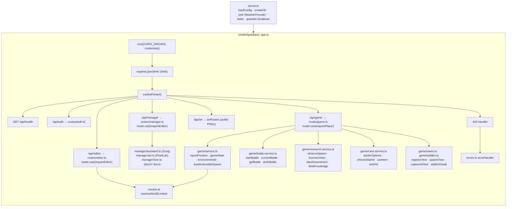

# 04 · API reference

> **In plain English:** the API server is the only program that talks to the database. The editor, the Creature Manager
> and the game send it requests like "save this world", "publish this Wildkin" or "what is around me?" and get JSON
> answers back. Editor and manager requests need a secret token; game requests need a login cookie. The API is also the
> only program that talks to the outside services (Open-Meteo weather, Groq AI, PixelLab art).
>
> Since v0.3.0 the game API also runs wild battles turn by turn (capture happens inside a battle), hands out the starter
> Wildkin, heals Wildkin (Trail Rations, vets at field stations) and manages the four Field Registry licenses and their
> assessments. The server decides everything; the game only says what the player wants to do.

Base URL in development: `http://localhost:4000`. All bodies are JSON. All request and response shapes are Zod schemas
in `@wildbound/shared` (names given below), so the TypeScript types are the real reference.

## Contents

- [App structure](#app-structure)
- [Authentication](#authentication)
- [Errors](#errors)
- [Endpoint summary](#endpoint-summary)
- [Health](#health)
- [Auth endpoints](#auth-endpoints)
- [Game endpoints](#game-endpoints)
- [Editor endpoints](#editor-endpoints)
- [Creature Manager endpoints](#creature-manager-endpoints)
- [Public art](#public-art)
- [Configuration](#configuration)
- [Adding an endpoint](#adding-an-endpoint)

## App structure



`createApp({ db, config, weather, assistant?, art?, now?, random? })` builds the app without listening. Tests pass a
test database, a `StaticWeather`, fake assistant/art providers, a fixed clock and `seededRandom()` and drive it
in-process with supertest. `server.ts` creates a `GroqAssistant` only when `GROQ_API_KEY` is set and a `PixelLabArt`
only when `PIXELLAB_API_KEY` is set (otherwise `null` = feature off), and logs which are on at startup.

| File | Responsibility |
|---|---|
| `src/server.ts` | Process entry. `WEATHER_API_URL=off` ⇒ `StaticWeather` (always clear), else `OpenMeteoWeather` |
| `src/app.ts` | Middleware, routers, 404, error handler |
| `src/config.ts` | `loadConfig()` reads env (see [Configuration](#configuration)) |
| `src/http.ts` | `HttpError(status, code, message, issues?, details?)`, `conflict(code, message, details?)` (a 409), `parseOr400(schema, input)`, `notImplemented(what)` |
| `src/errors.ts` | Error middleware |
| `src/auth.ts` | `requireEditor`, `startSession`, `endSession`, `requirePlayer`, `SESSION_COOKIE = "wb_session"` |
| `src/resolve.ts` | `resolveWorldContext(db, query, { timeZone, now })` |
| `src/weather.ts` | `WeatherProvider` interface, `OpenMeteoWeather`, `StaticWeather` |
| `src/game/service.ts` | `reportPosition` (with the walking-EXP meter), `gameState`, `loadActionableSpawn` |
| `src/game/common.ts` | `GameDeps`, `playerDayKey`, `insertOnce` (the "only once" inserts), `loadLicenses`, `ensureLicenses`, `requirePosition` |
| `src/game/battle-service.ts` | Wild battles: guards, turns, lazy endings, capture, battle EXP, matchup records |
| `src/game/research-service.ts` | Observe, researcher EXP, condition/phenotype/matchup records, habitat visits, licenses and assessments |
| `src/game/care-service.ts` | Starter, Trail Rations, vets, item grants (`grantItems`, stack cap 30) |
| `src/game/wildkin.ts` | Owned Wildkin with stats, lazy HP, restless and lead; `capturedView`, `wildkinDetail` (scanner depth), `grantWildkinExp` |
| `src/game/views.ts` | `registryView(creature, entry, knowledge)`, `spawnView(...)` |
| `src/game/pois.ts` | POIs near the player, field-station range checks (PostGIS) |
| `src/manager/assistant.ts` | `WildkinAssistant` interface, `GroqAssistant`, prompts, `sanitizeSuggestion` |
| `src/manager/art.ts` | `ArtGenerator` interface, `PixelLabArt`, `artPrompt`, `canAfford` |
| `src/manager/lore.ts` | Reads and caches the canon `.docx` files (mammoth), `buildLoreContext` |
| `src/routes/*.ts` | Thin HTTP handlers (`auth`, `game`, `editor`, `manager` incl. `artRoutes`) |

Express 5 forwards rejected promises from async handlers to the error middleware, so handlers simply
`throw new HttpError(...)`.

## Authentication

| Route group | Mechanism | Middleware |
|---|---|---|
| `/api/health`, `POST /api/auth/login` | none | – |
| `/api/auth/logout`, `/api/auth/me`, `/api/game/*` | `wb_session` cookie (httpOnly, SameSite=Lax, `Secure` if `SECURE_COOKIES=true`, 30 days) | `requirePlayer(db)` sets `res.locals.player` |
| `/api/editor/*`, `/api/manager/*` | `Authorization: Bearer <EDITOR_TOKEN>` (constant-time compare) | `requireEditor(token)` |
| `/api/art/*` | none (public images) | – |

Details and caveats: [08 · Security model](08-security.md).

## Errors

Every error body is `ApiError`:

```json
{ "error": "out_of_range", "message": "Get closer: 84 m away (max 60 m)", "issues": [] }
```

`issues` (optional) is a list of `ValidationIssue` `{ severity, code, entityType, entityId?, message }`.

`details` (optional, v0.3.0) is a small object with machine-readable extras, so a client can react without parsing the
message:

| `error` | `details` |
|---|---|
| `battle_in_progress` | `{ "battleId": "<uuid>" }`: the battle that is already running (go back to it) |
| `habitat_locked` | `{ "requirement": { "category": "aquatic", "rank": 3 } }` |
| `assessment_incomplete` | `{ "requirements": RequirementProgress[] }`: the checklist with `required`, `current` and `met` |
| `exp_too_low` | `{ "exp": 420, "threshold": 600 }` |
| `stale_turn` | `{ "turn": 4 }`: the battle's current turn (when caught before the write; refetch the battle either way) |

```json
409 { "error": "battle_in_progress", "message": "Finish your current battle first",
      "details": { "battleId": "6c0e…" } }
```

| Status | `error` codes | When |
|---|---|---|
| 400 | `bad_request`, `invalid_world`, `invalid_geometry`, `invalid_reference`, `publish_incomplete` | Zod parse failure (`parseOr400`), malformed JSON, broken world document, DB CHECK/FK failure, Wildkin entry missing required fields |
| 401 | `unauthorized` (editor), `unauthenticated` (player) | Missing/wrong token; no/expired session |
| 402 | `insufficient_credits` | PixelLab balance too low for the requested art |
| 404 | `not_found` | Unknown route (including the removed `POST /spawns/:id/capture`); spawn, battle, Wildkin or POI not yours or unknown; no running battle; unknown Wildkin entry; no art |
| 409 | `validation_failed`, `conflict`, `deleted`, `out_of_range`, `location_unavailable` | Publish blocked; unique violation or id/registry number taken; Wildkin entry is deleted; too far; no fresh position / locked |
| 409 | game (v0.3.0): `in_battle`, `battle_in_progress`, `habitat_locked`, `no_usable_wildkin`, `stale_turn`, `invalid_action`, `battle_over`, `already_has_wildkin`, `restless`, `full_hp`, `no_items`, `not_a_station`, `not_at_station`, `exp_too_low`, `assessment_incomplete`, `max_rank` | See each endpoint below |
| 410 | `gone` | Spawn expired, fled or already captured |
| 501 | `not_implemented` | Exercise endpoints not built yet |
| 502 | `assistant_failed`, `art_failed` | Groq or PixelLab answered with an error, timed out or returned garbage |
| 503 | `assistant_unavailable`, `art_unavailable` | `GROQ_API_KEY` / `PIXELLAB_API_KEY` not set |
| 500 | `internal` | Anything else (logged on the server, never returned) |

## Endpoint summary

| Method | Path | Access | Request | Response |
|---|---|---|---|---|
| GET | `/api/health` | public | – | `{ ok: true }` |
| POST | `/api/auth/login` | public | `LoginRequest` | `MeResponse` + cookie |
| POST | `/api/auth/logout` | cookie (optional) | – | 204 |
| GET | `/api/auth/me` | session | – | `MeResponse` |
| POST | `/api/game/position` | session | `PositionReport` | `PositionResponse` |
| GET | `/api/game/state` | session | – | `GameStateResponse` |
| POST | `/api/game/spawns/:id/observe` | session | – | `ObserveResponse` |
| GET | `/api/game/starter` | session | – | `StarterOptionsResponse` |
| POST | `/api/game/starter` | session | `StarterRequest` | `StarterResponse` |
| POST | `/api/game/spawns/:id/battle` | session | – | `BattleResponse` |
| GET | `/api/game/battles/current` | session | – | `BattleResponse` |
| GET | `/api/game/battles/:id` | session | – | `BattleResponse` |
| POST | `/api/game/battles/:id/actions` | session | `BattleActionRequest` | `BattleActionResponse` |
| GET | `/api/game/registry` | session | – | `RegistryResponse` |
| GET | `/api/game/inventory` | session | – | `InventoryResponse` |
| GET | `/api/game/party` | session | – | `PartyResponse` |
| PUT | `/api/game/party` | session | `UpdatePartyRequest` | 204 or `PartyResponse` · **501 exercise #7** |
| GET | `/api/game/wildkin/:id` | session | – | `WildkinDetailResponse` |
| PATCH | `/api/game/wildkin/:id` | session | `RenameWildkinRequest` | `CapturedWildkinView` |
| POST | `/api/game/items/:itemId/use` | session | `UseItemRequest` | `UseItemResponse` |
| POST | `/api/game/stations/:poiId/heal` | session | – | `VetResponse` |
| POST | `/api/game/pois/:poiId/collect` | session | – | `PickupResponse` · **501 exercise #14** |
| GET | `/api/game/licenses` | session | – | `LicensesResponse` |
| POST | `/api/game/licenses/:category/assessment` | session | – | `AssessmentResponse` |
| GET | `/api/editor/world` | editor | – | `EditorWorldResponse` |
| GET | `/api/editor/creatures` | editor | – | `CreatureListResponse` |
| GET | `/api/editor/published` | editor | – | `PublishedWorldResponse` |
| GET | `/api/editor/resolve` | editor | query `ResolveQuery` | `WorldContext` |
| PUT | `/api/editor/draft` | editor | `WorldDocument` | `SaveDraftResponse` |
| POST | `/api/editor/validate` | editor | `WorldDocument` | `ValidationReport` |
| POST | `/api/editor/publish` | editor | – | `PublishResponse` |
| GET | `/api/manager/config` | editor | – | `ManagerConfig` |
| GET | `/api/manager/stats` | editor | – | `WildkinStats` |
| GET | `/api/manager/wildkin` | editor | query `deleted=exclude\|include\|only` | `WildkinListResponse` |
| GET | `/api/manager/wildkin/:id` | editor | – | `WildkinEntry` |
| POST | `/api/manager/wildkin` | editor | `WildkinEntryInput` | 201 `WildkinEntry` |
| PUT | `/api/manager/wildkin/:id` | editor | `WildkinEntryInput` | `WildkinEntry` |
| POST | `/api/manager/wildkin/:id/publish` | editor | – | `WildkinEntry` |
| DELETE | `/api/manager/wildkin/:id[?permanent=1]` | editor | – | 204 (soft delete, or permanent) |
| GET | `/api/manager/wildkin/:id/usage` | editor | – | `WildkinUsage` |
| POST | `/api/manager/wildkin/:id/restore` | editor | – | `WildkinEntry` |
| POST | `/api/manager/assist` | editor | `AssistRequest` | `AssistResponse` |
| GET | `/api/manager/art/balance` | editor | – | `ArtBalance` |
| POST | `/api/manager/wildkin/:id/art` | editor | `GenerateArtRequest` | `GenerateArtResponse` |
| GET | `/api/art/wildkin/:id/:kind.png` | public | `?v=<version>` optional | `image/png` |

Removed in v0.1.0 (they allowed coordinate "teleporting"): public `GET /api/world/resolve`, `GET /api/world/published`,
`GET /api/creatures`.

Removed in v0.3.0: `POST /api/game/spawns/:id/capture` (now 404 `not_found`; `CaptureResponse` is gone too). Capture
happens inside a battle with the `capsule` action, and exercise #3 is retired.

## Health

`GET /api/health` → `200 { "ok": true }`. Does not touch the database.

## Auth endpoints

### `POST /api/auth/login`

Creates the player if the (lowercased) username is new, with `STARTER_INVENTORY` (10 Field Capsules, 3 Trail Rations,
1 Field Notebook); otherwise resumes it and bumps `lastSeenAt`. Starts a new session and sets the cookie.

```http
POST /api/auth/login
Content-Type: application/json

{ "username": "Sam_Field" }
```

```json
200 { "player": { "id": "8f1c…", "username": "sam_field", "displayName": "Sam_Field" } }
Set-Cookie: wb_session=<random 32 bytes base64url>; HttpOnly; SameSite=Lax; Path=/; Expires=…
```

400 if the username fails `UsernameSchema` (3–20 chars, `[A-Za-z0-9_]`).

### `POST /api/auth/logout`

Deletes the session row (if the cookie matches one) and clears the cookie. Always `204`.

### `GET /api/auth/me`

`200 MeResponse` or `401 unauthenticated`. The web app uses it to decide whether to show the login screen.

## Game endpoints

All require a session. **None accept coordinates for actions**; everything uses the server-tracked position.

### `POST /api/game/position`

Report one GPS fix. The server runs `checkMovement` and stores the fix only if plausible.

```json
// request (PositionReport)
{ "lat": 14.6518, "lng": 121.0444, "accuracy": 12, "clientTime": 1760900000000, "timeZone": "Asia/Manila" }
```

```json
// response (PositionResponse)
{
  "verdict": "accepted",
  "position": { "lat": 14.6518, "lng": 121.0444, "accuracyM": 12, "recordedAt": "2026-10-19T11:59:00.000Z" },
  "lockedUntil": null
}
```

| `verdict` | Meaning | Stored? |
|---|---|---|
| `first-fix` | First position ever for this player | yes |
| `accepted` | Plausible move | yes, strikes reset |
| `low-accuracy` | `accuracy` > 200 m | no, no strike |
| `too-fast` | Moved further than allowed | no (strike +1) |
| `locked` | Third strike now, or still locked | no |

`position` is always the **server's** view (unchanged when rejected). `clientTime` is informational only. `timeZone` is
a fallback used when the weather service gives none. See [07 · Anti-teleport](07-game-systems.md#anti-teleport-movement-checks).

### `GET /api/game/state`

The radar. Called every 10 s by the web app. Side effects: expires old spawns, marks spawns more than 240 m away as
`fled`, lets the remaining spawns **wander** (steps of 5–15 s each, random per step, since they last moved, at most 6 at once; a spawn that
leaves the 120 m spawn radius, or whose species was deleted, becomes `fled`), then creates up to 2 new spawns (cap 6
active). Species deleted in the Creature Manager are never spawned. See
[07 · Wandering](07-game-systems.md#wandering-spawns-experimental).

```json
{
  "position": { "lat": 14.6518, "lng": 121.0444, "accuracyM": 10, "recordedAt": "…" },
  "lockedUntil": null,
  "environment": { "timeOfDay": "night", "weather": "clear", "timeZone": "Asia/Manila", "temperatureC": 27.1, "weatherSource": "live" },
  "region": { "id": "1000…0001", "name": "Mabunyi Nature Reserve" },
  "habitat": { "id": "2000…0002", "name": "Sunbreak Clearing" },
  "spawns": [
    { "id": "…", "creatureId": "kantar", "registryNumber": 4, "lat": 14.6516, "lng": 121.0446,
      "distanceM": 31.2, "inRange": true, "observed": false, "expiresAt": "…" }
  ]
}
```

If the player has no position, a stale one (> 2 min) or is locked, `environment`, `region`, `habitat` are `null` and
`spawns` is `[]` (still 200). `region: null` with an environment means "outside every published region".

> Note: `creatureId` is included in spawns so the client can show the right icon. The *name* is only shown once the
> Registry has it (the radar labels unknown spawns `??? No. 004`).

### `POST /api/game/spawns/:id/observe`

Guard (`loadActionableSpawn`): fresh unlocked position (else 409 `location_unavailable`), spawn belongs to the player
(else 404), active and not expired (else 410), within 60 m of the tracked position (else 409 `out_of_range`).
Then, in one transaction: upsert the Registry entry (create, or `timesObserved + 1`) and set `spawns.observed_at`.

```json
200 { "entry": { "creatureId": "kantar", "registryNumber": 4, "status": "observed", "name": "Kantar",
                 "description": "…", "habitatSummary": "…", "rarity": null, "activityPattern": null, "skills": null,
                 "timesObserved": 1, "timesCaptured": 0, "firstObservedAt": "…", "firstCapturedAt": null },
      "firstObservation": true }
```

Observing does not remove the spawn; you can still capture it.

### `POST /api/game/spawns/:id/capture` — exercise #3

Runs the same guard, then answers `501 not_implemented`. Intended behaviour (see the `TODO(you)` in
`apps/api/src/routes/game.ts`): spend a Field Capsule, roll `captureChance(rarity, observedFirst)`, on failure roll
`FLEE_CHANCE_ON_FAIL`, and in one transaction update capsule, spawn, `captured_wildkin` and Registry. Response:

```json
{ "success": true, "fled": false, "capsulesLeft": 9, "entry": { "status": "captured", "rarity": "common", … }, "wildkinId": "…" }
```

### `GET /api/game/registry`

Every species, ordered by registry number, with fields unlocked by progress. A species soft-deleted in the Creature
Manager is listed only for players who already have a Registry entry for it (and still counts in `total` for them).

| status | Fields filled |
|---|---|
| `unknown` | `creatureId`, `registryNumber`, counts = 0 |
| `observed` | + `name`, `description`, `habitatSummary`, `firstObservedAt` |
| `captured` | + `rarity`, `activityPattern`, `skills`, `firstCapturedAt` |

Plus `observedCount` (observed or captured), `capturedCount`, `total`.

### `GET /api/game/inventory`

```json
{ "items": [ { "itemId": "field-capsule", "name": "Field Capsule", "description": "…", "category": "capture", "quantity": 10 }, … ] }
```

Rows whose `item_id` is not in `ITEMS` are skipped.

### `GET /api/game/party`

```json
{ "party": [ { "id": "…", "creatureId": "kawi", "registryNumber": 1, "speciesName": "Kawi", "nickname": null, "partySlot": 0, "capturedAt": "…" }, null, null, null, null, null ],
  "storage": [] }
```

`party` always has exactly 6 entries (`PARTY_SIZE`).

### `PUT /api/game/party` — exercise #7

Body `{ "slots": [uuid|null × 6] }` (validated: length 6, no duplicates). Currently `501`.

### `PATCH /api/game/wildkin/:id` — exercise #5

Body `{ "nickname": "Pip" }` or `{ "nickname": null }` (1–24 chars). Currently `501`.

## Editor endpoints

All require `Authorization: Bearer $EDITOR_TOKEN`.

### `GET /api/editor/world`

```json
{ "draft": WorldDocument, "creatures": CreatureDefinition[],
  "status": { "draftUpdatedAt": "…", "lastPublishedAt": "…", "publishedVersion": 2, "hasUnpublishedChanges": false } }
```

### `GET /api/editor/creatures`

`{ creatures: CreatureDefinition[] }`: the creature catalogue only, without soft-deleted species. The editor refetches
it whenever its window regains focus, so Wildkin published or deleted in the Creature Manager show up in the encounter
pickers without a reload.

### `GET /api/editor/published`

`PublishedWorldResponse`: `{ version, publishedAt, world, creatures }` where `world` contains only **active** regions,
their habitats and POIs, and active encounter tables. `version` is `null` before the first publish.

### `GET /api/editor/resolve`

Coordinate → `WorldContext` (see [02](02-world-model.md#worldcontext-the-answer-to-what-is-here)).

| Query param | Type | Default |
|---|---|---|
| `lat`, `lng` | number (coerced from string) | required |
| `radius` | int 1–5000 (meters, POI search) | 300 |
| `stage` | `draft` \| `published` | `published` |
| `timeOfDay` | `dawn`\|`day`\|`dusk`\|`night` | current hour in `WORLD_TIMEZONE` |
| `weather` | `clear`\|`cloudy`\|`rain`\|`storm`\|`fog` | `clear` |

```bash
curl -H "Authorization: Bearer dev-editor-token" \
  "http://localhost:4000/api/editor/resolve?lat=14.6518&lng=121.0444&timeOfDay=day&weather=rain&stage=draft"
```

### `PUT /api/editor/draft`

Replaces the whole draft. Pipeline: Zod parse (`schemaIssues`) → `checkIntegrity` → `saveDraft` → `validateWorld`.

- 400 `invalid_world` with `issues` for malformed or structurally broken documents (nothing saved).
- 200 `{ status, report }` otherwise. `report` may contain publish-blocking errors and warnings; they **don't block saving**.
- The integrity check accepts species that were **soft-deleted** in the Creature Manager, so a draft that still lists
  one can be saved. `validateWorld` (the `report`, `POST /validate` and `POST /publish`) only knows live species and
  reports the deleted one as an unknown Wildkin, which blocks publishing until you remove it from the table.

### `POST /api/editor/validate`

Validates a posted document **without saving** (the editor sends its unsaved in-memory world). Always 200 with a
`ValidationReport { ok, issues }`; malformed documents produce `schema` issues.

### `POST /api/editor/publish`

Validates the **saved** draft and publishes atomically.

- 200 `{ version, publishedAt, report }` (report may have warnings).
- 409 `validation_failed` with `issues` if there are errors. Published data is untouched.

Validation rules: [07 · Game systems](07-game-systems.md#world-validation).

## Creature Manager endpoints

All require `Authorization: Bearer $EDITOR_TOKEN` (the same token as the editor). Schemas are in
`packages/shared/src/wildkin.ts`. The concepts (entries vs creatures, draft/publish, soft delete, AI and art) are
explained in [13 · Creature Manager](13-creature-manager.md).

### `GET /api/manager/config`

Which optional services are on: `{ "assistant": { "enabled": false, "model": null }, "art": { "enabled": true, "model": "pixellab/pixen" } }`.
The manager uses it to disable the AI and art buttons with a hint.

### `GET /api/manager/stats`

```json
{ "total": 5, "published": 5, "drafts": 0, "unpublishedChanges": 0, "deleted": 0, "withArt": 5,
  "byRarity": { "common": 3, "TBD": 2 }, "nextRegistryNumber": 6 }
```

`total` and the other counts exclude deleted entries (except `deleted`). `nextRegistryNumber` is one more than the
highest number used by any entry **or** creature.

### `GET /api/manager/wildkin?deleted=exclude|include|only`

`{ wildkin: WildkinSummary[] }` (id, registry number, name, classification, rarity, status, `hasUnpublishedChanges`,
timestamps, `deletedAt`, `art: { icon, sprite, version }`), ordered by registry number. Default `exclude`.

### `GET /api/manager/wildkin/:id`

The full `WildkinEntry`: every `WildkinEntryInput` field plus `status`, `hasUnpublishedChanges`, `createdAt`,
`updatedAt`, `publishedAt`, `deletedAt`, `art`. 404 if unknown (deleted entries are still returned).

### `POST /api/manager/wildkin` and `PUT /api/manager/wildkin/:id`

Body: `WildkinEntryInput`. Only `id` (slug), `registryNumber` (1–9999) and `name` are required; everything else has a
default (empty text, `TBD`, `forager`, `[]`), so a half-written draft is valid.

- `POST` creates a **draft** → 201. 409 `conflict` if the id already exists as an entry or as a creature, or the
  registry number is used by another entry or creature.
- `PUT` replaces the entry → 200. 400 if the body's `id` differs from the URL (ids are immutable). 409 `deleted` if the
  entry is deleted (restore it first), 409 `conflict` for a taken registry number. A published entry edited here keeps
  `status: "published"` and gets `hasUnpublishedChanges: true`; the game keeps the old version until you publish.

### `POST /api/manager/wildkin/:id/publish`

Copies the entry's game fields into `creatures` (insert or update, same id) and marks it published, in one transaction.

- 400 `publish_incomplete` with `issues` when any of `name`, `registryDescription`, `habitatSummary` is
  empty (`PUBLISH_REQUIRED_FIELDS`).
- 409 `deleted` for a deleted entry; 409 `conflict` if the registry number is taken by another creature.

Field mapping (`creatureFromEntry`): `description` ← `registryDescription`,
`habitatAffinity` ← `habitatTags`, and `habitatSummary`, `rarity`, `activityPattern`, `spawnModifiers`, `skills`,
`movementStyle` as-is. The prose never reaches the game.

### `DELETE /api/manager/wildkin/:id` and `POST /api/manager/wildkin/:id/restore`

Soft delete → 204: sets `deleted_at` on the entry **and** on the creature with the same id (if published). The species
stops spawning at once (existing spawns flee on the next poll), disappears from the editor's pickers and from the
public art route, and stays in the Registry of players who already met it. Its registry number is released (numbers are
unique only among non-deleted Wildkin). Restore clears both and returns the entry; if the number was taken meanwhile,
the entry and creature get the next free number (compare `registryNumber`).

`?permanent=1` → 204: deletes the entry and its art, the creature, and every encounter-table entry (draft and
published), Registry record, captured Wildkin and spawn of that species, in one transaction. Cannot be undone.
`GET /api/manager/wildkin/:id/usage` returns what that would remove:

```json
{ "encounterEntries": { "draft": 1, "published": 1 }, "capturedWildkin": 0, "registryEntries": 3, "activeSpawns": 0 }
```

`POST /api/manager/wildkin/:id/art`: if the client disconnects before the answer (the manager tab was closed or the job
cancelled), the API aborts its PixelLab requests and saves nothing.

### `POST /api/manager/assist`

Asks the AI assistant (Groq) for a lore-aligned draft. 503 `assistant_unavailable` without `GROQ_API_KEY`.

```json
// request (AssistRequest)
{ "prompt": "a shy moth that pollinates night-blooming vines by the creek",
  "current": { "name": "", "habitatTags": ["creek"] } }
```

```json
// response (AssistResponse)
{ "suggestion": { "id": "luntay", "name": "Luntay", "activityPattern": "nocturnal", "movementStyle": "skulker", "…": "…" },
  "notes": ["PROPOSED: night pollinator role does not overlap with Lumae (diurnal)."],
  "dropped": ["rarity"],
  "model": "llama-3.3-70b-versatile" }
```

- `prompt`: 3–2000 characters. `current`: the form values (loose on purpose: a half-filled form is still context).
- The model gets the canon documents, the existing roster (number, name, id, status, classification, identity) and the
  current values, and must answer one JSON object (`response_format: json_object`).
- Every suggested field is validated on its own against `WildkinSuggestionSchema`; invalid ones are listed in `dropped`
  instead of failing the request. `registryNumber` is never suggested. Nothing is saved.
- 502 `assistant_failed` if Groq errors (e.g. a rate limit), times out (90 s) or returns invalid JSON.

### `GET /api/manager/art/balance`

`{ "generations": 1834, "usd": 0 }`: remaining PixelLab subscription generations and USD credits (`null` when not
applicable). 503 `art_unavailable` without `PIXELLAB_API_KEY`; 502 `art_failed` if PixelLab cannot be reached.

### `POST /api/manager/wildkin/:id/art`

Generates art from the **saved** entry with PixelLab Pixen and stores it in `wildkin_art`.

```json
// request (GenerateArtRequest), both fields optional
{ "kinds": ["icon", "sprite"], "extraPrompt": "muted greens, glowing tail tip" }
```

1. 409 `deleted` for a deleted entry; 400 if both `physicalDescription` and `identity` are empty.
2. **Checks the balance first.** 402 `insufficient_credits` if it cannot pay for one generation per image.
3. For each kind, builds the prompt (`artPrompt`), generates (icon 64 px, sprite 128 px, transparent background) and
   saves the PNG (replacing any previous one).
4. Returns `{ art, generated, balanceBefore, balanceAfter, prompts }`. `prompts` shows exactly what was sent.

## Public art

### `GET /api/art/wildkin/:id/:kind.png`

`kind` is `icon` or `sprite`. Serves the PNG from `wildkin_art` for any non-deleted encyclopedia entry (draft or
published), 404 otherwise. No auth: players see this art. With `?v=<art.version>` the response is cached for a year
(`immutable`); without it for 60 s. The game uses this route first and falls back to the static PNGs in
`apps/web/public/wildkin/` (see [06 · Web game](06-web-game.md#wildkin-art)). `wildkinArtPath(id, kind, version?)` in
`@wildbound/shared` builds the URL.

## Configuration

`loadConfig()` in `apps/api/src/config.ts` (env is loaded from the repo-root `.env` by `@wildbound/db`'s `env.ts`):

| Env var | Config field | Default |
|---|---|---|
| `DATABASE_URL` | `databaseUrl` | required |
| `API_PORT` | `port` | 4000 |
| `API_HOST` | `host` | `127.0.0.1` |
| `EDITOR_TOKEN` | `editorToken` | required |
| `CORS_ORIGINS` | `corsOrigins` | `http://localhost:5173,http://localhost:5174,http://localhost:5175` |
| `WORLD_TIMEZONE` | `worldTimeZone` | `Asia/Manila` |
| `WEATHER_API_URL` | `weatherApiUrl` | `https://api.open-meteo.com/v1/forecast` (`off` = static clear) |
| `SECURE_COOKIES` | `secureCookies` | `false` |
| `GROQ_API_KEY` | `groqApiKey` | empty = AI assistant off |
| `GROQ_MODEL` | `groqModel` | `llama-3.3-70b-versatile` |
| `GROQ_API_URL` | `groqApiUrl` | `https://api.groq.com/openai/v1` |
| `LORE_DOCS_DIR` | `loreDocsDir` | the repo's `docs/` folder |
| `LORE_SOURCE` | `loreSource` | `brief` |
| `LORE_MAX_CHARS` | `loreMaxChars` | `30000` |
| `PIXELLAB_API_KEY` | `pixellabApiKey` | empty = art generation off |
| `PIXELLAB_API_URL` | `pixellabApiUrl` | `https://api.pixellab.ai/v2` |

> `API_HOST=127.0.0.1` means only this machine can reach the API. To test from a phone on your LAN, set
> `API_HOST=0.0.0.0` (and serve the game over HTTPS; see [10 · Development guide](10-development-guide.md)).

## Adding an endpoint

Short version (full recipe in [11 · Cookbook](11-cookbook.md#add-an-api-endpoint)):

1. Define request/response schemas in `packages/shared/src/game.ts` (or `api.ts` for editor routes, `wildkin.ts` for
   manager routes).
2. Add the handler to the right router; parse input with `parseOr400(Schema, req.body)`; scope every query by
   `res.locals.player.id`; `throw new HttpError(...)` for failures; respond with `satisfies YourResponse`.
3. Put logic that needs the DB in `game/service.ts`, pure rules in `@wildbound/world`.
4. Add a client function in `apps/web/src/lib/api.ts` (parsing the response with the schema) and a hook in `queries.ts`.
5. Add an integration test in `apps/api/test/`.

Next: [05 · Map Editor](05-map-editor.md).
