# 05 · Map Editor (`apps/editor`)

> **In plain English:** the Map Editor is a drawing tool for the game world. You trace regions and habitats over a real
> map, pin points of interest, decide which Wildkin live in each habitat and how common they are, then save, check and
> publish. A "Test" tool lets you drop a pretend player anywhere and see exactly what the game would see there.

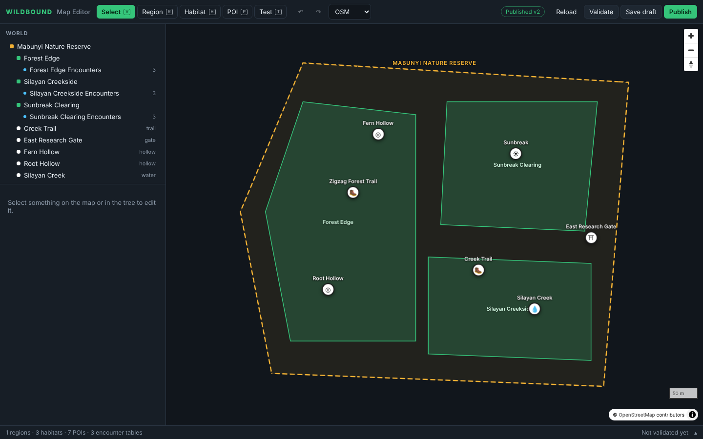

*The editor (base map tiles are blank in this offline screenshot; normally you see streets or satellite imagery).*

## Contents

- [Using the editor (workflow)](#using-the-editor-workflow)
- [Screen layout](#screen-layout)
- [Architecture](#architecture)
- [State: server state vs editing state](#state-server-state-vs-editing-state)
- [The Zustand store and undo/redo](#the-zustand-store-and-undoredo)
- [Pure edit operations (`world-edit.ts`)](#pure-edit-operations-world-editts)
- [The map controller (`editor-map.ts`)](#the-map-controller-editor-mapts)
- [Inspectors and forms](#inspectors-and-forms)
- [Save, Validate, Publish](#save-validate-publish)
- [Test mode](#test-mode)
- [Styling](#styling)
- [Configuration](#configuration)
- [Extending the editor](#extending-the-editor)

## Using the editor (workflow)

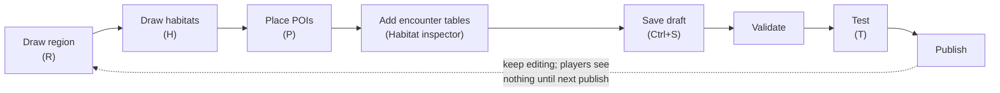

1. **Region (`R`)**: click points around the real area; double-click, press Enter, or click the first point to close it.
   Backspace removes the last point, Esc cancels. Rename it in the inspector.
2. **Habitat (`H`)**: same drawing; the habitat is assigned to the region containing its centroid (or the selected one).
3. **POI (`P`)**: click inside a region to place one; the tool stays active for more.
4. Select a habitat → **Add encounter table** → add Wildkin, set weights, optionally restrict by time/weather.
5. **Save draft** (`Ctrl+S`), **Validate**, **Test** (`T`), then **Publish**.

| Tool / key | Action |
|---|---|
| Select `V` | Click a habitat (click again to cycle to its region) or a POI. Drag white vertex handles to reshape, drag midpoint handles to add a vertex, right-click a vertex to delete it (minimum 3) |
| Region `R`, Habitat `H` | Draw polygons (self-intersecting shapes are refused) |
| POI `P` | Place POIs |
| Test `T` | Drop/drag the simulated player; arrow keys nudge ≈ 5.5 m (Shift ×5) |
| `Ctrl+S` | Save draft |
| `Ctrl+Z`, `Ctrl+Shift+Z` / `Ctrl+Y` | Undo / redo |
| `Delete` / `Backspace` | Delete selection (with confirm; cascades to children) |
| `Esc` | Back to Select, or clear the selection |

## Screen layout

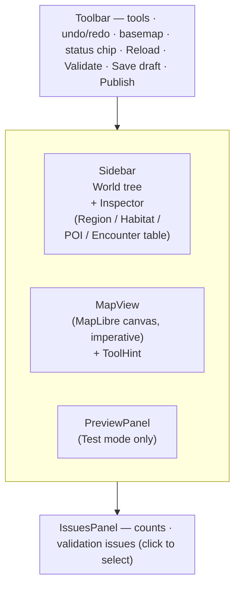

Overlays: `NoticeToast` (messages), `TokenDialog` (opens on 401), `ToolHint` (instructions for the active tool).

| Habitat selected (vertex handles, inspector) | Encounter table inspector |
|---|---|
| 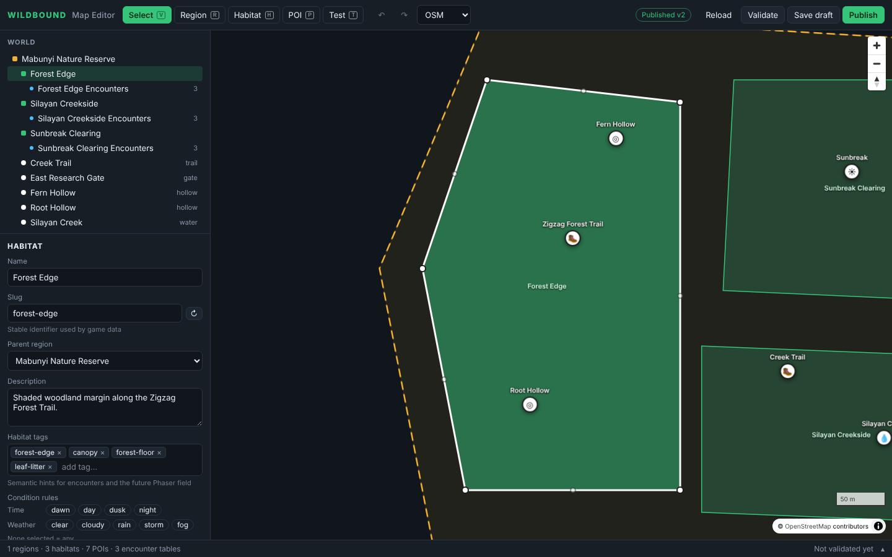 | 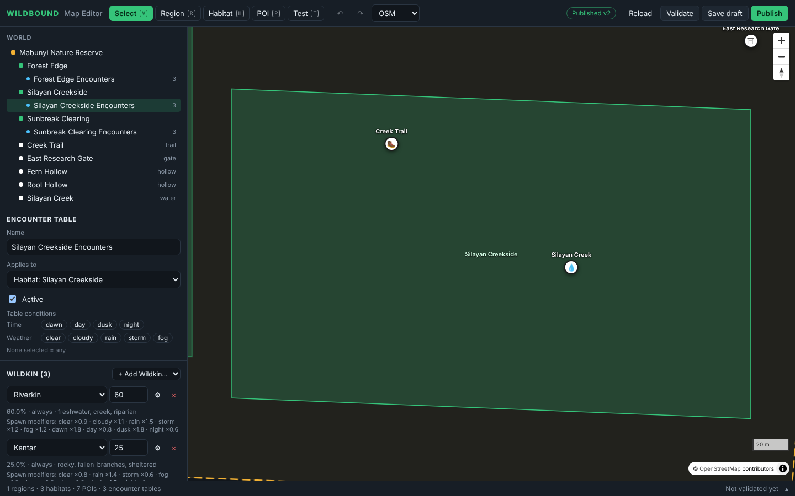 |

## Architecture

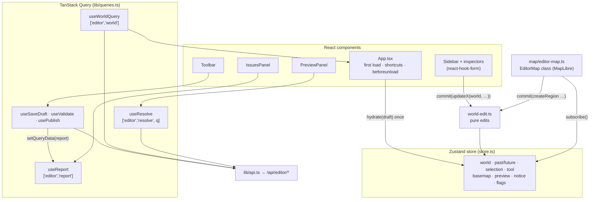

| Path | Role |
|---|---|
| `src/main.tsx` | Mounts `App` inside `QueryClientProvider` |
| `src/App.tsx` | Layout, first-load hydration, keyboard shortcuts, unsaved-changes warning |
| `src/store.ts` | Zustand store (local editing state) |
| `src/world-edit.ts` | Pure immutable edit operations (+ `world-edit.test.ts`) |
| `src/lib/api.ts` | Fetch client with bearer token; every response parsed by Zod; `ApiRequestError(status, issues)` |
| `src/lib/queries.ts` | Query keys, queries and mutations |
| `src/lib/query-client.ts` | `QueryClient` with central error handling (401 → token dialog; `meta.errorMessage` → toast) |
| `src/lib/spawn-preview.ts` | Format spawn modifiers; preview odds through `applySpawnModifiers` (+ tests) |
| `src/map/editor-map.ts` | Imperative MapLibre controller |
| `src/map/basemaps.ts` | Streets (OpenFreeMap), OSM raster, Esri satellite; default view Metro Manila |
| `src/map/MapView.tsx` | Mounts/destroys `EditorMap` |
| `src/components/` | `Toolbar`, `Sidebar`, `PreviewPanel`, `IssuesPanel`, `Overlays`, `ui.tsx` primitives, `fields.tsx` form fields, `legacy-fields.tsx` |
| `src/inspectors/` | `RegionInspector`, `HabitatInspector`, `PoiInspector` (exercise #9), `EncounterTableInspector`, `common.tsx` |

## State: server state vs editing state

The editor separates two kinds of state. Mixing them is the most common source of bugs.

| | Server state (TanStack Query) | Editing state (Zustand) |
|---|---|---|
| What | Saved draft, creatures, publish status, last validation report, resolve results | The world being edited, undo history, selection, tool, basemap, Test inputs, toasts |
| Source of truth | The API | The browser, until saved |
| Lifetime | Cached, `staleTime: Infinity` (only changes through the editor's own mutations) | Until reload |

The rule: **the first successful `GET /api/editor/world` fills the store (`hydrate`); after that the store owns the
edited world.** Save and Publish invalidate the world query (to refresh the status chip) but never overwrite local
edits. **Reload** is the explicit "discard my edits" action.

## The Zustand store and undo/redo

`useEditor` (`src/store.ts`) holds `world`, `past[]`, `future[]` (max 100 steps) and actions.

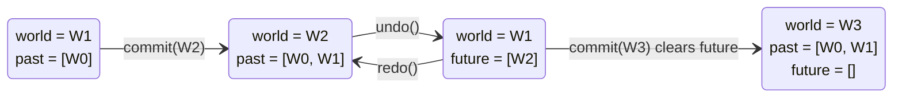

- `commit(next, selection?)`: push current world to `past`, clear `future`, mark dirty. **One commit = one undo step.**
- `beginTransient()` / `transient(next)` / `endTransient()`: used while dragging a vertex handle. Intermediate
  positions update the world without history; `endTransient` pushes the pre-drag snapshot once.
- `undo` / `redo` keep the selection only if the entity still exists.
- `markSaved(saved)`: dirty becomes `false` only if the world wasn't changed while the save was in flight
  (identity comparison, which works because edits are immutable).
- Test panel state lives in `preview` (`point`, `stage`, `timeOfDay`, `weather`, `radius`, `request`).
  `resolvePreview()` copies the inputs into `request`, which is the query key `PreviewPanel` resolves.

## Pure edit operations (`world-edit.ts`)

Every change to the world is a pure function `(world, …) → newWorld`. The store wraps them; they never mutate.

| Group | Functions |
|---|---|
| Ids, slugs | `newId()`, `slugify()`, `uniqueSlug()`, `isValidSlug()` |
| Geometry | `polygonFromVertices`, `isSelfIntersecting`, `editableRings`, `moveVertex`, `insertVertex`, `removeVertex` (refuses < 3), `regionAt(world, point)` (smallest containing region, like the resolver) |
| Create | `createRegion`, `createHabitat`, `createPoi`, `createEncounterTable`, `createEntry` (default weight 10). Names/slugs get `2`, `3`… suffixes to stay unique |
| Update | `updateRegion`, `updateHabitat` (moving a habitat to another region moves its tables), `updatePoi`, `updateEncounterTable` (picking a habitat pins the table to that habitat's region), `setGeometry` |
| Delete | `deleteEntity` cascades: region → its habitats, POIs and tables; habitat → its tables |
| Helpers | `entityExists`, `entityLabel`, `changedFields(current, values)` (deep diff for minimal commits) |

`world-edit.test.ts` covers these. If you add an edit, add a test.

## The map controller (`editor-map.ts`)

**The map is imperative; the UI is React.** `EditorMap` is a plain class created once by `MapView`. It subscribes to
the store with `useEditor.subscribe` and redraws only what changed, so dragging never fights React renders.

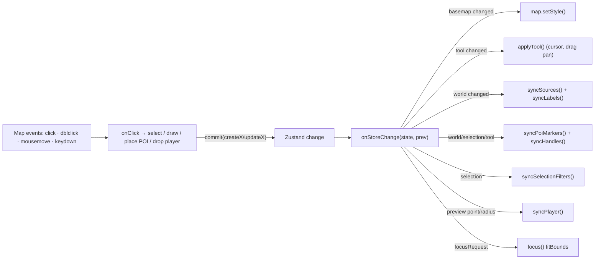

- **Layers** (GeoJSON sources): `region-fill/line` (gold `#f2b134`, gray if inactive), `habitat-fill/line` (green),
  `region-selected`, `habitat-selected*`, `player-radius-*` (pink), `drawing-*` (blue). They are re-added after a
  basemap style change.
- **Markers** (DOM): POI icons (draggable once selected in Select mode; a drop is one commit), labels, vertex/midpoint handles, the simulated player.
- **Selection by click**: hits are ordered smallest habitat first, then regions; clicking again cycles.
- **Drawing**: vertices within 4 px are collapsed (double-click adds duplicates); clicking within 12 px of the first
  point closes the shape; self-intersections are refused with a toast.

> ⚠️ Known issue: if the **Streets** style URL can't be loaded (offline, blocked `tiles.openfreemap.org`), the world
> layers are not drawn because they are added on style load. Switch the basemap to **OSM** or **Satellite**: their
> styles are inline, so polygons draw even when tiles fail.

## Inspectors and forms

The Sidebar shows the inspector for the current selection. Region, Habitat and EncounterTable inspectors use
**react-hook-form + `zodResolver`** with the shared schemas (`HabitatSchema.pick({...})`); `PoiInspector` still uses
legacy controlled inputs and is exercise #9.

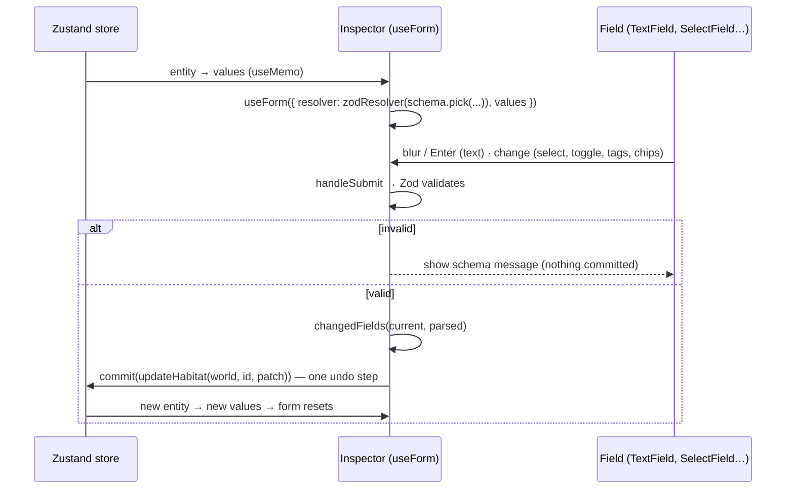

- **`values` (not `defaultValues`)**: when the store changes (undo, a map drag), the form resets to it.
- Text commits on blur or Enter; Escape reverts. Selects, toggles, tags and condition chips commit on change.
- Field components (`components/fields.tsx`): `EntityForm`, `TextField`, `SlugField` (with "regenerate from name"),
  `SelectField`, `ToggleField`, `TagsField` (with suggestions), `ConditionsField`, `UnlockField`, `useCommit`,
  `useFieldError`.
- `HabitatInspector` is the reference implementation. `EncounterTableInspector` shows field arrays (entries with
  weight, share %, conditions and the species' spawn modifiers formatted like `rain ×0.5 · night ×0.1`).
- Inspectors read the world with `useEditor.getState()` inside `save` so they never commit against a stale closure.

## Save, Validate, Publish

| Button | Mutation | API | Effect |
|---|---|---|---|
| **Save draft** / `Ctrl+S` | `useSaveDraft` | `PUT /api/editor/draft` | Saves the in-memory world. 400 issues open the Issues panel. On success: `markSaved`, report stored, world + resolve queries invalidated, toast ("N issue(s) must be fixed before publishing") |
| **Validate** | `useValidate` | `POST /api/editor/validate` | Checks the **unsaved** world without saving; opens the Issues panel |
| **Publish** | `usePublish` | (save if dirty) then `POST /api/editor/publish` | 409 issues go to the panel; success updates the status chip "Published vN" |
| **Reload** | `useReloadWorld` | `GET /api/editor/world` | Confirms if dirty, then `hydrate()` the saved draft |

The Issues panel lists errors and warnings; clicking one selects the entity. The world tree shows a red/yellow badge
on entities with issues. Rules are listed in [07 · World validation](07-game-systems.md#world-validation).

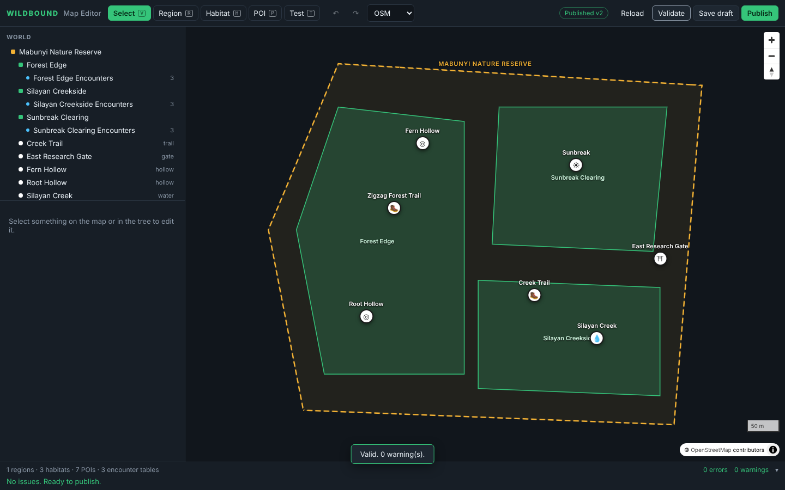

`useBusy()` combines `useIsFetching`/`useIsMutating` so buttons are disabled while anything runs.

## Test mode

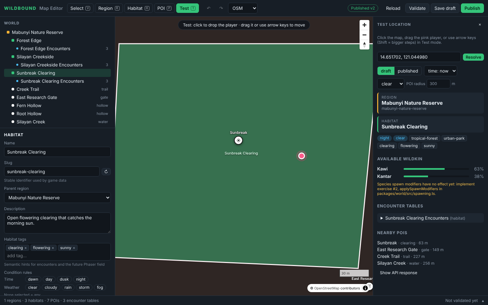

Press `T`, click the map. The pink marker is the simulated player; the circle is the POI radius.

- The panel calls `GET /api/editor/resolve` with the point and the chosen **stage** (draft/published), **time**
  (`now` or a fixed band), **weather** and **POI radius**, and shows the full `WorldContext`: region, habitat
  (with conditions met or not), environment tags, available Wildkin with probabilities, every encounter table and
  entry, nearby POIs, and the raw API response.
- "Draft" resolves the **saved** draft; the panel warns when there are unsaved edits.
- **Available Wildkin** are also run through `applySpawnModifiers` (`lib/spawn-preview.ts`) so you see the odds players
  will get in that weather/time. Statuses: `applied`, `neutral` (no modifier applies), `unchanged` (exercise #2 not
  implemented; a yellow hint says so, as in the screenshot), `error`.

In the screenshot it is night, so Lumae (whose entry is `dawn/day` only) is unavailable in Sunbreak Clearing and the
remaining weights Kawi 25 / Kantar 15 become 63 % / 38 %.

## Styling

Tailwind CSS 4 with the original dark theme as `@theme` tokens in `src/styles.css`: `canvas #11161c`, `panel`,
`line`, `fg`, `muted`, `accent #35c47a`, `region #f2b134`, `danger`, `warning`, `info`, `player #ff5c8a`, and a dense
px type scale (`text-micro` … `text-title`). The same file styles the map's imperative DOM markers (`.wb-marker`,
`.wb-player`, …). `cn()` in `lib/utils.ts` = clsx + tailwind-merge aware of those tokens. `components.json` is ready
for `npx shadcn add`.

## Configuration

From the repo-root `.env`: `VITE_API_URL` (default `http://localhost:4000`), `VITE_EDITOR_TOKEN` (must equal the API's
`EDITOR_TOKEN`), optional `VITE_MAP_STYLE` (Streets style URL). If the API answers 401, the token dialog asks for the
token and stores it in `localStorage` (`wildbound.editorToken`), which then wins over the env value.

## Extending the editor

- **New field on an entity:** add it to the Zod schema (shared), the DB ([03](03-database.md#how-to-change-the-schema)),
  the inspector's `pick({...})` and `values`, and a field component. Commit logic needs no change.
- **New entity kind:** add it to `WorldDocument`, `EntityKind`/`Selection`, `world-edit.ts` (create/update/delete,
  `entityExists`), the world tree, a new inspector, map layers in `editor-map.ts`, and the DB save/publish/load.
- **New tool:** add to `Tool` and `TOOLS` (Toolbar), a key in `TOOL_KEYS` (App), and a `case` in
  `EditorMap.onClick`/`applyTool`.

Recipes: [11 · Cookbook](11-cookbook.md).

Next: [06 · Web game](06-web-game.md).
