# 06 · Web game (`apps/web`)

> **In plain English:** this is the game players use on their phones. It looks like a handheld "field navigator"
> gadget. It asks for a username, then for location sharing, lets a new player choose a starter companion, then shows
> a radar with nearby Wildkin and points of interest, turn-based battles, a Registry (field guide), a Satchel (bag), a
> Party and the player's Field Registry licenses. It doesn't decide anything important itself; it shows what the server
> says, sends the server your GPS position, and sends one battle action per turn.

| Login | Location gate | Radar | Observe |
|---|---|---|---|
| 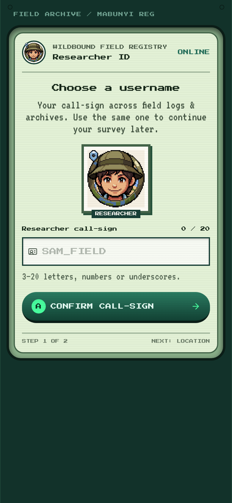 | 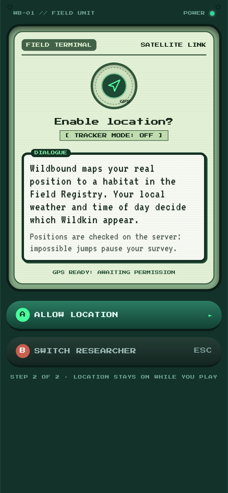 | 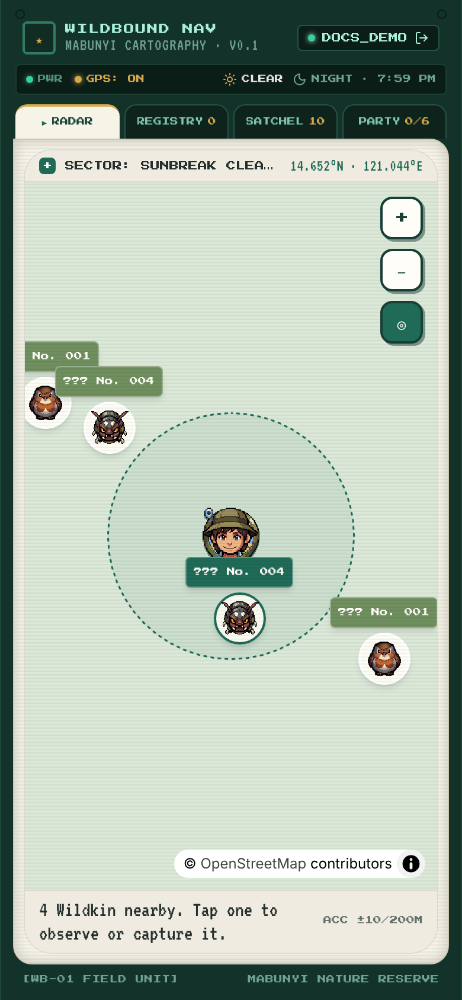 | 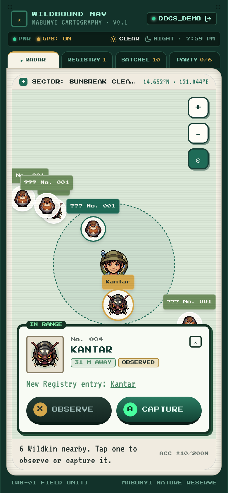 |

| Registry | Registry entry | Satchel | Party | Paused |
|---|---|---|---|---|
| 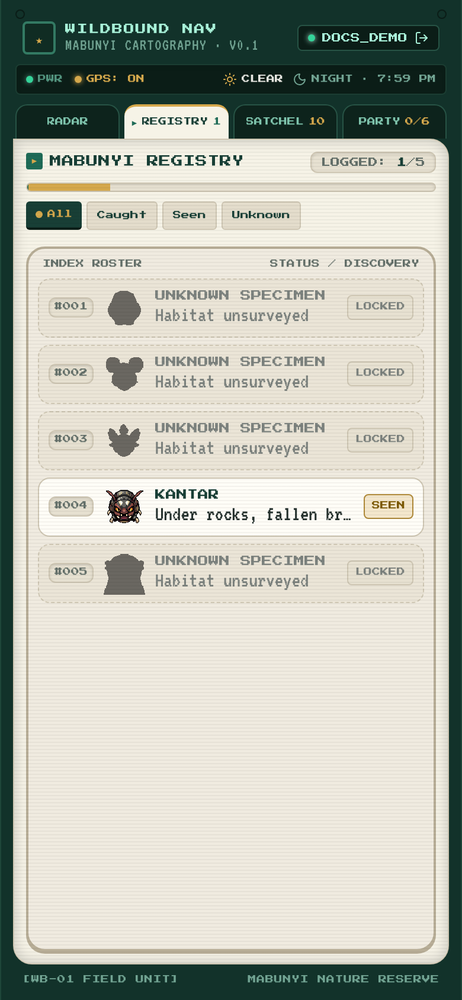 | 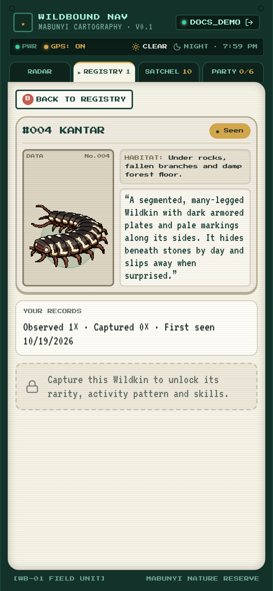 | 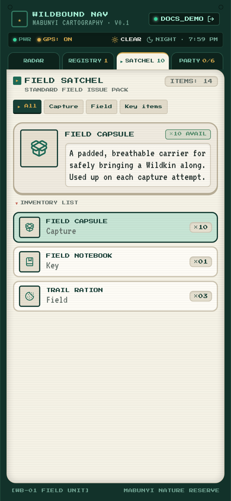 | 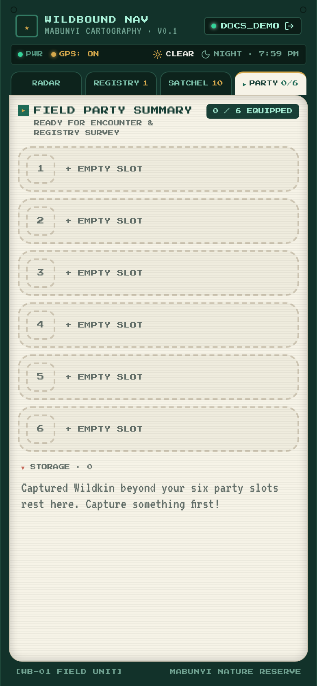 | 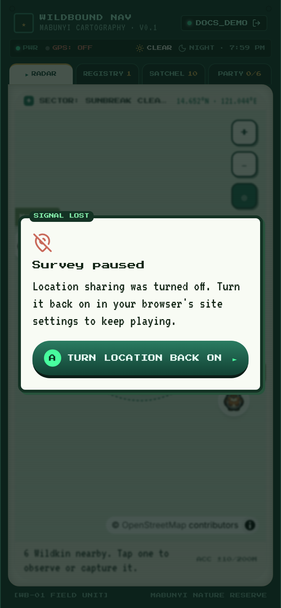 |

*Screenshots at 390 × 844 with a simulated position in Sunbreak Clearing, at night, offline (blank base map). They were
taken in v0.2.0: the v0.3.0 screens (starter, battle, party detail, License tab, POI sheet, five tabs) have no
screenshots yet. Every v0.3.0 screen was checked at 390 × 844 without horizontal scroll.*

## Contents

- [Screen flow and routing](#screen-flow-and-routing)
- [Provider tree](#provider-tree)
- [Location: `LocationProvider`](#location-locationprovider)
- [Position reporting: `usePositionReporter`](#position-reporting-usepositionreporter)
- [Server state: API client and queries](#server-state-api-client-and-queries)
- [GameLayout: the console shell](#gamelayout-the-console-shell)
- [Starter](#starter)
- [Radar](#radar)
- [Battle screen](#battle-screen)
- [Registry](#registry)
- [Party and Wildkin detail](#party-and-wildkin-detail)
- [License](#license)
- [Satchel](#satchel)
- [Visual design system](#visual-design-system)
- [Art assets](#art-assets)
- [Running and testing on a device](#running-and-testing-on-a-device)

## Screen flow and routing

`src/router.tsx` (React Router 7, `createBrowserRouter`):

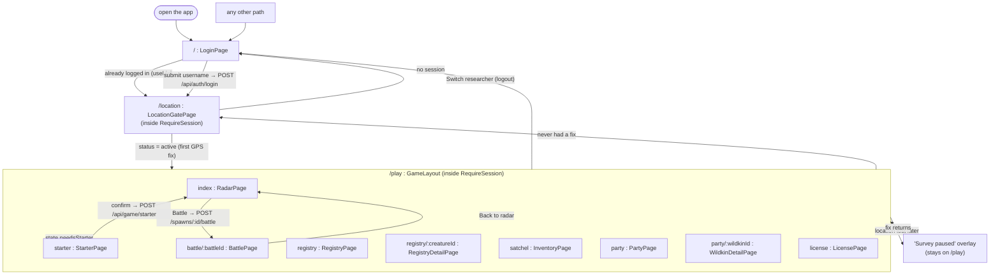

| Guard | Where | Rule |
|---|---|---|
| `RequireSession` | wraps `/location` and `/play/*` | `useMe()` pending → "Opening your ledger…"; error → "Cannot reach the API"; no player → `/` |
| `LoginPage` | `/` | Already logged in → `/location` |
| `LocationGatePage` | `/location` | `status === "active"` → `/play` |
| `GameLayout` | `/play` | No player → `/`; **no fix ever** → `/location`; fix lost later → paused overlay, not a redirect; `state.needsStarter` (the player owns no Wildkin) → `/play/starter` |
| `StarterPage` | `/play/starter` | Player already owns Wildkin → `/play` |

The difference matters: a player who loses GPS mid-game is **paused, not kicked out**, which is what the brief asked for.

## Provider tree

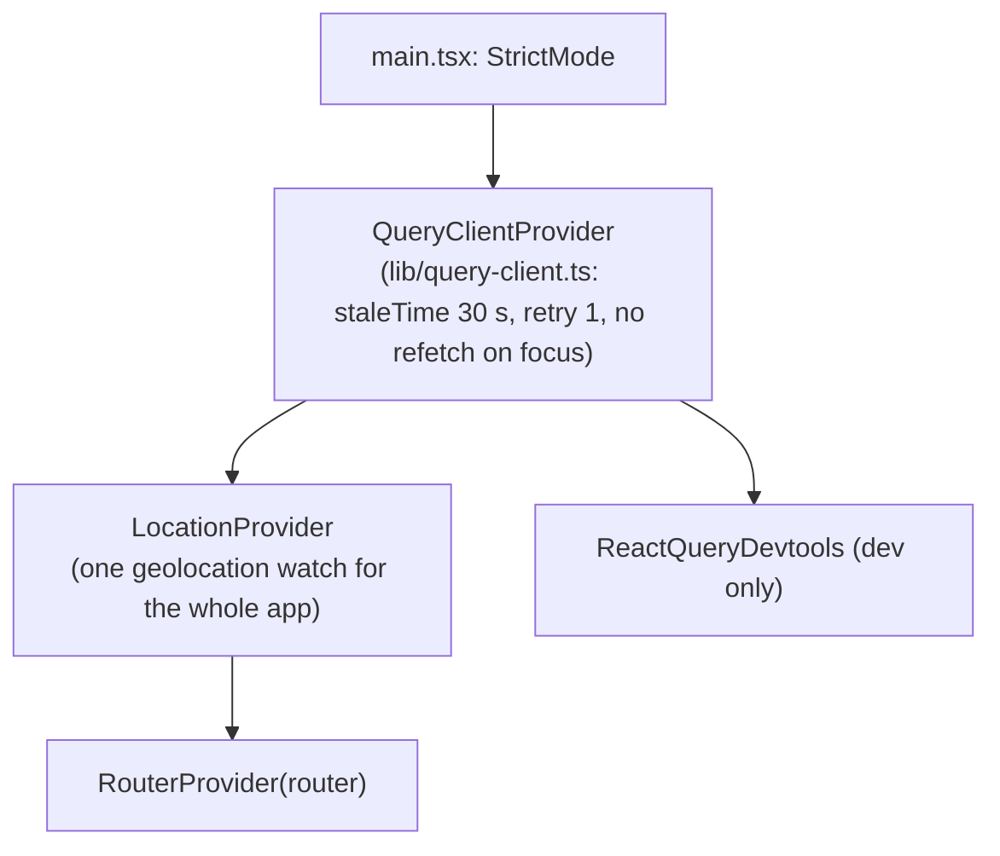

`LocationProvider` sits **above** the router so the GPS watch survives page changes.

## Location: `LocationProvider`

`src/features/location/LocationProvider.tsx` owns one `navigator.geolocation.watchPosition` (high accuracy,
`maximumAge 5 s`, `timeout 20 s`) and listens to the Permissions API. It exposes `{ status, fix, start }`.

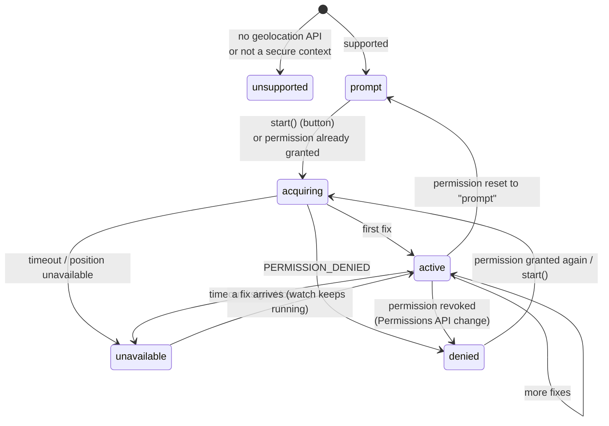

| Status | Meaning | Playable? |
|---|---|---|
| `unsupported` | No API, or page not on `https://`/`localhost` | no |
| `prompt` | Waiting for the user to press "Allow location" | no |
| `acquiring` | Permission granted, waiting for a fix | no |
| `active` | Receiving fixes | **yes (only this)** |
| `denied` | Blocked by the user | no |
| `unavailable` | Allowed but no fix arriving | no |

`fix = { lat, lng, accuracy, timestamp }` is the latest raw browser fix.

## Position reporting: `usePositionReporter`

`src/features/location/usePositionReporter.ts`, used by `GameLayout` while `status === "active"`.

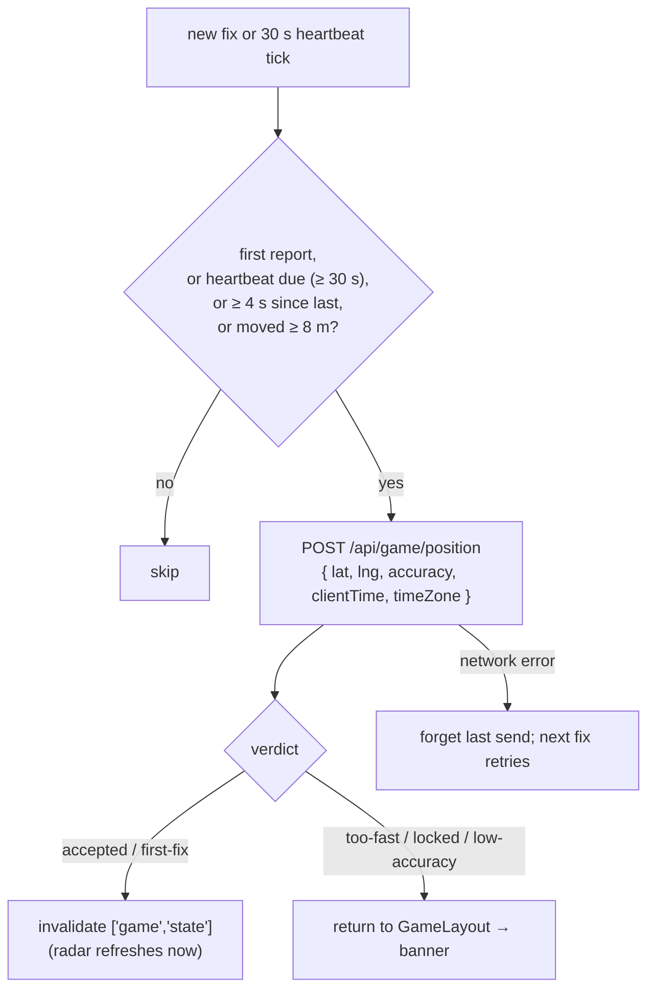

- The **heartbeat** exists because browsers stop calling `watchPosition` when the device is still, but the server only
  treats a position as current for 2 minutes (`GAME_RULES.positionStaleMs`).
- The hook returns the server's last `PositionResponse`, so `GameLayout` can show "That GPS jump looked impossible" or
  "Survey paused until …".

## Server state: API client and queries

`src/lib/api.ts`: a same-origin `fetch` wrapper. Every response is parsed with its Zod schema; errors become
`ApiError(status, code, message, details)` (`details` carries extras such as `battleId` on `battle_in_progress`). Vite
proxies `/api` to the API, so the httpOnly cookie just works.

`src/lib/queries.ts`:

| Hook | Key | Notes |
|---|---|---|
| `useMe()` | `["me"]` | Returns `null` on 401. `staleTime: Infinity` |
| `useLogin()` / `useLogout()` | (mutation) | `queryClient.clear()` then set `me` (a different save slot must not see cached data) |
| `useGameState(enabled)` | `["game","state"]` | **Polls every 10 s**, `staleTime 5 s`, only while location is active |
| `useRegistry()` | `["game","registry"]` | |
| `useInventory()` | `["game","inventory"]` | |
| `useParty()` | `["game","party"]` | |
| `useObserve()` | (mutation) | On success invalidates registry + state |
| `useStarterOptions()` / `useChooseStarter()` | `["game","starter"]` | Choosing sets `needsStarter: false` in the state cache at once (so the layout does not bounce back), then invalidates state, party, registry |
| `useStartBattle()` | (mutation) | Writes the new battle into `["game","battle",id]`, invalidates state |
| `useBattle(id)` | `["game","battle",id]` | |
| `useCurrentBattle()` | `["game","battle","current"]` | `null` on 404 |
| `useBattleAction(battle)` | (mutation) | Sends `{ turn: battle.turn, action }`, writes the returned battle into the cache. When `outcome` is set: invalidates party, Wildkin, inventory, state, registry and licenses; otherwise just party (HP is written every turn). On `stale_turn` / `battle_over` it refetches the battle |
| `useWildkin(id)` | `["game","wildkin",id]` | Party detail page |
| `useUseItem()` / `useVisitVet()` | (mutation) | Invalidate party, all Wildkin, inventory, state |
| `useCollectPoi()` | (mutation) | On settle invalidates inventory + state (exercise #14 answers 501 until done) |
| `useLicenses()` / `useTakeAssessment()` | `["game","licenses"]` | A passed assessment invalidates licenses, party, Wildkin, inventory, state |

Rule of thumb from the code: **anything a mutation changes on the server gets invalidated in `onSuccess`/`onSettled`.**

## GameLayout: the console shell

`src/features/game/GameLayout.tsx` wraps every `/play` page:

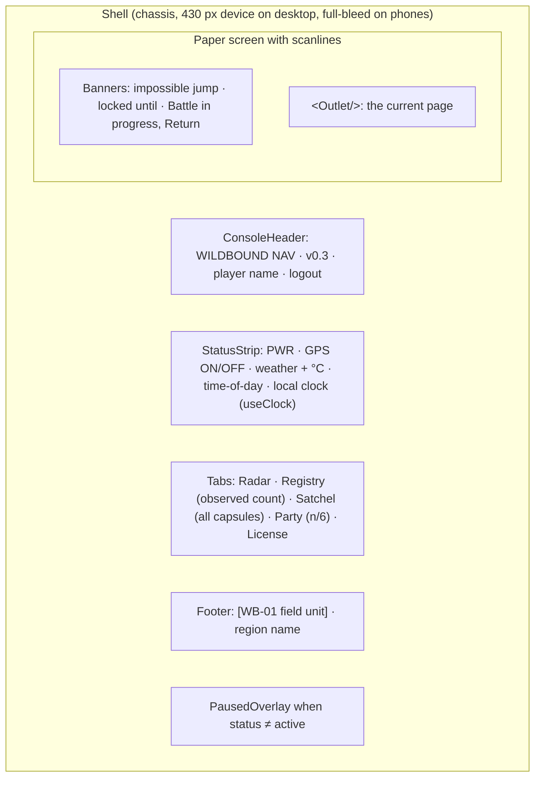

- Owns `usePositionReporter` and `useGameState` (so polling continues on every tab).
- **Five tabs** (`grid-cols-5`). To fit at 390 px the label and its counter stack in two lines; the Satchel counter sums
  every capsule type.
- **Battle banner.** Whenever `state.activeBattleId` is set and you are not on the battle screen, a gold banner reads
  "Battle in progress" with a "Return ►" link to `/play/battle/:id`, on every tab.
- **Starter redirect.** `state.needsStarter` sends the player to `/play/starter` before anything else.
- When not playable, `<main>` is blurred and non-interactive and the **Survey paused** dialog explains why
  (`denied` → "turn it back on in site settings", otherwise "we lost your GPS signal") with a retry button.
- `useClock()` ticks once a minute aligned to the minute; `formatClock(date, timeZone)` uses the server-reported zone.

## Starter

`src/features/starter/StarterPage.tsx` (`/play/starter`). Capture needs a battle and a battle needs a Wildkin, so a
player with no Wildkin (new, or an older save without any) chooses a companion first.

- The ranger at East Research Gate "entrusts every new license holder with a Wildkin that grew up around the station".
- Three cards from `GET /api/game/starter` (`STARTER_SPECIES`: Kawi, Mimu, Kantar): 128 px sprite, registry number,
  name, category chip, a short Registry description and the stat shape descriptors ("Speed: Signature strength").
- Picking one opens a confirm dialog ("Set out with Kawi? This choice is for keeps."); **Confirm** calls
  `POST /api/game/starter`, which creates a level 5 Wildkin in party slot 1 with a rolled genome and vigor and full HP,
  then navigates to the radar. The API refuses a second starter (409 `already_has_wildkin`).
- Its capture record reads "Entrusted by the rangers".

## Radar

`src/features/radar/RadarPage.tsx` + `RadarMap.tsx`.

- **Where you are** is the **server's** position (`state.position`), falling back to the raw fix until the first answer.
  The player is the PixelLab head; the dashed circle is the 60 m interact range.
- **Spawns** are MapLibre `Marker`s with a tag above the icon: the species name once your Registry has it, otherwise
  `??? No. 004`. Tag colours: gold = selected, forest green = in range, moss = out of range.
- The map is created **once** (`useEffect([])`); later effects add/move/remove markers by spawn id. The range-ring
  overlay is re-sent on several map events because a freshly mounted map isn't ready during the first effect.
- **Wandering (v0.2.0, experimental).** Spawns move on the server (see
  [07 · Wandering](07-game-systems.md#wandering-spawns-experimental)), so each poll can bring new coordinates. The
  client only animates what the server says:
  - a marker whose spawn moved **walks** from where it is drawn to the new spot, ease-in-out, in one
    `requestAnimationFrame` loop for all markers (a new position mid-walk starts from the current drawn point);
  - every walk is **desynchronised**: it waits its own random delay after the poll (so it still ends before the next
    poll, `WALK_WINDOW_MS` 9 s) and lasts according to the distance (`WALK_PACE_MPS` 1.2 m/s, clamped to
    `WALK_MIN_MS` to `WALK_MAX_MS`, 0.9 to 3.6 s). All positions arrive together with the poll, but Wildkin set off and
    stop at different moments;
  - the icon is **mirrored** (`scaleX(-1)`) when walking left, because the art faces right (it turns when the walk
    starts, not when the poll arrives);
  - new spawns **fade in** and vanished ones **fade out** (`FADE_MS` 350 ms) instead of popping;
  - with `prefers-reduced-motion` markers jump straight to the new position.
  If the spawn you have selected disappears (it wandered out of the spawn radius, expired or was deleted), the sheet
  closes and a short **"It wandered off."** message shows for 3.5 s. Wandering is kept as it is in v0.3.0; a spawn in a
  battle stops wandering and expiring.
- **In battle.** A spawn you are battling keeps its marker, with a terracotta tag "Name · In battle".
- **POI markers (v0.3.0).** Points of interest within 300 m (`state.pois`) are small square pixel signs with their name
  underneath: "+" on paper for a **field station** (POI types `research-station` and `gate`, e.g. East Research Gate),
  a gold crate mark for any other POI, faded once searched today. They sit below Wildkin markers (z-index 0, Wildkin 1,
  the player 2) and their name tags ignore taps, so a sighting always wins a tap; the player marker ignores taps too.
- **Restricted research zone.** When `state.habitatLocked` is set, the header shows it in a terracotta chip
  ("Restricted research zone: Aquatic rank 3") instead of the coordinates, and the status line says "Restricted zone:
  observe only".
- Base map: OSM raster, desaturated (−0.8) and 60 % opacity over a pale green background, so the pixel art reads first.
  Zoom 14 to 19, controls for zoom in/out and recenter.
- **Status line** (`radarStatus`) names the real reason when nothing shows: still scanning, server unreachable,
  locked, GPS too imprecise (`ACC ±x/200M` turns red), stale position, outside every published region, or nothing
  nearby.
- **Spawn sheet** (`SpawnSheet.tsx`, tap a marker): registry number, name or "Unidentified" (silhouette icon), the level
  once observed ("Lv 6"), distance, Observed and In battle chips, and two buttons:
  - **Observe** (X): disabled out of range or while the spawn is in a battle. The result names the Registry entry, the
    researcher EXP gained ("+100 Terrestrial researcher EXP (First observation of Kantar)") and the lead's EXP. After
    observing, the sheet shows the field notes from the scanner: Build ("Larger than typical"), marking ("Banded
    markings") and, from license rank 2 in its category, Temperament ("Keeps its distance").
  - **Battle** (A): `POST /api/game/spawns/:id/battle`, then navigate to `/play/battle/:id`. It is disabled with the
    reason written under it (`battleBlockedReason`), checked in this order: a battle is already running (the button
    becomes **Return** and goes to it), out of range ("Get within 60 m to observe or battle"), the spawn is busy in a
    battle, the habitat is locked ("Restricted research zone: Aquatic rank 3. You can still observe here."), or no party
    member can battle ("Your party needs rest: visit a vet or let first aid work."). On 409 `battle_in_progress` (another
    tab started one) it navigates to `details.battleId`.
- **POI sheet** (`PoiSheet.tsx`, tap a sign): name, type, distance, description, and:
  - **Search for supplies** (X): once a day per POI; shows what was found (and what did not fit the 30-per-item cap) or
    "Already searched today". The route is **exercise #14** and answers 501 until it is built: the sheet then says
    "Searching for supplies is not built yet (exercise #14 in apps/api/src/routes/game.ts). License rank-ups still grant
    items."
  - **Visit the vet** (A, field stations only): heals every Wildkin you own to full, for free, and lists any restless
    Wildkin that "cannot be treated yet".
  - **Take an assessment ►** (field stations only): a link to the License tab, where the station counts as in range.
  - Everything needs you within 60 m ("Get within 60 m to use it").
- The old capture button and its `TODO(you)` hint are gone (exercise #3 retired: capture happens in battle).

## Battle screen

`src/features/battle/BattlePage.tsx` (`/play/battle/:battleId`) plus the pure `battle-log.ts` (unit-tested in
`battle-log.test.ts`). The server resolves every turn; this screen sends one action and plays back the returned events.
The rules behind it are in [14 · Battles and research](14-battles-and-research.md).

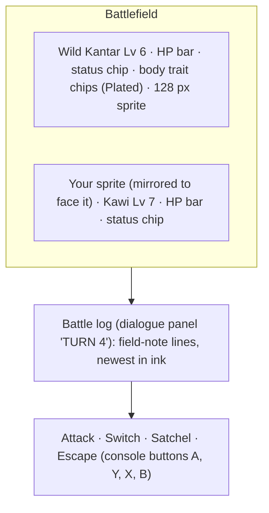

- **Layout.** The wild Wildkin at the top (name, level, HP bar as a fraction, status chip, body trait chips, sprite), the
  player's active Wildkin at the bottom (sprite mirrored, name, level, HP bar, status). The 128 px sprites are reused; no
  new art.
- **Action menu** (`ActionMenu`):

| Button | Opens / does |
|---|---|
| **Attack** (A) | The active Wildkin's one or two attacks, each with its approach and power word ("Peck · Pierce", "Moderate") |
| **Switch** (Y) | "Switch (uses your turn)": the other party members; restless and fainted ones are disabled with the reason ("Restless: it will not battle", "Fainted") |
| **Satchel** (X) | **Trail Ration** (with count; opens a picker: "Give a Trail Ration to (uses your turn)", where restless, fainted and full-strength members are disabled) and every capsule you carry, with counts. A capsule is thrown at once |
| **Escape** (B) | Tries to get away |

- **Replacement.** When your active Wildkin faints and another can fight (`awaiting === "replace"`), only the party list
  is shown: "Choose who goes next". Sending in the replacement is free.
- **Log playback.** After each action the screen keeps showing the battle as it was before the turn and plays the
  server's `events` one by one, 900 ms apart (`LINE_MS`). HP bars follow the events (`applyEvent`: damage as a share of
  max HP, switches, Trail Rations) and switch to the server's view when the log is done. Menus are disabled meanwhile.
  Lines (`eventLine`), for example:
  - "Kawi used Peck. It had nothing to shield it." (a matchup field note), "The wild Kantar used Venom Nip, but it was
    dodged."
  - "Field note recorded: Plated is weak to Crush." then "+50 Terrestrial researcher EXP (...)."
  - "The Field Capsule held. Gotcha!" or "It broke free!", "You could not get away!"
  - "Kawi gained 51 EXP.", "Kawi grew to level 7!" and, at the license cap, "Kawi's growth is held at your license
    cap."
  - The outcome line last.
- **End screens** (`EndScreen`), titled **Won**, **Captured**, **Lost**, **Escaped** or **Abandoned**, with the line from
  `BATTLE_END_LINES` (shared):

| Outcome | Line |
|---|---|
| Won | "The wild Kawi retreated into cover." |
| Captured | "Kawi was given first aid and settled into the capsule." plus a "Meet your new companion ►" link to its detail page |
| Lost | "Your Wildkin are exhausted. They have been given first aid; a vet at a field station can treat them faster." |
| Escaped | "You slipped away and the wild Kawi went back to its business." |
| Abandoned | "The wild Kawi lost interest and wandered off." |

  Each lists the EXP every Wildkin gained in the battle (`battle.expGained`) and has a **Back to radar** button.
- **Double taps.** The mutation sends the turn number the screen saw. A 409 `stale_turn` adds "That turn already
  happened. Catching up…" to the log and refetches the battle. See the
  [battle request lifecycle](01-architecture.md#a-battle-turn-post-apigamebattlesidactions).
- **Leaving.** You can switch tabs mid-battle; the battle banner brings you back. Walking more than 120 m from the spawn
  ends it as escaped, and 10 minutes without an action ends it as abandoned (both decided by the server).

## Registry

- `RegistryPage`: every species in registry order with a progress bar (caught / seen / total), filters
  (All, Caught, Seen, Unknown) and roster rows. Unknown species show the icon with the CSS `.silhouette` filter,
  "Unknown specimen" and are not clickable.
- `RegistryDetailPage` (`/play/registry/:creatureId`): dossier card with the 128 px sprite, habitat, description,
  "Observed n× · Captured n×", and either `LockedDetails` or `CapturedDetails` (**exercise #4**, currently a JSON dump;
  since v0.3.0 it also holds the species' stat shape descriptors, `entry.statShape`).
- **Field notes** (v0.3.0, observed species): the category, each body trait with what you have recorded ("weak to
  Crush · resists Pierce", or "?" until seen in battle; matchups are recorded per body trait, so a discovery on one
  Plated species fills in every Plated species), a grid of the times of day and weathers you have observed it in, and
  the individual traits recorded ("Large seen", "Banded markings seen"; a Temperament record is only named from license
  rank 2, below that it reads "Temperament variant seen").
- The UI hides nothing itself: locked fields are already `null` from the API.

## Party and Wildkin detail

- `PartyPage`: six slots (slot 1 as the large card, others as numbered rows, empty slots dashed) and storage. Each
  member shows its level ("Lv 7"), an HP bar, a condition chip (**Healthy**, **Injured**, **Fainted**, **Restless**), its
  marking variant if it has one, and a **LEAD** badge on the lead (slot 1, or the first party member that can battle
  when slot 1 cannot). Restless members say why ("Restless. Needs Aquatic rank 2 to cooperate."). **Details** opens the
  detail page; **Rename** opens `RenameForm` (**exercise #6**, the web part is still a placeholder; the API side is
  done). Moving Wildkin between slots is **exercises #7 and #8**, still open.
- `WildkinDetailPage` (`/play/party/:wildkinId`, from `GET /api/game/wildkin/:id`):
  - sprite, nickname or species, level, condition, Lead and marking chips;
  - an EXP bar to the next level ("EXP to level 8"), or "Held at license cap" (no EXP until the license ranks up), or
    "Fully grown" at 100;
  - an HP bar with a recovery estimate ("Fully recovered in about 3 h", "At full strength", or "Cannot be treated yet."
    for restless Wildkin; until exercise #13 is done there is no natural recovery, so the estimate assumes it);
  - a restless notice ("It travels with you but will not battle or accept treatment.");
  - **Use Trail Ration** (with the count left; disabled with the reason when restless, at full strength or out of
    rations);
  - **Field Registry license**: category, the license it needs ("needs Aquatic rank 2") and your rank;
  - body traits with their one-line reasons, the attacks with approach and power word;
  - **Scanner**: per stat the species shape descriptor, the individual grade (license rank 2+) and vigor word (rank 3+);
    Build, Temperament (rank 2+), Marking, Genotype (rank 4+, e.g. "Build S/L"). Hidden fields come from the server as
    `null` and read "? Rank 2";
  - **Capture record**: "Caught at Sunbreak Clearing on 12 Oct, level 6 (Day, Clear)." or "Entrusted by the rangers on
    ..." for the starter.

## License

`src/features/license/LicensePage.tsx` (`/play/license`, the fifth tab), from `GET /api/game/licenses`.

- The title says "At East Research Gate" when a field station is within 60 m, else "Assessments at a field station".
- **Four cards**, one per category (Aerial, Aquatic, Terrestrial, Verdant): rank chip, obedience cap ("Cap Lv 20"), a
  researcher EXP bar from the current threshold to the next ("140 / 600"), and for the next rank:
  - the assessment checklist (`AssessmentChecklist.tsx`, **exercise #15**). The fallback renders the plain requirement
    labels ("• Observe 2 different species"); the exercise adds progress per row ("Observe in 3 different weathers:
    1/3") with met and unmet styles. Counts are already clamped by the server to what the current world makes
    possible;
  - **Take assessment** (A): enabled when `canTakeAssessment` (enough researcher EXP, checklist met, at a field station),
    otherwise the server's `blockedReason` is shown under it (for example "Go to a field station such as East Research
    Gate");
  - a note that each rank-up grants category capsules and Field Capsules.
- After a pass, an "ASSESSMENT PASSED" panel lists the summary: the new rank and cap, "N Wildkin are no longer
  restless" when some now fall within the cap, and the items received (or what did not fit).
- At rank 5: "Highest rank. Every Aerial Wildkin trusts your care."

## Satchel

- `InventoryPage` ("Field satchel"): category filter (All, Capture, Field, Key items), an item detail panel and the
  list, with the five capsule types (Field, Canopy, Current, Burrow, Bloom), Trail Rations and the Field Notebook.
- Capsules say "Used in battle" (they are thrown from the battle's Satchel menu).
- **Use** on a Trail Ration opens a Wildkin picker (party and storage, with HP bars and condition chips); restless and
  full-strength Wildkin are disabled. Item use is refused while a battle is running (use the battle's Satchel instead).

## Visual design system

The look follows the six Stitch mockups in [`patches/0.1.0/mockups/`](../patches/0.1.0/mockups/) (`.html` + `.png`)
and the "Field Registry" tokens in [`DESIGN.md`](../patches/0.1.0/mockups/DESIGN.md): a deep-forest handheld console
around warm paper screens, light theme only.

| Mockup (Stitch) | Implemented |
|---|---|
| 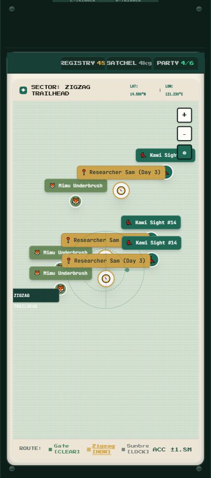 |  |

Tokens live in `src/styles.css` (`:root` variables mapped to Tailwind with `@theme inline`):

| Group | Tokens |
|---|---|
| Field Registry palette | `deep-forest #183f36`, `forest-slate`, `primary-forest #1f6b57`, `moss`, `leaf`, `field-gold #d5a84c`, `warm-paper`, `paper`, `muted-paper`, `ink #24302d`, `ink-muted`, `sky`, `water`, `terracotta #c96a5b`, `success`, `locked` |
| Console | `chassis`, `chassis-deep`, `chassis-edge`, `chassis-text`, `lcd`, `lcd-ink`, `lcd-edge`, `screen`, `screen-panel`, `screen-inset`, `screen-edge`, `led` |
| shadcn semantic | `background`, `foreground`, `primary`, `secondary`, `muted`, `accent`, `destructive`, `border`, `ring` → mapped to the palette |
| Fonts | `font-pixel` (Press Start 2P, console labels), `font-vt` (VT323, dot-matrix body), `font-sans` (Inter), `font-serif` (Noto Serif). Loaded from Google Fonts in `index.html` |
| Utilities | `.scanlines`, `.inset-panel`, `.raised-panel`, `.pixelated`, `.silhouette` |

Reusable pieces in `src/components/layout/Shell.tsx`: `Shell`, `Wordmark`, `Led`, `LcdScreen`, `ConsoleButton`
(face letters A, B, X, Y), `FaceLetter`, `ScreenTitle`. shadcn components (`button`, `badge`, `card`, `input`) in
`src/components/ui/` are restyled to the tokens. Add more with `npx shadcn add <name>` from `apps/web`.

## Art assets

| Asset | Path | Use |
|---|---|---|
| Player head | `public/player/head.png` | Radar marker, login avatar, favicon |
| Wildkin icons (64 px faces) | API `/api/art/wildkin/<creatureId>/icon.png`, fallback `public/wildkin/icons/<creatureId>.png` | Radar markers, spawn sheet, Registry roster, Party, battle party lists, Satchel picker |
| Wildkin sprites (128 px) | API `/api/art/wildkin/<creatureId>/sprite.png`, fallback `public/wildkin/sprites/<creatureId>.png` | Registry dossier, starter cards, battle screen (yours mirrored), party detail |

No new art was made for v0.3.0. Marking variants show as a text chip ("Banded markings"), not a different sprite.

### Wildkin art

Since v0.2.0 Wildkin art lives in the **database** (`wildkin_art`) and is served by the API, so a species created and
illustrated in the [Creature Manager](13-creature-manager.md) shows up in the game without rebuilding or copying files.
`lib/assets.ts` builds the URLs with `wildkinArtPath` from `@wildbound/shared`, and every Wildkin image falls back in
three steps (`wildkinArtFallback`, driven by the image's `onerror`):

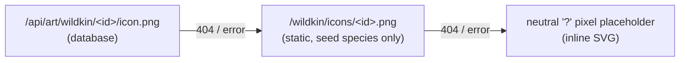

- React screens use `<WildkinImage creatureId kind>` (`components/WildkinImage.tsx`); the radar's DOM markers attach
  the same fallback to their ``.
- The static PNGs in `public/wildkin/` stay as a fallback for the five seed species; `pnpm db:seed` imports them into the
  database. File names **must equal the creature id**.
- Art was generated with PixelLab and is placeholder until approved against the Wildkin Bible. See
  [09](09-wildkin-and-content.md#art).

## Running and testing on a device

```bash
pnpm dev:api     # the game needs the API
pnpm dev:web     # http://localhost:5174
```

- Geolocation requires `https://` or `localhost`. On desktop use Chrome DevTools → *More tools → Sensors* → a custom
  location inside a published region, e.g. `14.6518, 121.0444`. Move in small steps (big jumps are rejected).
- On a phone, the page must be HTTPS (use a tunnel such as `cloudflared` or `ngrok` pointing at :5174). The Vite proxy
  forwards `/api` to the API, so only the game port needs to be exposed.
- Override the API target with `API_PROXY_TARGET=http://host:4000 pnpm dev:web`.
- **A full v0.3.0 walk-through** at `14.6518, 121.0444` (Sunbreak): choose a starter, observe and battle a Wildkin,
  throw a capsule once it is weakened, open the new companion's detail page, then step to East Research Gate to visit
  the vet and look at the License tab. To try a lost battle quickly, battle something stronger, or lower your party's HP
  in the database first. To test a restricted zone, see [05 · Locking a habitat](05-map-editor.md#locking-a-habitat-for-testing).

Next: [07 · Game systems](07-game-systems.md).
