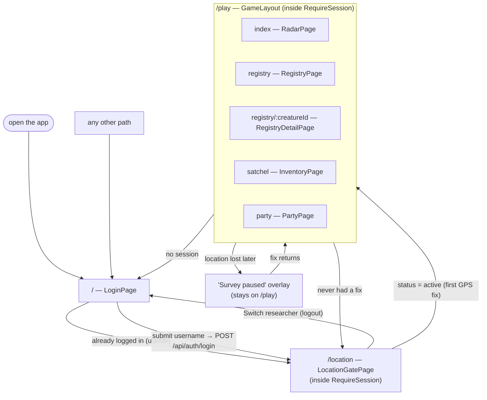
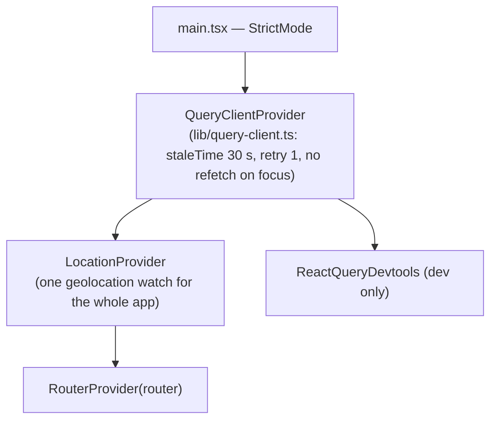
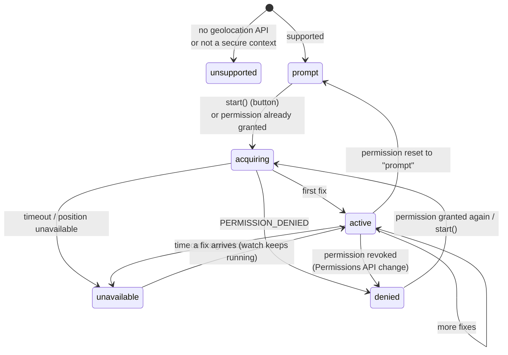
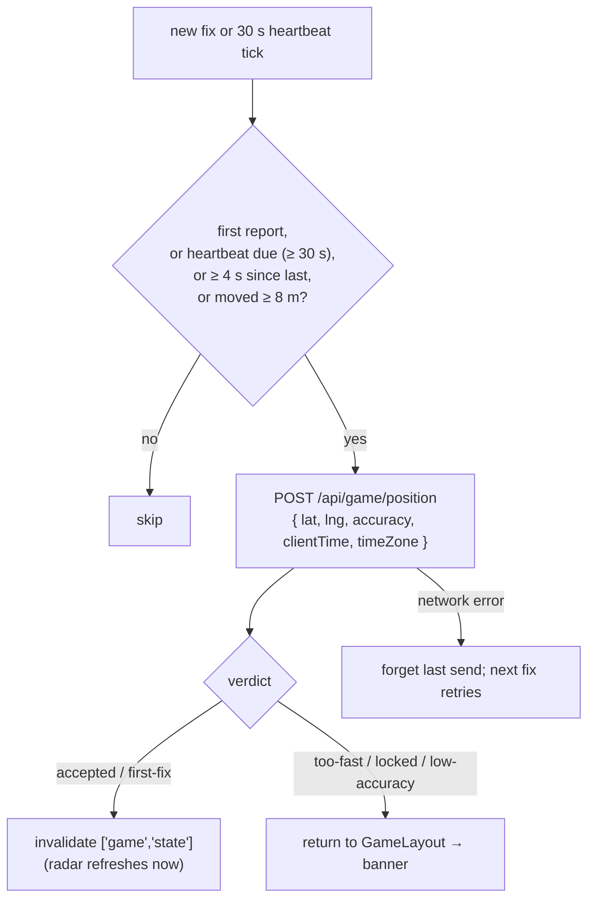
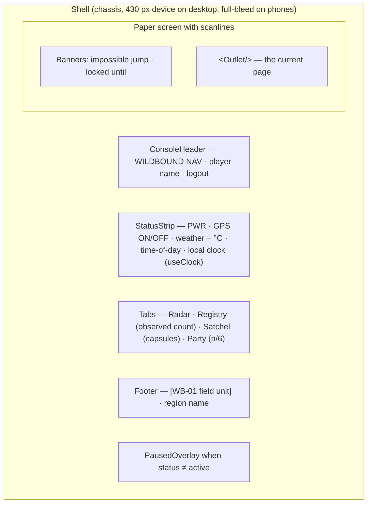
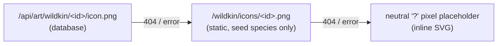

# 06 · Web game (`apps/web`)

> **In plain English:** this is the game players use on their phones. It looks like a handheld "field navigator"
> gadget. It asks for a username, then for location sharing, then shows a radar with nearby Wildkin, a Registry
> (field guide), a Satchel (bag) and a Party. It doesn't decide anything important itself; it shows what the server
> says and sends the server your GPS position.

| Login | Location gate | Radar | Observe |
|---|---|---|---|
|  |  |  |  |

| Registry | Registry entry | Satchel | Party | Paused |
|---|---|---|---|---|
|  |  |  |  |  |

*Screenshots at 390 × 844 with a simulated position in Sunbreak Clearing, at night, offline (blank base map).*

## Contents

- [Screen flow and routing](#screen-flow-and-routing)
- [Provider tree](#provider-tree)
- [Location: `LocationProvider`](#location-locationprovider)
- [Position reporting: `usePositionReporter`](#position-reporting-usepositionreporter)
- [Server state: API client and queries](#server-state-api-client-and-queries)
- [GameLayout: the console shell](#gamelayout-the-console-shell)
- [Radar](#radar)
- [Registry](#registry)
- [Satchel and Party](#satchel-and-party)
- [Visual design system](#visual-design-system)
- [Art assets](#art-assets)
- [Running and testing on a device](#running-and-testing-on-a-device)

## Screen flow and routing

`src/router.tsx` (React Router 7, `createBrowserRouter`):



| Guard | Where | Rule |
|---|---|---|
| `RequireSession` | wraps `/location` and `/play/*` | `useMe()` pending → "Opening your ledger…"; error → "Cannot reach the API"; no player → `/` |
| `LoginPage` | `/` | Already logged in → `/location` |
| `LocationGatePage` | `/location` | `status === "active"` → `/play` |
| `GameLayout` | `/play` | No player → `/`; **no fix ever** → `/location`; fix lost later → paused overlay, not a redirect |

The difference matters: a player who loses GPS mid-game is **paused, not kicked out**, which is what the brief asked for.

## Provider tree



`LocationProvider` sits **above** the router so the GPS watch survives page changes.

## Location: `LocationProvider`

`src/features/location/LocationProvider.tsx` owns one `navigator.geolocation.watchPosition` (high accuracy,
`maximumAge 5 s`, `timeout 20 s`) and listens to the Permissions API. It exposes `{ status, fix, start }`.



| Status | Meaning | Playable? |
|---|---|---|
| `unsupported` | No API, or page not on `https://`/`localhost` | no |
| `prompt` | Waiting for the user to press "Allow location" | no |
| `acquiring` | Permission granted, waiting for a fix | no |
| `active` | Receiving fixes | **yes (only this)** |
| `denied` | Blocked by the user | no |
| `unavailable` | Allowed but no fix arriving | no |

`fix = { lat, lng, accuracy, timestamp }` is the latest raw browser fix.

## Position reporting: `usePositionReporter`

`src/features/location/usePositionReporter.ts`, used by `GameLayout` while `status === "active"`.



- The **heartbeat** exists because browsers stop calling `watchPosition` when the device is still, but the server only
  treats a position as current for 2 minutes (`GAME_RULES.positionStaleMs`).
- The hook returns the server's last `PositionResponse`, so `GameLayout` can show "That GPS jump looked impossible" or
  "Survey paused until …".

## Server state: API client and queries

`src/lib/api.ts`: a same-origin `fetch` wrapper. Every response is parsed with its Zod schema; errors become
`ApiError(status, code, message)`. Vite proxies `/api` to the API, so the httpOnly cookie just works.

`src/lib/queries.ts`:

| Hook | Key | Notes |
|---|---|---|
| `useMe()` | `["me"]` | Returns `null` on 401. `staleTime: Infinity` |
| `useLogin()` / `useLogout()` | – | `queryClient.clear()` then set `me` (a different save slot must not see cached data) |
| `useGameState(enabled)` | `["game","state"]` | **Polls every 10 s**, `staleTime 5 s`, only while location is active |
| `useRegistry()` | `["game","registry"]` | |
| `useInventory()` | `["game","inventory"]` | |
| `useParty()` | `["game","party"]` | |
| `useObserve()` | – | On success invalidates registry + state |
| `useCapture()` | – | On settle invalidates state, registry, inventory, party |

Rule of thumb from the code: **anything a mutation changes on the server gets invalidated in `onSuccess`/`onSettled`.**

## GameLayout: the console shell

`src/features/game/GameLayout.tsx` wraps every `/play` page:



- Owns `usePositionReporter` and `useGameState` (so polling continues on every tab).
- When not playable, `<main>` is blurred and non-interactive and the **Survey paused** dialog explains why
  (`denied` → "turn it back on in site settings", otherwise "we lost your GPS signal") with a retry button.
- `useClock()` ticks once a minute aligned to the minute; `formatClock(date, timeZone)` uses the server-reported zone.

## Radar

`src/features/radar/RadarPage.tsx` + `RadarMap.tsx`.

- **Where you are** is the **server's** position (`state.position`), falling back to the raw fix until the first answer.
  The player is the PixelLab head; the dashed circle is the 60 m interact range.
- **Spawns** are MapLibre `Marker`s with a tag above the icon: the species name once your Registry has it, otherwise
  `??? No. 004`. Tag colours: gold = selected, forest green = in range, moss = out of range.
- The map is created **once** (`useEffect([])`); later effects add/move/remove markers by spawn id. The range-ring
  overlay is re-sent on several map events because a freshly mounted map isn't ready during the first effect.
- **Wandering (v0.2.0, experimental).** Spawns move on the server (see
  [07 · Wandering](07-game-systems.md#wandering-spawns-experimental)), so each poll can bring new coordinates. The
  client only animates what the server says:
  - a marker whose spawn moved **walks** from where it is drawn to the new spot, ease-in-out, in one
    `requestAnimationFrame` loop for all markers (a new position mid-walk starts from the current drawn point);
  - every walk is **desynchronised**: it waits its own random delay after the poll (so it still ends before the next
    poll, `WALK_WINDOW_MS` 9 s) and lasts according to the distance (`WALK_PACE_MPS` 1.2 m/s, clamped to
    `WALK_MIN_MS`–`WALK_MAX_MS`, 0.9–3.6 s). All positions arrive together with the poll, but Wildkin set off and
    stop at different moments;
  - the icon is **mirrored** (`scaleX(-1)`) when walking left, because the art faces right (it turns when the walk
    starts, not when the poll arrives);
  - new spawns **fade in** and vanished ones **fade out** (`FADE_MS` 350 ms) instead of popping;
  - with `prefers-reduced-motion` markers jump straight to the new position.
  If the spawn you have selected disappears (it wandered out of the spawn radius, expired or was deleted), the sheet
  closes and a short **"It wandered off."** message shows for 3.5 s. A capture result ("Captured!", "It slipped away")
  is shown instead when the spawn left because of a capture. This movement may be removed by v0.3.0 if it feels clunky.
- Base map: OSM raster, desaturated (−0.8) and 60 % opacity over a pale green background, so the pixel art reads first.
  Zoom 14–19, controls for zoom in/out and recenter.
- **Status line** (`radarStatus`) names the real reason when nothing shows: still scanning, server unreachable,
  locked, GPS too imprecise (`ACC ±x/200M` turns red), stale position, outside every published region, or nothing
  nearby.
- **Spawn sheet** (tap a marker): registry number, name or "Unidentified" (silhouette icon), distance, Observed badge,
  **Observe** (X) and **Capture** (A) buttons, disabled when out of range. Capture shows "isn't built yet" for the 501.

## Registry

- `RegistryPage`: every species in registry order with a progress bar (caught / seen / total), filters
  (All, Caught, Seen, Unknown) and roster rows. Unknown species show the icon with the CSS `.silhouette` filter,
  "Unknown specimen" and are not clickable.
- `RegistryDetailPage` (`/play/registry/:creatureId`): dossier card with the 128 px sprite, habitat, description,
  "Observed n× · Captured n×", and either `LockedDetails` or `CapturedDetails` (**exercise #4**, currently a JSON dump).
- The UI hides nothing itself: locked fields are already `null` from the API.

## Satchel and Party

- `InventoryPage` ("Field satchel"): category filter (All, Capture, Field, Key items), an item detail panel and the
  list. Read-only in v0.1.0.
- `PartyPage`: six slots (slot 1 as the large "LEAD" card, others as rows, empty slots dashed) and storage. Each
  member has a **Rename** button opening `RenameForm` (**exercise #6**, currently a placeholder). Moving Wildkin
  between slots is **exercise #8** (stretch).

## Visual design system

The look follows the six Stitch mockups in [`patches/0.1.0/mockups/`](../patches/0.1.0/mockups/) (`.html` + `.png`)
and the "Field Registry" tokens in [`DESIGN.md`](../patches/0.1.0/mockups/DESIGN.md): a deep-forest handheld console
around warm paper screens, light theme only.

| Mockup (Stitch) | Implemented |
|---|---|
|  |  |

Tokens live in `src/styles.css` (`:root` variables mapped to Tailwind with `@theme inline`):

| Group | Tokens |
|---|---|
| Field Registry palette | `deep-forest #183f36`, `forest-slate`, `primary-forest #1f6b57`, `moss`, `leaf`, `field-gold #d5a84c`, `warm-paper`, `paper`, `muted-paper`, `ink #24302d`, `ink-muted`, `sky`, `water`, `terracotta #c96a5b`, `success`, `locked` |
| Console | `chassis`, `chassis-deep`, `chassis-edge`, `chassis-text`, `lcd`, `lcd-ink`, `lcd-edge`, `screen`, `screen-panel`, `screen-inset`, `screen-edge`, `led` |
| shadcn semantic | `background`, `foreground`, `primary`, `secondary`, `muted`, `accent`, `destructive`, `border`, `ring` → mapped to the palette |
| Fonts | `font-pixel` (Press Start 2P, console labels), `font-vt` (VT323, dot-matrix body), `font-sans` (Inter), `font-serif` (Noto Serif). Loaded from Google Fonts in `index.html` |
| Utilities | `.scanlines`, `.inset-panel`, `.raised-panel`, `.pixelated`, `.silhouette` |

Reusable pieces in `src/components/layout/Shell.tsx`: `Shell`, `Wordmark`, `Led`, `LcdScreen`, `ConsoleButton`
(face letters A, B, X, Y), `FaceLetter`, `ScreenTitle`. shadcn components (`button`, `badge`, `card`, `input`) in
`src/components/ui/` are restyled to the tokens. Add more with `npx shadcn add <name>` from `apps/web`.

## Art assets

| Asset | Path | Use |
|---|---|---|
| Player head | `public/player/head.png` | Radar marker, login avatar, favicon |
| Wildkin icons (64 px faces) | API `/api/art/wildkin/<creatureId>/icon.png`, fallback `public/wildkin/icons/<creatureId>.png` | Radar markers, spawn sheet, Registry roster, Party |
| Wildkin sprites (128 px) | API `/api/art/wildkin/<creatureId>/sprite.png`, fallback `public/wildkin/sprites/<creatureId>.png` | Registry dossier |

### Wildkin art

Since v0.2.0 Wildkin art lives in the **database** (`wildkin_art`) and is served by the API, so a species created and
illustrated in the [Creature Manager](13-creature-manager.md) shows up in the game without rebuilding or copying files.
`lib/assets.ts` builds the URLs with `wildkinArtPath` from `@wildbound/shared`, and every Wildkin image falls back in
three steps (`wildkinArtFallback`, driven by the image's `onerror`):



- React screens use `<WildkinImage creatureId kind>` (`components/WildkinImage.tsx`); the radar's DOM markers attach
  the same fallback to their ``.
- The static PNGs in `public/wildkin/` stay as a fallback for the five seed species; `pnpm db:seed` imports them into the
  database. File names **must equal the creature id**.
- Art was generated with PixelLab and is placeholder until approved against the Wildkin Bible. See
  [09](09-wildkin-and-content.md#art).

## Running and testing on a device

```bash
pnpm dev:api     # the game needs the API
pnpm dev:web     # http://localhost:5174
```

- Geolocation requires `https://` or `localhost`. On desktop use Chrome DevTools → *More tools → Sensors* → a custom
  location inside a published region, e.g. `14.6518, 121.0444`. Move in small steps (big jumps are rejected).
- On a phone, the page must be HTTPS (use a tunnel such as `cloudflared` or `ngrok` pointing at :5174). The Vite proxy
  forwards `/api` to the API, so only the game port needs to be exposed.
- Override the API target with `API_PROXY_TARGET=http://host:4000 pnpm dev:web`.

Next: [07 · Game systems](07-game-systems.md).
