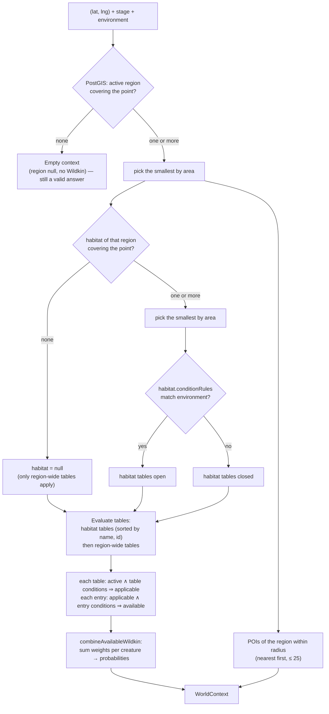
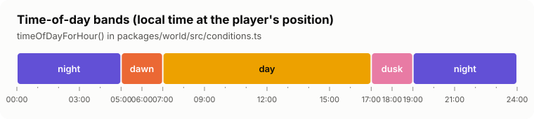
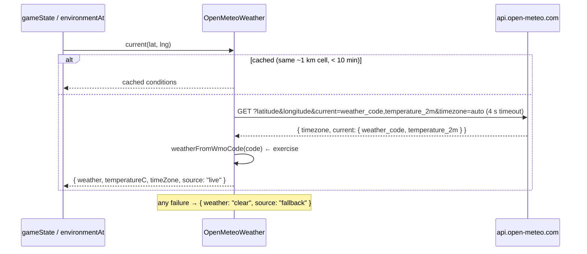
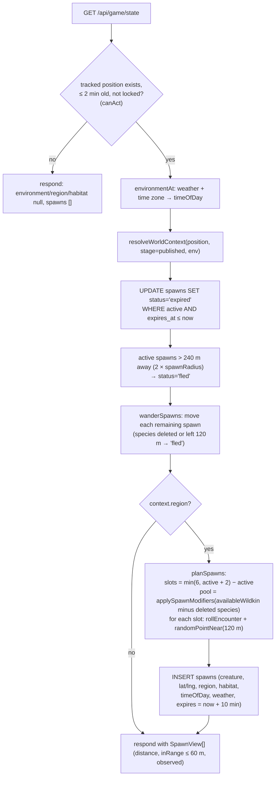
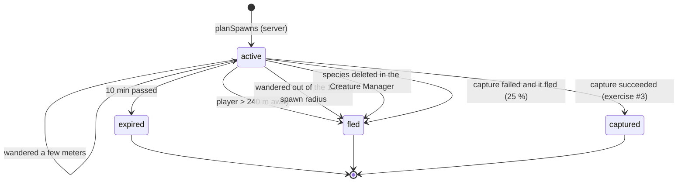
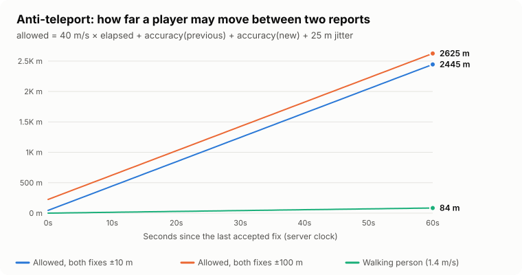
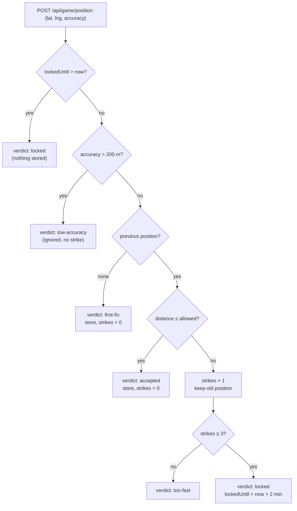
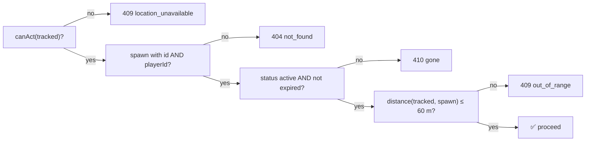
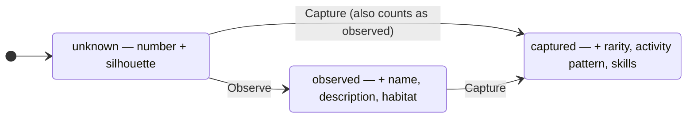

# 07 · Game systems

> **In plain English:** this page explains the rules of the game: how the server works out which habitat you're in,
> how it picks which Wildkin appear, how time and weather change the odds, how spawned Wildkin wander around, how it
> spots fake GPS jumps, and how the Registry fills in. Each section starts with the idea, then shows the exact formula and where the code lives.

Almost every rule here is a **pure function in `packages/world`** (no database, no network), tested in
`packages/world/src/*.test.ts`. The API's `apps/api/src/game/service.ts` glues them to the database.

## Contents

- [Coordinate resolution](#coordinate-resolution)
- [Encounter math](#encounter-math)
- [Time of day](#time-of-day)
- [Weather](#weather)
- [Spawn modifiers](#spawn-modifiers)
- [Spawning lifecycle](#spawning-lifecycle)
- [Wandering spawns (experimental)](#wandering-spawns-experimental)
- [Anti-teleport (movement checks)](#anti-teleport-movement-checks)
- [Acting on a spawn: Observe and Capture](#acting-on-a-spawn-observe-and-capture)
- [Registry unlocking](#registry-unlocking)
- [Inventory and party](#inventory-and-party)
- [World validation](#world-validation)
- [All tunable numbers](#all-tunable-numbers)

## Coordinate resolution

*"I'm at this GPS point. What part of the WILDBOUND world is that?"*



| Step | Code |
|---|---|
| Spatial lookups (region, habitat, POIs, candidate tables) | `findSpatialContext()` in `packages/db/src/world-repo.ts` |
| Environment default (time from zone, weather default clear) | `resolveWorldContext()` in `apps/api/src/resolve.ts` |
| Rules and assembly | `assembleWorldContext()` in `packages/world/src/context.ts` |
| Table evaluation | `evaluateEncounterTable()` in `packages/world/src/encounters.ts` |
| Merge across tables | `combineAvailableWildkin()` |

Why "smallest wins": a small habitat drawn inside a bigger one is the more specific place (a pond inside a forest).

## Encounter math

*"Which Wildkin can appear here, and how likely is each?"*

Weights are relative. Within one table, an available entry's probability is its weight divided by the sum of available
weights in that table. Across tables, weights for the same creature are **summed** and normalized.

**Worked example** (Sunbreak Clearing from the seed world):

| Entry | Weight | Entry conditions | Day | Night |
|---|---:|---|---|---|
| Lumae | 60 | dawn, day | ✅ 60 | ❌ |
| Kawi | 25 | any | ✅ 25 | ✅ 25 |
| Kantar | 15 | any | ✅ 15 | ✅ 15 |
| **Total available** | | | **100** | **40** |
| Probabilities | | | Lumae 60 %, Kawi 25 %, Kantar 15 % | Kawi 62.5 %, Kantar 37.5 % |

The night column is exactly what the editor's Test panel shows in
[the Test mode screenshot](05-map-editor.md#test-mode).

Then a creature is **rolled**:

```ts
// rollEncounter(candidates, random) — packages/world/src/encounters.ts
total = Σ weight; threshold = random() × total
walk the list subtracting weights; the first one that takes threshold below 0 wins
```

`seededRandom(seed)` (mulberry32) gives reproducible rolls for tests and previews.

Charts of the seed world's odds: [09 · Wildkin and world content](09-wildkin-and-content.md#who-spawns-where).

## Time of day



| Band | Local hours |
|---|---|
| dawn | 05:00–06:59 |
| day | 07:00–16:59 |
| dusk | 17:00–18:59 |
| night | 19:00–04:59 |

- `timeOfDayForHour(h)` and `timeOfDayAt(date, timeZone)` in `packages/world/src/conditions.ts` (uses
  `Intl.DateTimeFormat` with `hourCycle: "h23"`).
- **Game:** the time zone is the location's own (from Open-Meteo `timezone=auto`), else the zone the browser reported
  with the position, else `WORLD_TIMEZONE`. The server clock is used, never the client's.
- **Editor preview:** `timeOfDay` can be forced; otherwise current hour in `WORLD_TIMEZONE`.
- The status strip in the game shows the device's clock formatted in the server-reported zone.

## Weather



- Cache key is `lat.toFixed(2),lng.toFixed(2)` (a cell roughly 1.1 km across); TTL 10 min, kept in process memory.
- **Exercise #1:** `weatherFromWmoCode()` in `packages/world/src/weather.ts` currently always returns `"clear"`.
  Intended mapping:

| WMO code(s) | WILDBOUND weather |
|---|---|
| 0, 1 | clear |
| 2, 3 | cloudy |
| 45, 48 | fog |
| 51–57 drizzle, 61–67 rain, 71–77 snow, 80–82 showers, 85–86 snow showers | rain |
| 95, 96, 99 | storm |
| anything else | cloudy |

- `WEATHER_API_URL=off` → `StaticWeather` (always clear) for offline development. Tests use `StaticWeather` with any
  weather they need.

## Spawn modifiers

Encounter **conditions** are yes/no ("only at night"). **Spawn modifiers** are per-species multipliers that make a
Wildkin more or less common in each weather and time band:

```
effectiveWeight = weight × weather[env.weather] × timeOfDay[env.timeOfDay]     (missing key = ×1; 0 removes it)
```


**Exercise #2:** `applySpawnModifiers()` in `packages/world/src/spawning.ts` currently returns the weights unchanged,
so in v0.1.0 weather and time only act through encounter-table conditions. Tests: `spawning.exercise.test.ts`. The
modifiers are applied **only when spawning** (`planSpawns`) and in the editor's Test preview, not in `/resolve`'s
`availableWildkin`.

## Spawning lifecycle

*"Where do Wildkin come from and where do they go?"* Spawns are created lazily: every `GET /api/game/state` (the radar
polls every 10 s) runs one "tick" for that player.





Notes:

- **At most 2 new spawns per tick** (`MAX_NEW_SPAWNS_PER_TICK` in `service.ts`), so a cleared area refills gradually.
- `randomPointNear` places points uniformly in a disc (`r = R·√u`) using a flat-earth approximation, fine at 120 m.
- Spawns belong to **one player**; two players standing together see different spawns.
- Spawn rows are never deleted; old ones stay with their final status (useful for analytics; prune later if needed).
- **Deleted species never spawn.** `availableWildkin` is filtered against the live creature list (soft-deleted
  species are not in it), even when a published encounter table still names them.

## Wandering spawns (experimental)

> ⚠️ **Experimental (v0.2.0).** Wandering was added so the radar feels alive. It may be tuned or removed by v0.3.0 after
> play-testing. Everything is in one pure module plus one function in the API, so it is easy to switch off (see the
> end of this section).

*"Wildkin shouldn't stand still like pins on a map."* On every radar poll the server moves each active spawn a little,
like an animal going about its business: it keeps a rough heading with some drift, stops now and then, and its speed
depends on its species.

**Where:** `wanderStep()` / `wander()` in `packages/world/src/wandering.ts` (pure, tested in `wandering.test.ts`),
called by `wanderSpawns()` in `apps/api/src/game/service.ts`.

### How one step works


The **movement style** is a field of the species (`creatures.movement_style`, chosen in the
[Creature Manager](13-creature-manager.md), default `forager`). Its profile (`WANDER_PROFILES`):

| Style | Feels like | Speed while moving | Pause chance per step | Max turn per step | Typical drift per minute* |
|---|---|---:|---:|---:|---:|
| `still` | rooted, resting, hiding | 0.05 m/s | 85 % | 180° | < 1 m |
| `skulker` | short cautious moves, long pauses | 0.35 m/s | 60 % | 120° | ~8 m |
| `forager` | slow meandering | 0.4 m/s | 35 % | 90° | ~15 m |
| `roamer` | steady travel in one general direction | 0.7 m/s | 20 % | 36° | ~35 m |
| `darter` | quick bursts with frequent stops | 1.2 m/s | 50 % | 180° | ~35 m |

\* Total path length over 6 steps in the active period; the straight-line displacement is smaller because of turns.

**Activity period.** Outside the times its `activityPattern` counts as active, a Wildkin moves at **35 %** of its
speed (`INACTIVE_SPEED_FACTOR`), so a nocturnal species found at noon mostly dozes:

| Activity pattern | Active at |
|---|---|
| `diurnal` | dawn, day |
| `nocturnal`, `sheltering_by_day` | dusk, night |
| `crepuscular` | dawn, dusk |
| `cathemeral`, `seasonal`, `TBD` | always |

Seed species: Kawi `darter`, Mimu `skulker`, Lumae `forager`, Kantar `skulker`, Riverkin `roamer`.

### How it is driven by the poll

```
each step lasts its own random time: spawnWanderStepMs (10 s) × 0.5–1.5   → 5–15 s
steps    = as many steps as fit into (now − spawn.moved_at), at most spawnWanderMaxSteps (6)
moved_at = moved_at + time those steps took   (keeps the leftover, so slow polling doesn't slow Wildkin)
           or now, when the 6-step cap was hit (a player back from a break doesn't see Wildkin teleport)
new spawn: moved_at = now − random × 10 s     (a random phase, so spawns created together don't step together)
```

**No lockstep.** Because every step has its own length and every spawn its own phase, a poll usually finds that some
Wildkin took a step and others did not, and the radar then starts each walk at its own moment (below). Wildkin move
on their own instead of all at once on the poll tick.

- After each step, if the spawn is more than `spawnRadiusM` (**120 m**) from the player's tracked position, it stops
  and is marked `fled` ("it wandered off"). The older 240 m "player walked away" rule still runs first.
- A spawn whose species has been soft-deleted is marked `fled` without moving.
- `heading` is stored on the spawn so the next poll continues the same general direction.
- All randomness goes through `deps.random`, so tests with `seededRandom()` are deterministic.

### What the player sees

The radar animates the server's positions: each marker waits its **own random delay** after a poll before walking
and walks for a time that depends on the distance (short hops are quick, long treks slower), so markers set off and
stop at different moments. They face the direction they walk, fade in and out, and "It wandered off." appears when
the selected Wildkin leaves. Details in
[06 · Radar](06-web-game.md#radar).

### Tuning or switching it off

- Speeds and pause chances: `WANDER_PROFILES` and `INACTIVE_SPEED_FACTOR` in `packages/world/src/wandering.ts`.
- Step length and catch-up cap: `GAME_RULES.spawnWanderStepMs` / `spawnWanderMaxSteps` in
  `packages/shared/src/game.ts`; how much each step's length varies: `STEP_JITTER` (0.5 = ±50 %) in `wandering.ts`.
- On-screen walk: `WALK_MIN_MS` / `WALK_MAX_MS`, `WALK_PACE_MPS` and `WALK_WINDOW_MS` in
  `apps/web/src/features/radar/RadarMap.tsx`.
- Per species: change its movement style in the Creature Manager and publish.
- To disable it entirely, skip the `wanderSpawns(...)` call in `gameState()` (keep the active spawns as they are) or
  give every species the `still` style. The database columns (`heading`, `moved_at`) are harmless if unused.

## Anti-teleport (movement checks)

*"Is this new GPS position believable given the last one?"* — `checkMovement()` in `packages/world/src/movement.ts`,
called by `reportPosition()` in `apps/api/src/game/service.ts`.

```
allowed = maxSpeedMps (40) × elapsedSeconds  +  previous.accuracy  +  new.accuracy  +  jitterSlack (25 m)
accept if haversineDistance(previous, new) ≤ allowed
elapsed uses the SERVER clock; the client's timestamp is ignored
```





**Worked example:** last accepted fix 10 s ago at ±10 m; new fix ±10 m.
Allowed = 40 × 10 + 10 + 10 + 25 = **445 m**. Walking 14 m: accepted. Jumping 3 km: rejected, strike 1.

| Situation | Effect |
|---|---|
| Accepted move | strikes reset to 0, `lastSeenAt` updated |
| 3 rejected jumps in a row | locked 2 min (radar shows "Survey paused until …") |
| Locked | every report ignored until the lock expires; `canAct` false |
| Position older than 2 min | `canAct` false: no spawns, no actions (the web client heartbeats every 30 s to prevent this) |

Limits are plausibility checks, not proof: see [08 · Security](08-security.md#what-the-anti-cheat-does-not-stop).

## Acting on a spawn: Observe and Capture

Both go through `loadActionableSpawn(deps, playerId, spawnId)`:



**Observe** (implemented): one transaction upserts `registry_entries` (create, or `times_observed + 1`) and sets
`spawns.observed_at` (first time only). Returns the new Registry view and `firstObservation`.

**Capture** (exercise #3): intended rules from `packages/world/src/capture.ts`:

| Rarity | Base chance | Observed first (+0.15) |
|---|---:|---:|
| common | 70 % | 85 % |
| uncommon | 50 % | 65 % |
| rare | 30 % | 45 % |
| TBD | 60 % | 75 % |

Capped at 95 %. On a failed attempt the Wildkin flees with 25 % chance (`FLEE_CHANCE_ON_FAIL`). Every attempt costs
one Field Capsule. On success: spawn → `captured`, a `captured_wildkin` row in the first free party slot (0–5) or
storage, Registry `first_captured_at`/`times_captured` updated. All in **one transaction** so double taps can't spend
one capsule twice or capture one spawn twice.

## Registry unlocking

`registryView(creature, entry)` in `apps/api/src/game/views.ts`:



Status is derived: no row = unknown; row with `first_captured_at` = captured; otherwise observed. Locked fields are
sent as `null`, so a player can't read them from the network tab.

## Inventory and party

- Items are defined in code (`ITEMS` in `packages/shared/src/game.ts`); the DB only stores `(player, item, quantity)`.
  New players get `STARTER_INVENTORY` inside the login upsert.
- Quantities can't go negative (DB CHECK), which also protects against races.
- Party = `captured_wildkin.party_slot` 0–5; `NULL` = storage. The unique `(player_id, party_slot)` index means
  rearranging must clear slots first, then assign (exercise #7 explains this).

## World validation

Two levels, both in `packages/world/src/validation.ts`:

| Level | Function | Blocks | Rules |
|---|---|---|---|
| Schema | `schemaIssues(input)` | saving (400) | Zod: shapes, slugs, closed rings, ≥ 3 distinct vertices, weight range, coordinate range, limits |
| Integrity | `checkIntegrity(doc, creatureIds)` | saving (400) | duplicate ids; duplicate region slugs (world) / habitat & POI slugs (per region); missing parent region/habitat; table's habitat in another region; unknown Wildkin; duplicate entry ids; self-intersecting boundaries |
| Publish | `validateWorld(doc, creatureIds)` = integrity + the rows below | publishing (409) when any **error** | see below |

| Rule (`code`) | Severity |
|---|---|
| `habitat-outside-region` — more than 50 % of a habitat outside its region | error |
| `poi-outside-region` | error |
| `empty-encounter-table` — active table with no entries | error |
| `habitat-partially-outside-region` — more than 1 % outside | warning |
| `habitats-overlap` — overlap > 1 m² in the same region (smaller wins) | warning |
| `region-without-habitats` | warning |
| `habitat-without-encounters` | warning |
| `duplicate-creature-entry` — same Wildkin twice in a table | warning |
| `no-active-region` | warning |

Geometry checks use Turf (`isSimpleArea`, `fractionOutside`, `overlapSquareMeters`, `pointInArea`), with a 1 m²
tolerance for digitizing noise. The database's `ST_IsValid` CHECK is the final backstop.

## All tunable numbers

| Constant | Value | Where | Effect of raising it |
|---|---|---|---|
| `GAME_RULES.spawnRadiusM` | 120 m | `shared/src/game.ts` | Spawns further away; "fled" distance is 2× this |
| `GAME_RULES.interactRadiusM` | 60 m | 〃 | Observe/capture from further away; radar ring grows |
| `GAME_RULES.maxActiveSpawns` | 6 | 〃 | More Wildkin on the radar |
| `GAME_RULES.spawnTtlMs` | 10 min | 〃 | Spawns linger longer |
| `GAME_RULES.spawnWanderStepMs` | 10 s | 〃 | Wildkin take fewer, longer-spaced steps (each step covers more ground) |
| `GAME_RULES.spawnWanderMaxSteps` | 6 | 〃 | More catch-up movement after a gap between polls |
| `WANDER_PROFILES`, `INACTIVE_SPEED_FACTOR` | see [Wandering](#wandering-spawns-experimental) | `world/src/wandering.ts` | Faster / more restless Wildkin, more of them wander off |
| `GAME_RULES.maxSpeedMps` | 40 m/s | 〃 | More lenient anti-teleport |
| `GAME_RULES.maxAccuracyM` | 200 m | 〃 | Accept fuzzier fixes (desktop Wi-Fi location is often 50–150 m) |
| `GAME_RULES.jitterSlackM` | 25 m | 〃 | More GPS wobble tolerated |
| `GAME_RULES.strikesBeforeLock` | 3 | 〃 | More rejected jumps before a lock |
| `GAME_RULES.lockMs` | 2 min | 〃 | Longer lockout |
| `GAME_RULES.positionStaleMs` | 2 min | 〃 | Positions stay "current" longer (keep > web heartbeat 30 s) |
| `GAME_RULES.sessionTtlMs` | 30 days | 〃 | Login lasts longer |
| `MAX_NEW_SPAWNS_PER_TICK` | 2 | `api/src/game/service.ts` | Faster refill |
| Weather cache | 10 min, 0.01° cells | `api/src/weather.ts` | Fewer Open-Meteo calls, staler weather |
| Radar poll | 10 s | `web/src/lib/queries.ts` | Faster refill, more load |
| Report throttle / heartbeat | 4 s or 8 m / 30 s | `web/.../usePositionReporter.ts` | |
| Capture chances, flee chance | see table above | `world/src/capture.ts` | |
| Time-of-day boundaries | 5/7/17/19 h | `world/src/conditions.ts` | |
| Habitat outside thresholds | 50 % error, 1 % warning | `world/src/validation.ts` | |
| POI radius default / max / limit | 300 m / 5000 m / 25 | `shared/src/constants.ts` | |

Changing a `GAME_RULES` value affects client and server at once (the web app imports it to draw the range ring and
accuracy limit). Re-run `pnpm test` (several tests assert these numbers) and regenerate the charts
(`node docs/images/generate-charts.mjs`) if you change the movement formula.

Next: [08 · Security model](08-security.md).
