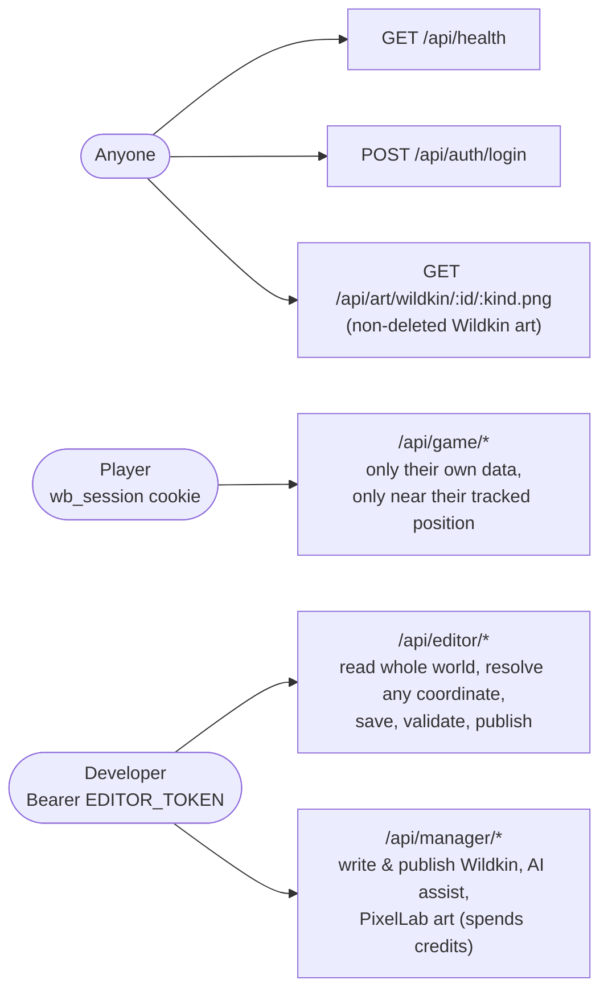
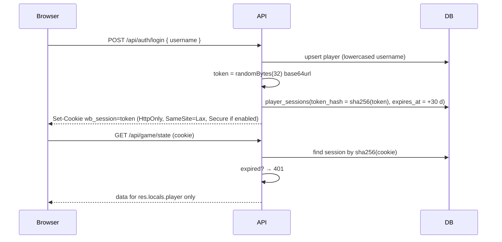

# 08 · Security model

> **In plain English:** two kinds of people talk to the server: developers (with a secret editor token, used by the Map
> Editor and the Creature Manager) and players
> (with a login cookie). The server never trusts what a player's phone *claims*; it checks that movements are
> believable and only lets players act on Wildkin it placed for them, near where it believes they are. It also plays
> out every battle turn itself and never sends the phone what the player is not supposed to know. WILDBOUND (v0.3.0) is
> built for local development: it has no passwords, so it is **not ready to put on the public internet** yet.

## Contents

- [Who can do what](#who-can-do-what)
- [Threat model](#threat-model)
- [Editor authentication](#editor-authentication)
- [Player sessions](#player-sessions)
- [Server authority: what the client may and may not say](#server-authority-what-the-client-may-and-may-not-say)
- [What the anti-cheat does not stop](#what-the-anti-cheat-does-not-stop)
- [Input validation and SQL safety](#input-validation-and-sql-safety)
- [Checklist before a public deployment](#checklist-before-a-public-deployment)
- [Rules for new code](#rules-for-new-code)

## Who can do what

| Capability | Anyone | Player | Editor |
|---|:-:|:-:|:-:|
| Create/resume a player by username | ✅ | | |
| Report own position, see own radar, observe own spawns | | ✅ | |
| Battle own spawns (one battle at a time), use items, visit vets, take assessments, near the tracked position | | ✅ | |
| See own Registry, inventory, party | | ✅ | |
| Resolve an arbitrary coordinate | | ❌ | ✅ |
| Read the whole world (where every Wildkin lives) | | ❌ | ✅ |
| Edit and publish the world | | ❌ | ✅ |
| Create, publish, delete Wildkin; use the AI assistant and PixelLab (Creature Manager) | | ❌ | ✅ |
| Download Wildkin art | ✅ | ✅ | ✅ |

## Threat model

| Threat | Mitigation | Status |
|---|---|---|
| **Teleporting** by sending fake coordinates to "be" in a rare habitat | No public resolver; server-tracked position updated only by `checkMovement` (speed + accuracy + jitter), strikes and lockout | ✅ |
| Acting on a Wildkin from far away | Range check against the **tracked** position, not request coordinates | ✅ |
| Acting on someone else's spawn | Every spawn query is scoped by `playerId` (404 otherwise) | ✅ |
| Forging spawns | Spawns are created only by the server; clients only send spawn ids | ✅ |
| Choosing your own weather/time | Weather fetched server-side for the tracked position; server clock | ✅ |
| Reading locked Registry data from the network | API sends `null` for locked fields | ✅ |
| Replaying a stale position to keep playing | Positions older than 2 min can't act | ✅ |
| Winning battles or capturing by editing the client | The server resolves every turn (`resolveTurn`) with its own randomness; the client only sends `{ turn, action }` | ✅ |
| Playing a turn twice (double tap, second tab, replay) | The turn number must match, and the battle row is updated with `where turn = expected` inside the turn's transaction | ✅ |
| Double-spending capsules / items | Item checked before the turn and spent inside the same transaction; DB CHECK `quantity >= 0` | ✅ |
| Double-awarding EXP, records, pickups or assessments | Every "only once" rule is a primary key or unique index (`insertOnce` = insert or do nothing), and multi-row writes are one interactive transaction; one active battle per player is a partial unique index | ✅ |
| Reading hidden battle or genetic data | Battle views send the wild HP as a fraction only; wild stats, genome, vigor, capture chance and unrecorded matchups are never sent; captured Wildkin fields above the player's scanner depth are `null` | ✅ |
| Battling in a license-locked habitat | Checked on the server against the spawn's published habitat (409 `habitat_locked`) | ✅ |
| Stealing a session from the DB | Only sha256 hashes of tokens are stored | ✅ |
| XSS stealing the session | Cookie is httpOnly | ✅ |
| CSRF | Cookie is `SameSite=Lax`; game mutations are POST/PUT/PATCH with JSON | ⚠️ partial (no CSRF token) |
| Account takeover | **Username-only login: anyone who knows a username can load that save** | ❌ known gap |
| Editor token leak | Single shared token, sent from the browser | ❌ dev only |
| Running up Groq / PixelLab bills | Keys stay on the server; both features need the editor token; PixelLab balance checked before each generation | ⚠️ as safe as the editor token |
| Seeing unreleased Wildkin | Art of **draft** entries is public at a guessable URL (`/api/art/wildkin/<id>/…`); names and text are not | ⚠️ accepted for dev |
| Brute force / flooding | No rate limiting | ❌ known gap |
| GPS spoofing apps walking slowly | Cannot be detected by a browser game | ❌ inherent |

## Editor authentication

- `requireEditor(EDITOR_TOKEN)` guards the whole `/api/editor` and `/api/manager` routers (Map Editor and Creature
  Manager share the token).
- `Authorization: Bearer <token>` is compared with `crypto.timingSafeEqual` (no timing leak).
- The editor reads `VITE_EDITOR_TOKEN` at build time and may store a typed token in `localStorage`. **Anything with a
  `VITE_` prefix is embedded in the browser bundle**, so the token is visible to whoever can load the editor. Fine
  locally; replace with real accounts (e.g. OAuth + roles) before hosting the editor anywhere.
- The web game never reads `VITE_EDITOR_TOKEN`.
- `GROQ_API_KEY` and `PIXELLAB_API_KEY` are read only by the API (no `VITE_` prefix), so they never reach a browser.

## Player sessions

- Logout deletes the session row and clears the cookie.
- Expired session rows are not cleaned up automatically (harmless; add a periodic delete later).
- Set `SECURE_COOKIES=true` whenever served over HTTPS.

## Server authority: what the client may and may not say

| The client MAY send | The client may NOT send (and nothing reads it) |
|---|---|
| A GPS fix `{ lat, lng, accuracy }` (a *report*, judged by the server) | "I am in habitat X" / region / environment |
| `clientTime` (informational, ignored) | Its own timestamps for movement math |
| Its time zone (fallback only) | Weather |
| A spawn id to observe or battle | Spawn coordinates, species, level or genes |
| A battle action for the turn it saw (`{ turn, action }`) | Damage, HP, turn order, capture results or EXP |
| A POI id (vet, supplies) or a license category (assessment) | "I am at the field station" (the server checks the distance) |
| A username | A player id |

## What the anti-cheat does not stop

Browsers cannot prove a location is real. A spoofing tool that moves the fake position at walking speed passes every
plausibility check. Options if it matters later: device attestation in a native app, server-side heuristics (perfectly
straight paths, constant speeds, impossible accuracy), rate limits per player, and making rare encounters depend on
time spent in an area. The README calls this out: *plausibility checking, not proof*.

## Input validation and SQL safety

- **Every input** is parsed with a Zod schema (`parseOr400`), including route params (`z.uuid()` for ids).
- JSON body limit: 10 MB (large worlds). Query parser: `"simple"`.
- **SQL injection:** raw SQL uses Prisma tagged templates (`$queryRaw\`…${value}…\``), which bind values as
  parameters. Only `resetTestData` / `reset.ts` use `$executeRawUnsafe`, with constant strings. Never build SQL with
  string concatenation.
- Errors: unexpected exceptions return a generic 500 and are logged server-side; stack traces are never sent.
- CORS only allows `CORS_ORIGINS` with credentials.

## Checklist before a public deployment

- [ ] Real player authentication (password/passkey/OAuth) instead of username-only.
- [ ] Real editor accounts and roles; remove `VITE_EDITOR_TOKEN`.
- [ ] HTTPS everywhere, `SECURE_COOKIES=true`, game and API on the same site (or a reverse proxy).
- [ ] Rate limiting (login, position, state, actions).
- [ ] CSRF protection for cookie-authenticated mutations (token or `Origin` check).
- [ ] Cleanup jobs for expired sessions and old spawns.
- [ ] Production config: `API_HOST`, `CORS_ORIGINS`, secrets via a secret manager, not `.env`.
- [ ] Logging/monitoring for rejected movements and lockouts.

## Rules for new code

1. Scope **every** player query by `playerId: res.locals.player.id`.
2. Never accept coordinates, environment or ownership claims from the client for game decisions. Use
   `getTracked()` / `loadActionableSpawn()`.
3. Validate input with a shared Zod schema; return locked data as `null` (Registry, scanner depth, battle views).
4. Multi-step writes that spend or grant something go in one `db.$transaction`, and re-check state inside it
   (e.g. `updateMany({ where: { id, status: "active" } })` and check `count`).
5. Back every "only once" rule with a unique key, not just a check (`insertOnce` in `apps/api/src/game/common.ts`).
6. Keep rules in `@wildbound/world` and out of `apps/web`. Rolls (levels, genomes, damage, capture) happen on the server.

Next: [09 · Wildkin and world content](09-wildkin-and-content.md).
