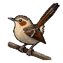
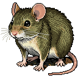
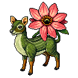
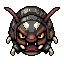
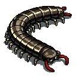
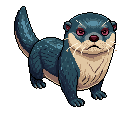
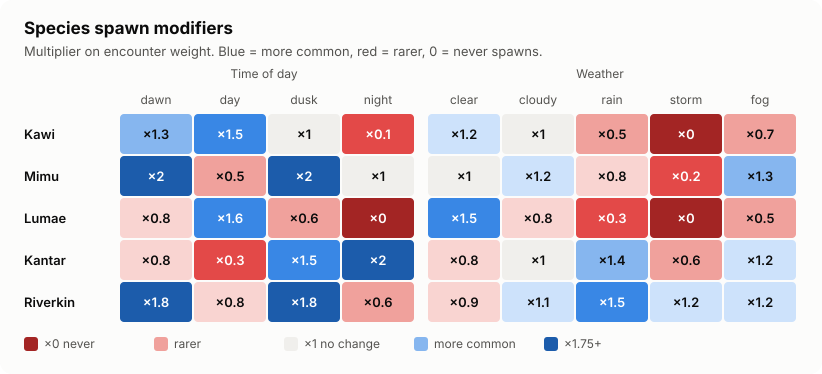
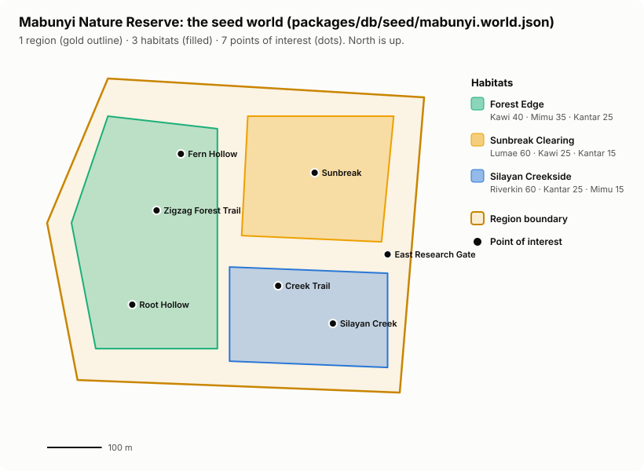
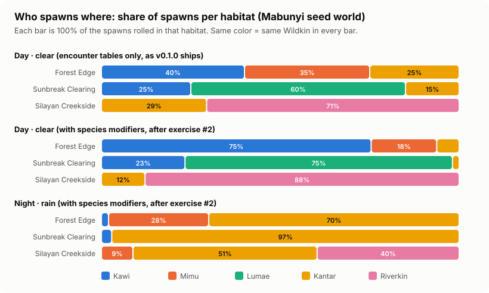

# 09 · Wildkin and world content

> **In plain English:** this page is about the *content* of the game rather than the code: the five Wildkin, where
> they live, how time and weather change how often you meet them, the sample nature reserve the game ships with, the
> artwork, and the story documents that are the source of truth for all of it. Since v0.2.0 Wildkin are written in the
> [Creature Manager](13-creature-manager.md), an encyclopedia app, instead of by editing JSON files. Since v0.3.0 every
> Wildkin also has battle data: a category, body traits, four base stats, placeholder attacks and a gene pool.

## Contents

- [The opening five Wildkin](#the-opening-five-wildkin)
- [Battle data (PROPOSED)](#battle-data-proposed)
- [Spawn modifiers](#spawn-modifiers)
- [The Mabunyi seed world](#the-mabunyi-seed-world)
- [Who spawns where](#who-spawns-where)
- [Art](#art)
- [Canon documents and authority](#canon-documents-and-authority)
- [Editing content](#editing-content)

## The opening five Wildkin

Seed data: [`packages/db/seed/creatures.json`](../packages/db/seed/creatures.json) (game fields) and
[`packages/db/seed/wildkin.json`](../packages/db/seed/wildkin.json) (their full Wildkin Bible entries for the Creature
Manager). Descriptions come from the Wildkin Bible; skills are all marked `proposed` (not yet approved canon). After
seeding, the live versions are in the database and are edited in the Creature Manager.

| No. | Icon | Sprite | Wildkin | Lives in | Rarity | Activity | Movement | Skills (proposed) |
|---:|:-:|:-:|---|---|---|---|---|---|
| 001 |  |  | **Kawi**: curious canopy bird, rust breast, expressive tail | Forest canopy, bright woodland edges | common | diurnal | darter | Branch Hop, Curious Tilt |
| 002 |  |  | **Mimu**: cautious green-brown forest mouse | Leaf litter, moss, roots, undergrowth | common | crepuscular | skulker | Leaf Litter Hide, Seed Cache |
| 003 |  |  | **Lumae**: leaf-bodied quadruped with a dorsal flower; sign of a healthy clearing | Sunny clearings with flowering plants | TBD | diurnal | forager | Bloom, Petal Veil |
| 004 |  |  | **Kantar**: segmented, armoured, pale side markings | Under rocks, fallen branches, damp floor | common | sheltering by day | skulker | Plate Curl, Quick Retreat |
| 005 |  |  | **Riverkin**: compact freshwater swimmer with a shimmering surface | Flowing water, shaded banks, pools | TBD | crepuscular | roamer | Tail Surge, Cool Shade |

Each creature also has `habitatAffinity` tags (e.g. Kawi: `canopy, woodland-edge, forest-edge`). They are
informational today; encounter tables decide where a Wildkin actually appears. The **movement style** decides how a
spawned Wildkin wanders on the radar (experimental, see [07 · Wandering](07-game-systems.md#wandering-spawns-experimental)).

## Battle data (PROPOSED)

Added in v0.3.0 (game fields in `creatures.json`, the same values in the encyclopedia entries in `wildkin.json` and in
the "Game data (PROPOSED)" blocks of the Wildkin Bible v1.2). **Every number and name here is PROPOSED**: a starting
point for play-testing, not established canon. The system rules behind them (the equal stat budget, categories, body
traits, the genetics model) are ESTABLISHED. How they are used: [07 · Stats](07-game-systems.md#stats),
[07 · Genetics](07-game-systems.md#genetics) and [14 · Battles and research](14-battles-and-research.md).

### Category, body trait and base stats

Every species' four base stats add up to exactly **300** (`STAT_BUDGET`): rarity is not strength. The word under each
number is the species shape descriptor the player sees (100+ Signature strength, 80 to 99 Solid, 60 to 79 Modest,
below 60 Weak point).

| Wildkin | Category (license) | Body trait | Weak to / resists | HP | ATK | DEF | SPD | Total |
|---|---|---|---|---:|---:|---:|---:|---:|
| Kawi | Aerial | feathered | surge / crush | 65 Modest | 75 Modest | 50 Weak point | **110 Signature** | 300 |
| Mimu | Terrestrial | soft-bodied | pierce / spore | 70 Modest | 50 Weak point | 80 Solid | **100 Signature** | 300 |
| Lumae | Verdant | leafy | toxin / surge | **100 Signature** | 50 Weak point | 80 Solid | 70 Modest | 300 |
| Kantar | Terrestrial | plated | crush / pierce | 70 Modest | 90 Solid | 95 Solid | 45 Weak point | 300 |
| Riverkin | Aquatic | slick | toxin / pierce | 85 Solid | 80 Solid | 60 Modest | 75 Modest | 300 |

Why these shapes: Kawi is a quick, curious darter; Mimu is a small, cautious hider; Lumae is a sturdy plant-bound
indicator species; Kantar is an armoured predator of small creatures that prefers retreat; Riverkin is a strong,
steady swimmer.

Stats at level 5 (Typical, Steady, vigor 0; the starter choice is Kawi, Mimu or Kantar at level 5):

| Wildkin | HP | ATK | DEF | SPD |
|---|---:|---:|---:|---:|
| Kawi | 21 | 12 | 10 | 16 |
| Mimu | 22 | 10 | 13 | 15 |
| Lumae | 25 | 10 | 13 | 12 |
| Kantar | 22 | 14 | 14 | 9 |
| Riverkin | 23 | 13 | 11 | 12 |

### Placeholder attacks

One or two per species, power 30 to 60. These are **not skills**: the 0.4.0 skill system replaces them. They are kept
apart from the `skills` field (the Registry's proposed skill list in the table above). Power is shown to the player
as a word (30 to 39 Light, 40 to 49 Moderate, 50 to 60 Heavy).

| Wildkin | Attack 1 | Attack 2 |
|---|---|---|
| Kawi | Peck (pierce, 40): a quick, precise jab of the short hooked beak | Wing Buffet (strike, 35): beats its dark-edged wings into the opponent's face |
| Mimu | Nibble (pierce, 35): a quick nip with small, sharp teeth | Scurry Strike (strike, 40): darts out from cover and bumps into the opponent |
| Lumae | Spore Puff (spore, 40): its dorsal flower releases a puff of fine spores | Leaf Shove (strike, 35): pushes with its sturdy, leaf-like body |
| Kantar | Venom Nip (toxin, 40): a defensive nip carrying a mild biological toxin | Plate Slam (crush, 40): throws the weight of its armored segments at the opponent |
| Riverkin | Splash Surge (surge, 40): a tail-driven rush of water | Tail Slap (crush, 35): a heavy blow with its powerful swimming tail |

Kantar's toxin is a defensive biological adaptation (the Biology reference's own example of a centipede-like Wildkin
with a defensive toxin). No real-world hazard is implied.

### Gene pools and marking variants

`p(L)` is the chance each Build allele is L (Large), `p(W)` the chance each Temperament allele is W (Wary). A habitat
override applies when the spawn's habitat carries the tag (first match in the listed order). Marking variants are
cosmetic only, shown as a text badge (no new art in 0.3.0), and expressed in `frequency²` of individuals (0.25 % at
0.05).

| Wildkin | Build p(L) | Build habitat overrides | Temperament p(W) | Marking variant (frequency) |
|---|---:|---|---:|---|
| Kawi | 0.40 | none | 0.40 | **Pale-tailed**: pale tips on the long tail feathers (0.05) |
| Mimu | 0.30 | none | 0.70 | **Moss-backed**: a greener stripe along the back (0.05) |
| Lumae | 0.50 | `sunny`: 0.60 | 0.50 | **Twin-bloom**: two dorsal flowers instead of one (0.05) |
| Kantar | 0.50 | `mature-woodland`: 0.75, `forest-floor`: 0.60 | 0.60 | **Banded**: the pale side markings join into full bands (0.05) |
| Riverkin | 0.50 | `deep-pool`: 0.65 | 0.40 | **Deep-shimmer**: a darker, blue-green shimmer (0.05) |

Kantar's override encodes the Bible's established "larger individuals deeper in mature woodland". In the seed world
the overrides that apply are Kantar in Forest Edge (`forest-floor`: 36 % Large instead of 25 %) and Lumae in Sunbreak
Clearing (`sunny`: 36 % Large). No seed habitat has the `mature-woodland` or `deep-pool` tag yet (both are in
`SUGGESTED_HABITAT_TAGS`). What the odds mean as shares of Small, Typical and Large individuals:
[07 · Genetics](07-game-systems.md#gene-pool-and-rollgenome).

What each species looks like in the population, by default odds:

| Wildkin | Small / Typical / Large | Bold / Steady / Wary |
|---|---|---|
| Kawi | 36 / 48 / 16 % | 36 / 48 / 16 % |
| Mimu | 49 / 42 / 9 % | 9 / 42 / 49 % |
| Lumae | 25 / 50 / 25 % | 25 / 50 / 25 % |
| Kantar | 25 / 50 / 25 % | 16 / 48 / 36 % |
| Riverkin | 25 / 50 / 25 % | 36 / 48 / 16 % |

## Spawn modifiers

How time and weather scale each Wildkin's encounter weight (×1 = unchanged, ×0 = never). These take effect once
exercise #2 (`applySpawnModifiers`) is implemented.

| Wildkin | dawn | day | dusk | night | clear | cloudy | rain | storm | fog |
|---|---:|---:|---:|---:|---:|---:|---:|---:|---:|
| Kawi | 1.3 | 1.5 | 1 | 0.1 | 1.2 | 1 | 0.5 | **0** | 0.7 |
| Mimu | 2 | 0.5 | 2 | 1 | 1 | 1.2 | 0.8 | 0.2 | 1.3 |
| Lumae | 0.8 | 1.6 | 0.6 | **0** | 1.5 | 0.8 | 0.3 | **0** | 0.5 |
| Kantar | 0.8 | 0.3 | 1.5 | 2 | 0.8 | 1 | 1.4 | 0.6 | 1.2 |
| Riverkin | 1.8 | 0.8 | 1.8 | 0.6 | 0.9 | 1.1 | 1.5 | 1.2 | 1.2 |

The values follow each species' activity pattern: the diurnal bird and flower Wildkin fade at night and in storms;
the crepuscular Mimu and Riverkin peak at dawn and dusk; Kantar, which shelters by day, comes out at night and in rain.

## The Mabunyi seed world

Data: [`packages/db/seed/mabunyi.world.json`](../packages/db/seed/mabunyi.world.json). Loaded with
`pnpm db:seed` (draft) or `pnpm db:seed --publish`.

| Kind | Items |
|---|---|
| Region | **Mabunyi Nature Reserve** (`mabunyi-nature-reserve`), biome tags `tropical-forest, urban-park`. Placeholder boundary near Ninoy Aquino Parks and Wildlife Center, Quezon City |
| Habitats | **Forest Edge** (`forest-edge, canopy, forest-floor, leaf-litter`), **Sunbreak Clearing** (`clearing, flowering, sunny`), **Silayan Creekside** (`freshwater, creek, riparian, rocky`). No habitat-level conditions |
| POIs | East Research Gate (gate), Zigzag Forest Trail (trail), Sunbreak (clearing), Root Hollow (hollow), Fern Hollow (hollow), Creek Trail (trail), Silayan Creek (water) |
| Encounter tables | One per habitat (below). No region-wide table |

| Table | Wild levels | Entries (weight, conditions) |
|---|---|---|
| Forest Edge Encounters | 2 to 6 | Kawi 40 · Mimu 35 · Kantar 25 |
| Sunbreak Clearing Encounters | 3 to 8 | Lumae 60 (dawn/day only) · Kawi 25 · Kantar 15 |
| Silayan Creekside Encounters | 4 to 10 | Riverkin 60 (**levels 5 to 12**, an entry override) · Kantar 25 · Mimu 15 (rain/cloudy only) |

All wild levels are within license rank 1 (obedience cap 20), so a new player can battle and capture everything in
Mabunyi; no habitat is license-locked. Difficulty rises from the forest edge to the creek, and Forest Edge is the
region's easy entry habitat (see [07 · Wild levels](07-game-systems.md#wild-levels)). East Research Gate (a `gate`)
is the seed world's **field station**: its vet heals for free and license assessments are taken there.

A good test coordinate is **`14.6518, 121.0444`** (the Sunbreak POI, inside Sunbreak Clearing).

> The real-world location is an implementation detail. The fiction calls it "Mabunyi Nature Reserve". Redraw the
> boundary over your real area in the editor (Satellite basemap, select the region, drag vertices); the world lives in
> data, not code.

## Who spawns where

Share of spawns rolled in each habitat, computed from the seed data by the same rules the server uses.

| Scenario | Habitat | Kawi | Mimu | Lumae | Kantar | Riverkin |
|---|---|---:|---:|---:|---:|---:|
| Day · clear (tables only, until exercise #2 is done) | Forest Edge | 40% | 35% | - | 25% | - |
| Day · clear (tables only) | Sunbreak Clearing | 25% | - | 60% | 15% | - |
| Day · clear (tables only) | Silayan Creekside | - | - | - | 29% | 71% |
| Day · clear (with modifiers, after exercise #2) | Forest Edge | 75% | 18% | - | 6% | - |
| Day · clear (with modifiers) | Sunbreak Clearing | 23% | - | 75% | 2% | - |
| Day · clear (with modifiers) | Silayan Creekside | - | - | - | 12% | 88% |
| Night · rain (with modifiers, after exercise #2) | Forest Edge | 2% | 28% | - | 70% | - |
| Night · rain (with modifiers) | Sunbreak Clearing | 3% | - | - | 97% | - |
| Night · rain (with modifiers) | Silayan Creekside | - | 9% | - | 51% | 40% |

How to read it: in Silayan Creekside on a clear day Mimu never appears (its entry requires rain or cloud), and at night
in rain Kantar dominates almost everywhere. Note that until exercise #1 (weather mapping) is done, the live weather is
always "clear".

## Art

Since v0.2.0 the **database is the home of Wildkin art** (`wildkin_art` table). The API serves it at
`/api/art/wildkin/<id>/icon.png` and `…/sprite.png`, and the game and the Creature Manager both load it from there.
New art is generated in the Creature Manager (**Generate sprites with PixelLab**, see
[13 · PixelLab art](13-creature-manager.md#pixellab-art)).

| Asset | Size | Path | Generated with |
|---|---|---|---|
| Wildkin face icons | 64 px | database (`wildkin_art`, kind `icon`); seed copies in `apps/web/public/wildkin/icons/<id>.png` | PixelLab (Pixen model) |
| Wildkin sprites | 128 px | database (`wildkin_art`, kind `sprite`); seed copies in `apps/web/public/wildkin/sprites/<id>.png` | PixelLab (Kantar regenerated in v0.1.0 pass 2 for its pale side markings) |
| Player head | - | `apps/web/public/player/head.png` | PixelLab |
| UI mockups | 6 screens | `patches/0.1.0/mockups/*.png/.html` | Google Stitch ("Wildbound Design System") |

Rules from the project brief and the Bible:

- Art is **placeholder until approved** against the Wildkin Bible.
- AI tools are **authoring tools**, never something the game needs to run: generation happens in the Creature Manager
  (an internal tool) and the result is stored in the database; players only download PNGs. AI is never the source of
  geographic truth.
- The cheapest PixelLab model (Pixen) is used and the credit balance is **checked before every generation**.
- The five seed PNGs in `apps/web/public/wildkin/` are imported into the database by `pnpm db:seed` and stay as the
  game's fallback. File names there must equal the creature `id`.
- The repo's `.mcp.json` also configures the PixelLab MCP server for hand-driven generation from an AI coding assistant.

`packages/assets` is reserved for future tile/creature/effect metadata for the Phaser field.

## Canon documents and authority

The creative canon lives in [`docs/`](./) as Word files, next to this documentation:

| Document | What it is |
|---|---|
| `WILDBOUND_Wildkin_Bible_v1.2.docx` | **Canonical species reference.** Appearance, behaviour, habitat, activity, rarity, art direction for each Wildkin; since v1.2 also categories and body traits (with the matchup table), individual variation, and a "Game data (PROPOSED)" block per species. Labels every fact `ESTABLISHED`, `PROPOSED` or `TBD` |
| `WILDBOUND_The_First_Field_Survey_Source_of_Truth.docx` | The story of the opening, written as a book: Sam returns to Luntian settlement at the edge of Mabunyi Forest Reserve, receives a Field Registry assignment, and finds Wildkin appearing outside their recorded habitats. The appendix "The Field License (PROPOSED for v0.3.0)" covers the license, first aid, vets, the ranger's starter companion and friendly battles |
| `WILDBOUND_Wildkin_Biology_and_Ecology_Reference_v1.1.docx` | Worldbuilding rules: Wildkin are a distinct biological lineage (shared genetic signature, an unresolved ancient origin), reproduction, ecology; since v1.1 also individual variation (4.3) and a new section 6 "Capture, Care, and Bonding" (the open questions are now section 16) |

Authority order (from the Bible): the Bible for species canon, then the First Field Survey, then other references.

These files are also the source of the **lore context of the Creature Manager's AI assistant**. By default the API
sends a condensed summary of them, [`docs/lore/assistant-brief.md`](lore/assistant-brief.md) (~2,000 tokens, small
enough for Groq's free tier); **when you change a canon document, update the brief too**. With `LORE_SOURCE=full` the
API reads every `docs/WILDBOUND_*.docx` (and `.md`) file in this order instead and sends the text (up to
`LORE_MAX_CHARS`); keep the `WILDBOUND_` prefix and the words `Wildkin_Bible`, `First_Field_Survey`,
`Biology_and_Ecology` in the file names, which set the order. See
[13 · AI assistant](13-creature-manager.md#ai-assistant).

Design rules from these documents that the code (and the assistant's instructions) follow:

- Wildkin are living species with ecology, **not** disposable battle units. **Observation precedes capture**
  (observing first raises capture chance).
- **Rarity is not strength.** Every species' base stats sum to exactly 300.
- **Wildkin are feral before they bond**: capture needs a weakened Wildkin, every injured Wildkin gets first aid, and
  a Wildkin above your license is restless (it travels with you but will not cooperate).
- Content is **data-driven**: a new species should reuse existing fields and systems.
- `TBD` values stay `TBD` in data (`rarity: "TBD"`, `activityPattern: "TBD"`); do not let tools invent them.
- A Wildkin appearing outside its habitat is a story clue (future feature).

## Editing content

| Want to… | Do this |
|---|---|
| Change where Wildkin appear, weights, conditions | In the **Map Editor** (no code). Save, validate, publish |
| Change a Wildkin's category, body traits, base stats, attacks or gene pool | In the **Creature Manager**, section 9 "Battle & genetics" (see [13](13-creature-manager.md#section-9-battle--genetics)); stats must sum to 300 to publish |
| Change a Wildkin's text, rarity, modifiers, skills or movement | In the **Creature Manager** (no code): edit, **Save draft**, then **Publish** so the game gets it |
| Add a new Wildkin | In the **Creature Manager**: [Cookbook: add a Wildkin](11-cookbook.md#add-a-new-wildkin) |
| Give a Wildkin new art | Creature Manager → **Generate sprites with PixelLab** |
| Retire a Wildkin | Creature Manager → **Delete** (soft delete: stops spawning, restorable, players keep their Registry entry) |
| Change the *seed* defaults for a fresh database | Edit `packages/db/seed/creatures.json` / `wildkin.json`, run `pnpm db:seed`. Note: this overwrites the five seed creatures' game data, but never existing encyclopedia entries |
| Replace the sample world | Edit `mabunyi.world.json` and `pnpm db:seed --force [--publish]`, or draw it in the editor |
| Refresh the charts on this page | `node docs/images/generate-charts.mjs` |

Next: [10 · Development guide](10-development-guide.md).
