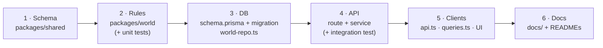
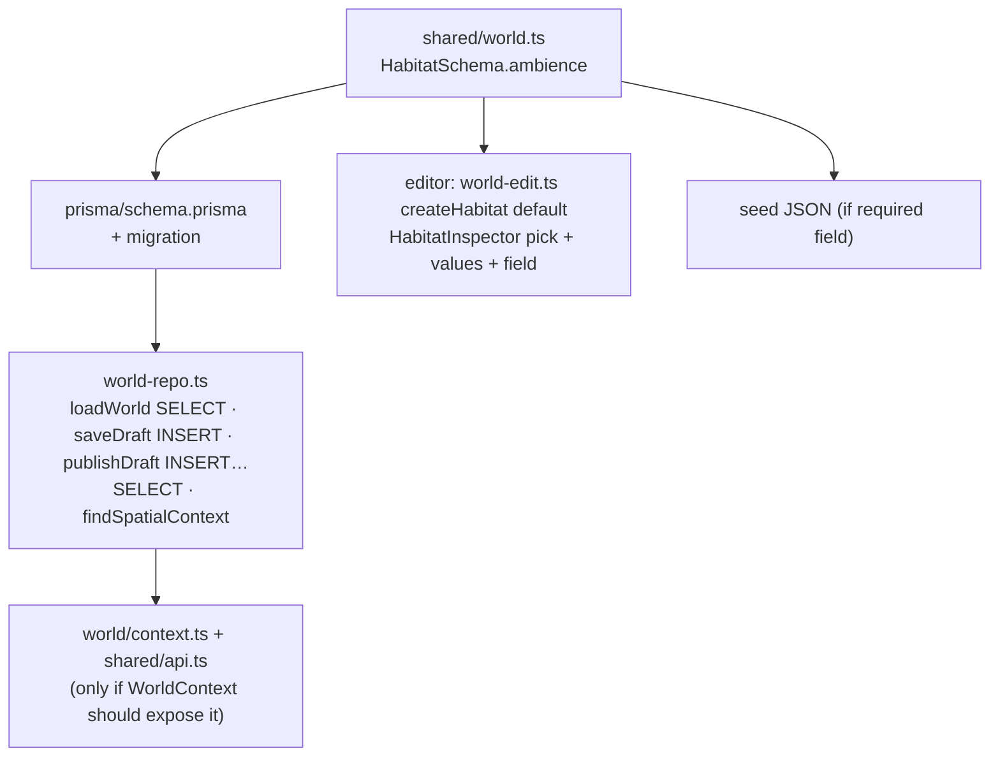

# 11 · Cookbook: how to change things

> **In plain English:** step-by-step recipes for the changes you're most likely to make, with the exact files to touch
> and a "what can break" list for each. Many content changes need **no code at all** (see the first table).

## Contents

- [Do I need to write code?](#do-i-need-to-write-code)
- [General workflow for any feature](#general-workflow-for-any-feature)
- [Add a new Wildkin](#add-a-new-wildkin)
- [Change a Wildkin's stats, text or spawn modifiers](#change-a-wildkins-stats-text-or-spawn-modifiers)
- [Add an inventory item](#add-an-inventory-item)
- [Tune a game rule](#tune-a-game-rule)
- [Add a weather state or time-of-day band](#add-a-weather-state-or-time-of-day-band)
- [Add a POI type](#add-a-poi-type)
- [Add an API endpoint](#add-an-api-endpoint)
- [Add a game screen (tab)](#add-a-game-screen-tab)
- [Add a field or entity to the world](#add-a-field-or-entity-to-the-world)
- [Add a player-data table](#add-a-player-data-table)
- [Add a world validation rule](#add-a-world-validation-rule)
- [Add an editor basemap](#add-an-editor-basemap)
- [Add a UI component (shadcn)](#add-a-ui-component-shadcn)
- [Impact map: what depends on what](#impact-map-what-depends-on-what)

## Do I need to write code?

| Change | Where | Code? |
|---|---|---|
| Move a boundary, add a habitat or POI | Map Editor → Save → Publish | No |
| Which Wildkin live in a habitat, weights, time/weather-only entries | Map Editor (encounter tables) | No |
| Wildkin description, rarity, modifiers, skills | `packages/db/seed/creatures.json` → `pnpm db:seed` | Data only |
| A new Wildkin | `creatures.json` + two PNGs → `pnpm db:seed` → editor | Data + art (+2 test numbers) |
| Spawn radius, interact range, anti-cheat limits | `GAME_RULES` | One constant |
| New item, weather state, POI type, endpoint, screen | See recipes | Yes |

## General workflow for any feature



Not every feature touches every layer, but follow this order: the schema change makes TypeScript point you to every
other place that needs updating. Finish with `pnpm typecheck && pnpm test && pnpm build`.

## Add a new Wildkin

1. **Data.** Append to `packages/db/seed/creatures.json`:
   ```json
   {
     "id": "tilapo",
     "registryNumber": 6,
     "name": "Tilapo",
     "description": "…from the Wildkin Bible…",
     "habitatAffinity": ["freshwater", "creek"],
     "habitatSummary": "Slow pools under overhanging roots.",
     "rarity": "uncommon",
     "activityPattern": "nocturnal",
     "spawnModifiers": { "timeOfDay": { "night": 2, "day": 0.3 }, "weather": { "rain": 1.5 } },
     "skills": [{ "name": "Mud Veil", "description": "…", "canon": "proposed" }]
   }
   ```
   `id` must be a slug and unique; `registryNumber` unique and positive. Use `TBD` rather than inventing canon.
2. **Art.** Add `apps/web/public/wildkin/icons/tilapo.png` (64 px face) and `…/sprites/tilapo.png` (128 px). File name
   = `id`.
3. **Load it.** `pnpm db:seed` (upserts creatures, keeps your draft).
4. **Place it.** In the editor, add it to encounter tables (it appears in the Wildkin picker), Save, Publish.
5. **Tests.** `apps/api/test/game.test.ts` (`registry.total` = 5) and `apps/api/test/world.test.ts` (5 creatures)
   count the seed roster; update them to 6.
6. Regenerate charts: `node docs/images/generate-charts.mjs` (a 6th series colour needs adding to `SERIES`), and
   update [09](09-wildkin-and-content.md).

**What can break:** missing art shows a broken image (no fallback); a duplicate `registryNumber` fails the seed (unique
constraint). The Registry, radar and party pick the new species up automatically.

## Change a Wildkin's stats, text or spawn modifiers

Edit `creatures.json`, run `pnpm db:seed`. Modifier values must be 0–10 (`SpawnModifiersSchema`); missing keys mean ×1.
Renaming an `id` is a **new** species (old rows stay; encounter entries reference ids). Avoid it, or write a migration.

## Add an inventory item

1. `packages/shared/src/game.ts` → add to `ITEMS` (`name`, `description`, `category`). `ItemIdSchema` updates itself.
2. Optional: add to `STARTER_INVENTORY` (only affects **new** players; existing players need a backfill, e.g. a
   one-off script with `db.inventoryItem.upsert` per player).
3. `apps/web/src/features/inventory/InventoryPage.tsx` → add an icon in `ICONS`; if it's a new `category`, add a filter
   in `CATEGORIES`.
4. If it does something, add an endpoint (recipe below) and a button.

**What can break:** nothing else; unknown item ids in the DB are silently skipped by `GET /inventory`.

## Tune a game rule

Edit `GAME_RULES` in `packages/shared/src/game.ts` (all values documented in
[07](07-game-systems.md#all-tunable-numbers)). The web app imports the same object (range ring, accuracy limit), so
both sides change together.

**What can break:** tests that assert specific distances or timings (`movement.test.ts`, `game.test.ts`); the web
heartbeat (30 s) must stay below `positionStaleMs`; charts in the docs (re-run the generator).

## Add a weather state or time-of-day band

Example: add `"snow"` weather.

1. `packages/shared/src/constants.ts` → add to `WEATHER`. Everything typed `Weather` now includes it.
2. `packages/world/src/weather.ts` → map WMO snow codes (71–77, 85–86) to `"snow"`; update `weather.exercise.test.ts`.
3. `apps/web/src/features/game/environment.tsx` → `WEATHER_LABEL` and the icon map (TypeScript errors until you do).
4. Optionally add `"snow"` modifiers to creatures in `creatures.json`.
5. The editor's condition chips, Test-panel select and modifier formatting iterate `WEATHER`, so they update themselves.
6. Stored JSON conditions remain valid (they never contained `snow`). No migration needed.

For a new **time band**, also change `timeOfDayForHour()` boundaries, `conditions.test.ts`, `TIME_LABEL`/icons in the
web app, and the time-of-day chart.

## Add a POI type

1. `POI_TYPES` in `packages/shared/src/constants.ts`.
2. `POI_ICONS` in `apps/editor/src/map/editor-map.ts` (else it falls back to "•").
3. Done: the DB column is plain text and the inspector lists `POI_TYPES`.

## Add an API endpoint

Example: `POST /api/game/items/trail-ration/use`.

1. **Contract** in `packages/shared/src/game.ts`:
   ```ts
   export const UseItemResponseSchema = z.object({ itemId: ItemIdSchema, quantityLeft: z.number().int() });
   export type UseItemResponse = z.infer<typeof UseItemResponseSchema>;
   ```
2. **Route** in `apps/api/src/routes/game.ts` (already behind `requirePlayer`):
   ```ts
   router.post("/items/:itemId/use", async (req, res) => {
     const { itemId } = parseOr400(z.object({ itemId: ItemIdSchema }), req.params, "Unknown item");
     const playerId = res.locals.player.id;                       // always scope by player
     const row = await db.$transaction(async (tx) => {
       const { count } = await tx.inventoryItem.updateMany({
         where: { playerId, itemId, quantity: { gt: 0 } },        // re-check inside the transaction
         data: { quantity: { decrement: 1 } },
       });
       if (count === 0) throw new HttpError(409, "none_left", "You have none left");
       return tx.inventoryItem.findUniqueOrThrow({ where: { playerId_itemId: { playerId, itemId } } });
     });
     res.json({ itemId, quantityLeft: row.quantity } satisfies UseItemResponse);
   });
   ```
   Logic that needs position/spawns goes in `game/service.ts`; pure rules in `@wildbound/world`.
3. **Client** `apps/web/src/lib/api.ts`: `useItem: (id: string) => request(UseItemResponseSchema, \`/api/game/items/${id}/use\`, post())`.
4. **Hook** `apps/web/src/lib/queries.ts`: a `useMutation` that invalidates `keys.inventory` on success.
5. **Test** in `apps/api/test/game.test.ts` with the `login()`/`report()` helpers.
6. **Docs:** add the row to [04 · API reference](04-api-reference.md).

For editor endpoints, use `apps/api/src/routes/editor.ts` (behind `requireEditor`), schemas in `shared/src/api.ts`, and
`apps/editor/src/lib/api.ts` + `queries.ts` (set `meta.errorMessage` for automatic toasts).

## Add a game screen (tab)

1. `apps/web/src/features/<name>/<Name>Page.tsx` → start with `<ScreenTitle title="…" />` inside
   `<div className="flex flex-1 flex-col gap-2.5 p-2.5">` like the other pages.
2. `apps/web/src/router.tsx` → add `{ path: "<name>", element: <NamePage /> }` under `/play`.
3. `GameLayout.tsx` → add a tab in `Tabs()` (the grid is `grid-cols-4`; change it to 5).
4. Data via a hook in `lib/queries.ts`.

The page inherits the session guard, pause overlay and polling automatically.

## Add a field or entity to the world

Example: add `ambience: string` to habitats.



1. Schema: add to `HabitatSchema` (give it `.default("")` to keep old JSON valid).
2. DB: column in `schema.prisma` → `migrate:new` → review SQL.
3. `world-repo.ts`: **four places** for a habitat column: `loadWorld` (SELECT + mapping), `saveDraft` (INSERT),
   `publishDraft` (the `INSERT … SELECT` copy), and `findSpatialContext` if resolution needs it. Forgetting the publish
   copy means the field is silently lost on publish.
4. Context: if players or the Test panel need it, add to `ResolvedHabitatSchema` and `assembleWorldContext`.
5. Editor: default value in `createHabitat`, `pick`/`values` + a `<TextField name="ambience">` in `HabitatInspector`.
6. Tests: a `world.test.ts` round trip (save → publish → resolve) catches missed copies.

A **new entity kind** (e.g. "spawn zones") follows the same path plus: a new array in `WorldDocumentSchema`, a new
table with `(id, stage)` keys and stage-aware FKs, integrity/validation rules, `EntityKind`/`Selection` and
create/update/delete/`entityExists` in `world-edit.ts`, a tree entry, an inspector, and map layers in `editor-map.ts`.

## Add a player-data table

1. Model in `schema.prisma` with `playerId` FK to `Player` **`onDelete: Cascade`**, `@@map("snake_case")`, `@map` columns.
2. `migrate:new`, add any CHECKs by hand, `pnpm db:migrate`.
3. Add the table to the `TRUNCATE` list in `packages/db/src/testing.ts` and the `DROP TABLE` list in
   `packages/db/src/scripts/reset.ts`.
4. Query it through Prisma, always with `where: { playerId }`.

## Add a world validation rule

`packages/world/src/validation.ts`:

- **Blocks saving?** Put it in `checkIntegrity` (structural problems only: broken references, duplicates).
- **Blocks publishing?** Push an `err({...})` in `validateWorld`.
- **Just advice?** Push a `warn({...})`.

Give it a stable kebab-case `code`, the right `entityType` and `entityId` (so the editor can highlight it), and a test
in `validation.test.ts`. The editor shows it automatically.

## Add an editor basemap

`apps/editor/src/map/basemaps.ts` → add an entry to `BASEMAPS` and its key to the `Basemap` type in `store.ts`. Prefer
key-free tile sources and include attribution. Inline raster styles (`raster(...)`) are more robust than remote style
URLs (see the known issue in [05](05-map-editor.md#the-map-controller-editor-mapts)).

## Add a UI component (shadcn)

```bash
cd apps/web     # or apps/editor
npx shadcn@latest add dialog
```

Components land in `src/components/ui/`. Restyle them with the design tokens (`bg-paper`, `text-ink`, `font-pixel`, …)
so they match the console look.

## Impact map: what depends on what

If you change the thing in the left column, check everything in the right column.

| Change | Also affects |
|---|---|
| A Zod schema in `shared` | API parsing (`parseOr400`), both clients' response parsing, DB mapping, seed JSON, tests |
| `GAME_RULES` | Server checks, radar ring and accuracy hint, tests, charts |
| `ITEMS` | Inventory endpoint, Satchel icons/filters, starter inventory |
| `creatures.json` | Registry total, tests counting species, art files, charts |
| `WEATHER` / `TIME_OF_DAY` | Weather mapping, web labels/icons, editor chips (auto), modifiers |
| A world DB column | `loadWorld`, `saveDraft`, `publishDraft`, maybe `findSpatialContext` |
| `assembleWorldContext` | Editor Test panel, game spawning, `context.test.ts`, integration tests |
| `checkMovement` | Every player's ability to play; `movement.test.ts`, `game.test.ts` |
| Route paths | `apps/web/src/lib/api.ts`, `apps/editor/src/lib/api.ts`, docs |
| `editor-map.ts` layers | Selection by click (`queryRenderedFeatures` layer ids), styles in `styles.css` |

Next: [12 · Exercises and roadmap](12-exercises-and-roadmap.md).
