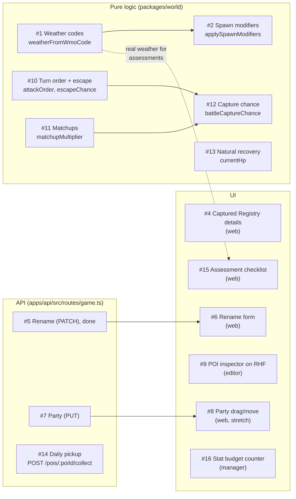
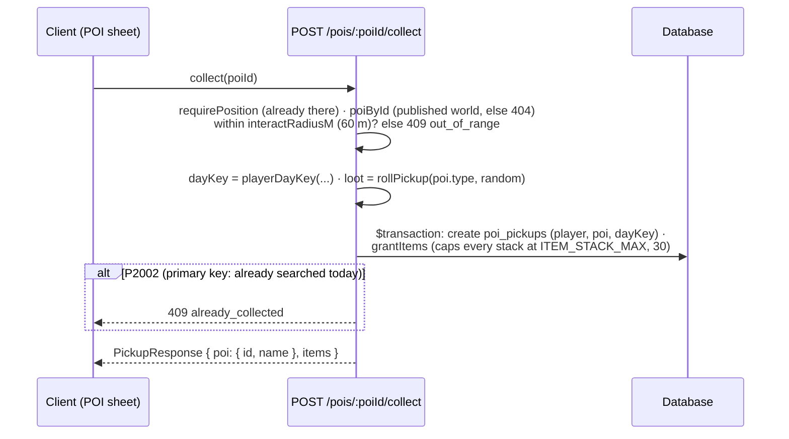

# 12 · Exercises and roadmap

> **In plain English:** some features are deliberately left unfinished so they can be built by hand as practice.
> The app works around each one (for example the battle screen still works with a simpler turn order, and the radar
> explains that searching for supplies is not built yet). v0.1.0 left nine exercises; v0.2.0 added none; v0.3.0
> (battles, capture, licenses) adds seven more (#10 to #16), retires #3 (capture now happens inside a battle) and
> marks #5 done. This page lists them, how they connect, and what is planned next.

Every gap is marked `TODO(you)` in the code with step-by-step instructions right where it lives. The canonical lists
are [`patches/0.1.0/EXERCISES.md`](../patches/0.1.0/EXERCISES.md) (#1 to #9) and
[`patches/0.3.0/EXERCISES.md`](../patches/0.3.0/EXERCISES.md) (#10 to #16, plus what changed for #1 to #9).

```bash
grep -rn "TODO(you)" apps packages --include=*.ts --include=*.tsx
pnpm test:exercises     # tests for #1, #2 and #10 to #13; they fail until implemented
```

## Status at a glance

| # | Exercise | Status in v0.3.0 |
|---|---|---|
| 1 | Weather codes | Open. Now also unlocks the weather requirements of license assessments |
| 2 | Spawn modifiers | Open |
| 3 | Capture | **Retired**: superseded by battle capture in 0.3.0 |
| 4 | Captured-only Registry section | Open. The section now also holds the stat shape descriptors |
| 5 | Rename API | **Done** |
| 6 | Rename form | Open (the API side works) |
| 7 | Rearrange party API | Open. Party order now decides the lead Wildkin |
| 8 | Rearrange party UI (stretch) | Open |
| 9 | POI inspector on react-hook-form | Open |
| 10 | Weighted turn order and escape chance | New, open |
| 11 | Matchup multiplier | New, open |
| 12 | In-battle capture chance | New, open |
| 13 | Lazy natural recovery | New, open |
| 14 | Daily POI pickup route | New, open |
| 15 | Assessment checklist with progress | New, open |
| 16 | Live stat budget counter | New, open |



Arrows are "makes sense after". The others are independent.

## New in v0.3.0 (#10 to #16)

Each one ships with a **working fallback**, so battles, capture, healing and licenses all work while it is open.

| # | Exercise | Where | You practise | Fallback until done | Done when |
|---|---|---|---|---|---|
| 10 | Weighted turn order and escape chance | `packages/world/src/battle/turn-order.ts` → `attackOrder(spdA, spdB, random)`, `escapeChance` | Pure TypeScript, probability | The faster side always goes first (ties: the player); escape is a flat 50% | `pnpm test:exercises` (turn-order) passes; a slower Wildkin sometimes strikes first |
| 11 | Matchup multiplier | `packages/world/src/battle/matchups.ts` → `matchupMultiplier(approach, traits)` | Lookup tables, `reduce` | Always 1: no weaknesses, so nothing to discover yet | `pnpm test:exercises` (matchups) passes; Peck on a Mimu writes "Field note recorded: Soft-bodied is weak to Pierce" |
| 12 | In-battle capture chance | `packages/world/src/battle/capture.ts` → `battleCaptureChance(...)` | Pure TypeScript, clamping | `rarityBase + observedBonus` only (capture is still possible) | `pnpm test:exercises` (capture) passes; weakened Wildkin are clearly easier to catch |
| 13 | Lazy natural recovery | `packages/world/src/recovery.ts` → `currentHp(row, maxHp, now, restless)` | Dates, pure functions | Returns the stored HP: no natural recovery (vets still heal) | `pnpm test:exercises` (recovery) passes; an injured Wildkin's HP bar refills over hours; restless ones stay frozen |
| 14 | Daily POI pickup route | `apps/api/src/routes/game.ts` → `POST /pois/:poiId/collect` | Express, Prisma interactive transactions, compound unique keys, `increment` with a cap | 501; the radar's POI sheet says "Searching for supplies is not built yet" (players still get the starter inventory and rank-up grants) | The test in `apps/api/test/battle.test.ts` ("daily pickups ... exercise #14") asserts the real behaviour instead of 501; "Search for supplies" adds items once a day |
| 15 | Assessment checklist with progress | `apps/web/src/features/license/AssessmentChecklist.tsx` | React, TanStack Query data, Tailwind tokens | A plain list of requirement labels; the "Take assessment" button still works | Each License card shows "Observe in 3 different weathers: 1/3", met and unmet rows styled differently |
| 16 | Live stat budget counter | `apps/manager/src/features/wildkin/BaseStatsEditor.tsx` | react-hook-form `useWatch`, Zod refinements | Four inputs; the budget error appears on submit | Typing stats in section 9 shows "240 / 300, 60 left" live, red until the total is exactly 300 |

The formulas behind #10 to #13 are in [14 · Battles and research](14-battles-and-research.md) and in the
`TODO(you)` comments; every constant lives in `BATTLE_RULES` (`packages/shared/src/battle.ts`).

## The v0.1.0 exercises (#1 to #9)

| # | Exercise | Where | You practise | Done when |
|---|---|---|---|---|
| 1 | Map Open-Meteo WMO codes to WILDBOUND weather | `packages/world/src/weather.ts` | Pure TS functions | `pnpm test:exercises` (weather) passes; status bar shows real weather. Then set `ASSESSMENT_RELAX_WEATHER=false` (see below) |
| 2 | Species spawn modifiers | `packages/world/src/spawning.ts` | `map`/`filter`, typed data | exercise tests pass; Kawi becomes rare at night; the editor Test panel shows "applied" |
| 3 | ~~Capture~~ | ~~`POST /spawns/:id/capture`~~ | | **Retired.** The route is gone (404); capture is a capsule action inside a battle |
| 4 | Captured-only Registry section | `apps/web/src/features/registry/RegistryDetailPage.tsx` → `CapturedDetails` | React, Tailwind tokens | After a capture the entry shows rarity, activity, skills and the stat shape descriptors (`entry.statShape`, e.g. "Speed: Signature strength") |
| 5 | Rename API | `apps/api/src/routes/game.ts` → `PATCH /wildkin/:id` | Prisma `findFirst`/`update`, ownership | **Done.** Returns the full v0.3.0 Wildkin view (level, HP, condition) |
| 6 | Rename form | `apps/web/src/features/party/RenameForm.tsx` | react-hook-form, zodResolver, `useMutation`, invalidation | Nickname changes in Party without reload |
| 7 | Rearrange party API | `apps/api/src/routes/game.ts` → `PUT /party` | Transactions, unique constraints | `GET /party` shows the new order; slot 0 becomes the lead |
| 8 | Rearrange party UI (stretch) | `apps/web/src/features/party/PartyPage.tsx` | React state, mutations, optimistic updates | Moves stick after refresh |
| 9 | POI inspector on react-hook-form | `apps/editor/src/inspectors/PoiInspector.tsx` | RHF + zodResolver + Zustand undo | Each field edit is one Ctrl+Z step; bad slug shows the Zod message |

### What v0.3.0 changed around them

- **#1 and license assessments.** While #1 is open, live weather is always `clear`, so an assessment requirement such
  as "Observe in 3 different weathers" could never be met. The API flag **`ASSESSMENT_RELAX_WEATHER`** (default
  `true`, in `.env.example` and `apps/api/src/config.ts`) clamps every weather requirement to 1. Set it to `false`
  once real weather works.
- **#3 is retired.** `POST /spawns/:id/capture`, its `TODO(you)`, its 501 test and its radar hint were removed.
  Capturing is now a `capsule` action in a wild battle (see [14](14-battles-and-research.md)).
- **#4** now also renders the species' stat shape descriptors. They are already in the fallback JSON dump, so they
  show up once the section is built.
- **#5 is done**: `PATCH /wildkin/:id` returns the full Wildkin view. #6 only needs the web form.
- **#7**: party order decides the **lead Wildkin** (slot 0 leads into battle and collects walking, observation and
  exploration EXP). Until #7 is done the lead is the first usable Wildkin by slot.

## Hints that apply to all

- Request/response shapes already exist in `packages/shared` (`UpdatePartyRequestSchema`,
  `RenameWildkinRequestSchema`, `PickupResponseSchema`, `RequirementProgressSchema`, `BaseStatsSchema`). Reuse them on
  both sides.
- **Tests.** #1, #2 and #10 to #13 have `*.exercise.test.ts` files next to the code (`pnpm test:exercises`). The unit
  tests (`pnpm test:unit`) pass both before and after you solve them, so a green unit run is not a hint either way.
  For #7 (`apps/api/test/game.test.ts`) and #14 (`apps/api/test/battle.test.ts`) the integration test currently
  **expects 501**: change it to the behaviour you build (better: write the test first).
- **Constants.** Every number lives in `GAME_RULES`, `BATTLE_RULES`, `EXP_RULES` or `RESEARCH_RULES`. Read the
  formula from there instead of typing literals.
- Scope every query by `playerId: res.locals.player.id`.
- Finished examples of every pattern are nearby: `visitVet` in `apps/api/src/game/care-service.ts` (range check,
  transaction) and `grantItems` (stack cap) for #14; `HpBar` and `ProgressBar` in
  `apps/web/src/components/field.tsx` for #15; the other `useWatch` uses in the manager form for #16; `GET /party`
  (view mapping), `LoginPage` (react-hook-form + zod), `HabitatInspector` (#9's model).

### Exercise #14 at a glance



## Roadmap

From the v0.3.0 brief ("Deferred"), the package READMEs and the handover notes:

| Stage | Items |
|---|---|
| **v0.1.0 (done)** | Map Editor, PostGIS resolver, draft/publish, Express + Prisma API, username sessions, live location with server-side movement checks, live weather and local time, server-authoritative spawns, Observe, Registry, Satchel, Party views, placeholder pixel art, tests |
| **v0.2.0 (done)** | Creature Manager (`apps/manager`): Wildkin encyclopedia with draft/publish into `creatures`, soft delete/restore, dashboard, Groq AI assistant fed with the canon documents, PixelLab art stored in the database and served by the API; the editor's Wildkin list follows the database live; wandering spawns on the radar |
| **v0.3.0 (done)** | Species stat shapes (equal budget of 300), categories, body traits, placeholder attacks and gene pools (Creature Manager section 9); individual genetics (Build, Temperament, Marking, Vigor); levels 1 to 100 and EXP from battles, walking, observation, exploration and captures with daily caps and a rested bonus; wild level ranges per encounter table; server-authoritative turn-based wild battles; capture through battle; matchups discovered in battle; a status framework; first aid, natural recovery and vets; Field Registry licenses (four categories, five ranks, researcher EXP, assessments, obedience cap, restless Wildkin, license-locked habitats, category capsules, scanner depth); starter Wildkin; canon updates (Wildkin Bible v1.2, Biology and Ecology Reference v1.1, a First Field Survey appendix). Wandering spawns are kept as they are |
| **Exercises** | #1, #2, #4, #6 to #16 above |
| **v0.4.0 (planned)** | The **skill system**: four skills per species from the reusable effect vocabulary, passives, learning by level, limited uses (replaces the placeholder attacks); **status sources** (skills inflict the statuses the framework already handles); **NPC friendly battles** and sparring circuits (the engine is built so a second trainer side can be added); **Temperament-driven wild behaviour**; research assignments; field techniques |
| **Later (to be announced)** | Currency and shops (only once a complementary system is designed); **breeding** (the allele model and `inheritGenome` are the groundwork); evolutions; minigames at POIs (via `interactionId`); bond descriptors; license-based tracking and longer observe range; attractants; player-vs-player battles; marking-variant art; the Phaser 3 top-down field view consuming the same `WorldContext` |
| **Before going public** | Real accounts (players and editors), HTTPS deployment, rate limiting, CSRF protection, cleanup jobs ([08](08-security.md#checklist-before-a-public-deployment)) |
| **Also later** | Story gating (`unlockCondition`, `storyStateRequirements` are already in the data), content version history, offline/PWA, social features, "Wildkin outside its habitat" story events, `packages/assets` tile/creature/effect metadata |

Rules for future work, from the briefs and READMEs:

- Deferred features get **no placeholder UI** until they are built.
- Battle and game systems **must consume `WorldContext`** and must not introduce a second world model. In v0.3.0 the
  pure battle rules live in `packages/world/src/battle/` (`packages/game` is still empty).
- Every tunable number stays in one exported constant object (`GAME_RULES`, `EXP_RULES`, `BATTLE_RULES`,
  `RESEARCH_RULES`), so tuning after play-testing never touches logic.
- Never trust the client: battle outcomes, rolls, EXP, capture and positions are computed on the server, and hidden
  information (wild stats, genome, vigor, capture chance, unrecorded matchups, details above the scanner depth) is
  sent as `null` or not at all.
- Generated art and AI text are content-production steps (Creature Manager), never a runtime dependency of the game
  or a source of geographic truth. AI suggestions are reviewed by a person before they are saved.
- Keep the editor a small game-world authoring tool, not a general GIS product.

## Project history

| Step | What happened |
|---|---|
| POC | Map Editor, world API and bootstrapped web app (Fastify + Drizzle at the time) |
| v0.1.0 pass 1 | Moved to Express 5 + Prisma 7 (old Drizzle DBs are baselined automatically), anti-teleport, the player game, PixelLab art, exercises |
| v0.1.0 pass 2 | Restyled the game to the Stitch mockups, moved the editor to Tailwind 4 + TanStack Query + react-hook-form, added exercise #9, regenerated the Kantar sprite |
| Fixes | Readable DB script errors, radar diagnostics, `maxAccuracyM` raised to 200 m for desktop testing, range ring fixes |
| v0.2.0 | Creature Manager app, `wildkin_entries` / `wildkin_art` tables and soft-deleted creatures (migration `2_wildkin_manager`), Groq assistant and PixelLab art in the API, DB-served art with fallbacks in the game, wandering spawns, live creature list in the editor. Brief: [`patches/0.2.0/instructions.md`](../patches/0.2.0/instructions.md) |
| v0.2.x fixes | Explicit Registry description (migration `3_registry_description`), a condensed lore brief for the assistant, registry numbers freed by deletion (migration `4_registry_number_reuse`), permanent delete, background art generation |
| v0.3.0 | Stats, genetics, levels and EXP, wild battles, capture through battle, healing, Field Registry licenses (migration `5_battle_system`), in four passes: (1) shared contracts, pure world logic, migration and seed; (2) the API; (3) web, editor and manager UI and exercises; (4) lore, canon and documentation. Brief and handovers: [`patches/0.3.0/`](../patches/0.3.0/) |

Details: [`patches/0.1.0/HANDOVER-pass-1.md`](../patches/0.1.0/HANDOVER-pass-1.md),
[`HANDOVER-pass-2.md`](../patches/0.1.0/HANDOVER-pass-2.md) and the v0.3.0 handovers in
[`patches/0.3.0/`](../patches/0.3.0/).
