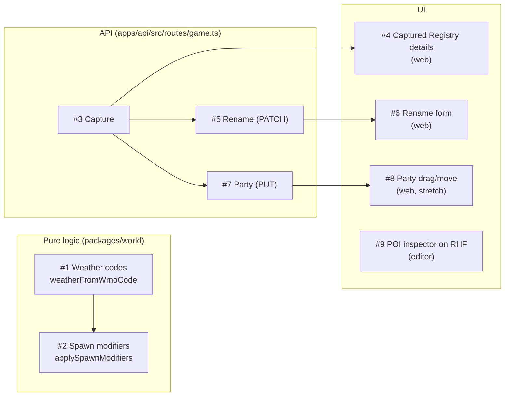
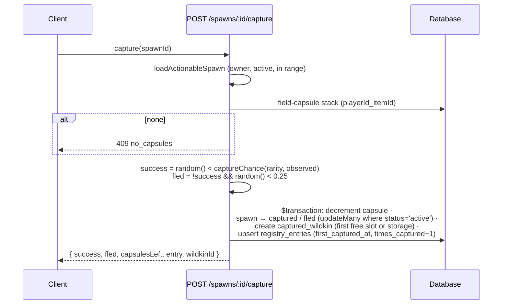

# 12 · Exercises and roadmap

> **In plain English:** v0.1.0 deliberately leaves nine features unfinished so they can be built by hand as practice.
> The app works around them (for example the Capture button explains that it isn't built yet). This page lists them,
> how they connect, and what is planned after v0.1.0.

Every gap is marked `TODO(you)` in the code with step-by-step instructions right where it lives. The canonical list is
[`patches/0.1.0/EXERCISES.md`](../patches/0.1.0/EXERCISES.md).

```bash
grep -rn "TODO(you)" apps packages --include=*.ts --include=*.tsx
pnpm test:exercises     # tests for #1 and #2; they fail until implemented
```

## The nine exercises



Arrows are "makes sense after". #9 is independent.

| # | Exercise | Where | You practise | Done when |
|---|---|---|---|---|
| 1 | Map Open-Meteo WMO codes to WILDBOUND weather | `packages/world/src/weather.ts` | Pure TS functions | `pnpm test:exercises` (weather) passes; status bar shows real weather |
| 2 | Species spawn modifiers | `packages/world/src/spawning.ts` | `map`/`filter`, typed data | exercise tests pass; Kawi becomes rare at night; the editor Test panel shows "applied" |
| 3 | Capture | `apps/api/src/routes/game.ts` → `POST /spawns/:id/capture` | Express, Prisma interactive transactions, compound keys, `increment`/`decrement` | Capture succeeds/fails on the radar, capsules go down, the Wildkin appears in Party |
| 4 | Captured-only Registry section | `apps/web/src/features/registry/RegistryDetailPage.tsx` → `CapturedDetails` | React, Tailwind tokens | After a capture the entry shows rarity, activity and skills |
| 5 | Rename API | `apps/api/src/routes/game.ts` → `PATCH /wildkin/:id` | Prisma `findFirst`/`update`, ownership | 200 with the new nickname |
| 6 | Rename form | `apps/web/src/features/party/RenameForm.tsx` | react-hook-form, zodResolver, `useMutation`, invalidation | Nickname changes in Party without reload |
| 7 | Rearrange party API | `apps/api/src/routes/game.ts` → `PUT /party` | Transactions, unique constraints | `GET /party` shows the new order |
| 8 | Rearrange party UI (stretch) | `apps/web/src/features/party/PartyPage.tsx` | React state, mutations, optimistic updates | Moves stick after refresh |
| 9 | POI inspector on react-hook-form | `apps/editor/src/inspectors/PoiInspector.tsx` | RHF + zodResolver + Zustand undo | Each field edit is one Ctrl+Z step; bad slug shows the Zod message |

### Hints that apply to all

- Request/response shapes already exist in `packages/shared/src/game.ts` (`CaptureResponseSchema`,
  `UpdatePartyRequestSchema`, `RenameWildkinRequestSchema`). Reuse them on both sides.
- For #3, #5 and #7 the integration test `apps/api/test/game.test.ts` currently **expects 501**. Change those
  assertions to the behaviour you build (better: write the test first).
- Scope every query by `playerId: res.locals.player.id`; reuse `loadActionableSpawn` for spawn actions.
- Finished examples of every pattern are nearby: Observe (transaction + upsert), `GET /party` (view mapping),
  `LoginPage` (react-hook-form + zod), `useObserve` (mutation + invalidation), `HabitatInspector` (#9's model).

### Exercise #3 at a glance



## Roadmap

From the project brief, the package READMEs and the handover notes:

| Stage | Items |
|---|---|
| **v0.1.0 (done)** | Map Editor, PostGIS resolver, draft/publish, Express + Prisma API, username sessions, live location with server-side movement checks, live weather and local time, server-authoritative spawns, Observe, Registry, Satchel, Party views, placeholder pixel art, tests |
| **Exercises** | The nine above |
| **Next (planned, not started)** | Phaser 3 top-down field view consuming the same `WorldContext` (`apps/web`); `packages/game` battle systems; `packages/assets` tile/creature/effect metadata |
| **Before going public** | Real accounts (players and editors), HTTPS deployment, rate limiting, CSRF protection, cleanup jobs ([08](08-security.md#checklist-before-a-public-deployment)) |
| **Later** | Story gating (`unlockCondition`, `storyStateRequirements` are already in the data), POI interactions (`interactionId`), content version history, offline/PWA, social features, "Wildkin outside its habitat" story events |

Rules for future work, from the brief and READMEs:

- The battle system (`packages/game`) **must consume `WorldContext`** and must not introduce a second world model.
- Generated art is a content-production step, never a runtime dependency or a source of geographic truth.
- Keep the editor a small game-world authoring tool, not a general GIS product.

## Project history (how v0.1.0 came together)

| Step | What happened |
|---|---|
| POC | Map Editor, world API and bootstrapped web app (Fastify + Drizzle at the time) |
| v0.1.0 pass 1 | Moved to Express 5 + Prisma 7 (old Drizzle DBs are baselined automatically), anti-teleport, the player game, PixelLab art, exercises |
| v0.1.0 pass 2 | Restyled the game to the Stitch mockups, moved the editor to Tailwind 4 + TanStack Query + react-hook-form, added exercise #9, regenerated the Kantar sprite |
| Fixes | Readable DB script errors, radar diagnostics, `maxAccuracyM` raised to 200 m for desktop testing, range ring fixes |

Details: [`patches/0.1.0/HANDOVER-pass-1.md`](../patches/0.1.0/HANDOVER-pass-1.md) and
[`HANDOVER-pass-2.md`](../patches/0.1.0/HANDOVER-pass-2.md).
