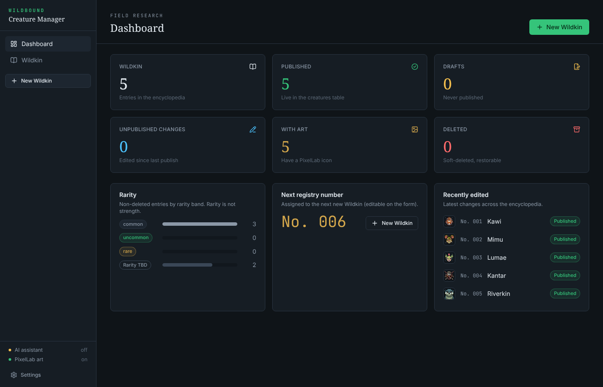
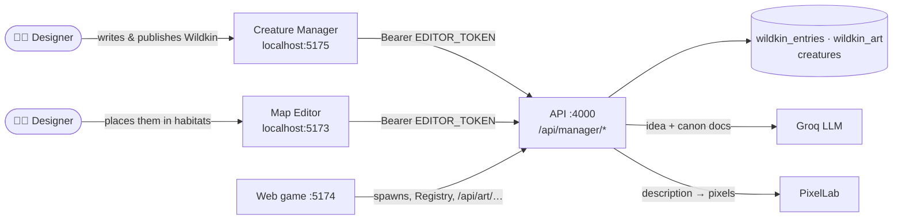
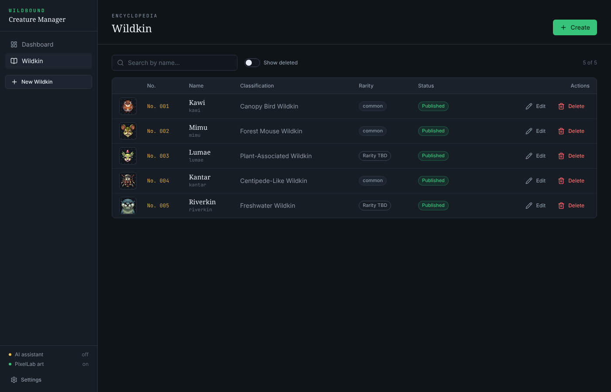
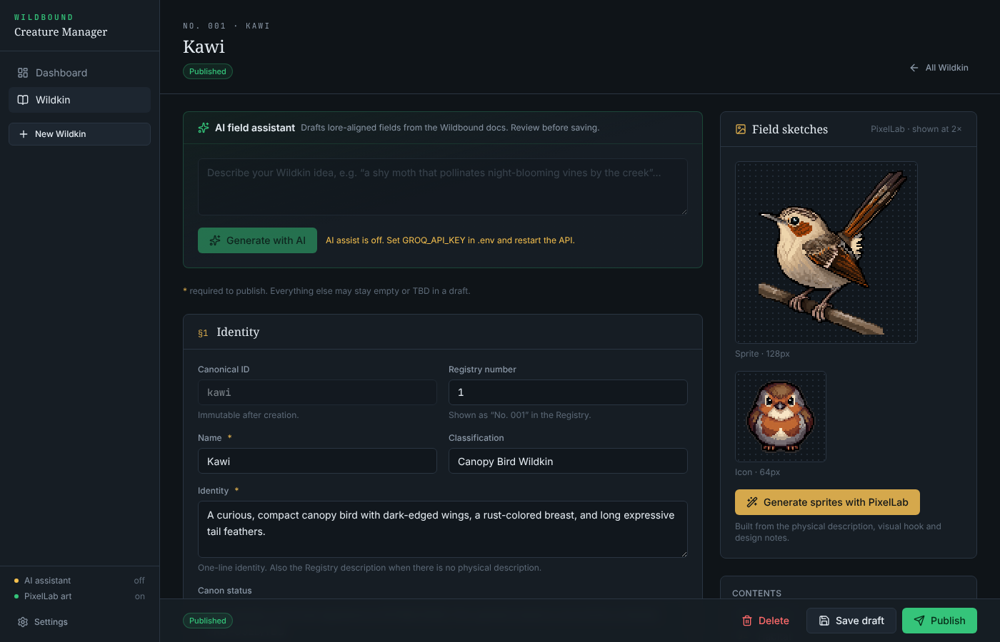
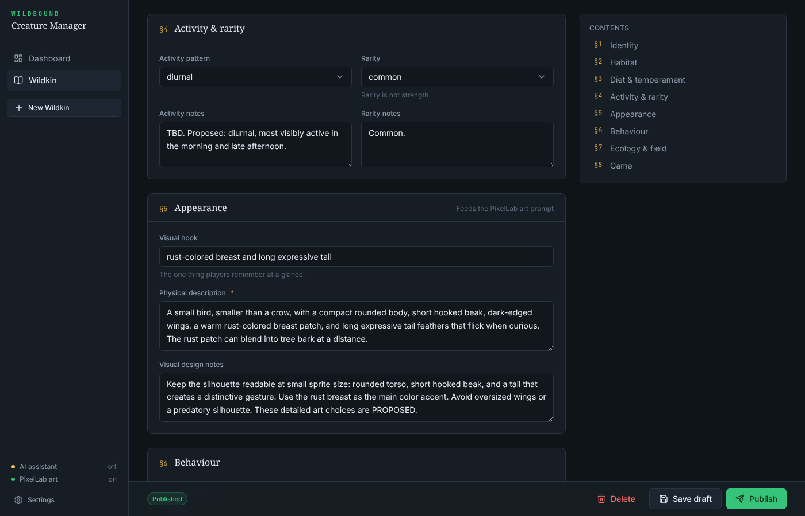
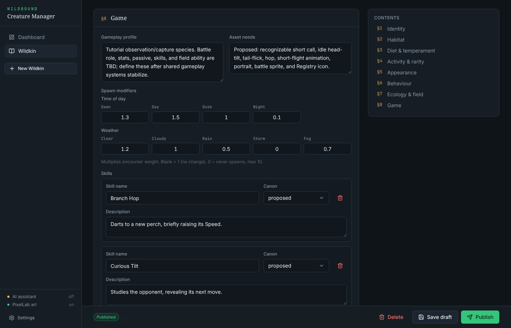
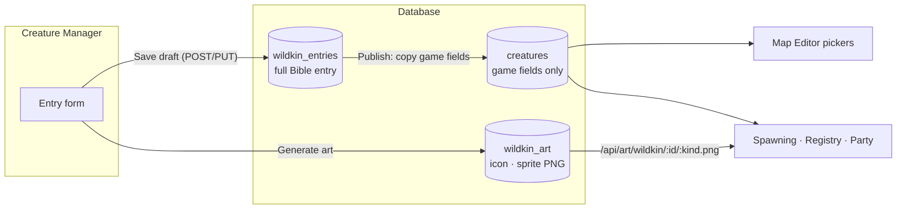
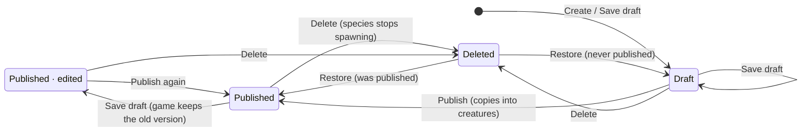
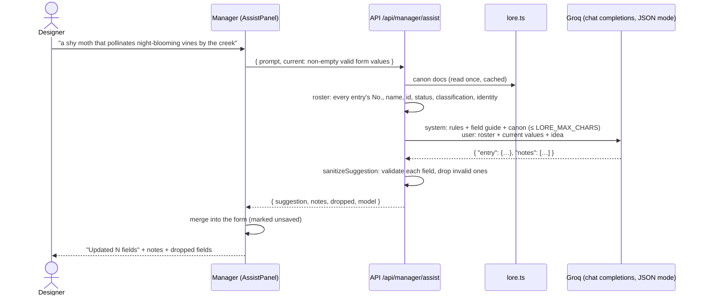
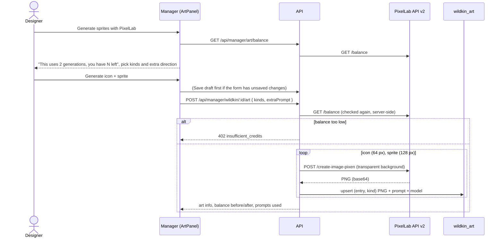

# 13 · Creature Manager (`apps/manager`)

> **In plain English:** the Creature Manager is WILDBOUND's **Wildkin encyclopedia you can edit**. It works like the
> Wildkin Bible (a Word document) turned into an app: each species gets an entry with its description, habitat, diet,
> behaviour, art and game settings. You write an entry as a **draft**, and when it is ready you press **Publish** to
> put the species into the game. An **AI assistant** that has read the WILDBOUND story documents can fill in the form
> from a one-line idea, and a **PixelLab** button draws the creature's pixel art from its written description.
> Nothing here needs programming.



## Contents

- [What it is for](#what-it-is-for)
- [Running it](#running-it)
- [Pages](#pages)
- [Encyclopedia vs creatures](#encyclopedia-vs-creatures)
- [AI assistant](#ai-assistant)
- [PixelLab art](#pixellab-art)
- [Code map](#code-map)
- [Extending the manager](#extending-the-manager)
- [Troubleshooting](#troubleshooting)

## What it is for

Before v0.2.0 a new Wildkin meant editing `packages/db/seed/creatures.json`, re-seeding, and generating art by hand.
The Creature Manager replaces that with one internal tool:

| Job | Where in the manager |
|---|---|
| Brainstorm a lore-friendly species | **AI field assistant** panel on the entry page |
| Write the full Bible entry (identity, habitat, diet, behaviour, ecology, open questions…) | The entry form, eight sections |
| Decide the game numbers (rarity, activity, spawn modifiers, skills, movement style) | Same form (sections 4, 6, 8) |
| Draw the icon and sprite | **Generate sprites with PixelLab** |
| Put the species in the game, or take it out again | **Publish**, **Delete** / **Restore** |
| See how the encyclopedia is doing | **Dashboard** |

It is a developer/designer tool like the [Map Editor](05-map-editor.md): it uses the same editor token and is not meant
to be exposed publicly. Where the species *lives* (which habitats, how common) is still decided in the Map Editor's
encounter tables.



## Running it

```bash
pnpm dev            # API, editor, game and manager together
# or only what the manager needs:
pnpm dev:api
pnpm dev:manager    # http://localhost:5175
```

Settings come from the repo-root `.env` (copy `.env.example`):

| Variable | Read by | Purpose |
|---|---|---|
| `VITE_API_URL` | manager | Where the manager's Vite server proxies `/api` (default `http://localhost:4000`; `API_PROXY_TARGET` overrides it). The browser only talks to `:5175`, so no CORS setup is needed |
| `VITE_EDITOR_TOKEN` | manager | Token sent as `Authorization: Bearer …`. Must equal the API's `EDITOR_TOKEN`. Can be overridden in **Settings** (sidebar), stored in `localStorage` `wildbound.editorToken`, shared with the Map Editor |
| `VITE_MANAGER_API_URL` | manager | Optional: call an API on another origin directly instead of through the proxy (that origin then needs `http://localhost:5175` in `CORS_ORIGINS`) |
| `GROQ_API_KEY` | API | Turns the AI assistant on. Free key at <https://console.groq.com/keys> |
| `GROQ_MODEL` | API | Groq chat model with JSON mode. Default `llama-3.3-70b-versatile` |
| `LORE_MAX_CHARS` | API | Characters of canon sent with each assistant request. Default `30000` |
| `LORE_DOCS_DIR` | API | Folder with the canon documents. Default: the repo's `docs/` |
| `PIXELLAB_API_KEY` | API | Turns art generation on. From <https://pixellab.ai> |

Both AI keys are optional. Without them the manager still works; the AI and art buttons are disabled with a hint, and
the sidebar shows **AI assistant: off** / **PixelLab art: off**. The API logs which services are on when it starts.
Restart the API after changing `.env`.

## Pages

### Dashboard (`/`)

Stat cards with the number of Wildkin in the database: **Wildkin** (entries, not deleted), **Published**, **Drafts**
(never published), **Unpublished changes** (published, edited since), **With art** (has an icon), **Deleted**
(restorable). Below them: the rarity breakdown (rarity is not strength), the **next registry number**, and the five most
recently edited entries. The numbers come from `GET /api/manager/stats`. The page will grow in later versions; cards are
a simple list (`STAT_CARDS` in `DashboardPage.tsx`).

### Wildkin list (`/wildkin`)



One row per species: icon, registry number (`No. 001`), name and id, classification, rarity and status badges
(**Draft**, **Published**, **Published · edited**). Search by name; **Show deleted** also lists deleted entries with
a **Restore** button. Each row has **Edit** and **Delete** (asks for confirmation, then soft-deletes). **Create** opens
an empty entry.

### Entry page (`/wildkin/new`, `/wildkin/:id`)



The entry follows the Wildkin Bible's structure in eight numbered sections, with a table of contents on the right:

| § | Section | Fields |
|---|---|---|
| 1 | Identity | Canonical ID, Registry number, **Name\***, Classification, **Identity\*** (one line), Canon status, Inspiration |
| 2 | Habitat | Habitat tags (combobox: suggested tags or your own slugs), **Habitat summary\*** (the Registry line), Habitat & distribution |
| 3 | Diet & temperament | Diet, Temperament, Diet tags, Temperament tags |
| 4 | Activity & rarity | Activity pattern (select), Rarity (select), Activity notes, Rarity notes |
| 5 | Appearance | Visual hook, **Physical description\***, Visual design notes. These three feed the art prompt |
| 6 | Behaviour | Movement style (select: still, skulker, forager, roamer, darter), Behaviour |
| 7 | Ecology & field | Role, Ecology, Field signs |
| 8 | Game | Gameplay profile, Asset needs, Spawn modifiers (0–10 per time of day and weather, blank = ×1), Skills (name, description, canon status), Open questions |

| Section 4–5 | Section 8 |
|---|---|
|  |  |

- Fields marked **\*** are required to publish; a draft may leave anything empty or `TBD`.
- Every property with fixed choices is a **select** (activity pattern, rarity, movement style, skill canon status), and
  habitat tags use a **combobox** with the suggested tags (`SUGGESTED_HABITAT_TAGS`), so values always match what the
  game understands.
- **Canonical ID** is derived from the name on a new entry until you edit it, and is **immutable** after the first
  save (it becomes the creature id the editor, game and art URLs use). The registry number defaults to the next free
  one and can be changed (it must stay unique).
- The action bar at the bottom shows the status and has **Delete**, **Save draft** and **Publish** (or **Save &
  publish** when there are unsaved changes). Leaving the page with unsaved changes asks first.
- On top: the [AI field assistant](#ai-assistant) panel. On the right: the [art panel](#pixellab-art) ("Field
  sketches").

### Sidebar

Dashboard, Wildkin, **New Wildkin**, the on/off status of the AI assistant and PixelLab art (from
`GET /api/manager/config`), and **Settings** for the editor token.

## Encyclopedia vs creatures

The most important idea in the manager: **there are two tables, and only one of them reaches the game.**

| | `wildkin_entries` (encyclopedia) | `creatures` (game data) |
|---|---|---|
| Who writes it | The Creature Manager (Save draft) | **Publish** in the manager, and `pnpm db:seed` for the five seed species |
| Who reads it | The manager | Map Editor pickers, spawning, Registry, Party |
| Contents | The whole Bible entry: prose, tags, notes, open questions **and** the game fields | Only the game fields |
| Drafts? | Yes (`status` draft/published, "unpublished changes") | No, always the live version |
| Art | `wildkin_art` (icon + sprite PNGs) belongs to the entry | – |



**What Publish copies** (`creatureFromEntry` in `packages/db/src/wildkin-repo.ts`):

| Entry field | → `creatures` column |
|---|---|
| `id`, `registryNumber`, `name` | same |
| `identity` (or `physicalDescription` if identity is empty) | `description` (the Registry text) |
| `habitatTags` | `habitat_affinity` |
| `habitatSummary`, `rarity`, `activityPattern`, `spawnModifiers`, `skills`, `movementStyle` | same |

Everything else (inspiration, diet, ecology, open questions, design notes…) stays in the encyclopedia. The game never
sees the prose, as the Bible asks.

### Status of an entry



- **Save draft** never changes the game. It is safe to experiment on a published species.
- **Publish** fails with *Cannot publish yet* when a required field is empty (`publish_incomplete`, the missing fields
  are listed), or when the registry number is used by another species.
- Ids and registry numbers are checked against **both** tables, so you cannot create an entry whose id or number
  belongs to an existing creature.

### Soft delete

**Delete** never removes data. It sets `deleted_at` on the entry and on the creature with the same id. Effects:

| Where | What happens |
|---|---|
| Creature Manager | Hidden from the list and counts (except **Deleted**); visible with **Show deleted**; read-only until restored |
| Game: spawning | The species never spawns again; its current spawns flee on the next radar poll |
| Game: Registry / Party | Players who already observed or captured it keep it; others never see it |
| Game: art | `/api/art/...` answers 404, so the game falls back to the static PNG or a placeholder |
| Map Editor | Removed from the Wildkin pickers. A draft that still lists it can be **saved**, but Validate/Publish report it as an **unknown Wildkin** until you remove it |

**Restore** clears both flags and everything comes back. To remove a species for good you would need SQL (and
captured Wildkin or encounter entries referencing it block that); this is deliberate.

## AI assistant

*"Describe your Wildkin idea"* → the form fills itself with a lore-aligned draft that you then review and edit.



### How the context is built

1. **Canon documents.** `apps/api/src/manager/lore.ts` reads every `WILDBOUND_*.docx` (with
   [mammoth](https://github.com/mwilliamson/mammoth.js)) or `WILDBOUND_*.md` in `docs/`, in the Bible's **authority
   order**: Wildkin Bible → First Field Survey → Biology & Ecology reference → anything else. The text is read once and
   cached until the API restarts.
2. **Budget.** `buildLoreContext` joins them into at most `LORE_MAX_CHARS` characters: the Bible is kept whole if it
   fits, the rest share what is left and are cut at a paragraph boundary (`[…truncated]`).
3. **Rules.** The system prompt repeats the Bible's design rules: Wildkin are living species, observation precedes
   capture, rarity is not strength, invented details are marked PROPOSED and unknowns stay TBD, no duplicates of an
   existing Wildkin's role, reusable mechanics only, a grounded field-research tone set in a tropical Philippine forest.
   A field guide lists every form field with its allowed values (activity patterns, rarities, movement styles,
   suggested habitat tags, spawn modifier keys, skill shape).
4. **Roster.** Every existing entry (drafts too) with its registry number, name, id, status, classification and
   identity, so the model avoids duplicates and can point out overlaps in `notes`.
5. **Current form.** The non-empty, valid values already in the form, so the assistant refines rather than starts over
   ("for an existing one, return only fields that should change").

### What comes back

- The model must answer one JSON object (`response_format: json_object`, temperature 0.8, up to 4096 tokens, 90 s
  timeout).
- Each field is validated on its own (`WildkinSuggestionSchema`); small slips are fixed first (ids and habitat tags
  are slugified, `"Nocturnal"` becomes `nocturnal`, comma lists become arrays, skills default to `proposed`). Fields
  that still fail are **dropped** and listed, instead of failing the whole answer.
- The registry number is never suggested, and on an existing entry the id is never overwritten.
- **Nothing is saved.** The suggestion only fills the form; you review it, then Save draft.

### Configuration and the free tier

- `GROQ_API_KEY` turns it on; `GROQ_MODEL` picks the model (default `llama-3.3-70b-versatile`; other JSON-mode models
  such as `openai/gpt-oss-120b` or `openai/gpt-oss-20b` work too).
- Each request sends roughly `LORE_MAX_CHARS` characters of canon (30,000 ≈ 7,500–8,000 tokens) plus the roster and
  form. **On Groq's free tier this can hit the per-minute token limit** (the manager shows *The assistant could not
  answer* with Groq's 413/429 message). Fixes, in order: wait a minute; lower `LORE_MAX_CHARS` (for example `12000`,
  which keeps most of the Bible); or pick a smaller model in `GROQ_MODEL` (for example `openai/gpt-oss-20b`; each
  model has its own limits, listed in the Groq console). Restart the API after changing `.env`.
- Updating a canon document changes what the assistant knows after an API restart. Keep the file name prefix
  `WILDBOUND_` (see [09 · Canon documents](09-wildkin-and-content.md#canon-documents-and-authority)).

## PixelLab art

**Generate sprites with PixelLab** (the "Field sketches" panel) draws the Wildkin from its encyclopedia entry.



| Setting | Value | Why |
|---|---|---|
| Model | PixelLab **Pixen** (`create-image-pixen`) | The cheapest image model: 1 generation per image |
| Sizes | Icon **64 × 64**, sprite **128 × 128** (`ART_SIZES`) | Same as the hand-made art in `apps/web/public/wildkin/` |
| Background | Transparent (`no_background`) | Markers and cards draw their own frame |
| Style | Icon: front view (south), face only. Sprite: side view facing right (east). Single-colour black outline, medium detail, a fresh random `seed` each time | Matches the existing art; the radar mirrors sprites when walking left |
| Balance | Checked **before every generation**, in the dialog and again on the server | Never start a job you cannot pay for (402 `insufficient_credits`) |

**The prompt** (`artPrompt` in `apps/api/src/manager/art.ts`) is built from the **saved** entry, differently per kind:

```
Icon (face only):
  Headshot of <Name>, a <Classification>: extreme close-up of the face only, cropped at the neck, eyes filling the
  image, front view. Only the head is visible: no body, no legs, no tail.
  Head colors and details: <face-related phrases of the physical description + visual hook>.
  <style>, game icon. <Extra direction>

Sprite (full body, varied pose):
  Full body of <Name>, a <Classification>, side view facing right, whole creature visible, centered.
  Pose: <random pose for the movement style>. Creature only: no background scenery, no branches, no ground, no props.
  <Physical description> Signature features: <Visual hook>. <style>. <Extra direction> Design notes: <Visual design notes>
```

- **Icons show the face only.** `faceDetails` keeps the phrases of the description that can describe a head
  (colours, eyes, ears, beak, markings) and drops the ones about the body, wings, legs or tail, which otherwise pull
  the model into drawing a half or full body.
- **Sprites get a different pose each time.** `pickPose` picks from a pool for the species' **movement style**
  (`SPRITE_POSES`: e.g. darter → mid-hop, poised to dart away, just landing…; skulker → crouched low, peeking out
  cautiously…) plus a few general poses, and never the pose of the sprite being replaced. Each request also sends a
  new random seed. Use the dialog's extra direction to ask for a specific pose.

It is trimmed to 1200 characters. The prompts actually sent are shown under the art after generating, so you can see
why a picture came out the way it did. To change the result, improve the **Appearance** section (or add extra
direction) and generate again.

**Storage and serving.** Each image is stored in `wildkin_art` (one row per entry and kind; generating again replaces
it) with the prompt and model. The API serves it publicly at `/api/art/wildkin/<id>/icon.png` and `…/sprite.png`
(any non-deleted entry, draft or published, so you can see art before publishing). The game loads art from there and
falls back to the static seed PNGs, then a placeholder ([06 · Wildkin art](06-web-game.md#wildkin-art)). No rebuild or
file copy is needed.

Rules: art is generated from the saved entry, so a new entry must be saved first (unsaved changes are saved as a draft
automatically); deleted entries must be restored first; the entry needs a physical description or identity.

## Code map

| Path | Role |
|---|---|
| `apps/manager/src/router.tsx` | Routes `/`, `/wildkin`, `/wildkin/new`, `/wildkin/:id` |
| `apps/manager/src/lib/api.ts` | Bearer-token fetch client; every response parsed with its Zod schema |
| `apps/manager/src/lib/queries.ts` | TanStack Query hooks; mutations invalidate stats, lists and the entry |
| `apps/manager/src/lib/wildkin-form.ts` | Pure helpers: slugify, empty entry, assistant context, suggestion merge, spawn modifiers (+ tests) |
| `apps/manager/src/features/dashboard/DashboardPage.tsx` | Dashboard and `STAT_CARDS` |
| `apps/manager/src/features/wildkin/` | `WildkinListPage`, `WildkinEditPage` (form), `AssistPanel`, `ArtPanel`, `fields.tsx`, `common.tsx` |
| `packages/shared/src/wildkin.ts` | The contract: `WildkinEntryInputSchema`, statuses, art kinds and sizes, stats, assist and art requests/responses, `wildkinArtPath` |
| `packages/db/src/wildkin-repo.ts` | CRUD, publish, soft delete, stats, art storage, seeding |
| `apps/api/src/routes/manager.ts` | `/api/manager/*` and the public `/api/art/*` |
| `apps/api/src/manager/{assistant,art,lore}.ts` | Groq assistant, PixelLab client and prompt, canon loader |
| `apps/api/test/manager.test.ts`, `apps/api/src/manager/manager.test.ts` | Integration tests (fake assistant/art providers) and unit tests |

Endpoints are documented in [04 · API reference](04-api-reference.md#creature-manager-endpoints), tables in
[03 · Database](03-database.md#encyclopedia-creature-manager).

## Extending the manager

- **A new dashboard card:** add the number to `WildkinStatsSchema` and `wildkinStats()`, then one object to
  `STAT_CARDS`.
- **A new prose field** (encyclopedia only): add it to `WildkinEntryInputSchema` with a default, then a `TextField` in
  the right section of `WildkinEditPage.tsx`. No migration: it lives in `content` JSON. Mention it in the assistant's
  `FIELD_GUIDE` if the AI should fill it.
- **A new game field** (reaches `creatures`): the above, plus a column in `schema.prisma` + migration, the field in
  `CreatureDefinitionSchema`, `creatureFromEntry`, `listCreatures`/`upsertCreatures`. See
  [11 · Cookbook](11-cookbook.md#add-a-field-or-entity-to-the-world) for the general recipe.
- **A different LLM or art provider:** implement `WildkinAssistant` or `ArtGenerator` and construct it in
  `apps/api/src/server.ts`. Tests already use fakes through the same interfaces.

## Troubleshooting

| Symptom | Fix |
|---|---|
| "Cannot reach the API" / every request fails | Run `pnpm dev:api`; check `VITE_API_URL` |
| 401 / token prompt | `VITE_EDITOR_TOKEN` must equal `EDITOR_TOKEN`, or set the token in **Settings** |
| "Cannot reach the API at …" | The API is not running (`pnpm dev:api`), or the proxy target is wrong: check `VITE_API_URL` / `API_PROXY_TARGET` and restart `pnpm dev:manager` |
| "AI assist is off" / "Art generation is off" | Set `GROQ_API_KEY` / `PIXELLAB_API_KEY` in `.env` and **restart the API** (Vite does not need a restart) |
| "The assistant could not answer: Groq returned 429/413…" | Groq rate or token limit (common on the free tier). Wait a minute, lower `LORE_MAX_CHARS`, or choose a smaller model in `GROQ_MODEL` |
| The assistant ignores a recent change to the Bible | The canon is cached: restart the API |
| "Dropped invalid suggestions for: …" | The model returned values that do not fit the schema; those fields were skipped. Fill them by hand or ask again |
| "Not enough PixelLab credits" (402) | Top up PixelLab or wait for the subscription to renew; the balance is shown in the dialog |
| "Art generation failed: PixelLab returned …" | PixelLab error or timeout (3 min). Try again; check the API log |
| "Cannot publish yet" | Fill the fields marked `*` (Name, Identity, Physical description, Habitat summary) |
| "Registry number N is already used by …" | Pick another number (the dashboard shows the next free one) |
| A new species does not appear in the Map Editor | It must be **published** (drafts are not in `creatures`). Then focus the editor tab; it refetches |
| A published species never spawns | It must also be in an encounter table of a **published** world (Map Editor), and the conditions/modifiers must allow it |
| Changes to Kawi & co. vanished after `pnpm db:seed` | Seeding resets the five seed creatures' game fields from `creatures.json`. Open the entry in the manager and Publish again |
| New art does not show in the game | Hard-refresh: URLs without `?v=` are cached for 60 s |

Next: [Glossary](glossary.md) · back to the [index](README.md).
