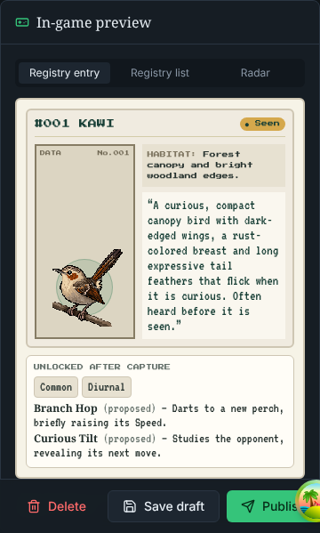
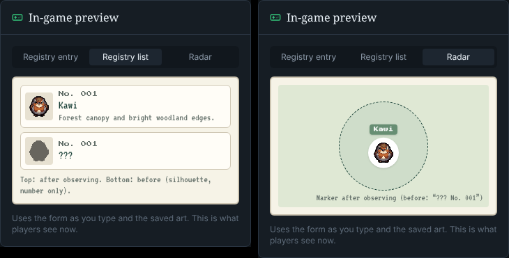
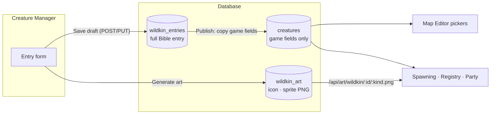
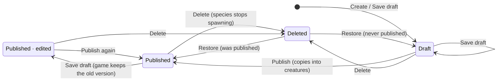
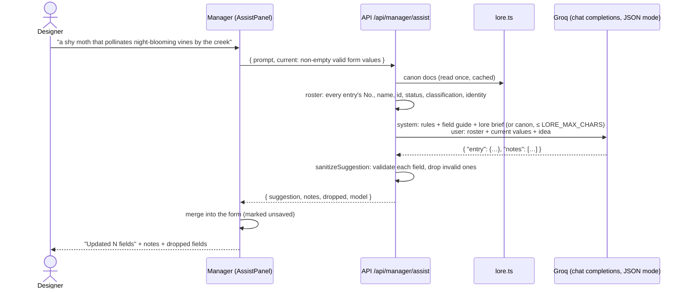
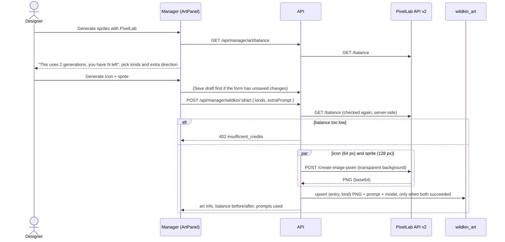

# 13 · Creature Manager (`apps/manager`)

> **In plain English:** the Creature Manager is WILDBOUND's **Wildkin encyclopedia you can edit**. It works like the
> Wildkin Bible (a Word document) turned into an app: each species gets an entry with its description, habitat, diet,
> behaviour, art and game settings. You write an entry as a **draft**, and when it is ready you press **Publish** to
> put the species into the game. An **AI assistant** that has read the WILDBOUND story documents can fill in the form
> from a one-line idea, and a **PixelLab** button draws the creature's pixel art from its written description.
> Since v0.3.0 an entry also holds the species' **battle and genetics** data: its category (which Field Registry
> license covers it), body traits, base stats (always adding up to 300, because rarity is not strength), one or two
> placeholder attacks and how wild individuals vary (the gene pool). A species cannot be published without them.
> Nothing here needs programming.


## Contents

- [What it is for](#what-it-is-for)
- [Running it](#running-it)
- [Pages](#pages)
- [Section 9: Battle & genetics](#section-9-battle--genetics)
- [Encyclopedia vs creatures](#encyclopedia-vs-creatures)
- [AI assistant](#ai-assistant)
- [PixelLab art](#pixellab-art)
- [Code map](#code-map)
- [Extending the manager](#extending-the-manager)
- [Troubleshooting](#troubleshooting)

## What it is for

Before v0.2.0 a new Wildkin meant editing `packages/db/seed/creatures.json`, re-seeding, and generating art by hand.
The Creature Manager replaces that with one internal tool:

| Job | Where in the manager |
|---|---|
| Brainstorm a lore-friendly species | **AI field assistant** panel on the entry page |
| Write the full Bible entry (identity, habitat, diet, behaviour, ecology, open questions…) | The entry form, nine sections |
| Decide the game numbers (rarity, activity, spawn modifiers, skills, movement style) | Same form (sections 4, 6, 8) |
| Decide the battle and genetics data (category, body traits, base stats, attacks, gene pool) | Same form, section 9 "Battle & genetics" |
| Draw the icon and sprite | **Generate sprites with PixelLab** |
| Put the species in the game, or take it out again | **Publish**, **Delete** / **Restore** |
| See how the encyclopedia is doing | **Dashboard** |

It is a developer/designer tool like the [Map Editor](05-map-editor.md): it uses the same editor token and is not meant
to be exposed publicly. Where the species *lives* (which habitats, how common) is still decided in the Map Editor's
encounter tables.


## Running it

```bash
pnpm dev            # API, editor, game and manager together
# or only what the manager needs:
pnpm dev:api
pnpm dev:manager    # http://localhost:5175
```

Settings come from the repo-root `.env` (copy `.env.example`):

| Variable | Read by | Purpose |
|---|---|---|
| `VITE_API_URL` | manager | Where the manager's Vite server proxies `/api` (default `http://localhost:4000`; `API_PROXY_TARGET` overrides it). The browser only talks to `:5175`, so no CORS setup is needed |
| `VITE_EDITOR_TOKEN` | manager | Token sent as `Authorization: Bearer …`. Must equal the API's `EDITOR_TOKEN`. Can be overridden in **Settings** (sidebar), stored in `localStorage` `wildbound.editorToken`, shared with the Map Editor |
| `VITE_MANAGER_API_URL` | manager | Optional: call an API on another origin directly instead of through the proxy (that origin then needs `http://localhost:5175` in `CORS_ORIGINS`) |
| `GROQ_API_KEY` | API | Turns the AI assistant on. Free key at <https://console.groq.com/keys> |
| `GROQ_MODEL` | API | Groq chat model with JSON mode. Default `llama-3.3-70b-versatile` |
| `LORE_SOURCE` | API | `brief` (default): send the condensed `docs/lore/assistant-brief.md` (~2,000 tokens). `full`: send the canon `.docx` files |
| `LORE_MAX_CHARS` | API | Upper bound on lore characters per assistant request. Default `30000` (matters for `full`) |
| `LORE_DOCS_DIR` | API | Folder with the canon documents. Default: the repo's `docs/` |
| `PIXELLAB_API_KEY` | API | Turns art generation on. From <https://pixellab.ai> |

Both AI keys are optional. Without them the manager still works; the AI and art buttons are disabled with a hint, and
the sidebar shows **AI assistant: off** / **PixelLab art: off**. The API logs which services are on when it starts.
Restart the API after changing `.env`.

## Pages

### Dashboard (`/`)

Stat cards with the number of Wildkin in the database: **Wildkin** (entries, not deleted), **Published**, **Drafts**
(never published), **Unpublished changes** (published, edited since), **Battle-ready** (published with a category,
body traits, base stats and attacks; new in v0.3.0, `battleReady` in `WildkinStatsSchema`), **With art** (has an
icon), **Deleted** (restorable). Below them: the rarity breakdown (rarity is not strength), the **next registry number**, and the five most
recently edited entries. The numbers come from `GET /api/manager/stats`. The page will grow in later versions; cards are
a simple list (`STAT_CARDS` in `DashboardPage.tsx`).

### Wildkin list (`/wildkin`)


One row per species: icon, registry number (`No. 001`), name and id, classification, rarity and status badges
(**Draft**, **Published**, **Published · edited**). Search by name; **Show deleted** also lists deleted entries with
a **Restore** button. Each row has **Edit** and **Delete** (asks for confirmation, then soft-deletes). **Create** opens
an empty entry.

### Entry page (`/wildkin/new`, `/wildkin/:id`)


The entry follows the Wildkin Bible's structure in nine numbered sections, with a table of contents on the right:

| § | Section | Fields |
|---|---|---|
| 1 | Identity | 🎮 Canonical ID, 🎮 Registry number, 🎮 **Name\***, Classification, Identity (one line), 🎮 **Registry description\*** (what players read in the Registry), Canon status, Inspiration |
| 2 | Habitat | 🎮 Habitat tags (combobox: suggested tags or your own slugs), 🎮 **Habitat summary\*** (the Registry line), Habitat & distribution |
| 3 | Diet & temperament | Diet, Temperament, Diet tags, Temperament tags |
| 4 | Activity & rarity | 🎮 Activity pattern (select), 🎮 Rarity (select), Activity notes, Rarity notes |
| 5 | Appearance | Visual hook, Physical description, Visual design notes. These three feed the art prompt |
| 6 | Behaviour | 🎮 Movement style (select: still, skulker, forager, roamer, darter), Behaviour |
| 7 | Ecology & field | Role, Ecology, Field signs |
| 8 | Game | Gameplay profile, Asset needs, 🎮 Spawn modifiers (0–10 per time of day and weather, blank = ×1), 🎮 Skills (name, description, canon status), Open questions |
| 9 | Battle & genetics | 🎮 **Category\*\***, 🎮 **Body traits\*\*** (max 2), 🎮 **Base stats\*\*** (sum exactly 300), 🎮 **Attacks\*\*** (max 2), 🎮 Gene pool. See [Section 9](#section-9-battle--genetics) |

| Section 4–5 | Section 8 |
|---|---|
|  |  |

- Fields marked **\*** are required to publish (Name, Registry description, Habitat summary), and so are the
  battle fields marked **\*\*** (see [Publish rules](#publish-rules)); a draft may leave anything empty or `TBD`.
- Fields marked 🎮 carry an **IN GAME** chip on the form: publishing copies them into the game (`GAME_FIELDS` in
  `@wildbound/shared`). Unmarked fields are **encyclopedia only**: Bible prose for people, the AI assistant and the art
  prompt.
- **Registry description** is the text players read in the in-game Registry after observing the Wildkin. It is its
  own field (it used to be taken from the identity line); the AI assistant always writes one that matches your idea.
- Every property with fixed choices is a **select** (activity pattern, rarity, movement style, skill canon status,
  category, attack approach and canon status), and
  habitat tags use a **combobox** with the suggested tags (`SUGGESTED_HABITAT_TAGS`), so values always match what the
  game understands.
- **Canonical ID** is derived from the name on a new entry until you edit it, and is **immutable** after the first
  save (it becomes the creature id the editor, game and art URLs use). The registry number defaults to the next free
  one and can be changed (it must stay unique).
- The action bar at the bottom shows the status and has **Delete**, **Save draft** and **Publish** (or **Save &
  publish** when there are unsaved changes). Leaving the page with unsaved changes asks first.
- On top: the [AI field assistant](#ai-assistant) panel. On the right: the [art panel](#pixellab-art) ("Field
  sketches") and the **in-game preview**.

#### Section 9: Battle & genetics

New in v0.3.0. Everything here is copied into the game on publish (🎮) and drives wild battles, capture and how
individual Wildkin vary. The rules behind it are in [14 · Battles and research](14-battles-and-research.md) and
[07 · Game systems](07-game-systems.md). All per-species values are **PROPOSED** canon until approved in the
Wildkin Bible.

| Field | What you set | Rules |
|---|---|---|
| **Category** | One of Aerial, Aquatic, Terrestrial, Verdant (or TBD) | Decides which Field Registry license covers the species (obedience cap, scanner depth, category capsule). Publishing needs a category other than TBD |
| **Body traits** | Toggle chips for Plated, Feathered, Soft-bodied, Leafy, Slick; each chip shows what it is weak to and resists, with the reason as a tooltip | At least 1 to publish, at most 2 (the other chips grey out). Pick what the anatomy shows; Strike attacks are always neutral |
| **Base stats** | HP, Attack, Defense, Speed (`BaseStatsEditor.tsx`). **Set base stats** starts from 75 / 75 / 75 / 75; **Clear** sets them back to "not set" (`null`) | Whole numbers 10 to 150 that add up to **exactly 300** (`STAT_BUDGET`), shaped by anatomy and behaviour. Rarity never adds strength |
| **Attacks** | Up to 2 rows, like the skills editor: name, approach (select with a hint per approach), power (with its word: Light, Moderate, Heavy), canon (proposed / established), description | Power 30 to 60. At least 1 to publish. These are **placeholder attacks**, separate from the Registry's `skills` list, and the 0.4.0 skill system replaces them |
| **Gene pool** | Build p(L) and Temperament p(W) sliders, habitat overrides, marking variant (`GenePoolEditor` in `BattleFields.tsx`) | See below. Leave the defaults (0.5 / 0.5, no overrides, no marking) unless the species clearly varies |

**Base stats and exercise #16.** Until the live budget counter (exercise #16 in
[`BaseStatsEditor.tsx`](../apps/manager/src/features/wildkin/BaseStatsEditor.tsx)) is built, the editor shows four
plain inputs and checks the total when you save: the form shows *Base stats must add up to exactly 300* (the
`.refine` on `BaseStatsSchema` in `packages/shared/src/battle.ts`), and a hint under the inputs says the counter is
not built yet. Once done it reads "240 / 300, 60 left" live, red until the total is 300. While stats are not set the
game uses an even 75 / 75 / 75 / 75 (`FALLBACK_BASE_STATS`), and a species with no attacks falls back to "Lunge";
neither can be published that way.

**Gene pool editor.**

- **Build** and **Temperament** each have a slider for the chance that one allele is `L` (Large) or `W` (Wary), with
  a live readout of what share of wild individuals that gives: `p²` Large (or Wary), `2p(1−p)` Typical (or Steady),
  `(1−p)²` Small (or Bold). At 0.5 that is 25% / 50% / 25%. The hint repeats the trade-offs (Small: HP ×0.9, Speed
  ×1.1; Large: HP ×1.1, Defense ×1.05, Speed ×0.9; Bold: Attack ×1.1, Defense ×0.9; Wary: Speed ×1.1, Attack ×0.9).
- **Habitat overrides** (up to 16 per gene): a habitat tag (suggestions: the entry's own habitat tags first, then
  `SUGGESTED_HABITAT_TAGS`) and its own slider and readout. When a Wildkin spawns, the **first** override (in this
  order) whose tag the spawn habitat carries wins; a tag listed twice is flagged, since only its first row applies.
  Kantar's `mature-woodland` 0.75 is the model: larger individuals deeper in mature woodland.
- **Marking variant** (a switch): name (after a visible difference, e.g. "Banded"), frequency 0 to 0.2 (the chance
  each allele is `m`) with the share of individuals that show it (frequency squared, so 0.05 gives 0.25%) and a
  description. It is cosmetic only and recessive (`mm`); the game shows it as a text badge (no variant art yet).

#### Publish rules

Publishing (`publishIssues` in `packages/db/src/wildkin-repo.ts`) refuses with `publish_incomplete` and lists every
problem:

| Field | Issue code | Message |
|---|---|---|
| Name, Registry description, Habitat summary | `required` | "… is required before publishing" |
| Category is TBD | `battle-category` | "Choose a category before publishing" |
| No body trait | `battle-bodyTraits` | "Add at least one body trait before publishing" |
| Base stats not set, or not adding up to 300 | `battle-baseStats` | "Set the base stats before publishing" / "Base stats must add up to exactly 300" |
| No attack | `battle-attacks` | "Add at least one placeholder attack before publishing" |

The checks are `PUBLISH_REQUIRED_FIELDS` and `PUBLISH_BATTLE_CHECKS` in `packages/shared/src/wildkin.ts`
(`isBattleReady` is the same test, used by the dashboard card).

**Entries from before v0.3.0.** The five seed species get their battle data from `pnpm db:seed`:
`backfillBattleFields` fills the five battle fields into their existing encyclopedia entries when a field is absent or
still at its default, keeps anything an author set, and does not mark the entry as edited. Any **other** species
(authored in the manager, or a database edited by hand) has no battle data yet: it stays in the game with the
fallbacks above, but you must fill in section 9 before you can publish it again. The form completes older entries with
the schema defaults when it loads them, so they open without errors.

#### In-game preview

| Registry entry | Registry list · Radar |
|---|---|
|  |  |

`GamePreview.tsx` draws the Wildkin the way the game does (same paper "Field Nav" colours and pixel fonts), live from
the form as you type plus the saved art:

- **Registry entry**: the dossier card (number, name, sprite, habitat summary, registry description) and the part
  unlocked after capture (rarity, activity pattern, skills).
- **Registry list**: the row after observing, and the silhouette row before.
- **Radar**: the map marker with its name tag.
- **Battle & genetics** (authoring view, in the manager's own colours): the stat shape as bars with their descriptors
  (Signature strength, Solid, Modest, Weak point) and a red note when the total is not 300; the category; each body
  trait with what it is weak to and resists and why; the attacks with approach and power word. **Roll a sample** rolls
  one level 50 individual locally with the same pure functions the server uses (`rollGenome`, `rollVigor`,
  `computeStats` from `@wildbound/world`, through `rollSample` in `src/lib/battle-preview.ts`), as a spawn with no
  habitat would be rolled (gene pool defaults, no overrides): its Build, Temperament, marking, genotype and a table of
  stats with grade and vigor. Raw numbers are fine here because this is an authoring tool; the game itself only shows
  words and bars.

Missing game text shows in red ("no registry description yet"). The note under the preview says whether players see
this version already, or still the last published one.

### Sidebar

Dashboard, Wildkin, **New Wildkin**, the on/off status of the AI assistant and PixelLab art (from
`GET /api/manager/config`), and **Settings** for the editor token.

## Encyclopedia vs creatures

The most important idea in the manager: **there are two tables, and only one of them reaches the game.**

| | `wildkin_entries` (encyclopedia) | `creatures` (game data) |
|---|---|---|
| Who writes it | The Creature Manager (Save draft) | **Publish** in the manager, and `pnpm db:seed` for the five seed species |
| Who reads it | The manager | Map Editor pickers, spawning, Registry, Party |
| Contents | The whole Bible entry: prose, tags, notes, open questions **and** the game fields | Only the game fields |
| Drafts? | Yes (`status` draft/published, "unpublished changes") | No, always the live version |
| Art | `wildkin_art` (icon + sprite PNGs) belongs to the entry | – |



**What Publish copies** (`creatureFromEntry` in `packages/db/src/wildkin-repo.ts`):

| Entry field | → `creatures` column |
|---|---|
| `id`, `registryNumber`, `name` | same |
| `registryDescription` | `description` (the Registry text) |
| `habitatTags` | `habitat_affinity` |
| `habitatSummary`, `rarity`, `activityPattern`, `spawnModifiers`, `skills`, `movementStyle` | same |
| `category`, `bodyTraits`, `baseStats`, `attacks`, `genePool` (v0.3.0) | `category`, `body_traits`, `base_stats`, `attacks`, `gene_pool` |

Everything else (inspiration, diet, ecology, open questions, design notes…) stays in the encyclopedia. The game never
sees the prose, as the Bible asks.

### Status of an entry



- **Save draft** never changes the game. It is safe to experiment on a published species.
- **Publish** fails with *Cannot publish yet* when a required field is empty or a battle field is not ready
  (`publish_incomplete`, every problem is listed; see [Publish rules](#publish-rules)), or when the registry number is
  used by another species.
- Ids and registry numbers are checked against **both** tables, so you cannot create an entry whose id or number
  belongs to an existing creature.

### Deleting

**Delete** (list row or entry page) asks how:

| Choice | What it does |
|---|---|
| **Move to deleted** (default) | Soft delete, restorable (below) |
| **Delete permanently** | Erases the entry, its art, the game creature and everything that references it. Before you confirm, the dialog lists what else goes (`GET …/usage`: draft and published encounter-table entries, players' Registry records, captured Wildkin, active spawns) and you must tick *I understand this cannot be undone*. Also offered on deleted rows ("Show deleted") and on a deleted entry's page |

**Both free the registry number.** Registry numbers are unique only among Wildkin that are not deleted (partial unique
indexes, migration `4_registry_number_reuse`), so a new Wildkin can take the number right away, and the next-number
suggestion skips deleted ones.

### Soft delete

**Move to deleted** sets `deleted_at` on the entry and on the creature with the same id. Effects:

| Where | What happens |
|---|---|
| Creature Manager | Hidden from the list and counts (except **Deleted**); visible with **Show deleted**; read-only until restored |
| Game: spawning | The species never spawns again; its current spawns flee on the next radar poll |
| Game: Registry / Party | Players who already observed or captured it keep it; others never see it |
| Game: art | `/api/art/...` answers 404, so the game falls back to the static PNG or a placeholder |
| Map Editor | Removed from the Wildkin pickers. A draft that still lists it can be **saved**, but Validate/Publish report it as an **unknown Wildkin** until you remove it |

**Restore** clears both flags and everything comes back. If its registry number was taken in the meantime, the restored
Wildkin gets the **next free number** and the manager tells you ("Restored as No. 007: No. 006 is now used by another
Wildkin"). To remove a species for good, use **Delete permanently**.

## AI assistant

*"Describe your Wildkin idea"* → the form fills itself with a lore-aligned draft that you then review and edit.



### How the context is built

1. **Lore.** `apps/api/src/manager/lore.ts` picks the source with `LORE_SOURCE`:
   - **`brief` (default):** [`docs/lore/assistant-brief.md`](lore/assistant-brief.md), a hand-condensed summary of
     the three canon documents (~9,300 characters, ~2,100 tokens since v0.3.0). It keeps what matters for designing a
     species: the setting and central mystery (First Field Survey), the biology rules (lineage, reproduction, diet,
     intelligence, abilities, individual variation, capture and care, friendly battles), the Bible's canon rules and
     design standards (including the stat budget, categories, body traits, approaches, placeholder attacks, genetics
     and marking variants), and the open questions. It leaves out the story's
     chapters and the per-species entries, because the existing Wildkin are sent separately (the roster, step 4).
   - **`full`:** every `WILDBOUND_*.docx` (read with [mammoth](https://github.com/mwilliamson/mammoth.js)) or
     `WILDBOUND_*.md` in `docs/`, in the Bible's **authority order** (Wildkin Bible → First Field Survey → Biology &
     Ecology reference), about 68,000 characters before trimming.

   Either is read once and cached until the API restarts. If the brief file is missing, the full documents are used.
2. **Budget.** `buildLoreContext` caps the lore at `LORE_MAX_CHARS` characters (default 30,000). The brief is well
   under it; with `full`, the Bible is kept whole if it fits and the rest share what is left, cut at a paragraph
   boundary (`[…truncated]`).
3. **Rules.** The system prompt repeats the Bible's design rules: Wildkin are living species, observation precedes
   capture, rarity is not strength, invented details are marked PROPOSED and unknowns stay TBD, no duplicates of an
   existing Wildkin's role, reusable mechanics only, a grounded field-research tone set in a tropical Philippine forest.
   A field guide lists every form field with its allowed values (activity patterns, rarities, movement styles,
   habitat tags, spawn modifier keys, skill shape). The **registry description** must match the author's idea and the
   lore (kept and polished if the idea already contains one, written otherwise) and is always returned.
   Since v0.3.0 the field guide also covers the **battle and genetics fields** (`FIELD_GUIDE` in
   `apps/api/src/manager/assistant.ts`), built from the shared constants so it never drifts from the rules:
   - `category`: one of aerial, aquatic, terrestrial, verdant, chosen from its anatomy and habitat;
   - `bodyTraits`: 1 or 2, consistent with its anatomy, listed with each trait's weakness, resistance and reason;
   - `baseStats`: whole numbers 10 to 150 that add up to **exactly 300** ("check the sum"), shaped by anatomy and
     behaviour (a heavy shelled grazer: high HP and Defense, low Speed; a darting flier: high Speed); rarity never
     means strength;
   - `attacks`: 1 or 2 placeholder attacks with an approach that fits how it actually fights (a beak pecks: pierce;
     a tail slam: crush; spraying water: surge), power 30 to 60, always marked `proposed`;
   - `genePool`: left out (the defaults) unless the idea clearly implies variation, for example larger individuals in
     one habitat or a rare marking (frequency at most 0.2).

   The rule "do not equate rarity with strength" now adds that every species' base stats share the same budget. The
   [lore brief](lore/assistant-brief.md) carries the same rules in its "Design standards" (stat budget, categories,
   body traits, approaches, placeholder attacks, genetics, marking variants, capture and care).
4. **Roster.** Every existing entry (drafts too) with its registry number, name, id, status, classification and
   identity, so the model avoids duplicates and can point out overlaps in `notes`.
5. **Current form.** The non-empty, valid values already in the form, so the assistant refines rather than starts over
   ("for an existing one, return only fields that should change"). A `TBD` category and the default gene pool count
   as empty and are not sent (`assistContext` in `src/lib/wildkin-form.ts`).

### What comes back

- The model must answer one JSON object (`response_format: json_object`, temperature 0.8, up to 4096 tokens, 90 s
  timeout).
- The prompt shows the exact answer shape (`{"entry": {<field>: <value>, …}, "notes": […]}`), but models do not always
  follow it (`openai/gpt-oss-120b` sometimes returns the fields as a list). `normalizeEntry` accepts the usual variants
  (fields at the top level, a list of partial objects, a list of `{field, value}` pairs, a JSON string, one extra
  wrapper) and turns them into one object. If nothing usable is left, the notes say so and the API logs the raw answer
  (`[assistant] … answered in an unexpected shape`) so you can see what the model sent.
- Each field is validated on its own (`WildkinSuggestionSchema`, derived from the entry schema, so the battle fields
  are suggestible too); small slips are fixed first (ids and habitat tags are slugified, `"Nocturnal"` becomes
  `nocturnal`, comma lists become arrays, skills default to `proposed`; attacks default to `proposed` through their
  schema). Fields that still fail are **dropped** and listed, instead of failing the whole answer. For example a
  suggested `baseStats` that does not add up to exactly 300 is dropped (it fails the `BaseStatsSchema` refine), so
  you set the stats by hand.
- **Habitat tags only come from the dropdown's list** (`SUGGESTED_HABITAT_TAGS`). Tags the model invents are removed
  and named in the notes ("Left out habitat tags that are not in the list: …"). You can still type your own tag in the
  combobox by hand.
- The registry number is never suggested, and on an existing entry the id is never overwritten.
- **Nothing is saved.** The suggestion only fills the form; you review it, then Save draft.

### Configuration and the free tier

- `GROQ_API_KEY` turns it on; `GROQ_MODEL` picks the model (default `llama-3.3-70b-versatile`; other JSON-mode models
  such as `openai/gpt-oss-120b` or `openai/gpt-oss-20b` work too).
- **Request size.** With the default brief a request is about **4,000 tokens** (≈ 2,100 lore + 1,600 rules and field
  guide, which grew with the v0.3.0 battle fields, + the roster, form and idea), still inside Groq's free-tier limit
  (e.g. 8,000 tokens per minute for `openai/gpt-oss-120b`). `LORE_SOURCE=full` with the default
  `LORE_MAX_CHARS=30000` is about **9,500 tokens** and
  gets *Groq returned 413: Request too large … tokens per minute*. If you hit 413 or 429: make sure `LORE_SOURCE` is
  `brief`; wait a minute (the limit is per minute); with `full`, lower `LORE_MAX_CHARS` (e.g. `12000`); or pick another
  model in `GROQ_MODEL` (each has its own limits, listed in the Groq console). Restart the API after changing `.env`.
- **Keeping the brief current.** The brief is a summary, so it does not update itself: when a canon document changes,
  update [`docs/lore/assistant-brief.md`](lore/assistant-brief.md) too (the canon documents win if they disagree), then
  restart the API. With `full`, keep the `WILDBOUND_` file name prefix (see
  [09 · Canon documents](09-wildkin-and-content.md#canon-documents-and-authority)).

## PixelLab art

**Generate sprites with PixelLab** (the "Field sketches" panel) draws the Wildkin from its encyclopedia entry.

### Generating in the background

A generation takes 10–60 s, so it runs as an **art job** (`apps/manager/src/lib/art-jobs.ts`) that is not tied to the
entry page:

- While it runs, the dialog shows the elapsed time with **Minimize** and **Cancel generation**. Closing the dialog
  also minimizes it, and leaving the page minimizes it automatically.
- Minimized jobs sit in the **dock** at the bottom right of every page (`ArtJobsDock`): name, what is being made,
  elapsed time, **Cancel** and **Open** (back to the Wildkin, dialog shown again). When it finishes the card shows
  *Done in 0:42* (or the error) until you dismiss it, and the lists, stats and art refresh by themselves.
- One job per Wildkin at a time; jobs for different Wildkin can run side by side.
- **Closing or reloading the browser tab cancels running jobs.** The browser asks first. The manager aborts the
  request; the API notices the closed connection, aborts its PixelLab calls and **saves nothing**. (A PixelLab image
  that was already finishing may still count against your balance.) Icon and sprite are generated in parallel and
  saved together, so a cancelled job never leaves one new image next to an old one.



| Setting | Value | Why |
|---|---|---|
| Model | PixelLab **Pixen** (`create-image-pixen`) | The cheapest image model: 1 generation per image |
| Sizes | Icon **64 × 64**, sprite **128 × 128** (`ART_SIZES`) | Same as the hand-made art in `apps/web/public/wildkin/` |
| Background | Transparent (`no_background`) | Markers and cards draw their own frame |
| Style | Icon: front view (south), face only. Sprite: side view facing right (east). Single-colour black outline, medium detail, a fresh random `seed` each time | Matches the existing art; the radar mirrors sprites when walking left |
| Balance | Checked **before every generation**, in the dialog and again on the server | Never start a job you cannot pay for (402 `insufficient_credits`) |

**The prompt** (`artPrompt` in `apps/api/src/manager/art.ts`) is built from the **saved** entry, differently per kind:

```
Icon (face only):
  Headshot of <Name>, a <Classification>: extreme close-up of the face only, cropped at the neck, eyes filling the
  image, front view. Only the head is visible: no body, no legs, no tail.
  Head colors and details: <face-related phrases of the physical description + visual hook>.
  <style>, game icon. <Extra direction>

Sprite (full body, varied pose):
  Full body of <Name>, a <Classification>, side view facing right, whole creature visible, centered.
  Pose: <random pose for the movement style>. Creature only: no background scenery, no branches, no ground, no props.
  <Physical description> Signature features: <Visual hook>. <style>. <Extra direction> Design notes: <Visual design notes>
```

- **Icons show the face only.** `faceDetails` keeps the phrases of the description that can describe a head
  (colours, eyes, ears, beak, markings) and drops the ones about the body, wings, legs or tail, which otherwise pull
  the model into drawing a half or full body.
- **Sprites get a different pose each time.** `pickPose` picks from a pool for the species' **movement style**
  (`SPRITE_POSES`: e.g. darter → mid-hop, poised to dart away, just landing…; skulker → crouched low, peeking out
  cautiously…) plus a few general poses, and never the pose of the sprite being replaced. Each request also sends a
  new random seed. Use the dialog's extra direction to ask for a specific pose.

It is trimmed to 1200 characters. The prompts actually sent are shown under the art after generating, so you can see
why a picture came out the way it did. To change the result, improve the **Appearance** section (or add extra
direction) and generate again.

**Storage and serving.** Each image is stored in `wildkin_art` (one row per entry and kind; generating again replaces
it) with the prompt and model. The API serves it publicly at `/api/art/wildkin/<id>/icon.png` and `…/sprite.png`
(any non-deleted entry, draft or published, so you can see art before publishing). The game loads art from there and
falls back to the static seed PNGs, then a placeholder ([06 · Wildkin art](06-web-game.md#wildkin-art)). No rebuild or
file copy is needed.

Rules: art is generated from the saved entry, so a new entry must be saved first (unsaved changes are saved as a draft
automatically); deleted entries must be restored first; the entry needs a physical description or identity.

## Code map

| Path | Role |
|---|---|
| `apps/manager/src/router.tsx` | Routes `/`, `/wildkin`, `/wildkin/new`, `/wildkin/:id` |
| `apps/manager/src/lib/api.ts` | Bearer-token fetch client; every response parsed with its Zod schema |
| `apps/manager/src/lib/queries.ts` | TanStack Query hooks; mutations invalidate stats, lists and the entry |
| `apps/manager/src/lib/wildkin-form.ts` | Pure helpers: slugify, empty entry, assistant context, suggestion merge, spawn modifiers, body trait toggling, gene pool shares and overrides, marking helpers, `baseStatsTotal` (+ tests) |
| `apps/manager/src/lib/battle-preview.ts` | Pure helpers for the preview's "Battle & genetics" block: `statShape`, `traitMatchups`, `rollSample` (+ tests) |
| `apps/manager/src/features/dashboard/DashboardPage.tsx` | Dashboard and `STAT_CARDS` |
| `apps/manager/src/features/wildkin/` | `WildkinListPage`, `WildkinEditPage` (form), `BattleFields.tsx` (`BodyTraitsPicker`, `AttacksEditor`, `GenePoolEditor`), `BaseStatsEditor.tsx` (exercise #16), `GamePreview`, `AssistPanel`, `ArtPanel`, `fields.tsx`, `common.tsx` |
| `packages/shared/src/wildkin.ts` | The contract: `WildkinEntryInputSchema`, statuses, art kinds and sizes, stats, `GAME_FIELDS`, `PUBLISH_REQUIRED_FIELDS`, `PUBLISH_BATTLE_CHECKS`, assist and art requests/responses, `wildkinArtPath` |
| `packages/shared/src/battle.ts`, `research.ts` | Battle vocabularies used by section 9: `STAT_BUDGET`, `BaseStatsSchema`, `BODY_TRAITS`, `APPROACHES`, `MATCHUPS`, `AttackSchema`, `GenePoolSchema`, `CATEGORIES` |
| `packages/db/src/wildkin-repo.ts` | CRUD, publish (`publishIssues`), soft delete, stats, art storage, seeding, `backfillBattleFields` |
| `apps/api/src/routes/manager.ts` | `/api/manager/*` and the public `/api/art/*` |
| `apps/api/src/manager/{assistant,art,lore}.ts` | Groq assistant, PixelLab client and prompt, canon loader |
| `apps/api/test/manager.test.ts`, `apps/api/src/manager/manager.test.ts` | Integration tests (fake assistant/art providers) and unit tests |

Endpoints are documented in [04 · API reference](04-api-reference.md#creature-manager-endpoints), tables in
[03 · Database](03-database.md#encyclopedia-creature-manager).

## Extending the manager

- **A new dashboard card:** add the number to `WildkinStatsSchema` and `wildkinStats()`, then one object to
  `STAT_CARDS`.
- **A new prose field** (encyclopedia only): add it to `WildkinEntryInputSchema` with a default, then a `TextField` in
  the right section of `WildkinEditPage.tsx`. No migration: it lives in `content` JSON. Mention it in the assistant's
  `FIELD_GUIDE` if the AI should fill it.
- **A new game field** (reaches `creatures`): the above, plus a column in `schema.prisma` + migration, the field in
  `CreatureDefinitionSchema`, `creatureFromEntry`, `listCreatures`/`upsertCreatures`. See
  [11 · Cookbook](11-cookbook.md#add-a-field-or-entity-to-the-world) for the general recipe.
- **A different LLM or art provider:** implement `WildkinAssistant` or `ArtGenerator` and construct it in
  `apps/api/src/server.ts`. Tests already use fakes through the same interfaces.

## Troubleshooting

| Symptom | Fix |
|---|---|
| "Cannot reach the API" / every request fails | Run `pnpm dev:api`; check `VITE_API_URL` |
| 401 / token prompt | `VITE_EDITOR_TOKEN` must equal `EDITOR_TOKEN`, or set the token in **Settings** |
| "Cannot reach the API at …" | The API is not running (`pnpm dev:api`), or the proxy target is wrong: check `VITE_API_URL` / `API_PROXY_TARGET` and restart `pnpm dev:manager` |
| "AI assist is off" / "Art generation is off" | Set `GROQ_API_KEY` / `PIXELLAB_API_KEY` in `.env` and **restart the API** (Vite does not need a restart) |
| "The assistant could not answer: Groq returned 429/413…" | Groq rate or token limit (common on the free tier). Use `LORE_SOURCE=brief` (the default, ~4,000 tokens per request), wait a minute, lower `LORE_MAX_CHARS` when using `full`, or choose another model in `GROQ_MODEL` |
| The assistant ignores a recent change to the Bible | The canon is cached: restart the API |
| "Dropped invalid suggestions for: …" | The model returned values that do not fit the schema; those fields were skipped. Fill them by hand or ask again |
| "Not enough PixelLab credits" (402) | Top up PixelLab or wait for the subscription to renew; the balance is shown in the dialog |
| "Art generation failed: PixelLab returned …" | PixelLab error or timeout (3 min). Try again; check the API log |
| "Cannot publish yet" | Fill the fields marked `*` (Name, Registry description, Habitat summary) and section 9: a category, at least one body trait, base stats adding up to exactly 300, at least one attack |
| An older species cannot be published again after upgrading to v0.3.0 | It has no battle data yet: fill in section 9. The five seed species get theirs from `pnpm db:seed` |
| "Base stats must add up to exactly 300" | Adjust the four values until they sum to 300 (each 10 to 150). Exercise #16 adds a live counter |
| The assistant's base stats were not applied ("Dropped invalid suggestions for: baseStats") | The model's four numbers did not add up to 300. Set them by hand or ask again |
| "Registry number N is already used by …" | Pick another number (the dashboard shows the next free one) |
| A new species does not appear in the Map Editor | It must be **published** (drafts are not in `creatures`). Then focus the editor tab; it refetches |
| A published species never spawns | It must also be in an encounter table of a **published** world (Map Editor), and the conditions/modifiers must allow it |
| Changes to Kawi & co. vanished after `pnpm db:seed` | Seeding resets the five seed creatures' game fields from `creatures.json`. Open the entry in the manager and Publish again |
| New art does not show in the game | Hard-refresh: URLs without `?v=` are cached for 60 s |

Next: [Glossary](glossary.md) · back to the [index](README.md).
