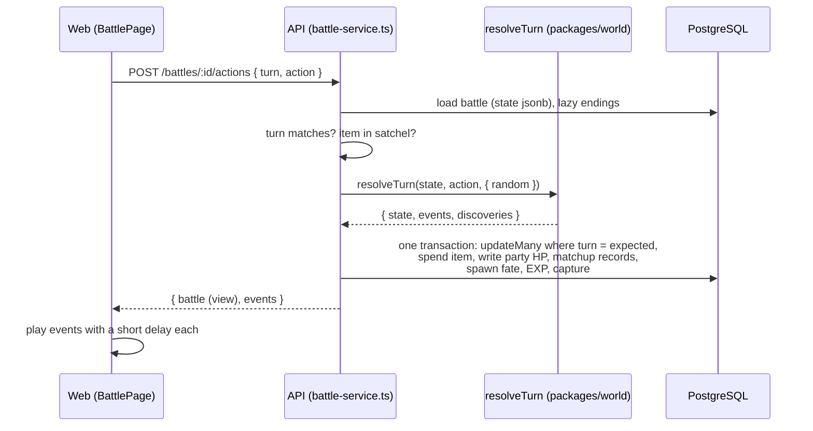
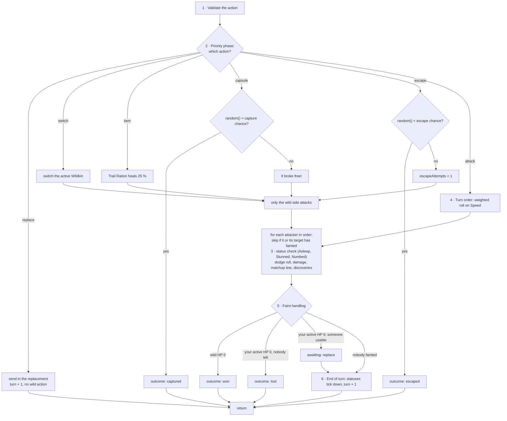
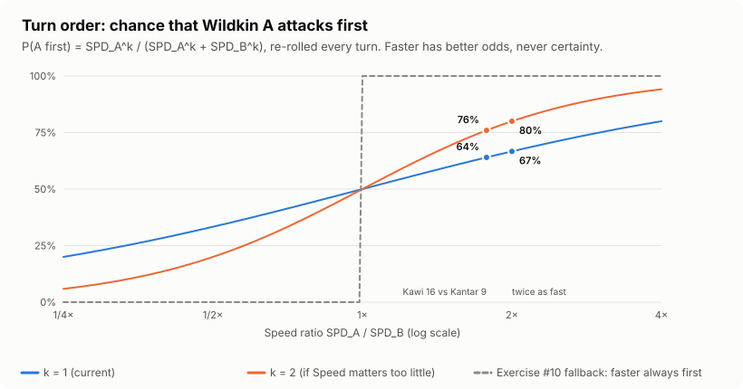

# 14 · Battles and research

> **In plain English:** this page explains the two big systems added in v0.3.0. **Wild battles**: you meet a Wildkin
> on the radar, send your lead Wildkin in, take turns attacking, and either weaken it enough to catch it in a capsule,
> knock it out, run away, or lose. **Field Registry licenses**: you earn researcher EXP by learning about Wildkin
> (observing, recording, exploring), then take an assessment at a field station to rank up. Your license rank decides
> how high a level of Wildkin will obey you, which restricted habitats you may battle in, and how much your scanner
> shows. Each section starts with the idea, then the exact rules, the numbers and where the code lives.

Stats, genetics, levels, EXP and healing are in [07 · Game systems](07-game-systems.md); every tunable number is in
its [All tunable numbers](07-game-systems.md#all-tunable-numbers) table. The HTTP side (routes, request and response
shapes, error codes) is in [04 · API reference](04-api-reference.md).

## Contents

- [Where the code lives](#where-the-code-lives)
- [Wild battles](#wild-battles)
  - [Starting a battle](#starting-a-battle)
  - [Actions](#actions)
  - [Turn resolution order](#turn-resolution-order)
  - [Wild behaviour](#wild-behaviour)
  - [Damage](#damage)
  - [Speed: turn order, escape and dodge](#speed-turn-order-escape-and-dodge)
  - [Statuses (framework only)](#statuses-framework-only)
  - [Capture](#capture)
  - [Battle end](#battle-end)
  - [Spawns during battle](#spawns-during-battle)
  - [Battle view and hidden information](#battle-view-and-hidden-information)
  - [Events](#events)
- [Matchups](#matchups)
- [Field Registry licenses](#field-registry-licenses)
  - [Categories](#categories)
  - [Ranks, the obedience cap and restless Wildkin](#ranks-the-obedience-cap-and-restless-wildkin)
  - [Researcher EXP](#researcher-exp)
  - [Assessments](#assessments)
  - [Rank-up grants](#rank-up-grants)
  - [License-locked habitats](#license-locked-habitats)
  - [Scanner depth](#scanner-depth)
- [Exercises in these systems](#exercises-in-these-systems)

## Where the code lives

Everything that decides an outcome is a **pure function in `packages/world`** (randomness injected as
`random: () => number`, tested with `seededRandom()`); the numbers live in `packages/shared`; the API loads and saves.

| What | Code |
|---|---|
| Constants, vocabularies, battle state, actions, events, views | `packages/shared/src/battle.ts` (`BATTLE_RULES`, `MATCHUPS`, `STATUS_RULES`, ...) |
| Licenses, researcher EXP, assessments, scanner depth | `packages/shared/src/research.ts` (`RESEARCH_RULES`, `ASSESSMENTS`, `SCANNER_DEPTH`) |
| One battle turn | `resolveTurn(state, action, { random })` in `packages/world/src/battle/engine.ts` |
| Damage, statuses, capture, matchups, turn order | `packages/world/src/battle/{damage,statuses,capture,matchups,turn-order}.ts` |
| Researcher EXP split, assessment progress and clamping | `packages/world/src/research.ts` |
| Battles in the database (guards, persistence, EXP, captures) | `apps/api/src/game/battle-service.ts` |
| Researcher EXP, records, habitat visits, licenses, assessments | `apps/api/src/game/research-service.ts` |
| Captured Wildkin (stats, lazy HP, restless, EXP grants, scanner) | `apps/api/src/game/wildkin.ts` |
| Starter, Trail Rations, vets, item grants | `apps/api/src/game/care-service.ts` |

## Wild battles

*"A wild Wildkin is feral: it will not accept a capsule while it still has the strength to resist."* Battles are
**turn-based, server-authoritative and played over HTTP**. The client sends one action per turn; the server resolves the
whole turn (your action and the wild Wildkin's) and returns the new battle view plus a list of events the UI plays back.
One active Wildkin per side, one active battle per player. Only wild battles exist in 0.3.0, but the engine is written
in terms of two sides so a trainer side (NPC friendly battles, 0.4.0) can be added without rewriting it.



### Starting a battle

`POST /api/game/spawns/:id/battle` (`startBattle`). Guards, in this order:

| # | Check | Refusal |
|---:|---|---|
| 1 | `loadActionableSpawn`: fresh, unlocked position; your spawn; `active` and not expired; within `interactRadiusM` (60 m) | 409 `location_unavailable`, 404, 410 `gone`, 409 `in_battle`, 409 `out_of_range` |
| 2 | No other active battle (lazy endings are applied first, see [Battle end](#battle-end)) | 409 `battle_in_progress`, `details.battleId` |
| 3 | The spawn's habitat is not [license-locked](#license-locked-habitats) for you | 409 `habitat_locked`, `details.requirement` |
| 4 | At least one **usable** party member: HP above 0 and not restless | 409 `no_usable_wildkin` |

Then, in one transaction, the spawn becomes `in_battle` (a conditional `updateMany`, so two requests cannot both take
it) and the battle row is created. The partial unique index `battles_one_active_per_player` backs the "one battle"
rule even for simultaneous requests (a `P2002` is turned into `battle_in_progress`).

The wild side is built from the spawn: species, level, genome, vigor, **full HP**, attacks, body traits, rarity and
whether the spawn was observed first. Your side is the whole party in slot order; the active Wildkin is the
**lead** (party slot 0 if usable, else the first usable member by slot, see `pickLead`).

### Actions

Every request is `{ turn, action }`. `turn` is the turn number the client saw; the server applies the action only when
it still matches (`updateMany ... where turn = expected`), so a double tap cannot act twice (409 `stale_turn` with
`details.turn`).

| Action | Shape | Uses the turn? | Notes |
|---|---|---|---|
| `attack` | `{ type: "attack", attackIndex }` | yes | One of the active Wildkin's placeholder attacks (index 0 or 1). A species with no attack uses `FALLBACK_ATTACK` ("Lunge", strike, 35) |
| `switch` | `{ type: "switch", wildkinId }` | **yes**: the wild Wildkin attacks the newcomer | To a usable party member that is not already out. Not while Entangled |
| `item` | `{ type: "item", itemId: "trail-ration", wildkinId }` | yes | Heals `max(1, floor(maxHp × 0.25))`, never above max. Not on restless, fainted or full-HP Wildkin |
| `capsule` | `{ type: "capsule", itemId }` | yes (on failure) | Any of the five capsules (`CAPSULE_ITEM_IDS`). Spent on every attempt. Not on a fainted Wildkin |
| `escape` | `{ type: "escape" }` | yes (on failure) | Not while Entangled |
| `replace` | `{ type: "replace", wildkinId }` | **no** | Only allowed, and required, right after your active Wildkin fainted. Free: no wild action follows |

An illegal action is refused with 409 `invalid_action` (with a readable message such as "Kantar is restless and will
not battle"); any action on a finished battle with 409 `battle_over`. The API checks the item is in the satchel
before calling the engine and spends it inside the turn's transaction.

### Turn resolution order

`resolveTurn` in `packages/world/src/battle/engine.ts`:



1. **Validate.** The action must be legal for the state (see the table above).
2. **Priority phase.** Your `switch`, `item`, `capsule` or `escape` resolves now, before any attack. A successful
   capsule or escape ends the battle immediately. `replace` is handled here too and returns straight away (free).
3. **Status check.** Done per attacker, just before it attacks: Asleep and Stunned always cancel the attack, Numbed
   cancels it 25 % of the time (a `skip` event).
4. **Attack phase.** If you attacked, both sides attack and the order is a [weighted roll on Speed](#speed-turn-order-escape-and-dodge).
   If you used a priority action, only the wild side attacks. Each attack: dodge roll, damage, matchup effect and
   field-note line, matchup discoveries. **A Wildkin that faints before its turn does not attack.**
5. **Faint handling.**
   - Wild faints: the battle ends `won`. A fainted Wildkin **cannot be captured**, so weaken it without knocking it
     out.
   - Your active Wildkin faints: if another usable party member exists, the battle waits for a `replace`
     (`awaiting: "replace"`); otherwise it ends `lost`.
6. **End of turn.** The two active Wildkin's statuses tick down (a `status` "recovered" event when one wears off), and
   `turn` goes up by one.

### Wild behaviour

The wild Wildkin picks one of its attacks **uniformly at random** every turn. It never switches, uses items or flees
in 0.3.0 (Temperament-driven behaviour is a 0.4.0 idea).

### Damage

```
levelFactor = floor(2 × L_att / 5 + 2)
base        = floor( floor( levelFactor × power × ATK_att / DEF_def ) / 50 ) + 2
damage      = max(1, floor( base × matchup × randomFactor ))      randomFactor uniform in [0.85, 1.00]
```

`ATK_att` is multiplied by 0.75 while the attacker is Exhausted. Damage never exceeds the defender's remaining HP. No
critical hits in 0.3.0. Code: `baseDamage`, `damage` in `packages/world/src/battle/damage.ts`.

**Worked example** (from the unit tests): a level 5 Kawi (ATK 12) uses Peck (pierce, 40) on a level 5 Mimu (DEF 13,
22 HP, soft-bodied, so weak to pierce):

| Step | Value |
|---|---|
| `levelFactor` | `floor(2 × 5 / 5 + 2)` = 4 |
| `floor(4 × 40 × 12 / 13)` | `floor(147.7)` = 147 |
| `base` | `floor(147 / 50) + 2` = 4 |
| × matchup 1.5 × random 0.85 to 1.00 | 5.1 to 6.0, so **5 or 6** damage |
| Hits to faint Mimu (22 HP) | about 4 |

So there is room to weaken it and throw a capsule. While exercise #11 is open the matchup is always ×1, so the same
Peck does 3 or 4.

A resisted example: a level 5 Kantar (ATK 14) uses Plate Slam (crush, 40) on a level 5 Kawi (DEF 10, feathered,
resists crush): `floor(4 × 40 × 14 / 10)` = 224, `floor(224 / 50) + 2` = 6, × 0.67 × random = **3 or 4**.

### Speed: turn order, escape and dodge

Speed decides three things. Faster has better odds, never certainty. Status recovery is not a Speed job (it will be a
defensive trait later).

```
P(A attacks first) = SPD_A^k / (SPD_A^k + SPD_B^k)          k = BATTLE_RULES.turnOrderExponent = 1
escape             = min(0.95, 0.20 + SPD_self / (SPD_self + SPD_wild) × 0.60 + 0.10 × escapeAttempts)
dodge              = defender faster ? min(0.10, (SPD_def − SPD_att) / SPD_def × 0.20) : 0
```



| Situation | k = 1 (current) | k = 2 |
|---|---:|---:|
| Equal Speed | 50 % | 50 % |
| Level 5 Kawi (Speed 16) vs level 5 Kantar (Speed 9) | 64 % | 76 % |
| Twice as fast | 67 % | 80 % |

The order is **re-rolled every turn**. If play-testing shows Speed matters too little, raise `k` to 2 (one constant).
The dashed line is what the game does while exercise #10 is open: the faster side always goes first (ties: the
player), which makes Speed far too decisive.

**Escape worked example:** a level 5 Kantar (Speed 9) running from a level 5 Kawi (Speed 16):
`0.20 + 9 / 25 × 0.60` = 41.6 % on the first try, 51.6 % on the second, 61.6 % on the third, and so on up to 95 %. The
+10 % per failed attempt means a slow Wildkin is never trapped forever. (While exercise #10 is open, escape is a flat
50 %.)

**Dodge worked example:** Kawi (16) attacked by Kantar (9): `(16 − 9) / 16 × 0.20` = 8.75 %. Kawi attacked by Mimu
(15): 1.25 %. The slower defender never dodges. Dodge is capped at 10 % because being dodged is less fun than hitting.
Dodge is implemented (`dodgeChance`), not an exercise.

A `priority` flag is reserved on attacks for the 0.4.0 skill system; no placeholder attack has it and the engine
ignores it.

### Statuses (framework only)

The whole framework exists (`packages/world/src/battle/statuses.ts`, `STATUS_RULES`), but **nothing inflicts a status
in 0.3.0** (skills will, in 0.4.0). The unit tests put statuses on a battle state directly.

| Status | Effect | Duration (turns) | Capture bonus |
|---|---|---|---:|
| `asleep` | Cannot attack | 1 to 3 | +0.20 |
| `stunned` | Cannot attack | 1 | +0.15 |
| `entangled` | Cannot switch out or escape | 2 to 4 | +0.15 |
| `numbed` | 25 % chance each turn to lose its attack | 2 to 4 | +0.10 |
| `exhausted` | ATK × 0.75 | 3 | +0.10 |

- One status at a time per Wildkin (`inflictStatus` keeps the existing one).
- Durations are rolled uniformly in `[minTurns, maxTurns]` and tick down at the end of each turn.
- Statuses end when the battle ends. Speed does not shorten them.

### Capture

*"Capture is not affection: the bond grows later, with time and shared experience."* Missing HP raises the chance most;
statuses raise it slightly less.

```
chance = min(0.95, rarityBase + observedBonus + 0.45 × (1 − hp / maxHp) + statusBonus + capsuleBonus)
```

| Part | Value |
|---|---|
| `rarityBase` | common 0.25, uncommon 0.15, rare 0.08, TBD 0.20 |
| `observedBonus` | 0.10 if this spawn was observed before the battle (`spawns.observed_at` set). Keeps "observation precedes capture" |
| HP part | up to 0.45 at near-zero HP |
| `statusBonus` | from the [status table](#statuses-framework-only) (always below the HP part's maximum) |
| `capsuleBonus` | 0.15 when a category capsule matches the wild species' category (`capsuleBonus` in `capture.ts`), else 0. Field Capsules never add a bonus |

Worked examples:

| Situation | Sum | Chance |
|---|---|---:|
| Full-HP common, not observed, Field Capsule | 0.25 | **25 %** |
| Observed common at 20 % HP, Field Capsule | 0.25 + 0.10 + 0.45 × 0.8 | **71 %** |
| Same Kantar with a Burrow Capsule (Terrestrial match) | 0.71 + 0.15 | **86 %** |
| Observed Lumae (rarity TBD) at 30 % HP, Bloom Capsule | 0.20 + 0.10 + 0.315 + 0.15 | **76.5 %** |
| Rare, not observed, half HP | 0.08 + 0.225 | **30.5 %** |
| Observed common at 10 % HP, Asleep, category capsule | 0.25 + 0.10 + 0.405 + 0.20 + 0.15 = 1.105 | **95 %** (cap) |

- There is no level term: higher-level Wildkin already resist capture by being harder to weaken.
- The chance is **never sent to the client**.
- While exercise #12 is open the chance is only `rarityBase + observedBonus` (35 % for an observed common), so
  capture still works but weakening does not help yet.

**On success**, inside the turn's transaction (`captureWildkin` in `battle-service.ts`): the capsule is spent; the
battle ends `captured`; the spawn becomes `captured`; a `captured_wildkin` row is created with the spawn's species,
level, genome and vigor, **its HP from the battle**, `exp = totalExpForLevel(level)`, `caught_level`, the habitat, time
of day and weather it was caught in, in the first free party slot 0 to 5 (else storage); the Registry entry is upserted
(`first_captured_at`, `times_captured + 1`); researcher EXP for the capture (first or repeat) and any new phenotype
records; battle EXP as for a win; and capture EXP for the lead. A Wildkin caught above your license cap is
[restless](#ranks-the-obedience-cap-and-restless-wildkin) straight away.

### Battle end

| Outcome | When | Spawn becomes | Other effects |
|---|---|---|---|
| `won` | The wild Wildkin fainted | `fled` ("retreated into cover") | `battle` EXP for the active Wildkin, `battle-shared` for the other non-fainted party members; a rested charge is spent if any (doubles both) |
| `captured` | A capsule succeeded | `captured` | As in [Capture](#capture), plus battle EXP as for a win |
| `lost` | Your active Wildkin fainted and nobody usable is left | `active` again with a fresh 10 min TTL (it stays wild) | Nothing else: no money, no EXP penalty. The party needs first aid time or a vet |
| `escaped` | An escape roll succeeded, **or** you moved more than `spawnRadiusM` (120 m) from the spawn | `fled` | The moved-away case plays an `escape` event with `reason: "moved-away"` |
| `abandoned` | No action for `BATTLE_RULES.idleTimeoutMs` (10 min) since `battles.updated_at` | `fled` | |

`escaped` (moved away) and `abandoned` are **lazy**: `settleActiveBattle` checks them whenever the game state, the
current battle or a battle is read, and before an action. A spawn can therefore never be held forever.

HP is written back to `captured_wildkin` (`current_hp`, `hp_updated_at = now`) **every turn**, so after any outcome
the party is exactly as the battle left it. While a battle runs, Trail Rations outside the battle and vets are refused
with 409 `battle_in_progress` (the battle's own HP would overwrite them).

End-screen lines are `BATTLE_END_LINES` in `shared/src/battle.ts`, for example "Kawi was given first aid and settled
into the capsule." EXP totals per Wildkin come from `exp_events.meta.battleId` (`expGained` in the view).

### Spawns during battle

- `spawn_status` has a value `in_battle`.
- `gameState` expires, flees and wanders only `active` spawns, so an `in_battle` spawn is **frozen**: no TTL expiry,
  no wandering, no "player walked away" rule. The radar still lists it, marked "In battle" (`inBattle`).
- A second observe or battle request on it gets 409 `in_battle` from `loadActionableSpawn`.
- When the battle ends the spawn moves to its final status from the table above.

### Battle view and hidden information

`BattleViewSchema` is all the client ever sees:

| Part | Shown | Never shown |
|---|---|---|
| Wild side | species id, name (always, even if not yet observed: you are looking at it), registry number, **level**, HP as a fraction 0 to 1, status, body traits | exact stats, HP number, genome, vigor, capture chance, unrecorded matchups |
| Your side | every party member's id, name or nickname, level, HP fraction, status, `fainted`, `restless`, `usable` with `unusableReason`, `active`; the active Wildkin's attacks with approach and power as a word | raw stats |
| Battle | `turn`, `awaiting` (`action` or `replace`), `outcome`, satchel counts of Trail Rations and capsules, `expGained`, `capturedWildkinId` | |

Power words: 30 to 39 "Light", 40 to 49 "Moderate", 50 to 60 "Heavy" (`powerWord`). Damage in events is a share of
the target's max HP, never a number. The full engine state (`BattleStateSchema`, stored in `battles.state`) stays on
the server.

### Events

Each response carries the turn's events in order. On the last turn the API appends field notes and EXP and puts
`battle-end` last.

| Event | Meaning |
|---|---|
| `attack` | side, attacker, attack, approach, `dodged`, damage (HP fraction), effect `weak` / `resist` / null, field-note line |
| `skip` | a status cancelled the attack |
| `status` | a status was inflicted or recovered (only "recovered" can happen in 0.3.0) |
| `switch`, `replace` | who went out and who came in |
| `faint` | a side's Wildkin fainted |
| `capsule` | `success`, or "It broke free!" |
| `escape` | `success`, `reason` `roll` or `moved-away` |
| `item` | Trail Ration target and HP fraction healed |
| `trapped` | reserved in the schema (an Entangled switch or escape is refused as `invalid_action` instead) |
| `matchup-recorded` | the first record of a body trait and approach pair ("Field note recorded: Plated is weak to Crush") |
| `exp` | Wildkin id, amount, new level if it leveled up, `heldAtCap` ("Kawi's growth is held at your license cap") |
| `researcher-exp` | category, amount, reason |
| `battle-end` | outcome and end line |

The web app turns these into field-note lines in `apps/web/src/features/battle/battle-log.ts` (see
[06 · Web game](06-web-game.md)).

## Matchups

*"Armour deflects points but cracks under blunt force."* Every attack has one **approach**; every species has one or
two **body traits**. A trait can be weak to one approach and resist another. Strike is always neutral.

```
APPROACHES  = strike, pierce, crush, surge, toxin, spore
BODY_TRAITS = plated, feathered, soft-bodied, leafy, slick
```

| Body trait | Weak to (× 1.5) | Resists (× 0.67) | Reason | Weak line | Resist line |
|---|---|---|---|---|---|
| plated | crush | pierce | Armour deflects points but cracks under blunt force | The plates cracked under the blow. | The point glanced off its plates. |
| feathered | surge | crush | Soaked feathers weigh it down; light and hard to pin | Its soaked feathers dragged it down. | It rode the impact on light wings. |
| soft-bodied | pierce | spore | No protection; lives among leaf-litter spores and molds | It had nothing to shield it. | It shrugged off the spores, as at home as in the leaf litter. |
| leafy | toxin | surge | Toxins wilt it; water feeds it | Its leaves curled and wilted. | It drank the water in. |
| slick | toxin | pierce | Absorbs through its skin; points glance off | Its skin drew the toxin in. | The point slid off its slick hide. |

- `MATCHUP_WEAK = 1.5`, `MATCHUP_RESIST = 0.67`. With two traits, both factors multiply (toxin on leafy + slick is
  2.25; crush on plated + feathered is 1.5 × 0.67 ≈ 1.0).
- The table, reasons and lines are one object, `MATCHUPS` in `shared/src/battle.ts`, so the UI, the manager, the AI
  assistant's prompt and these docs agree.
- `matchupMultiplier(approach, traits)` is **exercise #11** (fallback: always 1). `evaluateMatchup` builds the effect,
  the line and the discoveries from it.

**Discovery, per body trait.** Matchups are hidden until discovered. When a hit's multiplier is not exactly 1, each
trait that is weak to or resists the approach is a discovery. The API records `(player, body_trait, approach, effect)`
in `matchup_records` (primary key on the first three, so a pair is recorded once, with `ON CONFLICT DO NOTHING`).
Neutral hits are never recorded. Because records are **per trait, not per species**, learning "Plated is weak to
Crush" from a Kantar applies to every Plated species. The first record:

- adds a `matchup-recorded` event ("Field note recorded: Plated is weak to Crush");
- grants 50 researcher EXP (`matchup-record`) to the category of the species that was hit;
- fills in the Registry's field notes: for each observed species, each body trait shows the recorded weakness and
  resistance, or "?".

Discoveries work in both directions: the wild Wildkin hitting your Wildkin also records what your Wildkin's trait
revealed.

## Field Registry licenses

*"A researcher who lacks the knowledge for a Wildkin cannot safely treat or direct it."* Every player holds one Field
Registry license per Wildkin category, rank 1 to 5. Researcher EXP comes from **learning** (observing, recording,
exploring), never from battling.

### Categories

| Category | Display name | Seed species | Category capsule (+0.15 on a match) |
|---|---|---|---|
| `aerial` | Aerial | Kawi | Canopy Capsule (`canopy-capsule`) |
| `aquatic` | Aquatic | Riverkin | Current Capsule (`current-capsule`) |
| `terrestrial` | Terrestrial | Mimu, Kantar | Burrow Capsule (`burrow-capsule`) |
| `verdant` | Verdant | Lumae | Bloom Capsule (`bloom-capsule`) |

A species has exactly one category; `"TBD"` species cannot be published. Category capsules work on any Wildkin; they
only add the bonus on a match (`CATEGORY_CAPSULES` in `shared/src/research.ts`).

### Ranks, the obedience cap and restless Wildkin

| Rank | Obedience cap (`rank × 20`) | Researcher EXP to take the assessment for this rank |
|---:|---:|---:|
| 1 | 20 | (everyone starts here) |
| 2 | 40 | 600 |
| 3 | 60 | 2,000 |
| 4 | 80 | 5,000 |
| 5 | 100 | 12,000 |

- Every player has rank 1 in all four categories. The login upsert creates the rows (`ensureLicenses`); migration 5
  backfilled existing players.
- Researcher EXP is **cumulative** per category (the thresholds do not reset).
- The cap and the band a level belongs to: `obedienceCap(rank)` and `rankForLevel(level)` (levels 1 to 20 are rank 1,
  21 to 40 rank 2, ...).

**Owned Wildkin never become restless by leveling.** A Wildkin at its cap stops gaining EXP and anything beyond the
cap is lost (see [07 · License cap clamp](07-game-systems.md#license-cap-clamp)). After a rank-up it simply starts
gaining again from where it stopped.

**Restless** Wildkin are those **captured above the cap** of their category's license (a level 25 Riverkin caught with
Aquatic rank 1). A restless Wildkin:

- can be in the party, travels with you and still gains EXP (including `battle-shared`), up to the top of its own
  license band (`expCapFor`: the level 25 Riverkin can grow to 40);
- **cannot battle**: it is never the lead, a switch target or a replace target;
- **cannot be treated**: no natural recovery, no vet, no Trail Ration; its HP stays frozen;
- is explained in the UI: "Restless. Needs Aquatic rank 2 to cooperate." (`restlessReason`).

When an assessment raises the rank, every Wildkin of that category whose level is now within the cap cooperates
again; their `hp_updated_at` is set to now in the same transaction so they do not heal retroactively for the time they
were frozen. The summary says, for example, "3 Wildkin are no longer restless".

### Researcher EXP

Always for **one category**: the category of the species involved. Amounts are in `RESEARCH_RULES`; every gain is a
row in `exp_events` with `track = 'researcher'` and the `category`.

| Source (`exp_events.source`) | Amount | When |
|---|---:|---|
| `first-observation` | 100 | First ever observation of a species |
| `repeat-observation` | 10 | Each later observation, up to 5 per species per day (counted from `exp_events.meta.creatureId`) |
| `first-capture` | 150 | First capture of a species |
| `repeat-capture` | 20 | Every later capture |
| `condition-record` | 30 | First observation of a species in a time of day it was never observed in; the same for each new weather (`condition_records`) |
| `matchup-record` | 50 | First record of a body trait and approach pair, to the category of the species that was hit (`matchup_records`) |
| `phenotype-record` | 40 | First time you observe or capture a species showing Small, Large, Bold or Wary (`phenotype_records`) |
| `phenotype-record` (marking) | 200 | The same for its marking variant |
| `habitat-first-visit` | 50 | First visit ever to a habitat, split between categories |
| `habitat-daily-visit` | 10 | First visit to a habitat each day, split the same way |

Build, Temperament and Marking are **visible to an observer** (size, behaviour, pattern), so observing records them
too, even though Temperament is only named from rank 2 (see [Scanner depth](#scanner-depth)).

**Habitat split.** A habitat visit is recorded during the `gameState` tick when your position resolves to a habitat
(`habitat_visits`, keyed by player, habitat and day). The amount is split by each category's share of the encounter
weight available there at that moment (`splitResearcherExp`, `categoryWeights`): amounts are rounded down and the
leftover points go to the largest remainders first (ties: the larger weight), so the parts always add up.

Worked example, Sunbreak Clearing by day (Lumae 60 Verdant, Kawi 25 Aerial, Kantar 15 Terrestrial):

| Visit | Verdant | Aerial | Terrestrial |
|---|---:|---:|---:|
| First ever (50) | 30 | 13 | 7 |
| Daily (10) | 6 | 3 | 1 |
| First ever at night (Lumae is dawn/day only: Kawi 25, Kantar 15) | 0 | 31 | 19 |

### Assessments

Reaching the EXP threshold is not enough: you take the next rank's **assessment** at a field station (a POI of type
`research-station` or `gate`, such as East Research Gate, within 60 m). An assessment is a checklist of real
fieldwork, defined as **data** (`ASSESSMENTS` in `shared/src/research.ts`), never bespoke code.

**Requirement types.** All counted per player, for the species of the license's category, by `requirementCounts` in
`research-service.ts`:

| Type | Label | Counts | Table |
|---|---|---|---|
| `observeDistinctSpecies` | Observe {n} different species | species of the category with a Registry entry | `registry_entries` |
| `observeTimesOfDay` | Observe at {n} different times of day | distinct times of day recorded for them | `condition_records` |
| `observeWeathers` | Observe in {n} different weathers | distinct weathers recorded for them | `condition_records` |
| `captureCount` | Capture {n} Wildkin | sum of `times_captured` | `registry_entries` |
| `winBattles` | Win {n} wild battles | battles `won` or `captured` against them | `battles` |
| `recordMatchups` | Record {n} matchups | matchup records for body traits their species carry | `matchup_records` |
| `recordPhenotypes` | Record {n} individual traits | phenotype records for them (markings included) | `phenotype_records` |
| `visitHabitats` | Visit {n} habitats where they live | distinct habitats visited where they appear in the published world | `habitat_visits` |

**Template**, the same for every category in 0.3.0:

| Rank-up | Requirements |
|---|---|
| 1 to 2 | observeDistinctSpecies 2, observeTimesOfDay 2, captureCount 1 |
| 2 to 3 | recordMatchups 2, observeWeathers 3, winBattles 5, captureCount 3 |
| 3 to 4 | recordPhenotypes 2, observeTimesOfDay 4, winBattles 15, visitHabitats 3 |
| 4 to 5 | recordMatchups 4, recordPhenotypes 4, observeWeathers 5, winBattles 30, captureCount 10 |

**Clamping.** With only five species, "observe 2 Aquatic species" is impossible (Riverkin is the only one). So every
count is clamped to what is **achievable** in the current published world and creature list:
`achievableAssessmentLimits(world, creatures, category)` in `packages/world/src/research.ts`.

| Limit | Computed from |
|---|---|
| species | published species of the category listed in an active table of an active region |
| times of day, weathers | those in which any of them can spawn: the table, entry and habitat conditions allow it and the species' spawn modifier is above 0 |
| matchups | 2 per distinct body trait of those species |
| phenotypes | 4 per species (Small, Large, Bold, Wary; markings not counted) |
| habitats | where they appear (a region-wide table covers every habitat of its region) |
| captures, battles | unlimited when the category has any species, else 0 |

**`ASSESSMENT_RELAX_WEATHER`** (env, default `true`, read in `apps/api/src/config.ts`): while exercise #1 is open the
live weather is always `clear`, so "observe in 3 weathers" could never be met. With the flag on, every weather
requirement is additionally clamped to 1. Set it to `false` once real weather works.

What the clamped checklists are in the seed world (relaxed weather):

| Category | Rank 2 | Rank 3 | Rank 4 | Rank 5 |
|---|---|---|---|---|
| Aerial (Kawi) | species 1, times 2, capture 1 | matchups 2, weathers 1, wins 5, captures 3 | phenotypes 2, times 4, wins 15, habitats 2 | matchups 2, phenotypes 4, weathers 1, wins 30, captures 10 |
| Aquatic (Riverkin) | species 1, times 2, capture 1 | matchups 2, weathers 1, wins 5, captures 3 | phenotypes 2, times 4, wins 15, habitats 1 | matchups 2, phenotypes 4, weathers 1, wins 30, captures 10 |
| Terrestrial (Mimu, Kantar) | species 2, times 2, capture 1 | matchups 2, weathers 1, wins 5, captures 3 | phenotypes 2, times 4, wins 15, habitats 3 | matchups 4, phenotypes 4, weathers 1, wins 30, captures 10 |
| Verdant (Lumae) | species 1, times 2, capture 1 | matchups 2, weathers 1, wins 5, captures 3 | phenotypes 2, times 2, wins 15, habitats 1 | matchups 2, phenotypes 4, weathers 1, wins 30, captures 10 |

A unit test (`research.test.ts`) checks that every 0.3.0 assessment is completable for every category in the sample
world.

**Taking it.** `POST /api/game/licenses/:category/assessment` (`takeAssessment`). Refusals: 409 `max_rank`,
`location_unavailable`, `not_at_station`, `exp_too_low` (`details.exp`, `details.threshold`), `assessment_incomplete`
(`details.requirements`, the progress list). On success, in one transaction: rank + 1 (a conditional update), an
`assessment_completions` row (its primary key makes each rank-up happen once), the [grants](#rank-up-grants), and
`hp_updated_at = now` for the Wildkin that are no longer restless. The response has the new license view and a
summary such as "Aquatic license rank 2: Wildkin up to level 40 cooperate with you", "1 Wildkin is no longer
restless", "Received 5 Current Capsule".

### Rank-up grants

Every rank-up grants **5 category capsules** of that category and **3 Field Capsules** (`RESEARCH_RULES.grantCategoryCapsules`,
`grantFieldCapsules`). Stacks are capped at `ITEM_STACK_MAX` (30): the excess is dropped and the summary says so
("2 Field Capsule did not fit in your satchel").

### License-locked habitats

- A habitat can carry `licenseRequirement: { category, rank } | null` (rank 2 to 5; rank 1 is everyone), authored in
  the Map Editor's Habitat inspector and published like every other habitat field (`habitats.license_requirement`).
- For a player below the requirement, spawns still appear there and can be **observed** (that is how you earn the
  license), but **battle and capture are refused** with 409 `habitat_locked`. The radar shows "Restricted research
  zone: Aquatic rank 3" (`habitatLocked` on the state, `battleLocked` on each spawn).
- The seed world has no locked habitat. **To lock one for testing:** in the Map Editor select a habitat (for example
  Silayan Creekside), set *License requirement* to Aquatic, rank 2, Save, Publish; then try to battle there with a
  fresh player. See [05 · Map editor](05-map-editor.md).

### Scanner depth

How much you see about **your own captured** Wildkin depends on your license rank **in its category**
(`SCANNER_DEPTH`, `scannerShows(detail, rank)` in `shared/src/research.ts`). The server filters; hidden fields are
sent as `null`, never hidden in CSS.

| Rank | Shown on the Wildkin detail page |
|---:|---|
| 1 | Level, HP, category, body traits, species shape descriptors, Build phenotype (Small, Typical, Large), marking variant |
| 2 | + Temperament phenotype (Bold, Steady, Wary) and individual stat grades |
| 3 | + Vigor words |
| 4 and 5 | + Genotype (both alleles of every gene, so hidden carriers become visible) |

For **wild** spawns, observing reveals the level, a Build hint ("Larger than typical" / "Smaller than typical",
nothing for Typical), a marking hint ("Banded markings"), and **from rank 2** a Temperament hint ("Holds its ground" /
"Keeps its distance").

**The Temperament naming rule.** Temperament is visible to any observer, so Bold and Wary phenotypes are **recorded at
every rank** (and earn their 40 researcher EXP). They are only **named** from rank 2 in that category:

| Where | Below rank 2 | From rank 2 |
|---|---|---|
| Researcher EXP reason (`phenotypeWord` in `research-service.ts`) | "Temperament variant of Kawi recorded" | "Wary Kawi recorded" |
| Registry field notes (`views.ts`) | "Temperament variant seen" (listed once, even if both were recorded) | "Bold seen", "Wary seen" |

The Registry reads the rank when it is shown, so records made at rank 1 are named once you reach rank 2.

## Exercises in these systems

Four of the pure functions are left as `TODO(you)` exercises, each with a working fallback (see
[12 · Exercises](12-exercises-and-roadmap.md) and `patches/0.3.0/EXERCISES.md`). Tests live in `*.exercise.test.ts`
(`pnpm test:exercises`); the unit and integration tests pass both before and after you solve them.

| # | Function | Fallback until done | What the player notices |
|---:|---|---|---|
| 10 | `attackOrder(spdA, spdB, random)`, `escapeChance(spdSelf, spdWild, attempts)` in `battle/turn-order.ts` | Faster always goes first (ties: the player); escape is a flat 50 % | The slower Wildkin never strikes first |
| 11 | `matchupMultiplier(approach, traits)` in `battle/matchups.ts` | Always 1 | No weak or resist lines, no matchup records, no matchup researcher EXP, the Registry's "?" never fills in. **`recordMatchups` (rank 2 to 3 and 4 to 5) cannot be met**, so no license gets past rank 2 |
| 12 | `battleCaptureChance(inputs)` in `battle/capture.ts` | `rarityBase + observedBonus` only | Weakening, statuses and category capsules do not help yet |
| 13 | `currentHp(row, maxHp, now, restless)` in `recovery.ts` | Returns the stored HP | No natural recovery: only vets and Trail Rations heal. The detail page's "Fully recovered in about ..." estimate (`msUntilFull`) assumes the finished formula |

Damage, dodge, statuses, the engine, researcher EXP, assessments and clamping are complete.

Next: [glossary](glossary.md).
